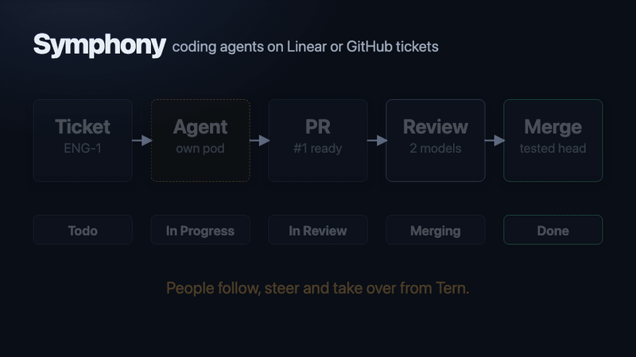
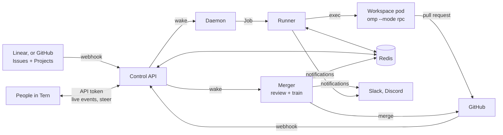

# Symphony

Symphony runs coding agents on tickets from Linear or from a GitHub Projects board. Each agent uses an isolated workspace. The agent opens a pull request. A separate merger reviews and merges it. Operators use [Tern](https://docs.stencil.so/tern/), the `symphony` CLI, or MCP.



[Watch the 3-minute explainer](docs/media/symphony-explainer.mp4) ([captions](docs/media/symphony-explainer.vtt)), or pick a feature in [the video list](docs/videos.md).

## Design

- A ticket with the `symphony` label is a work order. A `repo:owner/name` label names its repository (with GitHub, the default is the issue's own repository). The ticket state shows the progress.
- Each ticket gets its own workspace pod. The workspace gets the model credential of its agent role, a short-lived GitHub token for the ticket's repositories, and a telemetry token for one dispatch. The Linear API key, the GitHub App private key, Slack and Discord tokens, and Symphony API tokens never enter a workspace.
- Two independent models review each pull request. A finding blocks only when both models agree. A deterministic train merges the exact head that CI tested. No human approval is necessary, unless a repository turns on the approval gate.
- A person can follow any agent live, send it a message during a turn, interrupt it, or take over the ticket.

## Capabilities

| Area | Features |
|---|---|
| Orchestration | Dispatch by webhook in under 3 s, safety poll, concurrency limits, retries with backoff and a retry budget, stall detection, anti-runaway cooldown, fencing against duplicate work, intake verdicts, failure triage |
| Workspaces | One pod and one session volume for each ticket, images for `node`, `dotnet9`, `dotnet10` and `polyglot`, optional Docker (privileged, Sysbox or Kata) |
| Repositories | Discovery of every repository the GitHub App reaches (runtime, monorepo components, default branch), provisioning of labels and a merger policy, configuration from Tern |
| Trackers | Linear, or issues on a GitHub Projects (v2) board with the `Status` field as the state. A memory tracker for tests and local mode. |
| Tickets | Multi-repository tickets, planning tickets with sub-issues and a blocking order, read-only investigations, questions to people that never block a run and outlive it, agents that wait for a person instead of looping, a session trace on each ticket, canceled tickets that close their pull requests |
| Merger | One merger for every repository, Symphony-labeled PRs only by default, parallel review lanes, oracle on a different model, one rejection rule, AI arbiter, delta re-review, optional human approval gate, polish rounds, merge train with batches and bisection, AI conflict resolution, main-branch watch, simulator previews on Seiji |
| Live operation | Native chat in Tern (ACP), steer, follow-up, interrupt and answer in under 300 ms, holds and local takeover with `omp --resume` |
| Administration | API tokens with `viewer`, `operator` and `admin` roles, models for each agent role, provider API keys, MCP servers for each agent role (credentials stay in the gateway), skill sources for each agent role, audited commands, team `omp` settings |
| Assistant | A Slack and Discord bot that answers questions, researches and plans tickets with read-only agents, with an optional sandbox to run commands and share files. A mapped person confirms each proposal |
| Learning | Retrospective of each finished ticket and a learnings pull request for `AGENTS.md` and skills, with a human gate |
| Observability | Token and cost ledger, OpenTelemetry rollup posted to the ticket, telemetry history with charts in Tern, provider rate limits, Slack and Discord notifications and direct messages |

## How it works



1. A person makes a ticket in the tracker with the `symphony` label, and a `repo:` label when necessary.
2. The daemon starts a runner. The runner makes a workspace, clones the repository and starts the engine, Oh My Pi (`omp`).
3. The agent does the work, opens a ready pull request and moves the ticket to In Review.
4. The merger reviews the pull request. It sends the ticket to Rework, or it moves the ticket to Merging and the train merges the pull request.
5. The merge moves the ticket to Done: the Linear–GitHub integration does it for Linear, and the closed issue does it for GitHub. The reflector proposes lessons for the repository.

[docs/architecture.md](docs/architecture.md) has the full diagrams.

## Quick start: local mode

Local mode runs everything in one process on your machine, with tickets in memory. Use it to try Symphony or to develop it.

> **Warning:** Local mode has no container. The agent runs as your user, with your files and git credentials. Use a test machine or a dedicated user.

You need Python 3.12 or later, [uv](https://docs.astral.sh/uv/), git, Redis 7 or later, `omp` at the version in `src/symphony/edge.py` (`OMP_VERSION`), and a model credential. With the memory tracker, you need no Linear key and no GitHub App.

1. Get the code:
   ```sh
   git clone <repository URL> symphony && cd symphony
   ```
2. Install the dependencies:
   ```sh
   uv sync
   ```
3. Install the `symphony` CLI:
   ```sh
   uv tool install --editable .
   ```
4. Set the model credential. For the built-in Bedrock defaults:
   ```sh
   export AWS_REGION=us-east-1
   export AWS_BEARER_TOKEN_BEDROCK=<Bedrock API key>
   ```
5. Write `WORKFLOW.local.md`. Replace `/path/to/omp` with the absolute path of your `omp`:
   ```markdown
   ---
   tracker:
     kind: memory
   hooks:
     after_create: |
       git init -q -b main .
   agent:
     max_turns: 3
   engine:
     command: /path/to/omp --mode rpc
   ---
   You are working on {{ issue.identifier }}: {{ issue.title }}

   {{ issue.description }}

   Work only in the current directory. Do not push. When you finish, reply with a one-line summary.
   ```
6. Make the Redis data directory:
   ```sh
   mkdir -p ~/.local/share/symphony/redis
   ```
7. Start Redis:
   ```sh
   redis-server --appendonly yes --dir ~/.local/share/symphony/redis --daemonize yes
   ```
8. Start Symphony. The process prints an admin API token once. Keep it.
   ```sh
   export REDIS_URL=redis://127.0.0.1:6379/0
   uv run python -m symphony.entry.local --root ~/symphony-local --workflow WORKFLOW.local.md
   ```
9. In a second terminal, log in with that token:
   ```sh
   symphony login --url http://127.0.0.1:8080 --token -
   ```
10. Make a ticket:
    ```sh
    symphony api POST /v1/dev/issues --data '{"identifier":"DEV-1","title":"Make a.txt","description":"Make a.txt with the text alpha."}'
    ```
11. Follow the session:
    ```sh
    symphony watch DEV-1
    ```
12. Optional: connect Tern with `symphony tern install`. Then open **Symphony: Dashboard** (`Ctrl+Alt+S`).

[docs/install.md](docs/install.md#17-run-in-local-mode) explains local mode with a real tracker and GitHub. There, `symphony setup` connects them and stores the credentials in `<root>/secrets.env`.

## Quick start: Kubernetes

You need a cluster with a CNI that enforces NetworkPolicy (k3s is enough), `kubectl`, the standalone `kustomize` and a model credential. You need a registry only to build your own images. The install starts with only Redis and the API. Then `symphony setup` connects the GitHub App, the tracker (Linear or a GitHub Projects board), the repositories, the models, the notifications and the webhooks. It verifies each value before it saves it. [docs/install.md](docs/install.md) gives every step, including the GitHub App permissions and one merger for each repository.

1. Choose the images. Each release has multi-arch (`amd64` and `arm64`) images on the GitHub Container Registry: `ghcr.io/<owner>/symphony-orchestrator:<version>` and `ghcr.io/<owner>/symphony-agent:<runtime>-<version>`. Replace `<owner>` with the GitHub owner of this repository and `<version>` with a release, for example `0.1.0`. Or build and push your own images ([Images](docs/install.md#images)):
   ```sh
   REGISTRY=registry.example.com/symphony scripts/build_images.sh
   ```
2. Point the manifests at the orchestrator image:
   ```sh
   (cd deploy && kustomize edit set image symphony-orchestrator=ghcr.io/<owner>/symphony-orchestrator:<version>)
   ```
3. Install:
   ```sh
   kubectl apply -k deploy/
   ```
4. Copy the Secret template:
   ```sh
   cp deploy/secrets.example.yaml deploy/secrets.yaml
   ```
5. Fill in `deploy/secrets.yaml`: the bootstrap token in `symphony-api`, and the model credential in `model-provider`.
6. Apply the Secrets:
   ```sh
   kubectl apply -n symphony -f deploy/secrets.yaml
   ```
7. Reach the API:
   ```sh
   kubectl -n symphony port-forward svc/symphony-api 8080
   ```
8. In a second terminal, log in with the bootstrap token:
   ```sh
   symphony login --url http://127.0.0.1:8080 --token -
   ```
9. Run the setup. Or open **Setup** in Tern:
   ```sh
   symphony setup
   ```
10. Check the status:
    ```sh
    symphony setup --status
    symphony status
    ```

Then point `kubernetes.agent_images` in the workflow at the same images, for example `node: ghcr.io/<owner>/symphony-agent:node-<version>`. Use Admin in Tern or `PUT /v1/workflow`.

To try the full stack on a workstation, run `scripts/e2e_kind.sh`. It makes a kind cluster and runs one real attempt.

## Documentation

[docs/index.md](docs/index.md) is the map of all documents. The main ones:

| Document | Content |
|---|---|
| [Concepts](docs/concepts.md) | Ticket lifecycle, attempts, sessions, agent roles, holds, investigations, learnings |
| [Architecture](docs/architecture.md) | Components, data stores, deployment, sequence diagrams |
| [Install](docs/install.md) | Kubernetes, k3s, kind, local mode, GitHub, Linear or GitHub Projects, Slack, Discord, Tern |
| [Configuration](docs/configuration.md) | Every `WORKFLOW.md` key, environment variable and Secret |
| [Providers](docs/providers.md) | Model API keys and models for each agent role |
| [Security](docs/security.md) | Trust boundaries, credentials, token roles, network policy |
| [Merger](docs/merger.md) | AI review and merge train |
| [MCP servers](docs/mcp.md) | Extra tools for agents, per role, through the gateway |
| [Assistant](docs/assistant.md) | The Slack and Discord bot: ask, research, plan |
| [Tern](docs/tern.md) and [CLI](docs/cli.md) | The operator interfaces |
| [API](docs/api.md) | HTTP API, events, MCP, webhooks |
| [Troubleshooting](docs/troubleshooting.md) | Symptoms, checks and fixes |
| [Glossary](docs/glossary.md) | Terms |

To contribute, read [CONTRIBUTING.md](CONTRIBUTING.md) and [AGENTS.md](AGENTS.md). To report a vulnerability, read [SECURITY.md](SECURITY.md).

## License

Symphony is available under the [MIT License](LICENSE).
