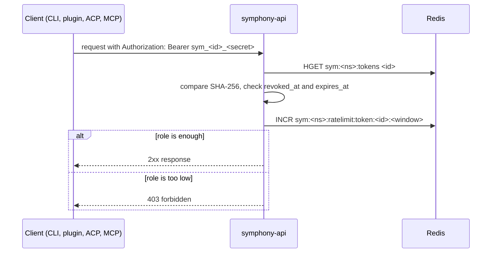
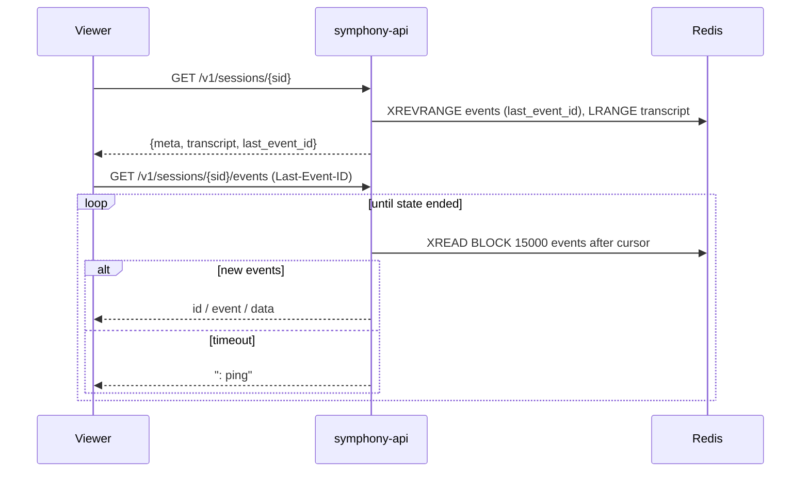
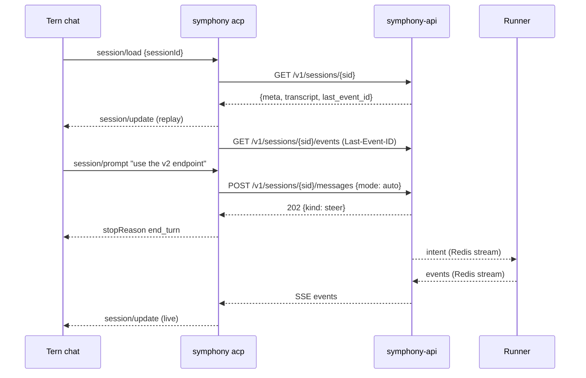

# HTTP API

The `symphony-api` service serves the control API on port 8080. People, the CLI, the Tern
plugin, the ACP bridge, MCP clients and webhooks use it. The API reads and writes Redis only on
the hot paths. For the stores behind each route, read [internals.md](internals.md).

The `symphony-gateway` service is separate. It serves only workspaces (see
[Gateway](#gateway)).

## Conventions

| Item | Rule |
|---|---|
| Base path | `/v1` for REST, `/mcp` for MCP, `/healthz` and `/readyz` with no authentication |
| Body | JSON. Unknown body fields are an error (`extra="forbid"`) |
| Timestamps | `*_at` and `*At` in the board projections are ISO-8601 UTC strings that end in `Z`. Token and session documents keep Redis epoch milliseconds |
| Errors | `{"error": {"code", "message", "diagnostics"?}}` with the HTTP status that fits |
| Input echo | Validation errors name the fields. They never repeat the input, because a body can contain an API key |

### Error statuses

| Status | Codes (examples) | Meaning |
|---|---|---|
| 401 | `unauthorized`, `invalid_token`, `invalid_signature`, `stale_webhook` | No token, bad token, or bad webhook signature. Has `WWW-Authenticate: Bearer realm="symphony"` for tokens |
| 403 | `forbidden` | The token role is too low |
| 404 | `not_found`, `unknown_repo` | Unknown session, command, token, provider, merger repository or route |
| 405 | `method_not_allowed` | Wrong method |
| 409 | `session_ended`, `stale_target`, `already_held`, `not_held`, `conflict`, `review_mismatch`, `setup_incomplete` | The state changed or the request does not fit the current state. `setup_incomplete`: a command needs the tracker and setup is not complete |
| 412 | `precondition_failed` | `If-Match` names an old revision or generation |
| 422 | `invalid_request`, `invalid_revision`, `unknown_provider`, `provider_key_required`, `repo_required` | Bad input |
| 428 | `precondition_required` | A write that needs `If-Match` has no `If-Match` |
| 429 | `rate_limited` | Too many requests; read `Retry-After` |
| 503 | `unavailable`, `workflow_unavailable`, `projection_unavailable`, `providers_unavailable`, `providers_outcome_unknown`, `catalog_unavailable`, `merger_unavailable`, `webhook_unconfigured` | A backing service is not available |

## Authentication

Each request has the header `Authorization: Bearer sym_<id>_<secret>`. The API reads the token
record from Redis on each request. Thus revocation and expiry apply on the next request.

| Role | Can do |
|---|---|
| `viewer` | Read all routes except providers and tokens |
| `operator` | Everything a viewer can do, and send messages, interrupt, commands, hold, release, merger actions |
| `admin` | Everything an operator can do, and team configuration, workflow, providers, API tokens |

- A token has the form `sym_<8 hex>_<43 characters>`. The server keeps only a SHA-256 of the
  secret.
- `POST /v1/admin/tokens` returns the full token one time.
- `SYMPHONY_BOOTSTRAP_TOKEN` installs the first admin token (name `bootstrap`) when the API
  starts, if it is not present.
- Each token has a limit of `SYMPHONY_API_RATE_LIMIT` requests per minute (default 600). Each
  client address has a limit of 30 failed authentications per minute.
- For a durable command, the daemon checks again that the token is active and has the role
  when it executes the command.



## Concurrency headers

| Header | Routes | Rule |
|---|---|---|
| `ETag` + `If-None-Match` | `GET /v1/overview`, `GET /v1/sessions`, `GET /v1/admin/catalog` | The same document gives the same `ETag`. A match returns `304` with no body |
| `ETag` | `GET /v1/workflow`, `GET /v1/admin/config`, `GET /v1/admin/providers` | The revision (workflow ConfigMap version, configuration generation, or providers Secret version) |
| `If-Match` | `PUT /v1/workflow`, `POST /v1/workflow/validate`, `PUT /v1/admin/config`, `PUT /v1/admin/providers/{id}` | Required. Quoted or bare. Missing: 428. Malformed: 422. Old: 412 |
| `Idempotency-Key` | `POST /v1/commands`, `PUT /v1/workflow` | Optional, 8 to 128 letters, digits, `-` or `_`. The same key with the same request returns the same command |

## Route reference

### Health

| Method and path | Auth | Response |
|---|---|---|
| `GET /healthz` | None | `{status: "ok"}` |
| `GET /readyz` | None | `{status: "ready"}`, or 503 when Redis does not answer |

### Identity and board

| Method and path | Role | Request | Response |
|---|---|---|---|
| `GET /v1/me` | viewer | — | `{name, role, token_id}` |
| `GET /v1/overview` | viewer | `If-None-Match` | See [Overview](#overview). `ETag`, 304 |
| `GET /v1/issues` | viewer | — | `{items: [issue]}`; see [Issues](#issues) |
| `POST /v1/commands` | operator | `{action, target?, reason}`; `Idempotency-Key` | `202` command |
| `GET /v1/commands/{id}` | viewer | `id` is 32 hex characters | Command |
| `GET /v1/audit` | viewer | `?cursor=&limit=1..200` (default 50) | `{items: [{id, time, actor, action, target, result, reason, commandId}], nextCursor}`, newest first |
| `GET /v1/workflow` | viewer | — | `{revision, documentHash, values, redactedKeys, observed}`; `ETag` |
| `POST /v1/workflow/validate` | admin | `{patch}` (1 to 61 keys); `If-Match` | `{baseRevision, documentHash, diff}`; no publication |
| `PUT /v1/workflow` | admin | `{patch, reason (8-1000), documentHash?}`; `If-Match`; `Idempotency-Key` | `202` command with `action: "workflow"`. A different `documentHash` gives 409 `review_mismatch` |
| `GET /v1/repos` | viewer | — | Repository projection |
| `GET /v1/infra` | viewer | — | Services and Kubernetes resources |
| `GET /v1/telemetry` | viewer | `?limit=1..500` (default 200) | Tokens, cost, models, monthly counters, sessions |
| `GET /v1/learning` | viewer | — | Learning proposals of the reflector |

**Command** shape: `{id, action, target, state, submittedAt, finishedAt, result, revision}`. The
`state` is `accepted`, `applying`, `succeeded` or `failed`.

**Command actions:**

| Action | Target | Effect when the daemon applies it |
|---|---|---|
| `pause` | None | No new dispatch. Running agents continue |
| `resume` | None | Dispatch starts again |
| `refresh` | None | The daemon reads Linear now |
| `reevaluate` | Identifier, issue id, or `{issueId, dispatchSeq}` | A `blocked` or `retry_queued` ticket is evaluated again. Other states: 409 `stale_target` |
| `hold` | Identifier, issue id, or `{issueId}` (also a ticket Symphony never tracked) | The ticket is held (see [internals.md](internals.md#12-hold-a-ticket)). Already held: 409 `already_held` |
| `release` | Same as `hold` | The hold ends. Not held: 409 `not_held` |

The `reason` has 8 to 1000 characters. After the API accepts a command, it calls
`wake(daemon, "command:<action>")`.

#### Overview

```text
{daemon: {alive, paused, heartbeat_at, setup},
 counts: {running, waiting_input, queued, retrying, in_review, merging, held},
 tokens_today, cost_today,
 merger: {reviewing, train, parked},   # sums of all repositories
 config_generation,
 rate_limits: [{model, stage, remaining, limit, reset_at, retry_after_ms, observed_at, source}],
 held: [{issue_id, identifier, by, reason, at}]}
```

`rate_limits` has only observations of the last hour. A held ticket counts only under `held`.
`daemon.setup` is `"ready"`, `"incomplete"` (the daemon idles: no usable WORKFLOW or tracker
yet) or `null` (no report yet). It comes from the Redis record `daemon:setup`.

#### Issues

Each item has `issue_id, identifier, title, repo, status, phase, held, tracker_state, attempt,
seq, session_id, session_state, input_request, model, tokens, cost, pr_url, reason,
updated_at, evidence_count`. `phase` is `held` when a person holds the ticket. `reason` tells
why the daemon cannot dispatch the ticket: `no_repo_designation`,
`malformed_repo_designation`, `mixed_owner_repo_designation`, `repo_not_authorized`, or null.

#### Projections

The projections `repos`, `infra`, `telemetry` and `learning` contain no text for people. Each
field that a person sees is a stable code. The clients translate the codes. Each projection
has `observedAt` and `sources: {<name>: {status, observedAt, note}}`. The `status` is `fresh`,
`stale` or `unavailable`. The `note` is English detail for logs only. An `unavailable` source
means "unknown", not "none".

| Projection | Fields |
|---|---|
| `repos` | `items: [{name, runtime, routes, issues}]`, `limits: {runs, resources, truncated}` |
| `infra` | `paused`, `heartbeatAt`, `services: [{name, role, status, detail}]`, `resources: [{name, kind, status, component, detail, activePods, createdAt}]` |
| `telemetry` | `totals: {input, output, cacheRead, cacheWrite, total, costEstimate}`, `models: [{model, requests, input, output}]`, `monthly: [{month, dispatched, rework, prsOpened, prsMerged, learningPrs}]`, `sessions: [{sid, identifier, kind, state, model, turn, tokens, updatedAt}]` |
| `learning` | `items: [{id, identifier, repo, status, provenance, outcome, prUrl, updatedAt}]` |

| Field | Codes |
|---|---|
| `repos.items[].routes` | `issue`, `retrospective`, `default` |
| `infra.services[].role` | `redis`, `daemon`, `api`, `gateway`, `merger`, `runner`, `workspace`, `sweep`, `other` |
| `infra.services[].status` | `healthy`, `degraded`, `unknown` |
| `infra.services[].detail` | `ok`, `stale`, `unreadable`, or a Pod code |
| `infra.resources[].kind` | `Pod`, `Job`, `PersistentVolumeClaim` |
| `infra.resources[].detail` (Pod) | `ready`, `not_ready`, `pending`, `failed`, `succeeded`, `unknown` |
| `infra.resources[].detail` (Job) | `active`, `complete`, `failed`, `unknown` |
| `infra.resources[].detail` (PVC) | `bound`, `pending`, `lost`, `unknown` |
| `learning.items[].status` | `pending`, `completed`, `failed` |
| `learning.items[].provenance` | `retrospective`, `retained` |
| `learning.items[].outcome` | `nothing_to_learn`, `pr_opened`, `completed`, `failed`, `pending` |

The cost is a local estimate from the price table of omp. It is not a billed charge.

### Sessions

| Method and path | Role | Request | Response |
|---|---|---|---|
| `GET /v1/sessions` | viewer | `?state=a,b&limit=1..500` (default 50); `If-None-Match` | `{items: [meta]}`, newest first; `ETag`, 304 |
| `GET /v1/sessions/{sid}` | viewer | `?transcript_limit=0..4000` (default 4000) | `{meta, transcript, last_event_id}` |
| `GET /v1/sessions/{sid}/events` | viewer | `Last-Event-ID` or `?after=` | SSE stream; see [Event stream](#event-stream) |
| `GET /v1/sessions/{sid}/export.jsonl` | viewer | — | `application/x-ndjson`: an omp session file for `omp --resume` (a `session` header line, then one entry per line) |
| `POST /v1/sessions/{sid}/messages` | operator | `{text (1-20000), mode: "auto" \| "steer" \| "follow_up"}` | `202 {intent_id, kind}` |
| `POST /v1/sessions/{sid}/interrupt` | operator | `{reason? (≤ 1000)}` | `202 {intent_id, kind: "interrupt"}` |

The session states are `starting`, `running`, `waiting_input`, `idle` and `ended`. A message
or an interrupt to an `ended` session gives 409 `session_ended`.

Each session meta (the items of `GET /v1/sessions` and `meta` of `GET /v1/sessions/{sid}`)
has `mcp_leases: [{server, id, model?, platform?}]`: the ids that the session holds on MCP
servers with `cleanup`, for example Seiji leases ([mcp.md](mcp.md#session-cleanup)). It is
`[]` when the session holds none. The API reads it for the whole page in one Redis pipeline.

In `auto` mode, the API selects the intent:

1. If the session has a pending input request, the intent is `answer`.
2. If the session state is `running`, the intent is `steer`.
3. In all other cases, the intent is `follow_up`.

#### Event stream

`GET /v1/sessions/{sid}/events` is `text/event-stream`. Each event has `id:` (the Redis stream
id), `event:` (the kind) and `data:` (JSON).

1. The server sends `retry: 1000` first.
2. With `Last-Event-ID` or `?after=<id>`, the stream continues after that id. The id must look
   like `1700000000000-0`; `0-0` replays the full retained stream.
3. With no cursor, the stream starts at the current end.
4. If no event arrives in 15 s, the server sends the comment `: ping`.
5. The stream closes after a `symphony.state` event with `state: "ended"`.

The event kinds are the omp RPC event types (`message_update`, `tool_execution_*`,
`turn_end`, …) and the Symphony kinds `symphony.state`, `symphony.intent_applied`,
`symphony.input_requested`, `symphony.input_resolved` and `symphony.mcp_lease`
(`{server, id, held, model?, platform?}`: the session started or stopped holding an MCP id).

To show a session with no gap:

1. Read `GET /v1/sessions/{sid}`.
2. Show the `transcript`.
3. Open the event stream with `Last-Event-ID: <last_event_id>`.
4. After a disconnect, open the stream again with the id of the last event you received.



### Team configuration, catalog, providers, tokens

| Method and path | Role | Request | Response |
|---|---|---|---|
| `GET /v1/admin/config` | viewer | — | The team configuration document; `ETag: "<generation>"` |
| `PUT /v1/admin/config` | admin | `{models?, omp?, reason (1-500)}`; `If-Match: <generation>` | The new document. Old generation: 412. Concurrent write: 409 `conflict`. Empty patch or invalid document: 422 |
| `GET /v1/admin/config/observed` | viewer | — | `{<consumer>: {generation, at}}` |
| `POST /v1/admin/config/observed` | viewer | `{generation}` | `204`. Writes `member:<token name>` (used by `symphony omp sync`) |
| `GET /v1/admin/catalog` | viewer | `?provider=`; `If-None-Match` | The provider and model catalog of the pinned omp. Unknown provider: 404 |
| `GET /v1/admin/providers` | admin | — | `{revision, storageReady, items: [{id, builtin?, name?, api?, baseUrl?, auth?, models?, credentialConfigured}]}`; never a key |
| `PUT /v1/admin/providers/{id}` | admin | `{builtin: true, apiKey?}` or `{name, api, baseUrl, auth, models, apiKey?}`; `If-Match` | The new document; `ETag` |
| `GET /v1/admin/tokens` | admin | — | `{items: [token]}` |
| `POST /v1/admin/tokens` | admin | `{name (1-64), role, expires_days? (1-3650)}` | `201 {token, id, name, role, created_at, created_by, expires_at, last_used_at, revoked_at}`; `Cache-Control: no-store` |
| `DELETE /v1/admin/tokens/{id}` | admin | — | The revoked token record |

The provider formats and the catalog rules are in
[internals.md](internals.md#13-providers). For a built-in provider, the id must be in the
catalog (else 422 `unknown_provider`). If you omit `apiKey`, the stored key stays.

The audit log records `teamconfig.publish`, `token.create`, `token.revoke`, `provider.save`,
`merger.<action>`, `setup.<step>`, `admin.mcp.<put|remove|headers|test>` and `mcp.viewer`.
The target of a merger action is `pr:<owner/name>#<n>`; of an MCP action, `mcp:<name>`.

### MCP servers for agents

| Method and path | Role | Request | Response |
|---|---|---|---|
| `GET /v1/admin/mcp` | admin | — | `{servers: [{name, transport, url?, command?, args?, env?, roles, enabled, timeout_ms?, instructions?, http_base?, agent_env?, rewrite_origins?, cleanup?, headers_set}], roles: [...]}`; never a header value |
| `PUT /v1/admin/mcp/{name}` | admin | A definition (below), no secret values | The stored definition with `headers_set`. It replaces the whole definition; stored headers stay |
| `DELETE /v1/admin/mcp/{name}` | admin | — | `204`. The stored headers go too |
| `PUT /v1/admin/mcp/{name}/headers` | admin | `{headers: {<header>: <value> \| null}}` | `{headers_set: [...]}`. Values are write-only; `null` removes one |
| `POST /v1/admin/mcp/{name}/test` | admin | — | `{ok, tools: [name], protocol_version, me?: {user, quota}, error?: {code, message}}`; `code` is `unreachable`, `rejected` (401/403) or `protocol_error`. `me` is the preset's identity route (Seiji: `GET {http_base}/v1/me`). A stdio server: `{ok: null, note}` |
| `POST /v1/mcp/{name}/viewer` | operator | `{lease_id, control: bool = false}` | `{url, expires_in, control}`, `Cache-Control: no-store`. Audited `mcp.viewer` |

A definition is `{preset?, transport: "http" | "sse" | "stdio", url?, command?, args?, env?,
roles, enabled?, timeout_ms? (0-7200000), instructions?, http_base?, agent_env?,
rewrite_origins?, cleanup?}`. The name matches `^[a-z0-9][a-z0-9_-]{0,47}$`. `http` and
`sse` need an `https://` URL (`http://` only for hosts in `SYMPHONY_MCP_ALLOW_HTTP_HOSTS`).
`stdio` needs `command`, has no secret headers, and its `env` holds non-secret values only: a
name that looks like a credential is refused. Roles are the team roles. An invalid definition
gets 422 `invalid_mcp_server` with `error.field`. An unknown name gets 404.

The companion fields are for `http` and `sse` servers ([mcp.md](mcp.md#companion-http-api)):

- `http_base`: the server's HTTP API root, with the rules of `url`.
- `agent_env`: `{NAME: template}`, at most 16. The only placeholders are `{token}`,
  `{http_url}` (needs `http_base`) and `{mcp_url}`. A credential-like name needs a
  placeholder, and a literal that looks like a key or holds `Bearer` is refused.
- `rewrite_origins`: up to 8 origins `scheme://host[:port]`; needs `http_base`.
- `cleanup`: `{acquire_tool, id_field, release_tool, release_arg}`; `http` only.

`preset: "seiji"` fills the fields that the body leaves out ([mcp.md](mcp.md#presets)). The
stored definition has no `preset` field.

The viewer route answers only for a lease that a session with a live MCP token holds
(`mcp_leases`). Anything else gets 404 `lease_not_held`, and the server is not asked. It calls
the preset's viewer route (Seiji: `POST {http_base}/v1/leases/{lease_id}/viewer` with
`{"control": <control>}`) with the stored headers. A relative `url` becomes absolute against
`http_base`. Errors: 404 `viewer_unsupported` (no preset viewer), 409 `viewer_refused` (the
server refused; the message is its error text, for example "the screen viewer supports iOS
simulators only for now"), 502 `rejected` (the server refused the stored header) and 502
`mcp_unreachable`.

### Merger

One merger runs for each repository. The routes show and address each repository.

| Method and path | Role | Request | Response |
|---|---|---|---|
| `GET /v1/merger` | viewer | — | `{repos: [{repo, alive, reviewing, parked, train, batch, queue}]}`, sorted by `repo`; see [merger.md](merger.md#api-and-store) |
| `POST /v1/merger/prs/{n}/{action}` | operator | `action` ∈ `bypass`, `requeue`, `release`; `{reason (1-1000), repo?}` | `202 {id, pr, action, actor, reason, at, repo}` |

Rules for `repo` in an action:

- `repo` is `owner/name`. The API compares it in lower case.
- You can omit `repo` only when exactly one repository has a merger.
- If several repositories have a merger and you omit `repo`, the API gives 422 `repo_required`.
- If no merger serves the repository, or the name is malformed, the API gives 404
  `unknown_repo`. The same applies when no merger is registered.

If the merger store is not available, both routes give 503 `merger_unavailable`. After an
action, the API calls `wake(merger:<repo>)`.

### Assistant memory

The assistant's soul in use and its per-person memory (`src/symphony/api/assistant.py`,
[assistant.md](assistant.md#memory)). Every call is audited: `assistant.memory_read`,
`assistant.memory_forget` or `assistant.memory_wipe`, with the target `memory`,
`memory:<login>` or `memory:<login>:<id>`. The audit never holds the memory text.

| Method and path | Role | Request | Response |
|---|---|---|---|
| `GET /v1/assistant/memory` | admin | — | `{soul: {repo, path, sha} \| null, people: [{login, count, updated_at}]}`; `soul` comes from the assistant's heartbeat (`null` when it is not running; `sha: null` when the file is missing) |
| `GET /v1/assistant/memory/{login}` | admin | — | `{login, items: [{id, text, kind, at, thread}]}`; `items` is empty for a person without memory |
| `DELETE /v1/assistant/memory/{login}` | admin | — | `{login, removed: N}` |
| `DELETE /v1/assistant/memory/{login}/{id}` | admin | — | `{login, removed: {id, text, kind, at, thread}}`; 404 `not_found` for an unknown id |

`login` is a GitHub login (compared in lower case); `id` is 8 hex characters. Anything else is
422 or 404.

### Backup

Backup, restore and archive of the namespace's Redis state (`src/symphony/api/backup.py`,
[backup.md](backup.md)). The target comes from the mounted `WORKFLOW.md` (`backup.s3` or
`backup.dir`); the S3 access keys from the API's environment (Secret `symphony-backup`). No
answer holds a credential. Downloads have `Cache-Control: no-store`.

| Method and path | Role | Request | Response |
|---|---|---|---|
| `GET /v1/backup` | admin | — | `{namespace, target: {kind: "s3", endpoint, bucket, prefix, region} \| {kind: "dir", dir} \| null, reason, keep, retention: {sessions_days, audit_days}, last: {backup?, archive?, restore?}}`; `reason` says why there is no target |
| `GET /v1/backup/export` | admin | — | A backup file (`application/gzip`), streamed. Audited `backup.export` |
| `POST /v1/backup/restore?confirm=true[&namespace_from=NS]` | admin | A backup file as the body | `{namespace, source_namespace, created_at, symphony_version, keys, records, restored, kept, failed}`. Audited `backup.restore` |
| `POST /v1/backup/run` | admin | — | `{target, archive: {name, sessions, audit}, backup: {name, keys, records, bytes, pruned}}`. Audited `backup.run` |
| `GET /v1/backup/backups` | admin | — | `{target, items: [{name, size, modified}]}`, oldest first |
| `POST /v1/backup/backups/{name}/restore?confirm=true[&namespace_from=NS]` | admin | — | As `POST /v1/backup/restore`, plus `name` |
| `GET /v1/backup/archive` | admin | — | `{target, items: [{name, size, modified}]}` |
| `GET /v1/backup/archive/{name}` | admin | — | One archive object (`application/gzip`, JSONL inside). Audited `backup.archive.get` |

Errors: 422 `confirm_required` (no `confirm=true`), 409 `daemon_running` (the daemon holds its
lease and is not paused), 409 `namespace_mismatch` (the backup is of another namespace and
`namespace_from` does not name it), 422 `checksum_mismatch`, `truncated`, `invalid_backup`,
`unsupported_format` or `outside_prefix` (nothing was written), 409 `not_configured` (no
target, or no S3 access keys), 404 `not_found`, 422 `invalid_name`, 502 `target_error` (the
S3 error code only), 500 `restore_incomplete` (some `RESTORE` calls failed; the counts are in
the message).

### Setup

First-run setup (`src/symphony/api/setup.py`). The CLI (`symphony setup`) and the Tern Setup
view use these routes. [install.md](install.md#4-run-the-first-run-setup) explains the flow.

| Method and path | Role | Request | Response |
|---|---|---|---|
| `GET /v1/setup` | viewer | — | `{complete, mode, steps: [{id, title, status, required, detail, error}]}` |
| `PUT /v1/setup/tracker` | admin | `{kind: "linear", api_key, team_key \| project_slug}` or `{kind: "github", owner, project_number, status_field?}` | `{kind, states, warnings, restarted}` |
| `PUT /v1/setup/github-app` | admin | `{app_id, installation_id, private_key}` | `{repositories, missing_permissions, restarted}` |
| `PUT /v1/setup/repositories` | admin | `{default_repo?: "owner/name" \| null, base_branches?: {"owner/name": "branch" \| null}}` (at least one; a field left out stays as published) | `{default_repo, base_branches, mergers, without_merger, restarted}` |
| `PUT /v1/setup/notifications` | admin | `{slack?, discord?}` | `{slack: {configured, last_test}, discord: {configured, last_test}, restarted}` |
| `POST /v1/setup/notifications/test` | admin | — | `{results: {slack?: {ok, error}, discord?: {ok, error}}}` |
| `PUT /v1/setup/assistant` | admin | `{slack?: {app_token?, channels}, discord?: {channels}, repositories?: ["owner/name"] \| null}` | `{slack: {connected, channels} \| null, discord: {connected, channels, intent} \| null, repositories, restarted}` |
| `POST /v1/setup/webhooks` | admin | `{rotate?}` or no body | `{linear: {url, secret}, github: {url, secret, events}, restarted}`, with `Cache-Control: no-store` |

**Status.** `mode` is `kubernetes` or `local`. `status` is `done`, `todo`, `error` or
`skipped`. `error` is `{code, message}` or `null`. `complete` is true when every required step
is `done`. The API computes each status from the running configuration (process environment,
the published WORKFLOW, Redis) and the real services. It stores no flags. It keeps the result
of a vendor check for 30 seconds (`CACHE_S`). Every setup write drops that cache.

| Step | Required | `detail` | Step error codes |
|---|---|---|---|
| `tracker` | yes | `{kind, team_key, project_slug, owner, project_number, status_field, credential, states}` | the tracker codes below, `workflow_unavailable` |
| `github_app` | yes | `{configured, repositories, missing_permissions}` | `github_permissions_missing`, the App codes below |
| `repositories` | yes | `{default_repo, base_branches, repositories, mergers, without_merger}` | `merger_missing` (Kubernetes only: a repository has no live merger), `branch_not_found` |
| `models` | yes | `{roles: [{role, provider, model, credential: "stored" \| "host" \| null}]}` | `model_credential_missing` |
| `notifications` | no | `{slack: {configured, last_test}, discord: {configured, last_test}}` | `notification_failed` |
| `assistant` | no | `{enabled, running, heartbeat_at, threads, repositories, slack: {configured, connected, channels}, discord: {configured, connected, channels, intent}}` | `slack_app_token_missing`, `slack_app_token_rejected`, `slack_bot_token_rejected`, `discord_bot_token_rejected`, `message_content_intent_missing` (`skipped` while `assistant.enabled` is not true) |
| `webhooks` | no | `{linear: {secret, in_use, last_delivery_at}, github: {secret, in_use, last_delivery_at}}` | — (`skipped` while no secret exists) |

**Writes.** Each write verifies first. It refuses to store a value that fails. Credentials are
write-only: no response, log or audit entry contains them. The audit action is
`setup.<step>`. In Kubernetes a stored credential reaches the components through a restart of
the Deployments that read it. `restarted` names them, in order. The status shows the new value
after the API itself has restarted. In local mode `restarted` is `[]`.

- `PUT /v1/setup/tracker` publishes the WORKFLOW tracker section itself (no daemon command: a
  fresh install has no working daemon yet). `warnings` has `{code: "state_missing", state}` for
  each WORKFLOW state that is not on the board.
- `PUT /v1/setup/notifications`: an absent channel is unchanged, and `null` removes it.
  `slack` is `{bot_token, channel}` or `{webhook_url}`. `discord` is `{bot_token, channel_id}`
  or `{webhook_url}`. A new channel gets a test message first.
- `PUT /v1/setup/assistant` sends `slack`, `discord` or both. Slack checks the app token with
  `apps.connections.open` (the socket is not opened) and the stored bot token with
  `auth.test`. Discord checks the stored bot token with `GET /applications/@me` and its
  message-content intent flag (`intent` is `full` or `limited`). A missing `app_token` reuses
  the stored one. Then it stores `SLACK_APP_TOKEN` in `symphony-slack`, publishes WORKFLOW
  `assistant:` (`enabled: true` and the channels; a transport not sent gets no channels), and
  restarts `symphony-assistant`. [assistant.md](assistant.md#setup) explains the step.
- `POST /v1/setup/webhooks` makes `LINEAR_WEBHOOK_SECRET` and `GITHUB_WEBHOOK_SECRET` and
  returns them once. The URLs use `SYMPHONY_PUBLIC_URL`, or the request's base URL when it is
  unset. `events` lists the GitHub events to subscribe.

| Status | Code | Cause |
|---|---|---|
| 401 | `invalid_token` | The token was revoked before the save |
| 409 | `github_app_required` | A GitHub tracker before the GitHub App |
| 409 | `webhooks_exist` | Webhook secrets exist and `rotate` is not set. They cannot be shown again |
| 409 | `notifications_not_configured` | A test with no Slack or Discord channel |
| 409 | `secret_missing` | The Secret does not exist. Apply the install manifests (they make it empty) |
| 409 | `host_env_overrides` | Local mode: the host environment sets this variable, so a stored value would be ignored |
| 409 | `slack_bot_token_missing`, `discord_bot_token_missing` | The assistant reuses the bot token of the notifications step, and none is stored |
| 422 | `invalid_request` | For example both or neither of `team_key` and `project_slug` |
| 422 | `linear_unauthorized`, `linear_team_not_found`, `linear_project_not_found` | Linear refused the key, or has no such team or project |
| 422 | `invalid_github_app`, `invalid_private_key`, `github_app_unauthorized`, `github_installation_not_found`, `github_app_rejected` | The App credential does not mint a token |
| 422 | `github_project_not_found`, `github_status_field_missing` | The board or its status field is not there |
| 422 | `repo_not_installed` | The App is not installed on the default repository |
| 422 | `branch_not_found` | A `base_branches` branch does not exist on the repository |
| 422 | `branch_not_verified` | GitHub returned a non-2xx, non-404 status verifying a branch. When no GitHub App is configured, branch verification is skipped |
| 422 | `notification_unverified` | The test message failed. Nothing was stored |
| 422 | `invalid_secret` | An empty or too long value |
| 422 | `slack_app_token_missing`, `slack_app_token_rejected` | No Slack app-level token, or Slack refused it (Socket Mode off, or no `connections:write`) |
| 422 | `slack_bot_token_rejected`, `discord_bot_token_rejected` | The vendor refused the stored bot token |
| 422 | `message_content_intent_missing` | The Discord application has no Message Content Intent |
| 503 | `vendor_unreachable` | The vendor could not be reached. Try again |
| 503 | `secrets_unavailable`, `secret_unavailable`, `secret_forbidden` | The secret store is not wired, or a Secret cannot be read or written |
| 503 | `restart_forbidden`, `restart_failed` | The value was stored, but a Deployment could not be restarted. Restart it by hand |
| 503 | `workflow_unavailable` | The workflow document is not reachable |

The webhook routes record each signed delivery in `sym:<ns>:setup:webhook:<source>` (epoch
milliseconds). The `webhooks` step reads it.

### Local mode only

`python -m symphony.entry.local` with `tracker.kind: memory` also mounts these routes
(`src/symphony/entry/local.py`).

| Method and path | Role | Request | Response |
|---|---|---|---|
| `GET /v1/dev/issues` | viewer | — | `{items: [issue]}` with the comments that the daemon wrote |
| `POST /v1/dev/issues` | operator | `{identifier, title, description?, state? = "Todo", labels?, priority? (0-4)}` | `201` issue; wakes the daemon |
| `POST /v1/dev/issues/{id}/state` | operator | `{state}` | The issue. A terminal state stops the attempt and removes the workspace |

## Webhooks

Both webhooks check only an HMAC-SHA256 signature over the raw body, with a constant-time
compare. A webhook only wakes a loop. The loop reads the source of truth again, so a lost or
repeated delivery costs only latency.

| Route | Signature header | Secret | Extra check | Response |
|---|---|---|---|---|
| `POST /v1/webhooks/linear` | `Linear-Signature` = hex HMAC | `LINEAR_WEBHOOK_SECRET` | `webhookTimestamp` within 5 minutes, else 401 `stale_webhook` | `202 {woke: ["daemon"]}` |
| `POST /v1/webhooks/github` | `X-Hub-Signature-256` = `sha256=` + hex HMAC | `GITHUB_WEBHOOK_SECRET` | `X-GitHub-Event` selects the wake; `ping` wakes nothing | `202 {woke: [...]}` |

If the secret is not set, the route gives 503 `webhook_unconfigured`. A bad signature gives 401
`invalid_signature`. A body that is not a JSON object gives 422.

| GitHub event | Wake |
|---|---|
| `pull_request`, `check_suite`, `check_run`, `workflow_run` | `merger:<repo>`, with `<repo>` from `repository.full_name` |
| `push` to the default branch | `merger:<repo>` |
| `issue_comment` on a pull request, `pull_request_review`, `pull_request_review_comment` | `daemon`, reason `github:comment:<owner/name>#<pr>` |
| `issue_comment` on an issue | `daemon`, reason `github:issue_comment:<action>:<owner/name>#<n>` |
| `issues`, `sub_issues`, `issue_dependencies` | `daemon`, reason `github:<event>:<action>:<owner/name>#<n>` |
| `projects_v2_item` for an issue item | `daemon`, reason `github:projects_v2_item:<action>:<issue node id>`. Draft and pull request items wake nothing |
| Other events | None |

The `issues`, `issue_comment` (on issues), `sub_issues`, `issue_dependencies` and
`projects_v2_item` events serve the GitHub tracker (`tracker.kind: github`). Subscribe the
webhook to them when you use that tracker.

The wake reasons are in [internals.md](internals.md#wake-reasons).

## MCP

`POST /mcp` is an MCP server over streamable HTTP. The protocol versions are `2025-06-18`
(default), `2025-03-26` and `2024-11-05`. Each request is one JSON-RPC 2.0 message, and each
response is one JSON body. The server never starts a stream, so `GET /mcp` and `DELETE /mcp`
give 405.

- Authentication is the same bearer token as `/v1`.
- The methods are `initialize`, `ping`, `tools/list` and `tools/call`. A notification gets 202.
- A tool that needs a higher role returns a tool error (`isError: true`), not an HTTP error.
- A tool result has `content` (text) and `structuredContent` (JSON).

| Tool | Role | Arguments | Same as |
|---|---|---|---|
| `list_sessions` | viewer | `state?`, `limit? (1-200, default 20)` | `GET /v1/sessions` |
| `get_session` | viewer | `sid`, `transcript_limit? (0-200, default 40)` | `GET /v1/sessions/{sid}` |
| `send_message` | operator | `sid`, `text`, `mode? = "auto"` | `POST /v1/sessions/{sid}/messages` |
| `interrupt` | operator | `sid`, `reason?` | `POST /v1/sessions/{sid}/interrupt` |
| `list_issues` | viewer | — | `GET /v1/issues` |
| `overview` | viewer | — | `GET /v1/overview` |
| `pause` | operator | `reason` | `POST /v1/commands` `pause` |
| `resume` | operator | `reason` | `POST /v1/commands` `resume` |
| `hold` | operator | `issue`, `reason` | `POST /v1/commands` `hold` |
| `release` | operator | `issue`, `reason` | `POST /v1/commands` `release` |
| `merger_status` | viewer | — | `GET /v1/merger` |
| `setup_status` | viewer | — | `GET /v1/setup` |
| `mcp_servers` | viewer | — | `GET /v1/admin/mcp`: name, transport, roles and enabled only |

`symphony tern install` adds this server to Tern for each person. See [tern.md](tern.md).

## ACP bridge

`symphony acp` is an ACP agent (JSON-RPC over stdio). Tern starts it and shows each Symphony
session as a native chat. The bridge uses the CLI credential and the `/v1` routes above. It
has no state of its own.

| ACP method | Bridge behavior |
|---|---|
| `initialize` | Protocol version 1. Capabilities: `loadSession`, `sessionCapabilities: {list, resume}`. No authentication methods |
| `session/list` | `GET /v1/sessions?limit=100`, mapped to `{sessionId, title, updatedAt}` |
| `session/new` | Opens no session. Shows a help text: work starts from a Linear ticket |
| `session/load` | `GET /v1/sessions/{sid}`, replays the transcript as `session/update`, shows a pending question, then opens one SSE tail from `last_event_id` |
| `session/resume` | The same as `session/load`, with no replay |
| `session/prompt` | Text sends `POST …/messages` with `mode: "auto"` and returns `end_turn` at once. Text that starts with `/` is a command |
| `session/cancel` | `POST …/interrupt` (Esc in Tern) |

The chat commands are `/interrupt`, `/pause`, `/resume`, `/status` and `/takeover`. Live
events arrive as `session/update` outside any prompt turn. Each loaded session has exactly one
SSE connection.



## Gateway

`symphony-gateway` (port 8090) is the only Symphony service that a workspace pod can reach.
Merger agents and the assistant reach it too, for MCP. It serves no credential: it adds the
stored MCP headers to upstream requests itself.

| Method and path | Auth | Request | Response |
|---|---|---|---|
| `POST /v1/traces` | `Authorization: Bearer <bridge_token>` of the attempt | OTLP/HTTP export, protobuf or JSON. Resource attributes name the issue and the dispatch seq | An empty OTLP response in the same encoding |

| Status | Cause |
|---|---|
| 400 | The body does not decode, or the spans name no issue |
| 401 | The token is not the current `bridge_token` of the issue (the token is cleared when the attempt ends) |
| 409 | The dispatch seq is not the current one (fencing) |
| 503 | Redis is not available |

The gateway folds the spans into `telemetry:<issue_id>`. The exporter ignores its own errors, so
no gateway answer changes the outcome of an attempt.

### MCP proxy

`/v1/mcp/{name}` and `/v1/mcp/{name}/{path}`, any method, with `Authorization: Bearer
<mcp token>`. The token is the agent session's own (internals section 18).

- The token must be live, its role must be in the server's `roles`, and the server must be an
  enabled `http` or `sse` server. Anything else gets 403 `{"error": "mcp_forbidden"}`, which
  does not say which check failed.
- `/v1/mcp/{name}` goes to the server's URL; `/v1/mcp/{name}/{path}` goes to `/{path}` on the
  same origin. The legacy SSE `endpoint` event is rewritten to a gateway path.
- The gateway drops the agent's `Authorization` and forwards only `Accept`, `Content-Type`,
  `Content-Length`, `MCP-Session-Id`, `MCP-Protocol-Version` and `Last-Event-ID`, plus the
  stored headers. The status and body pass through, streamed both ways. For a server with
  `http_base`, JSON and text answers up to 8 MiB have their links rewritten (below). For a
  server with `cleanup`, the gateway reads `tools/call` requests and their answers to record
  held ids ([mcp.md](mcp.md#session-cleanup)).
- Connect timeout 10 s, then no read deadline. When the client closes, the gateway closes the
  upstream request. It cannot reach the server: 502 `{"error": "mcp_unreachable"}`.

### MCP companion HTTP API

`/v1/mcp/{name}/http/{path}`, any method, with the same token and the same checks. It goes to
`{http_base}/{path}` with the query string ([mcp.md](mcp.md#companion-http-api)).

- A server without `http_base`: the path goes to the MCP proxy, as `/http/{path}` on the
  server's origin.
- A first segment `view`, or an empty, `.` or `..` segment: 404
  `{"error": "mcp_not_proxied"}`. Viewer routes take no token, so they are never proxied.
- Forwarded request headers: the MCP proxy's, plus `X-Filename`, `Range`, `If-Range`,
  `If-None-Match` and `If-Modified-Since`. The stored headers replace `Authorization`.
- Request and response bodies stream. An untouched response keeps its `Content-Length`.
- In JSON, `text/*` and Markdown answers up to 8 MiB without a content encoding, `http_base`
  and each `rewrite_origins` origin become `{gateway}/v1/mcp/{name}/http`. Binary bodies and
  larger bodies pass unchanged.
