# Architecture

This document describes the components of Symphony, how they talk, where they store state, and how they run on Kubernetes and in local mode. [concepts.md](concepts.md) explains the behavior. [internals.md](internals.md) gives the exact contracts between components.

## Contents

- [System context](#system-context)
- [Components](#components)
- [Processes and entry points](#processes-and-entry-points)
- [Data stores](#data-stores)
- [Deployment on Kubernetes](#deployment-on-kubernetes)
- [First-run setup](#first-run-setup)
- [Local mode](#local-mode)
- [Ticket lifecycle](#ticket-lifecycle)
- [Attempt sequence](#attempt-sequence)
- [Merger review flow](#merger-review-flow)
- [Merge train flow](#merge-train-flow)
- [Credential flow](#credential-flow)
- [Live chat and steer](#live-chat-and-steer)
- [MCP proxy and assistant](#mcp-proxy-and-assistant)
- [Latency targets](#latency-targets)

## System context

Symphony reads tickets from a tracker, runs one coding agent for each ticket, and gives the pull requests to an AI merger. The tracker is Linear, or issues on a GitHub Projects (v2) board. People operate Symphony from Tern. Notifications go to Slack, Discord, or both.

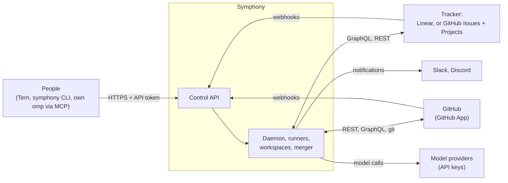

## Components

| Component | Job | Code |
|---|---|---|
| Control API | Serves people and their agents: `/v1` routes, server-sent events, MCP at `/mcp`, and the Linear and GitHub webhooks. The REST and MCP routes for people need an API token. The webhook routes need the vendor's HMAC signature. The health routes (`/healthz`, `/readyz`) need nothing. | `src/symphony/api/`, `src/symphony/entry/serve.py` |
| Setup | Part of the control API. Finds what a new install lacks, verifies each value against the real service, writes the integration Secrets and the WORKFLOW, and restarts the Deployments that read them. | `src/symphony/api/setup.py`, `src/symphony/setup_secrets.py` |
| Sandbox gateway | Serves agents only. It accepts engine telemetry (`POST /v1/traces`, OTLP) with the attempt's own token. It proxies agents' MCP requests to remote MCP servers (`/v1/mcp/<name>`) and adds the stored headers ([mcp.md](mcp.md)). | `src/symphony/gateway_api.py`, `src/symphony/mcp_servers.py` |
| Daemon | Runs the orchestration tick: reconcile, retries, dispatch. Starts runner and reflector Jobs. Reaps idle workspaces. Applies durable commands. | `src/symphony/orchestrator.py`, `src/symphony/entry/daemon.py` |
| Runner | Runs one attempt: prepares the workspace, starts the engine, drives the turns, publishes the session, serves the host tools, writes the outcome. | `src/symphony/runner.py`, `src/symphony/entry/run_issue.py` |
| Workspace | Holds the clone and runs the engine (`omp --mode rpc`). It gets the model credential of its agent role, a short-lived GitHub token for the ticket's repositories, and a telemetry token for one dispatch. It never gets the Linear API key, the GitHub App private key, Slack or Discord tokens, or Symphony API tokens. | `src/symphony/kube.py`, `docker/agent.Dockerfile` |
| Reflector | Runs the retrospective of a terminal ticket and opens a learnings pull request. | `src/symphony/reflector.py`, `src/symphony/entry/reflect.py` |
| Nightly sweep | Starts the missed retrospectives and keeps metrics retention. | `src/symphony/entry/sweep.py` |
| Assistant | A chat bot on Slack (Socket Mode) and Discord (the Gateway). It answers questions, researches and proposes tickets with read-only agents. A mapped person confirms each proposal ([assistant.md](assistant.md)). | `src/symphony/assistant/`, `src/symphony/entry/assistant.py` |
| Tracker adapters | One interface for the `linear`, `github` and `memory` trackers: read tickets, move them, comment, keep the Workpad, make sub-issues and issues, attach evidence. The daemon, the runners, the mergers and the reflector use it. | `src/symphony/trackers/` |
| Notifier | Sends each event to every configured channel: Slack, Discord, or both. A failure never stops its caller. | `src/symphony/notify.py` |
| Merger | Reviews every ready pull request with AI agents and merges them with a deterministic train. Watches the main branch. | `src/symphony/merger/`, `src/symphony/entry/merger.py` |
| Redis | Holds all shared state. | `deploy/redis.yaml` |
| `symphony` CLI | Holds the person's API token. Gives commands, the ACP bridge (`symphony acp`) and the raw API access for the Tern plugin. | `src/symphony/cli/` |
| Tern plugin | Dashboard, sessions, tickets, merger, repositories, infrastructure, telemetry, learnings, audit and admin views inside Tern. | `tern-plugin/` |

## Processes and entry points

One image, `symphony-orchestrator`, runs every trusted process. The `symphony-agent:<runtime>` images run the workspaces.

| Process | Command | Port | Kubernetes object |
|---|---|---|---|
| Control API | `python -m symphony.entry.serve api` | 8080 | Deployment `symphony-api` |
| Sandbox gateway | `python -m symphony.entry.serve gateway` | 8090 | Deployment `symphony-gateway` |
| Daemon | `python -m symphony.entry.daemon` | 8081 (health) | Deployment `symphony-daemon` |
| Merger | `python -m symphony.entry.merger` | 8081 (health) | Deployment `symphony-merger`, plus one Deployment for each other repository |
| Assistant | `python -m symphony.entry.assistant` | 8081 (health) | Deployment `symphony-assistant` |
| Runner | `python -m symphony.entry.run_issue` | — | Job, one for each dispatch |
| Reflector | `python -m symphony.entry.reflect` | — | Job, one for each retrospective |
| Nightly sweep | `python -m symphony.entry.sweep` | — | CronJob `symphony-nightly-sweep` (03:30 each day) |
| Local mode | `python -m symphony.entry.local` | 8080 and 8090 | none |
| Admin token tool | `python -m symphony.entry.admin_token` | — | none |

The daemon holds a lease in Redis. If a second daemon starts during a rolling update, it waits. The dispatch tokens stop any duplicate dispatch that the lease does not stop.

## Data stores

Redis is the only data store. All keys start with `sym:<namespace>:`. Redis runs with the append-only file on (`appendfsync everysec`) on a persistent volume.

| Data | Purpose | Main writer |
|---|---|---|
| Ticket records, dispatch tokens, holds, daemon lease, heartbeat | Orchestration and fencing | daemon, runner |
| Sessions: metadata, event stream, transcript, intents | Live view and steering | runner, merger (events); API (intents) |
| API tokens | Authentication. Only a SHA-256 hash of each secret is stored. | API |
| Team configuration and its history, consumer reports | Agent role models | API (publish); consumers (reports) |
| Durable commands and audit events | `pause`, `resume`, `refresh`, `reevaluate`, `interrupt`, `hold`, `release`, workflow and provider changes | API, daemon |
| Wake lists (`wake:daemon`, `wake:merger`) | Immediate action after a webhook or a command | API |
| Merger records, leases, baselines, batch state, actions | Review and train | merger |
| Telemetry rollups, token totals, monthly metrics, rate limits | Reports and cost | runner, gateway, reflector |
| MCP tokens | One token hash per agent session, with a TTL | runner, merger, reflector, assistant |
| Assistant proposals, heartbeat, `assist` sessions | Ticket proposals (7 days), the assistant's status, its chat sessions | assistant |

Back up the Redis volume. The tracker can rebuild the discovery of tickets, but not the API tokens, the audit, the team configuration or the merger intents.

Two Kubernetes objects also hold state:

| Object | Content |
|---|---|
| ConfigMap `symphony-workflow` | `WORKFLOW.md`, mounted at `/workflow` in each pod. |
| Secret `symphony-providers` | The provider API keys and custom providers saved from Tern. |

## Deployment on Kubernetes

All objects live in one namespace (`symphony` by default). Each service has its own ServiceAccount with a namespaced Role.

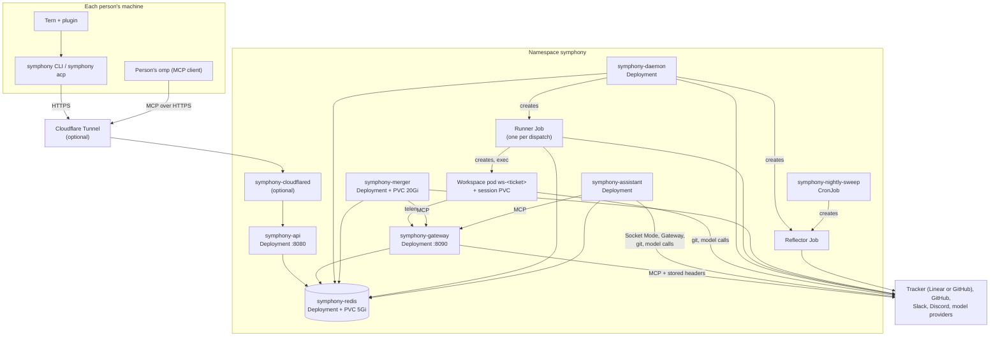

The external services also include the remote MCP servers that Admin adds.

Important properties of this topology:

- A workspace can reach only the gateway, DNS and public addresses. The NetworkPolicy blocks private ranges, so a workspace cannot reach the API, Redis, the node or the cloud metadata endpoint.
- A workspace mounts no ServiceAccount token. The runner reaches it through the Kubernetes API (`pods/exec`), not through the pod network.
- The daemon and the merger use the `Recreate` strategy with one replica.
- The workspace pod lives longer than one attempt. After an attempt, the daemon marks it idle. The daemon deletes a workspace that stays idle for `kubernetes.sandbox.idle_timeout_s`. The session volume stays until the ticket is terminal, so a new pod can resume the session.
- One merger Deployment serves one repository (`SYMPHONY_MERGER_REPO`). Run one merger Deployment, with its own PVC, for each repository. The merger's Redis keys include the repository, so several mergers can share one namespace.
- The API starts with only Redis and the Secret `symphony-api`. The integration Secrets are optional mounts: until setup fills them, the daemon, the mergers and the Jobs idle instead of crash-looping.

A single VM with k3s is enough to start. k3s includes containerd, `local-path` storage and a NetworkPolicy controller. [install.md](install.md) gives the steps.

## First-run setup

A new install has only Redis and the API. The admin runs `symphony setup` or opens **Setup** in Tern. Both call `/v1/setup`. The API verifies each value, stores it in its Secret, and restarts the consumers: the daemon, each merger, and the API itself last. In local mode, the values go to `<root>/secrets.env` and apply at once.

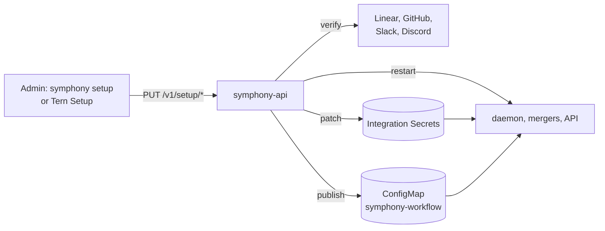

The webhook URLs that setup shows use `SYMPHONY_PUBLIC_URL`, or the request's address when it is unset. [install.md](install.md#4-run-the-first-run-setup) gives the steps. [internals.md](internals.md#17-first-run-setup) gives the contracts.

## Local mode

Local mode runs one process on one machine. It does the work of the API, the gateway, the daemon and the runners. Attempts are threads. Each attempt drives a local `omp --mode rpc` subprocess in a directory.

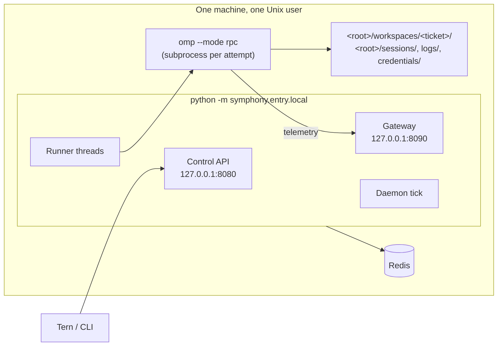

> **Warning:** Local mode has no pod and no container. The agent runs as the host user, with that user's files, network and git credentials. Use a dedicated Unix user on a dedicated machine. See [security.md](security.md#local-mode).

Differences from Kubernetes:

| Topic | Local mode |
|---|---|
| Workspaces | Directories under `<root>/workspaces/`. The hooks run in the workspace directory (also `$SYMPHONY_WORKSPACE`). |
| `kubernetes:` block | Ignored, except `kubernetes.learning`. |
| Reflector | Does not run. The log records `reflector_skipped_local_mode`. |
| `/v1/workflow`, `/v1/admin/providers` | Answer 503. Edit `WORKFLOW.md` on disk. Model credentials come from the host environment. |
| Memory tracker | `/v1/dev/issues` makes and moves tickets. |
| First admin token | Made and printed once if no valid admin token exists and `SYMPHONY_BOOTSTRAP_TOKEN` is not set. |

## Ticket lifecycle

[concepts.md](concepts.md#ticket-lifecycle) explains each state, label and internal status.

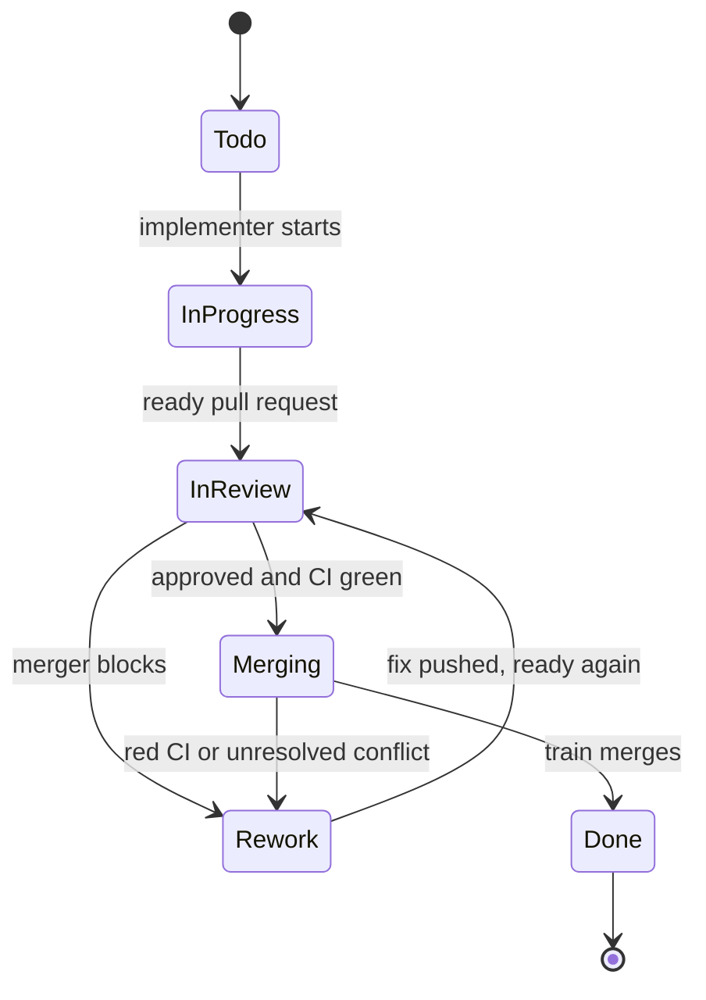

## Attempt sequence

This sequence shows one attempt on Kubernetes, from the ticket to the pull request.

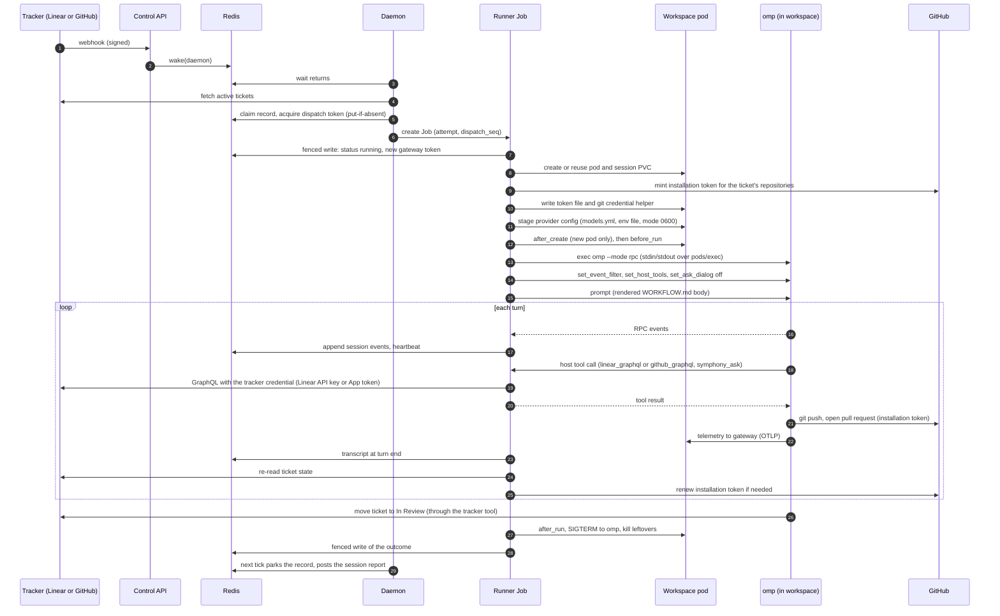

## Merger review flow

The merger takes ready pull requests from a queue: `review-bypass` first, then re-reviews, then first reviews. [merger.md](merger.md) gives every rule.

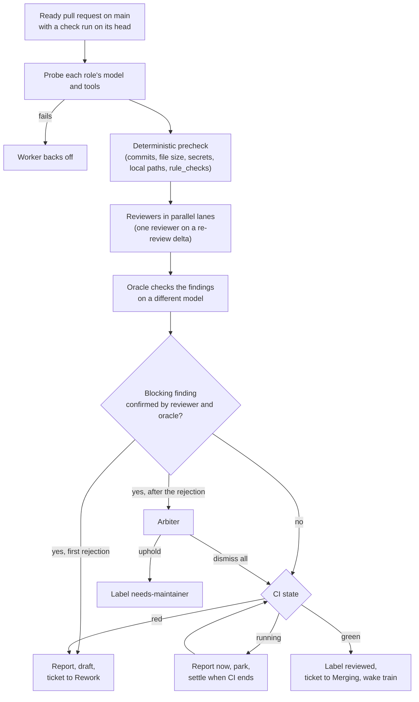

## Merge train flow

The train has no agent except for conflict resolution. One lease makes it serial.

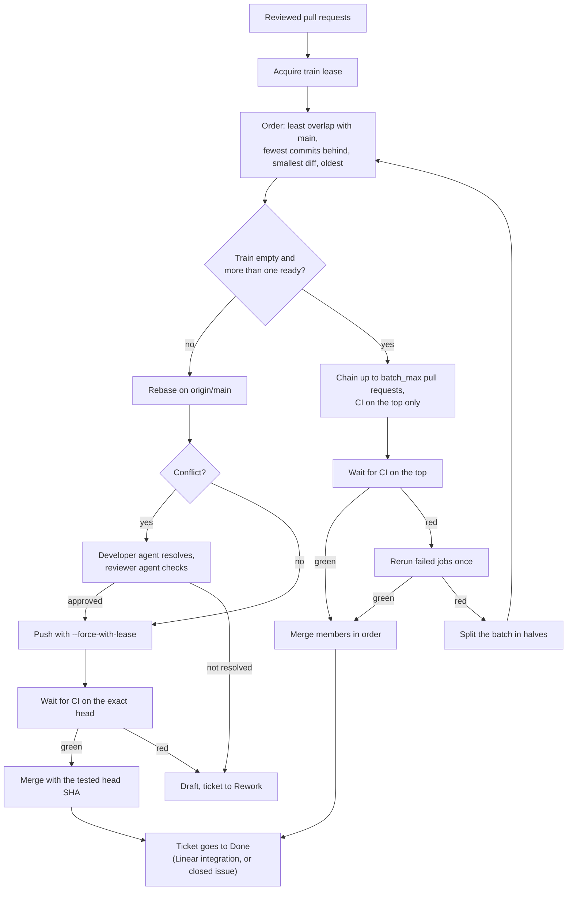

## Credential flow

The trusted side keeps the Linear API key, the GitHub App private key, Slack and Discord tokens, and Symphony API tokens. A workspace gets the model credential of its agent role, a GitHub installation token for the ticket's repositories (at most 1 hour), and a telemetry token for one dispatch. [security.md](security.md) lists each credential.

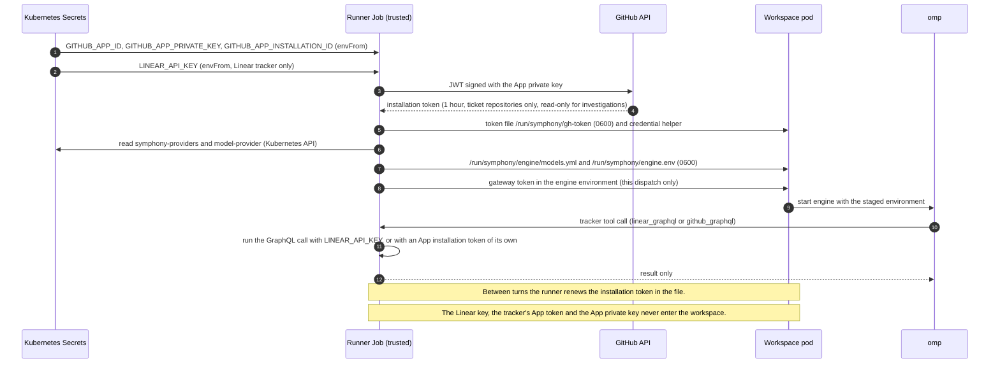

## Live chat and steer

A person opens a session in Tern. The ACP bridge replays the transcript and then follows the live events. A message from the person becomes an intent that the runner applies at once.

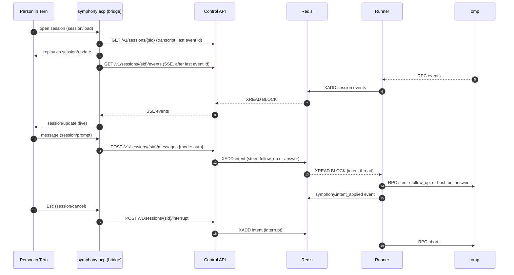

The `steer`, `follow_up`, `answer` and `interrupt` routes need the `operator` token role. Read routes need `viewer`. [api.md](api.md) gives the routes, and [tern.md](tern.md) describes the Tern views.

## MCP proxy and assistant

Agents reach remote MCP servers only through the gateway. The assistant runs its own read-only agents and talks to people in chat.

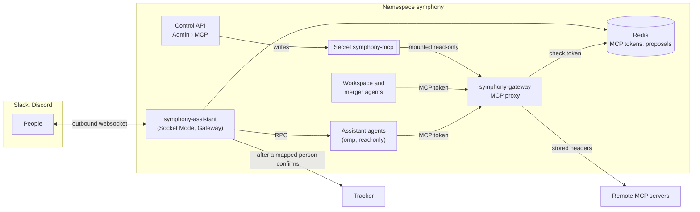

[mcp.md](mcp.md) and [assistant.md](assistant.md) describe each part.

## Latency targets

| Path | Mechanism | Target |
|---|---|---|
| Ticket made or moved in the tracker → dispatch | Webhook (Linear, or the GitHub `issues`, `issue_comment`, `sub_issues`, `issue_dependencies` and `projects_v2_item` events), then `wake(daemon)`. Safety poll each 15 s. | under 3 s |
| Pull request ready, CI done or push to main → merger | Webhook, then `wake(merger)`. Safety poll each 30 s. | under 5 s |
| Person's message → engine | Intent, then `XREAD BLOCK` in the runner, then RPC | under 300 ms |
| Engine event → Tern | Stream, then SSE or ACP | under 300 ms |
| Tern dashboard | `GET /v1/overview` with `ETag` each 2 s | under 100 ms for each call |

A missed webhook costs latency only. The safety poll still runs.
