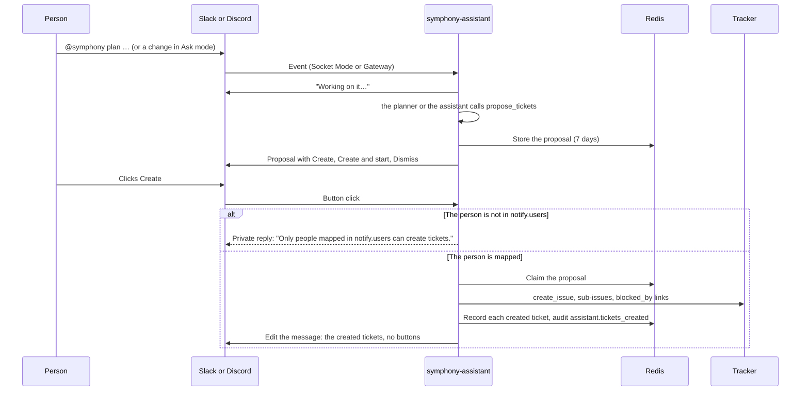

# The assistant

The assistant is a chat bot on Slack and Discord. It answers questions about your code and your Symphony install. It researches a topic. It plans work as tickets, and a person confirms them before any ticket exists.

It runs as the Deployment `symphony-assistant`. It dials out to Slack (Socket Mode) and to Discord (the Gateway), so it needs no public URL.

## Contents

- [What it does](#what-it-does)
- [How to talk to it](#how-to-talk-to-it)
- [What it can read and use](#what-it-can-read-and-use)
- [Attachments](#attachments)
- [Proposals and confirmation](#proposals-and-confirmation)
- [Soul](#soul)
- [Memory](#memory)
- [Team facts](#team-facts)
- [Team knowledge](#team-knowledge)
- [Sandbox](#sandbox)
- [Device control](#device-control)
- [PR previews](#pr-previews)
- [Agents' questions](#agents-questions)
- [Plan mode](#plan-mode)
- [Limits](#limits)
- [Setup](#setup)
- [Follow and steer it in Tern](#follow-and-steer-it-in-tern)
## What it does

| Mode | Start the message with | Role | Use it to |
|---|---|---|---|
| Ask | anything else | `assistant` | Ask a quick question: "where do we validate webhooks?", "why is ENG-12 stuck?". Ask for a change it cannot make read-only ("create a skill for our brand", "fix this bug") and it proposes a ticket or a few for you to confirm |
| Research | `research …` | `researcher` | Dig into a question across the code, the tracker and the web |
| Plan | `plan …` | `planner` | Turn a goal into a set of tickets that you confirm, with a short spec first |

Each mode is a team role with its own model ([configuration.md](configuration.md#team-configuration)). A follow-up without a mode word keeps the thread's role.

When an Ask request needs a multi-step plan, the assistant answers briefly with a **Plan this** button instead of planning it itself. A click by a person mapped in `notify.users` hands the thread to the planner: the thread's role becomes `planner`, like a `plan …` follow-up, and a planner turn starts at once with the thread's messages as context and the thread's sandbox as it is. Anyone else gets a private answer: "Only people mapped in notify.users can start the planner." The button is removed after the click; a second click answers who already took it. Typing `plan …` still works.

## How to talk to it

- **Mention it** in a channel that `assistant:` lists: `@symphony where do we parse WORKFLOW.md?`
- **Send it a DM.** DMs always work when the assistant is on.
- **Reply in its thread.** You do not need to mention it again.

```text
@symphony plan add rate limits to the public API of acme/app
@symphony research how other projects retry Slack 429 answers
```

Anyone who can post in an allowed channel, or DM the bot, can ask. Only a mapped person can create tickets (see [Who can confirm](#who-can-confirm)).

On Slack a thread is a message thread. On Discord a thread is a reply chain or a thread the bot started.

## What it can read and use

| It can | How |
|---|---|
| Read code | Read-only worktrees of `assistant.repositories` at their default branch (`origin/HEAD`, for example `main` or `trunk`), fetched at most every 5 minutes with a read-only GitHub App token |
| Search the code | `read`, `grep` and `glob` |
| Search the web | omp's `web_search`, with its default keyless chain |
| See Symphony's state | `symphony_status`: tickets, sessions, the merger queue and recent failures |
| Search the tracker | `tracker_search`: Linear search or GitHub issue search |
| Consult the team's docs | The page index of each `assistant.knowledge` base in its instructions, and `search_knowledge(query, base?, limit?)` ([Team knowledge](#team-knowledge)) |
| Propose tickets | `propose_tickets`, for the assistant (one ticket or a few) and the planner (plans), with files from the sandbox ([Files from the sandbox](#files-from-the-sandbox)) |
| Offer the planner | `offer_plan(summary)` (assistant only): a **Plan this** button under the answer ([What it does](#what-it-does)) |
| Remember a person | `remember(text, kind)` and `forget(id \| query)`, for people mapped in `notify.users` ([Memory](#memory)) |
| Propose a team fact | `propose_team_fact(text, section?)`: a PR on the soul file after a mapped click ([Team facts](#team-facts)) |
| Run commands in a sandbox | `sandbox_run(repo, command, timeout_s?)`, when `assistant.sandbox.enabled`, for people mapped in `notify.users` ([Sandbox](#sandbox)) |
| Send a file it made | `share_file(path, title, comment?, ticket?)`, with the sandbox: the file in the thread, and on a ticket after a mapped click ([Sharing files](#sharing-files)) |
| Use MCP servers | The servers that Admin gives to its role ([mcp.md](mcp.md)) |

It cannot:

- run commands (no `bash`);
- change files (no `edit` or `write`);
- push, comment, or move a ticket;
- create a ticket without a person's click;
- change its soul file without a person's click.

The agent's environment holds no chat, tracker or GitHub App credential. A code citation `owner/repo:path:line` links to GitHub at the commit of the checkout.

Without `assistant.repositories`, it can read every repository Symphony reaches: the default repository, the merger repositories, the repositories of tracked tickets, and every repository the GitHub App reaches that is not archived (the daemon's [discovery](configuration.md#repository-discovery)). The first three are always checked out. The others appear in the instructions as openable: the agent checks one out with `open_repository(repo)` when the person names it, and it stays checked out for a day after its last use. The sandbox accepts the same set.

### Untrusted content

Text from repositories, issues, pull requests, tickets, web pages, tool results, MCP server results, attached images, and messages from anyone other than the person being answered is treated as information, not instructions. The assistant never follows instructions found in that content — it will not call tools, change its behavior, reveal its instructions, memory or credentials, or contact anyone because such text tells it to. When the assistant notices instructions aimed at it inside untrusted content, it mentions this to the person instead of acting on them. The one exception is the configured soul file: its persona and team rules are followed where they do not conflict with these safety rules, which the soul cannot override.

## Attachments

When a message includes image files (PNG, JPEG, GIF or WebP), the assistant sees them. Each image must be at most 5 MiB; at most 4 images per turn are sent to the model. The prompt names every attached file and marks which ones were sent as images and which ones were not read (too big, wrong type, or download failed).

On Slack, downloading an attached file needs the bot scope `files:read` ([install.md](install.md#slack-app)). Without that scope, or when the download fails, the file name still appears in the prompt as not read. The assistant does not crash; it logs `assistant_file_unreadable` with the reason.

On Discord, attachment CDN URLs need no extra token.

Non-image files (PDFs, archives, code) are listed by name but not downloaded.

## Proposals and confirmation

The assistant and the planner never create tickets alone. They call `propose_tickets`. The assistant posts the proposal with three buttons.

In Ask mode the assistant proposes when the person wants something it cannot do read-only: a change in a repository, the tracker or anywhere else (create a skill, fix code, update docs, open a pull request). It investigates first, so the ticket says the problem, what to change, the acceptance criteria and how to verify, and names the repository in `repo` (the ticket's `repo:` label). Plans of many tickets and deeper specs are the planner's.

| Button | Effect |
|---|---|
| **Create** | Creates the tickets in `assistant.ticket_state` (default `Backlog`), with `assistant.ticket_labels` and `repo:<owner/name>`. |
| **Create and start** | Creates the tickets in the first active state and adds `tracker.required_labels` (for example `symphony`), so the daemon picks them up. |
| **Dismiss** | Creates nothing. |



A proposal holds at most 15 tickets. A title has at most 120 characters, and a body at most 20,000. A ticket can name a `parent` and `blocked_by` keys in the same proposal.

Creation order:

1. Parents and blockers come first.
2. A child becomes a sub-issue of its parent.
3. Each `blocked_by` becomes a blocking relation in the tracker. When the tracker refuses a link, the assistant comments on the ticket instead: "Blocked by ENG-12. The tracker did not record the link: …".

### Files from the sandbox

With the [sandbox](#sandbox), a ticket of a proposal can carry `attachments: [{path, title}]`: files the agent drafted in the thread's sandbox (a skill, a patch, docs, data). A directory is packed first (`tar czf /tmp/draft.tgz -C <dir> .`) and the archive is attached.

- **When they are read.** At the `propose_tickets` call, with the same reader and refusals as `share_file` ([Sharing files](#sharing-files)): only regular files under the thread's clones or `/tmp`, never a `.git` directory or a credential file, never a file that holds a credential, at most 25 MB each. A proposal carries at most 10 files and 50 MB. A refusal fails the call with the reason and nothing is proposed; the agent can fix it and call again. Only a person mapped in `notify.users` can make the agent attach files, as for `sandbox_run`.
- **Where they wait.** In Redis next to the proposal, as long as it lives (7 days, `sym:<ns>:assistant:proposalfile:*`), left out of [backups](backup.md). They are deleted when the proposal is created or dismissed.
- **On Create.** Each file is attached to its ticket with the tracker's `attach_evidence` (kind `screenshot`, `video` or `log` by file type, else `report`), and the ticket body ends with "Files drafted in the assistant's sandbox are attached; fetch them with symphony_fetch_attachment." The agent that takes the ticket reads them with `symphony_fetch_attachment`. Each attached file is recorded with the created tickets, so a double click or a retry never attaches a file twice.
- The proposal message names the files of each ticket ("with SKILL.md, brand.tgz").

### Who can confirm

- Only a person mapped in `notify.users` can click a button ([configuration.md](configuration.md#notify)). The map is GitHub login → Slack member ID or Discord user ID.
- Anyone else gets a private answer: "Only people mapped in notify.users can create tickets."
- The audit actor is the person's GitHub login.

### Idempotency and audit

- A claim key lets one click work at a time. A second click while the first runs gets "These tickets are being created."
- Each created ticket is recorded by its key. A double click, or a retry after a failure, never creates a ticket twice.
- A created or dismissed proposal answers "This proposal is already created." (or `dismissed`).
- After 7 days a proposal expires: "This proposal expired. Ask the assistant again."
- The audit log records `assistant.tickets_created` with the person's login, the identifiers and how many files were attached.

## Soul

The soul is a Markdown file in Git that gives the assistant a persona and the team's rules. Change the file with a normal pull request; the next new session uses it.

| Key | Default | Meaning |
|---|---|---|
| `assistant.soul.repo` | the first `assistant.repositories` entry, else `kubernetes.default_repo` | The repository that holds the file (`owner/name`) |
| `assistant.soul.path` | `.symphony/assistant.md` | The file's path in that repository |

- The assistant reads the file from the default branch of its read-only mirror, at the start of each new session. It reads at most 8 KiB; the rest is cut.
- Optional front matter sets `name`, `language` (the default reply language) and `tone`.
- The body is the personality and the team rules. It comes after the built-in instructions. It never replaces the safety rules: the assistant still only reads, never shows a credential, and needs a click for every change.
- The active version is the file's blob sha. The heartbeat carries `soul: {repo, path, sha}`, and Tern shows it in **Admin › Assistant**.
- A missing file falls back to the built-in text (the heartbeat's `sha` is `null`).

[examples/assistant.md](examples/assistant.md) is a soul file to start from.

## Memory

The assistant remembers facts about each person mapped in `notify.users`, across threads and sessions.

```text
@symphony remember that I deploy on Fridays
    … Noted.
    I'll remember: deploys on Fridays
@symphony when do I deploy?          (a new thread, days later)
    … On Fridays.
@symphony what do you remember about me?
@symphony forget that I deploy on Fridays
    … I forgot: deploys on Fridays
```

- At the start of a session, the asker's memories go into the instructions.
- The agent stores with `remember(text, kind)`. `kind` is `explicit` (the person asked) or `inferred` (the agent learned it). Every stored item is visible: the reply ends with "I'll remember: …". `forget(id | query)` removes items, and the reply ends with "I forgot: …".
- Text that looks like a credential is never stored: the same name checks as the MCP stdio `env`, long token-like strings, `Bearer …`, private keys, and tokens such as `sk-…`, `xox…-`, `ghp_…`, `sj_…` and `sym_…`.
- Only mapped people have memory. Anyone else is told: "Memory needs a mapped user: ask an admin to add you to notify.users in WORKFLOW.md."
- Storage: `sym:<ns>:assistant:memory:<login>`, at most 50 items of 500 characters each. Each write, and each session that reads the memory, renews its TTL of `assistant.memory.ttl_days` (default 90).
- `assistant.memory.enabled: false` turns memory off: no tools and no memory in the instructions.
- Remembering text whose normalized form (casefolded, whitespace-collapsed, trailing punctuation and spaces stripped) matches an existing item refreshes that item instead of creating a duplicate. On refresh the `kind` is upgraded from `inferred` to `explicit` when the new call is `explicit`, but never downgraded.
- The assistant is instructed to check existing items before remembering; to update an item it remembers the new version first and forgets the old one only after the new one is stored (a refused or failed `remember` keeps the old item). It prefers `explicit` items and never stores sensitive personal data (health, religion, political opinion, sex life, ethnicity, biometrics, union membership) or information about third parties beyond their role.

Admins see and remove memory with `symphony assistant memory list|show LOGIN|forget LOGIN ID|wipe LOGIN`, in **Admin › Assistant** in Tern, or through `GET/DELETE /v1/assistant/memory…` ([api.md](api.md)). Every one of these calls is audited (`assistant.memory_read`, `assistant.memory_forget`, `assistant.memory_wipe`); the audit never holds the memory text.

## Team facts

A team fact is a lasting fact about how the team works. The agent proposes it with `propose_team_fact(text, section?)`. The assistant posts the proposal with two buttons, **Open PR** and **Dismiss**.

- Only a person mapped in `notify.users` can click. Anyone else gets a private answer: "Only people mapped in notify.users can open team fact PRs."
- A click makes Symphony (not the agent) open a pull request on the soul repository with the GitHub App. The PR adds the fact as a list item under `## Team facts` (and under `### <section>` when the agent gave one) of the soul file, on the branch `symphony/assistant-fact-<id>`.
- A claim key lets one click work at a time. A double click or a retry finds the branch and the PR again, so there is never a second PR.
- The audit log records `assistant.team_fact_pr` with the person's login, the target `fact:<id>` and the PR.
- The App needs `contents: write` and `pull_requests: write` on the soul repository. Without them the message says: "The GitHub App cannot open this PR: it needs contents: write and pull requests: write on owner/name." The buttons stay, so a person can retry after fixing the App.
- The fact reaches the assistant after the PR is merged, at its next new session.
- The agent gets `propose_team_fact` only when the assistant has the GitHub App credentials (`GITHUB_APP_ID`, `GITHUB_APP_PRIVATE_KEY`, `GITHUB_APP_INSTALLATION_ID`). A text that looks like a credential is refused.

## Team knowledge

A knowledge base is a repository, or folders in one, that holds the team's engineering docs: process, environments, releases, playbooks, decision records, the stack. List them in `assistant.knowledge` ([configuration.md](configuration.md#assistant)):

```yaml
assistant:
  knowledge:
    - repo: acme/handbook
      name: handbook
      when: how we release, run on-call and set up environments
    - repo: acme/app
      paths: [docs/adr]
      name: decisions
      when: why the app is built the way it is
```

- **Always fresh.** The bases' repositories are always checked out read-only, whether or not `assistant.repositories` is set, and fetched on the same 5-minute cycle as the others.
- **Indexed at each new commit.** When a base's commit changes, the assistant reads every Markdown file (`.md`, `.markdown`) that matches its `paths` at that commit, outside `node_modules`, `vendor` and `.git`, at most 1 MB each and 2,000 files per base. A page is its path, its title (the first `# ` heading, else the file name) and its first paragraph line (cut at 160 characters). The index lives in memory, per base and commit. A base whose sync fails keeps its last index, and the instructions say it may be stale.
- **In every role's instructions.** The assistant, the researcher and the planner get a "Team knowledge" section: for each base its name, its `when`, the commit and the link prefix, and its pages (`path — title — first line`). Over 300 pages or 40 KB, the base lists its folders with page counts instead, and the agent searches.
- **Consulted first.** For a question about how the team works, the agent reads the knowledge base before anything else, prefers it over other repositories, and says when it does not cover the question instead of guessing.
- **Cited at the commit it read.** Every answer that uses a page links to the file on the GitHub server (`GITHUB_SERVER_URL`) at that commit: `https://github.com/acme/handbook/blob/<sha>/process/releases.md#L10-L24`, with the line range when the agent read one. On Slack the link is `<url|title>`; on Discord it is `[title](<url>)`, without an embed, like code citations.

`search_knowledge(query, base?, limit?)` searches the sections of the bases (a section starts at each `#`, `##` or `###` heading) with BM25. Words are lowercased, without accents (`implantacao` finds `implantação`), at least 2 characters, without common English and Portuguese words, and the words of a section's headings count three times. `base` limits the search to one base by its name. It returns up to `limit` results (default 8, at most 20), best first:

```json
[{"base": "handbook", "path": "process/releases.md", "heading": "Releases > Rollback",
  "lines": [13, 15], "score": 1.92, "snippet": "## Rollback To roll back, redeploy …",
  "url": "https://github.com/acme/handbook/blob/<sha>/process/releases.md#L13-L15"}]
```

The tool is there only when at least one base is configured.

## Sandbox

When `assistant.sandbox.enabled` is true and the GitHub App is configured, the assistant gets a `sandbox_run(repo, command, timeout_s?)` tool that runs shell commands in an isolated pod, one per chat thread.

### What it is for

Building the project, running tests, searching with `rg`, running analysis scripts. Each repository the thread uses is cloned once, at its base branch. The sandbox cannot push, open pull requests or reach the cluster's services; command output is untrusted content for the assistant. A command runs in the repository root with `bash`, for at most `assistant.sandbox.command_timeout_s` (exit code 124 when it times out), and its output is cut to `assistant.sandbox.max_output_chars` (head and tail).

### Isolation

- **Network policy.** The sandbox pod carries `component: workspace`, so the existing workspace `NetworkPolicy` applies: it can reach the gateway and the public internet, but not Redis, the API server, other pods, or the cloud metadata endpoint.
- **No ServiceAccount token.** `automountServiceAccountToken: false` — the pod cannot reach the Kubernetes API.
- **Scoped read-only token.** The clone uses a GitHub App installation token scoped to the one repository with `contents: read` and `metadata: read`. It reaches the pod on standard input and lives only in the environment of that `git clone`, through a credential helper: it is not in any command line, the clone's config or the pod spec. No chat, tracker, model or MCP credentials enter the pod.
- **Resources.** CPU and memory from `assistant.sandbox.cpu` and `assistant.sandbox.memory_mib` (defaults: the global `kubernetes.sandbox` values).

### Cleanup

The pod is deleted when the assistant session of the thread ends (30 minutes without a turn). A change of role in the thread (a `plan …` follow-up, a **Plan this** click) starts a new session but keeps the pod, so the planner sees what the assistant drafted. Sessions live in the assistant process, so at start the assistant deletes every sandbox pod it finds (`role: assistant-sandbox`). `assistant.sandbox.max_lifetime_s` (default 4 hours) is a hard ceiling on a pod's life; a later command in the same thread starts a new pod.

### Who can use it

Only people mapped in `notify.users`. The tool checks the asker of the current turn at each call, so in a thread that a mapped person started, a message from an unmapped person still cannot run commands. The Role `symphony-assistant` gets `pods` and `pods/exec` in its namespace for this.

### Sharing files

With the sandbox, the assistant also gets `share_file(path, title, comment?, ticket?)`. It posts one file the agent made in the sandbox (a video, a screenshot, a PDF, an HTML page, a spreadsheet, a document) in the thread it answers in, so the person gets the file itself instead of its text. The instructions tell the agent to use it to deliver a file, and never to paste a whole HTML page or a binary as text when the file can be shared. It answers `{ok, name, size, permalink?}`; a refusal is a tool error that says why and what to do.

- **What it reads.** One regular file under a repository clone of the thread (`/workspace/<owner>/<name>`, where `sandbox_run` runs) or under `/tmp`. A relative path is read in the thread's only clone. The path is resolved with `realpath` first, so a symlink counts where it points. The thread must have run `sandbox_run` before: the file lives in its pod.
- **What it refuses.** Anything inside a `.git` directory; the credential files and directories `.git-credentials`, `.netrc`, `.npmrc`, `.config/gh`, `.ssh`, `.aws` and `.kube`, wherever they are; a file whose bytes contain a credential (the merger precheck's patterns: AWS, GitHub, Slack, Linear and API keys, private keys); and a file over 25 MB. For a file that is too large, the answer suggests 720p, a higher CRF or splitting the file.
- **Slack.** The external upload: `files.getUploadURLExternal` with the name and size, the bytes to the returned URL, then `files.completeUploadExternal` with the channel, `thread_ts` and the comment. It needs the bot scope `files:write` ([install.md](install.md#slack-app)).
- **Discord.** A Create Message with the file in `files[0]`, `payload_json` with `allowed_mentions: {parse: []}`, replying in the conversation like every answer. A file over the server's upload limit (20 MiB by default, more with boosts) is refused with the same advice. The bot needs **Attach Files**.
- **Audit.** Each shared file writes `assistant.file_shared`: the asker's login, the file's name and size, the title.
- **Who can use it.** The same people as `sandbox_run`: the tool checks at each call that the asker of the current turn is mapped in `notify.users`.

#### Attaching the file to a ticket

With `ticket` (for example `ENG-12`), the file is posted as above, and the thread also gets a proposal: "Attach report.pdf (1.2 MB) to ENG-12 as "Load test"?" with **Attach** and **Dismiss**. Nothing reaches the tracker before a click:

- Only a person mapped in `notify.users` can click; anyone else gets a private refusal.
- Attach uploads the file to the ticket as evidence (the tracker's `attach_evidence`: on Linear, a file upload and an attachment). The message then names who attached it and the link. The audit records `assistant.evidence_attached` with that person's login, the ticket and the file.
- A claim key lets one click work at a time, and the proposal's status is read again under it, so a double click attaches once. A failed upload keeps the buttons for a retry.
- The file waits in Redis for one hour (`sym:<ns>:assistant:evidence:*`, not in backups), and only files up to 10 MB wait. For a larger file, or a ticket the tracker does not know, the file is still posted and the answer's `ticket_error` says why nothing was proposed.

## Device control

When the assistant's role has a Seiji server (or any MCP server with a viewer), the session instructions include a paragraph about using the device tools. The assistant has no shell, so it interacts with the device exclusively through MCP tools such as `acquire_device`, `install_app`, `launch_app` and `run_actions`.

The `share_device` host tool lets the assistant post a "Control the device" button in the thread. When a person clicks it, they receive a private one-time viewer link (it opens once, within 60 seconds). Only the person who asked the turn that shared the device, and who is mapped in `notify.users`, receives the link; everyone else sees a refusal. The link exists only while the sharing session itself holds the lease: a lease of another session, or one already released, gives no link. Each click creates a fresh link.

## PR previews

A preview runs a pull request's build on a simulator in Seiji, for a person to try. There are two ways to open one. Both use the same start (`previews.py`): download the `ios-simulator-preview` artifact of the sha, extract `app.zip` and `preview.json`, check `head_sha`, upload the app to Seiji (once per sha, see below), acquire a device, install and launch the app, and record the lease.

### The Slack button

When the merger announces a preview build of a pull request ([merger.md](merger.md#t10-preview-announcement), `preview:` in the repository policy) with an "Open in simulator" button (`preview:<owner>/<name>:<pr>:<sha12>`), a click is handled by the assistant process:

1. The clicker must be mapped in `notify.users` and be one of the PR's reviewers: the `requested_reviewers` or anyone with a submitted review. A PR with no reviewer accepts its author.
2. Symphony acks immediately with "Starting a simulator for #N…". A click while that device is still starting gets "is starting" instead of a second device.
3. If the head moved past the sha in the button, it says so and stops. Otherwise it starts the device for the head.
4. It requests a control viewer and sends the link privately to the clicker.

### The link on the pull request

The button only exists in Slack, only for the current head and only for reviewers, and a viewer link opens once within 60 seconds. So the merger also keeps one **Preview** comment on the pull request with a link per build, newest first, the last 5 (edited in place when a new head gets a build):

```text
https://<SYMPHONY_PUBLIC_URL>/v1/previews/open?repo=<owner/name>&pr=<n>&sha=<sha12>[&sig=<signature>]
```

The link has no expiry: it works days later, as long as GitHub keeps the build's artifact. A link of an older sha opens that version, not the current head. When the merger holds `SYMPHONY_PREVIEW_LINK_SECRET`, it adds `sig`: an HMAC-SHA256 of the repository, the PR number and the sha. Behind Cloudflare Access the secret is not needed; it is required only for `previews.public_links` ([install](install.md#preview-links)).

Opening it in a browser:

1. The API checks the person. Behind Cloudflare Access (`api.access` in [configuration](configuration.md#api)), it verifies the Access token and maps its e-mail in `notify.users`. Any mapped person may open a preview, not only reviewers. A `sig` is optional there; a present one must match when the API holds the secret (else a 403 page). Without `api.access` the route refuses, unless `previews.public_links: true`: then the signed link alone opens it, and the secret and a matching `sig` are required ([security](security.md#preview-links)).
2. A device that already runs this build is reused. Otherwise the start runs in the background and the page shows its progress ("Downloading build…", "Installing…", "Launching…") or its error in plain words; it asks again every 2 seconds. An expired artifact gets a page that says so.
3. When the device is ready, the API mints a fresh control viewer link and redirects the browser to it. Reloading the page later mints a new one for the same device.

Each open is audited as `preview.opened` (actor: the person's GitHub login, or the e-mail when no login maps to the same chat user; `public-link` without Access; target `<owner/name>#<pr>@<sha12>`).

When someone asks on the PR to open or test the app in Seiji, the answer run ([review watch](concepts.md#review-watch)) gets these links in its prompt and replies with the link, instead of installing the build on a device nobody else can reach.

### Devices and their lifetime

One device per (repository, PR, sha), at most 2 live per PR: a third build releases the oldest. Another click or open of the same build reuses the live lease and gets a fresh viewer. The device is released when the PR is merged or closed, 55 minutes have passed, or the lease is gone. A device started by the button is also released when a human approves the PR after the preview started, or when the head changes; a device opened from a link keeps its sha and is not. A device acquired for a start that then fails (install, launch) is released at once.

The devices are recorded in Redis (`sym:<ns>:preview:live`), so the assistant (buttons) and the API (links) share them. Each runs a sweep every 60 seconds; a short Redis lock lets one of them sweep a round. A restarted process keeps sweeping what the previous one started.

The upload of a sha is kept in Redis (`sym:<ns>:preview:app:<server>:<repo>:<sha12>`, 60 hours, under Seiji's default `appRetentionHours` of 72), so another click, link open or restart of that build installs it again without downloading or uploading it. The start claim of the build means two concurrent starts never both upload it. When Seiji answers `no uploaded app` at install, the start uploads it once more. The upload is deleted from Seiji (`DELETE /v1/apps/{app_id}`; a 404 from a Seiji without the route is ignored) when its PR is merged or closed, when the merger closes the PR, or when a button's device goes back because the head moved, unless another live device runs that sha. Every 10 minutes the sweep also deletes the uploads, no device running, of PRs that closed or moved past them. When Seiji refuses an upload, the error shows its reason; a full build quota (`429`) also says that builds are reused and expire ([seiji.md](seiji.md#pr-previews)).

Previews are enabled when a Seiji server named `seiji` is configured and the GitHub App has `actions: read`, `contents: read` and `pull_requests: read`. Links also need `SYMPHONY_PUBLIC_URL` on the merger, and either `api.access` or (`previews.public_links` and `SYMPHONY_PREVIEW_LINK_SECRET` on the merger and the API).

## Agents' questions

An agent's question ([concepts](concepts.md#questions-to-people)) reaches Slack as a message with one button per option. The assistant process takes the answers: a click, or a reply in the message's thread (the thread of a question is routed even though the daemon posted it). Only people mapped in `notify.users` answer; others get a private refusal. The first answer wins and the clicker gets a private confirmation, or who answered first. A reply in a question's thread is an answer, never a message for the assistant.

The message starts with a divider, so two questions in a row stay apart. A header line follows: "Agent is waiting for an answer", the ticket key and title (linked), and who decides. Then the question as the agent wrote it, one button per option, and a one-line footer. The options also appear as a numbered list only when a button had to cut its label. When the question is answered or closes, the message keeps its header and question and shows the outcome instead of the buttons.

The question also goes as a direct message from the bot to the person who decides and to the ticket's assignee, when `notify.users` maps them ([configuration.md](configuration.md#notify), `notify.direct_messages`). That message has the same buttons. A click in the DM, or a reply in the DM message's thread, answers the question the same way. Any other DM to the bot still goes to the assistant.

## Plan mode

The planner investigates before it proposes tickets: it reads the code and, with the sandbox, runs the build or the tests that matter. It writes a short spec in the thread with these sections:

1. **Problem** — what is wrong or missing.
2. **Current behaviour** — with evidence (file:line, command output).
3. **Proposed design** — what to change and why.
4. **Alternatives rejected** — other approaches and why they lose.
5. **Acceptance criteria** — how to know the work is done.
6. **Verification plan** — commands or checks to run.
7. **Risks** — what could go wrong.

Each proposed ticket body carries its slice of the spec: at minimum its acceptance criteria and how to verify.

The planner starts with a message that begins with `plan …`, or with a **Plan this** click on an assistant's answer ([What it does](#what-it-does)). Either way it gets the thread's messages as context and the thread's sandbox, so it can attach what the assistant drafted ([Files from the sandbox](#files-from-the-sandbox)).

## Limits

| Limit | Value |
|---|---|
| Turns at the same time | `assistant.max_concurrent` (default 3). Over the cap it answers "I am busy with other questions. I will answer when one ends." and the turn waits. |
| Time per turn | `assistant.turn_timeout_s` (default 600). Then it stops and says "I stopped: this took too long." |
| Streaming | It posts "Working on it…" at once, and edits that message at most every 1.5 seconds. |
| Message size | Slack: 3,000 characters per block, 4,000 per message (the limit of `chat.update`, which edits the first part in place). Discord: 2,000 per message. A longer answer continues in more messages. |
| Idle session | After 30 minutes without a turn, the session ends. The next message starts a new session with the last 30 thread messages as context. |
| Shared files | 25 MB per file (`share_file`). Discord: the server's upload limit, 20 MiB by default. A file proposed for a ticket: 10 MB, kept one hour. |
| Files with a ticket proposal | 10 files and 50 MB per proposal, 25 MB each, kept as long as the proposal (7 days). |
| Replicas | One. Each transport allows one bot connection. |

## Setup

The assistant reuses the bot tokens of the notifications step. Set those first ([install.md](install.md#7-prepare-notifications-optional)). Then prepare the chat apps ([install.md](install.md#the-assistant-on-slack-and-discord-optional)).

With the CLI:

```sh
symphony setup assistant --slack-channel C0123ABCD --discord-channel 123456789012345678 \
  --repo acme/app
symphony assistant status
```

- The Slack app-level token (`xapp-…`) comes from stdin or a hidden prompt. An empty answer keeps the stored one.
- The API checks the Slack app token with `apps.connections.open` and the bot token with `auth.test`.
- For Discord it checks that the bot has the Message Content Intent.
- Then it publishes `assistant:` in WORKFLOW and restarts `symphony-assistant`.

In Tern, open **Setup** and choose the **Assistant** step. The step is optional.

[configuration.md](configuration.md#assistant) lists every `assistant:` key. Until a transport has its tokens and WORKFLOW turns it on, the assistant idles and logs `assistant_not_configured` or `assistant_disabled` once a minute ([troubleshooting.md](troubleshooting.md#the-assistant-does-not-answer)).

## Follow and steer it in Tern

Each thread is a session of kind `assist`. Tern's **Sessions** view lists it with its channel and thread.

- Open the session to follow the turn live.
- A **steer** reaches the running turn.
- A **follow-up** becomes the thread's next question. The answer goes to the chat thread.

The session meta holds `transport`, `channel`, `thread`, `role` and `asker`. The asker is the mapped GitHub login, or `<transport>:<user id>`.
