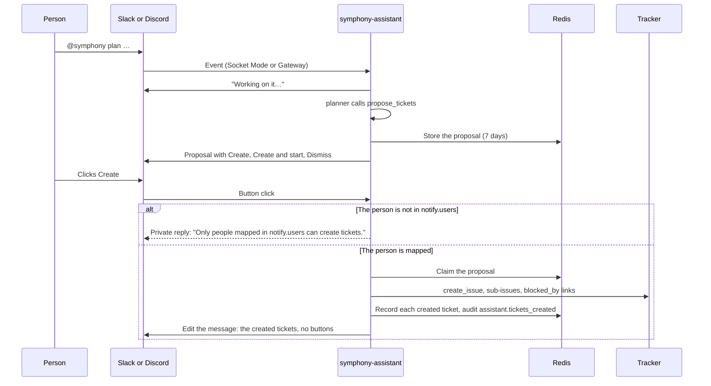

# The assistant

The assistant is a chat bot on Slack and Discord. It answers questions about your code and your Symphony install. It researches a topic. It plans work as tickets, and a person confirms them before any ticket exists.

It runs as the Deployment `symphony-assistant`. It dials out to Slack (Socket Mode) and to Discord (the Gateway), so it needs no public URL.

## Contents

- [What it does](#what-it-does)
- [How to talk to it](#how-to-talk-to-it)
- [What it can read and use](#what-it-can-read-and-use)
- [Proposals and confirmation](#proposals-and-confirmation)
- [Soul](#soul)
- [Memory](#memory)
- [Team facts](#team-facts)
- [Limits](#limits)
- [Setup](#setup)
- [Follow and steer it in Tern](#follow-and-steer-it-in-tern)

## What it does

| Mode | Start the message with | Role | Use it to |
|---|---|---|---|
| Ask | anything else | `assistant` | Ask a quick question: "where do we validate webhooks?", "why is ENG-12 stuck?" |
| Research | `research …` | `researcher` | Dig into a question across the code, the tracker and the web |
| Plan | `plan …` | `planner` | Turn a goal into a set of tickets that you confirm |

Each mode is a team role with its own model ([configuration.md](configuration.md#team-configuration)). A follow-up without a mode word keeps the thread's role.

## How to talk to it

- **Mention it** in a channel that `assistant:` lists: `@symphony where do we parse WORKFLOW.md?`
- **Send it a DM.** DMs always work when the assistant is on.
- **Reply in its thread.** You do not need to mention it again.

```text
@symphony plan add rate limits to the public API of acme/app
@symphony research how other projects retry Slack 429 answers
```

Anyone who can post in an allowed channel, or DM the bot, can ask. Only a mapped person can create tickets (see [Who can confirm](#who-can-confirm)).

On Slack a thread is a message thread. On Discord a thread is a reply chain or a thread the bot started.

## What it can read and use

| It can | How |
|---|---|
| Read code | Read-only worktrees of `assistant.repositories` at their default branch (`origin/HEAD`, for example `main` or `trunk`), fetched at most every 5 minutes with a read-only GitHub App token |
| Search the code | `read`, `grep` and `glob` |
| Search the web | omp's `web_search`, with its default keyless chain |
| See Symphony's state | `symphony_status`: tickets, sessions, the merger queue and recent failures |
| Search the tracker | `tracker_search`: Linear search or GitHub issue search |
| Propose tickets | `propose_tickets` (planner only) |
| Remember a person | `remember(text, kind)` and `forget(id \| query)`, for people mapped in `notify.users` ([Memory](#memory)) |
| Propose a team fact | `propose_team_fact(text, section?)`: a PR on the soul file after a mapped click ([Team facts](#team-facts)) |
| Use MCP servers | The servers that Admin gives to its role ([mcp.md](mcp.md)) |

It cannot:

- run commands (no `bash`);
- change files (no `edit` or `write`);
- push, comment, or move a ticket;
- create a ticket without a person's click;
- change its soul file without a person's click.

The agent's environment holds no chat, tracker or GitHub App credential. A code citation `owner/repo:path:line` links to GitHub at the commit of the checkout.

Without `assistant.repositories`, it reads the default repository, the merger repositories and the repositories of tracked tickets.

## Proposals and confirmation

The planner never creates tickets alone. It calls `propose_tickets`. The assistant posts the proposal with three buttons.

| Button | Effect |
|---|---|
| **Create** | Creates the tickets in `assistant.ticket_state` (default `Backlog`), with `assistant.ticket_labels` and `repo:<owner/name>`. |
| **Create and start** | Creates the tickets in the first active state and adds `tracker.required_labels` (for example `symphony`), so the daemon picks them up. |
| **Dismiss** | Creates nothing. |



A proposal holds at most 15 tickets. A title has at most 120 characters, and a body at most 20,000. A ticket can name a `parent` and `blocked_by` keys in the same proposal.

Creation order:

1. Parents and blockers come first.
2. A child becomes a sub-issue of its parent.
3. Each `blocked_by` becomes a blocking relation in the tracker. When the tracker refuses a link, the assistant comments on the ticket instead: "Blocked by ENG-12. The tracker did not record the link: …".

### Who can confirm

- Only a person mapped in `notify.users` can click a button ([configuration.md](configuration.md#notify)). The map is GitHub login → Slack member ID or Discord user ID.
- Anyone else gets a private answer: "Only people mapped in notify.users can create tickets."
- The audit actor is the person's GitHub login.

### Idempotency and audit

- A claim key lets one click work at a time. A second click while the first runs gets "These tickets are being created."
- Each created ticket is recorded by its key. A double click, or a retry after a failure, never creates a ticket twice.
- A created or dismissed proposal answers "This proposal is already created." (or `dismissed`).
- After 7 days a proposal expires: "This proposal expired. Ask the planner again."
- The audit log records `assistant.tickets_created` with the person's login and the identifiers.

## Soul

The soul is a Markdown file in Git that gives the assistant a persona and the team's rules. Change the file with a normal pull request; the next new session uses it.

| Key | Default | Meaning |
|---|---|---|
| `assistant.soul.repo` | the first `assistant.repositories` entry, else `kubernetes.default_repo` | The repository that holds the file (`owner/name`) |
| `assistant.soul.path` | `.symphony/assistant.md` | The file's path in that repository |

- The assistant reads the file from the default branch of its read-only mirror, at the start of each new session. It reads at most 8 KiB; the rest is cut.
- Optional front matter sets `name`, `language` (the default reply language) and `tone`.
- The body is the personality and the team rules. It comes after the built-in instructions. It never replaces the safety rules: the assistant still only reads, never shows a credential, and needs a click for every change.
- The active version is the file's blob sha. The heartbeat carries `soul: {repo, path, sha}`, and Tern shows it in **Admin › Assistant**.
- A missing file falls back to the built-in text (the heartbeat's `sha` is `null`).

[examples/assistant.md](examples/assistant.md) is a soul file to start from.

## Memory

The assistant remembers facts about each person mapped in `notify.users`, across threads and sessions.

```text
@symphony remember that I deploy on Fridays
    … Noted.
    I'll remember: deploys on Fridays
@symphony when do I deploy?          (a new thread, days later)
    … On Fridays.
@symphony what do you remember about me?
@symphony forget that I deploy on Fridays
    … I forgot: deploys on Fridays
```

- At the start of a session, the asker's memories go into the instructions.
- The agent stores with `remember(text, kind)`. `kind` is `explicit` (the person asked) or `inferred` (the agent learned it). Every stored item is visible: the reply ends with "I'll remember: …". `forget(id | query)` removes items, and the reply ends with "I forgot: …".
- Text that looks like a credential is never stored: the same name checks as the MCP stdio `env`, long token-like strings, `Bearer …`, private keys, and tokens such as `sk-…`, `xox…-`, `ghp_…`, `sj_…` and `sym_…`.
- Only mapped people have memory. Anyone else is told: "Memory needs a mapped user: ask an admin to add you to notify.users in WORKFLOW.md."
- Storage: `sym:<ns>:assistant:memory:<login>`, at most 50 items of 500 characters each. Each write, and each session that reads the memory, renews its TTL of `assistant.memory.ttl_days` (default 90).
- `assistant.memory.enabled: false` turns memory off: no tools and no memory in the instructions.

Admins see and remove memory with `symphony assistant memory list|show LOGIN|forget LOGIN ID|wipe LOGIN`, in **Admin › Assistant** in Tern, or through `GET/DELETE /v1/assistant/memory…` ([api.md](api.md)). Every one of these calls is audited (`assistant.memory_read`, `assistant.memory_forget`, `assistant.memory_wipe`); the audit never holds the memory text.

## Team facts

A team fact is a lasting fact about how the team works. The agent proposes it with `propose_team_fact(text, section?)`. The assistant posts the proposal with two buttons, **Open PR** and **Dismiss**.

- Only a person mapped in `notify.users` can click. Anyone else gets a private answer: "Only people mapped in notify.users can open team fact PRs."
- A click makes Symphony (not the agent) open a pull request on the soul repository with the GitHub App. The PR adds the fact as a list item under `## Team facts` (and under `### <section>` when the agent gave one) of the soul file, on the branch `symphony/assistant-fact-<id>`.
- A claim key lets one click work at a time. A double click or a retry finds the branch and the PR again, so there is never a second PR.
- The audit log records `assistant.team_fact_pr` with the person's login, the target `fact:<id>` and the PR.
- The App needs `contents: write` and `pull_requests: write` on the soul repository. Without them the message says: "The GitHub App cannot open this PR: it needs contents: write and pull requests: write on owner/name." The buttons stay, so a person can retry after fixing the App.
- The fact reaches the assistant after the PR is merged, at its next new session.
- The agent gets `propose_team_fact` only when the assistant has the GitHub App credentials (`GITHUB_APP_ID`, `GITHUB_APP_PRIVATE_KEY`, `GITHUB_APP_INSTALLATION_ID`). A text that looks like a credential is refused.

## Limits

| Limit | Value |
|---|---|
| Turns at the same time | `assistant.max_concurrent` (default 3). Over the cap it answers "I am busy with other questions. I will answer when one ends." and the turn waits. |
| Time per turn | `assistant.turn_timeout_s` (default 600). Then it stops and says "I stopped: this took too long." |
| Streaming | It posts "Working on it…" at once, and edits that message at most every 1.5 seconds. |
| Message size | Slack: 3,000 characters per block, 40,000 per message. Discord: 2,000 per message. A longer answer continues in more messages. |
| Idle session | After 30 minutes without a turn, the session ends. The next message starts a new session with the last 30 thread messages as context. |
| Replicas | One. Each transport allows one bot connection. |

## Setup

The assistant reuses the bot tokens of the notifications step. Set those first ([install.md](install.md#7-prepare-notifications-optional)). Then prepare the chat apps ([install.md](install.md#the-assistant-on-slack-and-discord-optional)).

With the CLI:

```sh
symphony setup assistant --slack-channel C0123ABCD --discord-channel 123456789012345678 \
  --repo acme/app
symphony assistant status
```

- The Slack app-level token (`xapp-…`) comes from stdin or a hidden prompt. An empty answer keeps the stored one.
- The API checks the Slack app token with `apps.connections.open` and the bot token with `auth.test`.
- For Discord it checks that the bot has the Message Content Intent.
- Then it publishes `assistant:` in WORKFLOW and restarts `symphony-assistant`.

In Tern, open **Setup** and choose the **Assistant** step. The step is optional.

[configuration.md](configuration.md#assistant) lists every `assistant:` key. Until a transport has its tokens and WORKFLOW turns it on, the assistant idles and logs `assistant_not_configured` or `assistant_disabled` once a minute ([troubleshooting.md](troubleshooting.md#the-assistant-does-not-answer)).

## Follow and steer it in Tern

Each thread is a session of kind `assist`. Tern's **Sessions** view lists it with its channel and thread.

- Open the session to follow the turn live.
- A **steer** reaches the running turn.
- A **follow-up** becomes the thread's next question. The answer goes to the chat thread.

The session meta holds `transport`, `channel`, `thread`, `role` and `asker`. The asker is the mapped GitHub login, or `<transport>:<user id>`.
