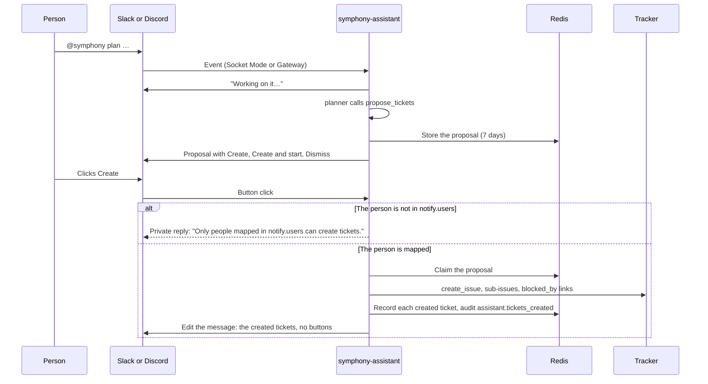

# The assistant

The assistant is a chat bot on Slack and Discord. It answers questions about your code and your Symphony install. It researches a topic. It plans work as tickets, and a person confirms them before any ticket exists.

It runs as the Deployment `symphony-assistant`. It dials out to Slack (Socket Mode) and to Discord (the Gateway), so it needs no public URL.

## Contents

- [What it does](#what-it-does)
- [How to talk to it](#how-to-talk-to-it)
- [What it can read and use](#what-it-can-read-and-use)
- [Attachments](#attachments)
- [Proposals and confirmation](#proposals-and-confirmation)
- [Soul](#soul)
- [Memory](#memory)
- [Team facts](#team-facts)
- [Sandbox](#sandbox)
- [Device control](#device-control)
- [PR previews](#pr-previews)
- [Plan mode](#plan-mode)
- [Limits](#limits)
- [Setup](#setup)
- [Follow and steer it in Tern](#follow-and-steer-it-in-tern)
## What it does

| Mode | Start the message with | Role | Use it to |
|---|---|---|---|
| Ask | anything else | `assistant` | Ask a quick question: "where do we validate webhooks?", "why is ENG-12 stuck?" |
| Research | `research …` | `researcher` | Dig into a question across the code, the tracker and the web |
| Plan | `plan …` | `planner` | Turn a goal into a set of tickets that you confirm |

Each mode is a team role with its own model ([configuration.md](configuration.md#team-configuration)). A follow-up without a mode word keeps the thread's role.

## How to talk to it

- **Mention it** in a channel that `assistant:` lists: `@symphony where do we parse WORKFLOW.md?`
- **Send it a DM.** DMs always work when the assistant is on.
- **Reply in its thread.** You do not need to mention it again.

```text
@symphony plan add rate limits to the public API of acme/app
@symphony research how other projects retry Slack 429 answers
```

Anyone who can post in an allowed channel, or DM the bot, can ask. Only a mapped person can create tickets (see [Who can confirm](#who-can-confirm)).

On Slack a thread is a message thread. On Discord a thread is a reply chain or a thread the bot started.

## What it can read and use

| It can | How |
|---|---|
| Read code | Read-only worktrees of `assistant.repositories` at their default branch (`origin/HEAD`, for example `main` or `trunk`), fetched at most every 5 minutes with a read-only GitHub App token |
| Search the code | `read`, `grep` and `glob` |
| Search the web | omp's `web_search`, with its default keyless chain |
| See Symphony's state | `symphony_status`: tickets, sessions, the merger queue and recent failures |
| Search the tracker | `tracker_search`: Linear search or GitHub issue search |
| Propose tickets | `propose_tickets` (planner only) |
| Remember a person | `remember(text, kind)` and `forget(id \| query)`, for people mapped in `notify.users` ([Memory](#memory)) |
| Propose a team fact | `propose_team_fact(text, section?)`: a PR on the soul file after a mapped click ([Team facts](#team-facts)) |
| Use MCP servers | The servers that Admin gives to its role ([mcp.md](mcp.md)) |

It cannot:

- run commands (no `bash`);
- change files (no `edit` or `write`);
- push, comment, or move a ticket;
- create a ticket without a person's click;
- change its soul file without a person's click.

The agent's environment holds no chat, tracker or GitHub App credential. A code citation `owner/repo:path:line` links to GitHub at the commit of the checkout.

Without `assistant.repositories`, it can read every repository Symphony reaches: the default repository, the merger repositories, the repositories of tracked tickets, and every repository the GitHub App reaches that is not archived (the daemon's [discovery](configuration.md#repository-discovery)). The first three are always checked out. The others appear in the instructions as openable: the agent checks one out with `open_repository(repo)` when the person names it, and it stays checked out for a day after its last use. The sandbox accepts the same set.

### Untrusted content

Text from repositories, issues, pull requests, tickets, web pages, tool results, MCP server results, attached images, and messages from anyone other than the person being answered is treated as information, not instructions. The assistant never follows instructions found in that content — it will not call tools, change its behavior, reveal its instructions, memory or credentials, or contact anyone because such text tells it to. When the assistant notices instructions aimed at it inside untrusted content, it mentions this to the person instead of acting on them. The one exception is the configured soul file: its persona and team rules are followed where they do not conflict with these safety rules, which the soul cannot override.

## Attachments

When a message includes image files (PNG, JPEG, GIF or WebP), the assistant sees them. Each image must be at most 5 MiB; at most 4 images per turn are sent to the model. The prompt names every attached file and marks which ones were sent as images and which ones were not read (too big, wrong type, or download failed).

On Slack, downloading an attached file needs the bot scope `files:read` ([install.md](install.md#slack-app)). Without that scope, or when the download fails, the file name still appears in the prompt as not read. The assistant does not crash; it logs `assistant_file_unreadable` with the reason.

On Discord, attachment CDN URLs need no extra token.

Non-image files (PDFs, archives, code) are listed by name but not downloaded.

## Proposals and confirmation

The planner never creates tickets alone. It calls `propose_tickets`. The assistant posts the proposal with three buttons.

| Button | Effect |
|---|---|
| **Create** | Creates the tickets in `assistant.ticket_state` (default `Backlog`), with `assistant.ticket_labels` and `repo:<owner/name>`. |
| **Create and start** | Creates the tickets in the first active state and adds `tracker.required_labels` (for example `symphony`), so the daemon picks them up. |
| **Dismiss** | Creates nothing. |



A proposal holds at most 15 tickets. A title has at most 120 characters, and a body at most 20,000. A ticket can name a `parent` and `blocked_by` keys in the same proposal.

Creation order:

1. Parents and blockers come first.
2. A child becomes a sub-issue of its parent.
3. Each `blocked_by` becomes a blocking relation in the tracker. When the tracker refuses a link, the assistant comments on the ticket instead: "Blocked by ENG-12. The tracker did not record the link: …".

### Who can confirm

- Only a person mapped in `notify.users` can click a button ([configuration.md](configuration.md#notify)). The map is GitHub login → Slack member ID or Discord user ID.
- Anyone else gets a private answer: "Only people mapped in notify.users can create tickets."
- The audit actor is the person's GitHub login.

### Idempotency and audit

- A claim key lets one click work at a time. A second click while the first runs gets "These tickets are being created."
- Each created ticket is recorded by its key. A double click, or a retry after a failure, never creates a ticket twice.
- A created or dismissed proposal answers "This proposal is already created." (or `dismissed`).
- After 7 days a proposal expires: "This proposal expired. Ask the planner again."
- The audit log records `assistant.tickets_created` with the person's login and the identifiers.

## Soul

The soul is a Markdown file in Git that gives the assistant a persona and the team's rules. Change the file with a normal pull request; the next new session uses it.

| Key | Default | Meaning |
|---|---|---|
| `assistant.soul.repo` | the first `assistant.repositories` entry, else `kubernetes.default_repo` | The repository that holds the file (`owner/name`) |
| `assistant.soul.path` | `.symphony/assistant.md` | The file's path in that repository |

- The assistant reads the file from the default branch of its read-only mirror, at the start of each new session. It reads at most 8 KiB; the rest is cut.
- Optional front matter sets `name`, `language` (the default reply language) and `tone`.
- The body is the personality and the team rules. It comes after the built-in instructions. It never replaces the safety rules: the assistant still only reads, never shows a credential, and needs a click for every change.
- The active version is the file's blob sha. The heartbeat carries `soul: {repo, path, sha}`, and Tern shows it in **Admin › Assistant**.
- A missing file falls back to the built-in text (the heartbeat's `sha` is `null`).

[examples/assistant.md](examples/assistant.md) is a soul file to start from.

## Memory

The assistant remembers facts about each person mapped in `notify.users`, across threads and sessions.

```text
@symphony remember that I deploy on Fridays
    … Noted.
    I'll remember: deploys on Fridays
@symphony when do I deploy?          (a new thread, days later)
    … On Fridays.
@symphony what do you remember about me?
@symphony forget that I deploy on Fridays
    … I forgot: deploys on Fridays
```

- At the start of a session, the asker's memories go into the instructions.
- The agent stores with `remember(text, kind)`. `kind` is `explicit` (the person asked) or `inferred` (the agent learned it). Every stored item is visible: the reply ends with "I'll remember: …". `forget(id | query)` removes items, and the reply ends with "I forgot: …".
- Text that looks like a credential is never stored: the same name checks as the MCP stdio `env`, long token-like strings, `Bearer …`, private keys, and tokens such as `sk-…`, `xox…-`, `ghp_…`, `sj_…` and `sym_…`.
- Only mapped people have memory. Anyone else is told: "Memory needs a mapped user: ask an admin to add you to notify.users in WORKFLOW.md."
- Storage: `sym:<ns>:assistant:memory:<login>`, at most 50 items of 500 characters each. Each write, and each session that reads the memory, renews its TTL of `assistant.memory.ttl_days` (default 90).
- `assistant.memory.enabled: false` turns memory off: no tools and no memory in the instructions.
- Remembering text whose normalized form (casefolded, whitespace-collapsed, trailing punctuation and spaces stripped) matches an existing item refreshes that item instead of creating a duplicate. On refresh the `kind` is upgraded from `inferred` to `explicit` when the new call is `explicit`, but never downgraded.
- The assistant is instructed to check existing items before remembering; to update an item it remembers the new version first and forgets the old one only after the new one is stored (a refused or failed `remember` keeps the old item). It prefers `explicit` items and never stores sensitive personal data (health, religion, political opinion, sex life, ethnicity, biometrics, union membership) or information about third parties beyond their role.

Admins see and remove memory with `symphony assistant memory list|show LOGIN|forget LOGIN ID|wipe LOGIN`, in **Admin › Assistant** in Tern, or through `GET/DELETE /v1/assistant/memory…` ([api.md](api.md)). Every one of these calls is audited (`assistant.memory_read`, `assistant.memory_forget`, `assistant.memory_wipe`); the audit never holds the memory text.

## Team facts

A team fact is a lasting fact about how the team works. The agent proposes it with `propose_team_fact(text, section?)`. The assistant posts the proposal with two buttons, **Open PR** and **Dismiss**.

- Only a person mapped in `notify.users` can click. Anyone else gets a private answer: "Only people mapped in notify.users can open team fact PRs."
- A click makes Symphony (not the agent) open a pull request on the soul repository with the GitHub App. The PR adds the fact as a list item under `## Team facts` (and under `### <section>` when the agent gave one) of the soul file, on the branch `symphony/assistant-fact-<id>`.
- A claim key lets one click work at a time. A double click or a retry finds the branch and the PR again, so there is never a second PR.
- The audit log records `assistant.team_fact_pr` with the person's login, the target `fact:<id>` and the PR.
- The App needs `contents: write` and `pull_requests: write` on the soul repository. Without them the message says: "The GitHub App cannot open this PR: it needs contents: write and pull requests: write on owner/name." The buttons stay, so a person can retry after fixing the App.
- The fact reaches the assistant after the PR is merged, at its next new session.
- The agent gets `propose_team_fact` only when the assistant has the GitHub App credentials (`GITHUB_APP_ID`, `GITHUB_APP_PRIVATE_KEY`, `GITHUB_APP_INSTALLATION_ID`). A text that looks like a credential is refused.

## Sandbox

When `assistant.sandbox.enabled` is true and the GitHub App is configured, the assistant gets a `sandbox_run(repo, command, timeout_s?)` tool that runs shell commands in an isolated pod, one per chat thread.

### What it is for

Building the project, running tests, searching with `rg`, running analysis scripts. Each repository the thread uses is cloned once, at its base branch. The sandbox cannot push, open pull requests or reach the cluster's services; command output is untrusted content for the assistant. A command runs in the repository root with `bash`, for at most `assistant.sandbox.command_timeout_s` (exit code 124 when it times out), and its output is cut to `assistant.sandbox.max_output_chars` (head and tail).

### Isolation

- **Network policy.** The sandbox pod carries `component: workspace`, so the existing workspace `NetworkPolicy` applies: it can reach the gateway and the public internet, but not Redis, the API server, other pods, or the cloud metadata endpoint.
- **No ServiceAccount token.** `automountServiceAccountToken: false` — the pod cannot reach the Kubernetes API.
- **Scoped read-only token.** The clone uses a GitHub App installation token scoped to the one repository with `contents: read` and `metadata: read`. It reaches the pod on standard input and lives only in the environment of that `git clone`, through a credential helper: it is not in any command line, the clone's config or the pod spec. No chat, tracker, model or MCP credentials enter the pod.
- **Resources.** CPU and memory from `assistant.sandbox.cpu` and `assistant.sandbox.memory_mib` (defaults: the global `kubernetes.sandbox` values).

### Cleanup

The pod is deleted when the assistant session of the thread ends (30 minutes without a turn). Sessions live in the assistant process, so at start the assistant deletes every sandbox pod it finds (`role: assistant-sandbox`). `assistant.sandbox.max_lifetime_s` (default 4 hours) is a hard ceiling on a pod's life; a later command in the same thread starts a new pod.

### Who can use it

Only people mapped in `notify.users`. The tool checks the asker of the current turn at each call, so in a thread that a mapped person started, a message from an unmapped person still cannot run commands. The Role `symphony-assistant` gets `pods` and `pods/exec` in its namespace for this.

## Device control

When the assistant's role has a Seiji server (or any MCP server with a viewer), the session instructions include a paragraph about using the device tools. The assistant has no shell, so it interacts with the device exclusively through MCP tools such as `acquire_device`, `install_app`, `launch_app` and `run_actions`.

The `share_device` host tool lets the assistant post a "Control the device" button in the thread. When a person clicks it, they receive a private one-time viewer link (it opens once, within 60 seconds). Only the person who asked the turn that shared the device, and who is mapped in `notify.users`, receives the link; everyone else sees a refusal. The link exists only while the sharing session itself holds the lease: a lease of another session, or one already released, gives no link. Each click creates a fresh link.

## PR previews

When the merger announces a preview build of a pull request ([merger.md](merger.md), `preview:` in the repository policy) with an "Open in simulator" button (`preview:<owner>/<name>:<pr>:<sha12>`), a click is handled by the assistant process:

1. The clicker must be mapped in `notify.users` and be one of the PR's reviewers: the `requested_reviewers` or anyone with a submitted review. A PR with no reviewer accepts its author.
2. Symphony acks immediately with "Starting a simulator for #N…". A click while that device is still starting gets "is starting" instead of a second device.
3. It finds the `ios-simulator-preview` artifact for the PR's current head SHA. If the head moved past the sha in the button, it says so and stops.
4. It downloads the artifact, extracts `app.zip` and `preview.json`, checks `head_sha`, and uploads the app to Seiji.
5. It acquires a device, installs the app and launches it, then records the lease.
6. It requests a control viewer and sends the link privately to the clicker.

One device per (repository, PR number). A second click by any allowed reviewer reuses the live lease and gets a fresh viewer. The device is released when the PR is merged or closed, a human approves it after the preview started, the head changes, 55 minutes have passed, or the lease is gone. A background loop checks every 60 seconds. A device acquired for a click that then fails (install, launch) is released at once. Live previews are recorded in Redis: an assistant that restarts releases the previews of the previous process.

Previews are enabled when a Seiji server named `seiji` is configured and the GitHub App has `actions: read` and `pull_requests: read`.

## Plan mode

The planner investigates before it proposes tickets: it reads the code and, with the sandbox, runs the build or the tests that matter. It writes a short spec in the thread with these sections:

1. **Problem** — what is wrong or missing.
2. **Current behaviour** — with evidence (file:line, command output).
3. **Proposed design** — what to change and why.
4. **Alternatives rejected** — other approaches and why they lose.
5. **Acceptance criteria** — how to know the work is done.
6. **Verification plan** — commands or checks to run.
7. **Risks** — what could go wrong.

Each proposed ticket body carries its slice of the spec: at minimum its acceptance criteria and how to verify.

## Limits

| Limit | Value |
|---|---|
| Turns at the same time | `assistant.max_concurrent` (default 3). Over the cap it answers "I am busy with other questions. I will answer when one ends." and the turn waits. |
| Time per turn | `assistant.turn_timeout_s` (default 600). Then it stops and says "I stopped: this took too long." |
| Streaming | It posts "Working on it…" at once, and edits that message at most every 1.5 seconds. |
| Message size | Slack: 3,000 characters per block, 4,000 per message (the limit of `chat.update`, which edits the first part in place). Discord: 2,000 per message. A longer answer continues in more messages. |
| Idle session | After 30 minutes without a turn, the session ends. The next message starts a new session with the last 30 thread messages as context. |
| Replicas | One. Each transport allows one bot connection. |

## Setup

The assistant reuses the bot tokens of the notifications step. Set those first ([install.md](install.md#7-prepare-notifications-optional)). Then prepare the chat apps ([install.md](install.md#the-assistant-on-slack-and-discord-optional)).

With the CLI:

```sh
symphony setup assistant --slack-channel C0123ABCD --discord-channel 123456789012345678 \
  --repo acme/app
symphony assistant status
```

- The Slack app-level token (`xapp-…`) comes from stdin or a hidden prompt. An empty answer keeps the stored one.
- The API checks the Slack app token with `apps.connections.open` and the bot token with `auth.test`.
- For Discord it checks that the bot has the Message Content Intent.
- Then it publishes `assistant:` in WORKFLOW and restarts `symphony-assistant`.

In Tern, open **Setup** and choose the **Assistant** step. The step is optional.

[configuration.md](configuration.md#assistant) lists every `assistant:` key. Until a transport has its tokens and WORKFLOW turns it on, the assistant idles and logs `assistant_not_configured` or `assistant_disabled` once a minute ([troubleshooting.md](troubleshooting.md#the-assistant-does-not-answer)).

## Follow and steer it in Tern

Each thread is a session of kind `assist`. Tern's **Sessions** view lists it with its channel and thread.

- Open the session to follow the turn live.
- A **steer** reaches the running turn.
- A **follow-up** becomes the thread's next question. The answer goes to the chat thread.

The session meta holds `transport`, `channel`, `thread`, `role` and `asker`. The asker is the mapped GitHub login, or `<transport>:<user id>`.
