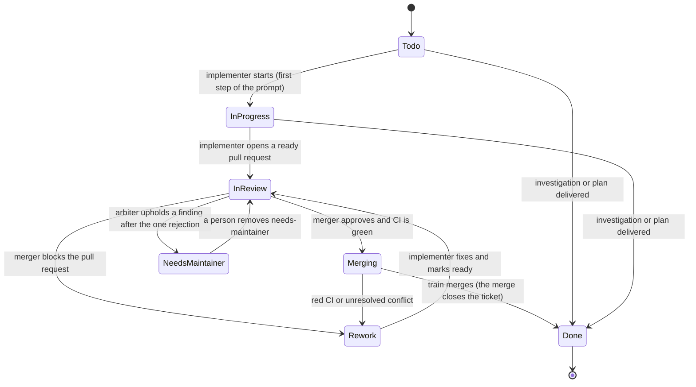
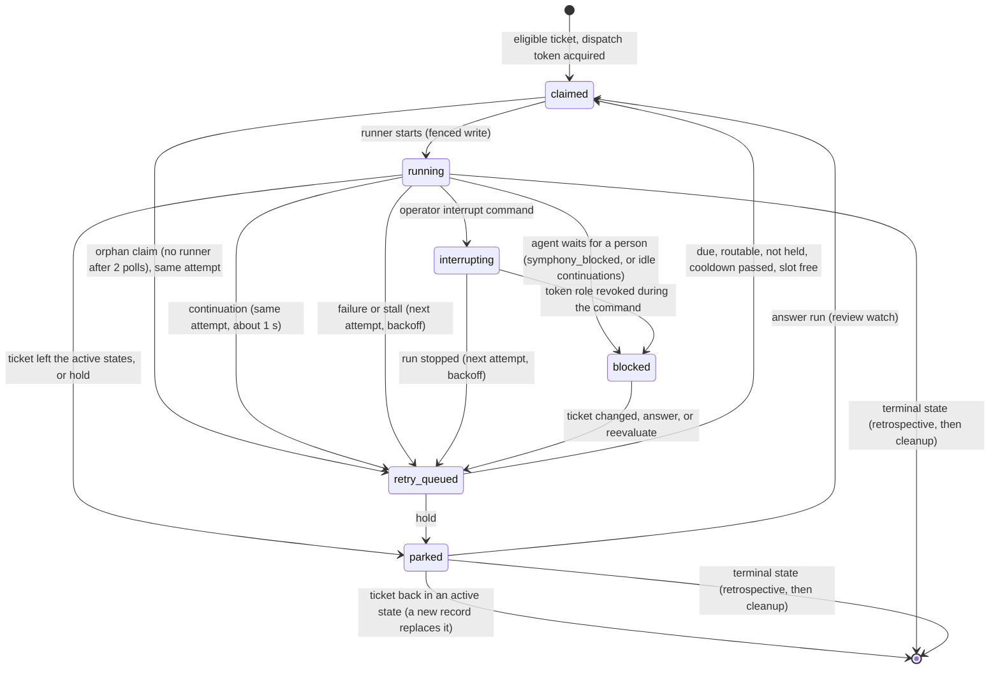

# Concepts

This document explains how Symphony works on a ticket. It defines the lifecycle, the attempts, the sessions, the agent roles and the special ticket types. The terms are in the [glossary](glossary.md).

## Contents

- [Ticket lifecycle](#ticket-lifecycle)
- [Attempts, continuations, retries and cooldown](#attempts-continuations-retries-and-cooldown)
- [Sessions and live events](#sessions-and-live-events)
- [Agent roles and team configuration](#agent-roles-and-team-configuration)
- [Holds and takeover](#holds-and-takeover)
- [Investigations](#investigations)
- [Multi-repository tickets](#multi-repository-tickets)
- [Planning tickets and sub-issues](#planning-tickets-and-sub-issues)
- [Monorepos and components](#monorepos-and-components)
- [Review watch](#review-watch)
- [Learnings](#learnings)

## Ticket lifecycle

### Tracker states

A ticket moves through the tracker states below. With Linear, the states are the team's workflow states. With GitHub, they are the options of the project's `Status` field. `WORKFLOW.md` gives their names (see [configuration.md](configuration.md#tracker)). The values here are the defaults.

| State | Set of states | Who works on the ticket | Who moves the ticket out |
|---|---|---|---|
| Todo | active | the implementer | the implementer (to In Progress) |
| In Progress | active | the implementer | the implementer (to In Review) |
| In Review | parked (`tracker.states.review`) | the merger | the merger (to Rework or Merging) |
| Rework | active (`tracker.states.rework`) | the implementer | the implementer (to In Review) |
| Merging | parked (`tracker.states.merging`) | the merge train | the merge itself (to Done), or the merger (to Rework) |
| Done, Canceled, Duplicate | terminal | nobody | — |

A state is **active** when it is in `tracker.active_states`. A state is **terminal** when it is in `tracker.terminal_states`. Any other state is **parked**: Symphony keeps the record and the workspace, but it does not run the implementer there. With GitHub, a closed issue is terminal in any state.

When the train merges the pull request, the ticket goes to Done:

- With Linear, the Linear–GitHub integration moves the ticket.
- With GitHub, the pull request closes the issue (`Closes owner/repo#n`), and the project's **Item closed** workflow sets the `Status` to Done.

Symphony validates the state names when it loads `WORKFLOW.md`:

- `rework` must be an active state.
- `review` and `merging` must not be active states.
- `done` must be a terminal state.



`NeedsMaintainer` is not a tracker state. It is the `needs-maintainer` label on the pull request while the ticket stays in In Review. [merger.md](merger.md) describes the review and the train.

### Labels

| Label | Where | Effect |
|---|---|---|
| `symphony` (each entry of `tracker.required_labels`) | ticket | The ticket is a candidate for dispatch only when it has all the required labels. The comparison ignores case. If a person removes a required label during an attempt, the daemon stops the attempt and keeps the workspace. |
| `repo:owner/name` | ticket | The repository of the work. Several labels make a multi-repository ticket. With GitHub, the label is optional: the default is the issue's own repository. See [Multi-repository tickets](#multi-repository-tickets). |
| `investigation` (`tracker.investigation_label`) | ticket | The ticket is an investigation. See [Investigations](#investigations). |
| `component:<name>` | ticket | At most one. Scopes the agent to a component of the primary repository. The name must match a component in `kubernetes.components`. See [Monorepos and components](#monorepos-and-components). |
| `runtime:<name>` | ticket | At most one. Overrides the workspace runtime from every other source. |
| `symphony-learnings` (`kubernetes.learning.learnings_label`) | pull request | The reflector puts it on each learnings pull request. |
| `reviewed`, `wait-ci`, `train-ci`, `review-requested`, `in-audit`, `review-bypass`, `needs-maintainer` | pull request | The merger uses these labels. See [merger.md](merger.md). |

### Eligibility and order

The daemon dispatches a ticket only when all of these conditions are true:

1. The ticket has a title.
2. The ticket is in an active state.
3. Every ticket that blocks it is in a terminal state. With Linear, a blocker is a `blocks` relation. With GitHub, it is a "blocked by" dependency.
4. The ticket has a repository: a valid `repo:` label, or the default (`kubernetes.default_repo` with Linear, the issue's own repository with GitHub).
5. The ticket has all the required labels.
6. With Linear, if `tracker.provider.assignee` is set, the ticket's assignee has that name.
7. No person holds the ticket.
8. Symphony does not track the ticket already, or tracks it only as parked.
9. A concurrency slot is free (`agent.max_concurrent_agents` and `agent.max_concurrent_agents_by_state`).
10. Admission is open (Symphony is not paused).

The daemon dispatches candidates in this order: priority 1 to 4 first (lower number first, no priority last), then the oldest creation time, then the identifier.

### Internal status

Symphony keeps one record for each tracked ticket. The record has a status that the tracker does not show.

| Status | Meaning |
|---|---|
| `claimed` | The daemon took the dispatch token. The runner did not start yet. |
| `running` | The runner owns the attempt. |
| `retry_queued` | A retry or a continuation waits for its time (`retry_at`). |
| `parked` | The ticket is not in an active state, or a person holds it. It uses no slot. |
| `interrupting` | An operator stopped the attempt with the `interrupt` command. The stop is not confirmed yet. |
| `blocked` | The attempt needs a person's decision: the retries ran out (`agent.max_failed_attempts`), or the agent waits for a person ([Waiting for a person](#waiting-for-a-person); the API shows `blocked_on_person`). The `reevaluate` command or a change on the ticket opens it again. |



When the ticket reaches a terminal state, the daemon does these steps in this order:

1. It starts the retrospective, if learning is on and the state is in `kubernetes.learning.reflect_on`.
2. It records the monthly metrics.
3. It stops the runner and the engine.
4. It deletes the workspace (the `before_remove` hook runs first).
5. It deletes the dispatch tokens, the record and the telemetry rollup.

When a ticket disappears from the tracker, gets a new assignee, or loses a required label, the daemon stops the attempt and forgets the record. It keeps the workspace.

## Attempts, continuations, retries and cooldown

An **attempt** is one implementer run with a number that starts at 1. A **dispatch** is one start of a runner. One attempt can have several dispatches.

### How an attempt ends

| Outcome | Cause | Next step |
|---|---|---|
| `done` | The ticket left the active states (for example, the agent moved it to In Review). | The daemon parks the record, or cleans it when the state is terminal. |
| `continuation` | The turn cap (`agent.max_turns`) was reached, the wall-clock guard (`kubernetes.runner.wallclock_guard_s`) fired, a person interrupted and did not write, or the ticket's repository set changed. | The same attempt runs again after about 1 second. The cooldown can delay it. |
| `blocked` | The agent called `symphony_blocked`, or `agent.max_idle_continuations` continuation turns in a row changed nothing. | The ticket waits for a person ([Waiting for a person](#waiting-for-a-person)). The attempt is not consumed. |
| `failed` | A fatal hook failed, the prompt did not render, the engine stream was silent for `engine.turn_timeout_ms`, an engine command failed, the model returned an error, or the GitHub credential renewal failed. | The attempt number increases. The retry waits for the backoff. |
| `fenced` | A newer dispatch owns the ticket. | Nothing. The runner exits with no effect. |

The runner checks the ticket state before each turn. Each turn after the first gets a short continuation prompt. The first turn gets the full prompt, plus the failure summary of the previous attempt when there is one.

### Waiting for a person

An agent that cannot go on without a person — an unanswered question, access it lacks, a decision that is not its own — calls the `symphony_blocked` host tool with the reason and what it needs (`answer`, `access`, `decision` or `other`). The run ends at the end of that turn with outcome `blocked`. Without this signal, each continuation would start again at the same point and repeat the same "blocked" message.

A safety net catches an agent that does not call the tool: when `agent.max_idle_continuations` (default 3) continuation turns in a row change nothing, the run ends the same way, with the reason "no progress in 3 continuation turns". A turn changes nothing when the workspace has no new commit and no file change (the runner compares `git rev-parse HEAD`, `git status --porcelain` and `git diff HEAD` of each repository before and after the turn) and the agent called no tool beyond reads: file reads and searches, tracker queries (not mutations), and shell commands that only read (`git status`, `git log`, `ls`, `cat`…). A turn in which a person wrote to the agent always counts as progress. The first turn of a dispatch counts only when the dispatch continues a clean exit. A continuation that cannot read the workspace counts as progress, so the net never cuts a run on missing evidence.

While the ticket waits:

- It holds no slot and gets no dispatch, retry or continuation.
- The daemon writes one short comment on the ticket that says what the agent waits for.
- The API and Tern show the status `blocked_on_person` with the reason.
- The record is in Redis, so a daemon restart keeps the ticket waiting.

The ticket gets one new run when a person acts: an answer to one of the agent's questions (on the ticket, in Slack, in Tern or with the CLI), a comment, a label or state change, or any other edit of the ticket after the daemon's comment. The `refresh` and `reevaluate` commands also open it again. A move out of the active states parks it as usual.

Symphony's own comments never count: when the ticket's update time moves, the daemon reads the comments written since its waiting comment and ignores those whose id Symphony recorded when it wrote them (`sym:<ns>:comment-own:<id>`), such as a question reminder. A label or state other than the ones the ticket had when it started waiting counts at once. An update that none of Symphony's own comments explains (for example, a person edits the description) counts too, because the tracker does not say who edited.

### Backoff

The backoff after a failed attempt $n$ is:

$$\text{backoff}(n) = \min\left(10\,\text{s} \times 2^{\,n-1},\ \texttt{agent.max\_retry\_backoff\_ms}\right)$$

With the default cap of 300 seconds, the waits are 10 s, 20 s, 40 s, 80 s, 160 s, and then 300 s.

### Stall detection

The runner writes a heartbeat at most once each 10 seconds while events arrive. If no event arrives for more than `agent.stall_timeout_ms` in two windows in sequence, the daemon stops the runner and queues a failed attempt. The daemon then writes a comment on the ticket, because the agent cannot report its own stop.

> **Caution:** The engine sends no events while a tool runs. Set `agent.stall_timeout_ms` longer than the longest command of your build (for example `npm ci`, `dotnet restore` or `docker pull`). Otherwise the daemon stops healthy attempts.

### Cooldown

A continuation exits cleanly, but the work is not complete. If the ticket did not change since that exit, the next dispatch waits for `kubernetes.redispatch_cooldown_s`. This rule stops an agent that loops with no progress. A change on the ticket (a comment, a state change, a label) ends the cooldown. The `refresh` command also ends the cooldown once for each queued run.

## Sessions and live events

Each attempt is a **session** with the ID `<issue_id>:<dispatch_seq>`. A merger agent has a session with the ID `merger:<pr>:<role>:<n>`. The session kinds are `implement`, `answer`, `review`, `oracle`, `arbiter`, `resolve` and `reflect`.

A session has these parts in Redis:

| Part | Content | Writer |
|---|---|---|
| Metadata | State, ticket, title, repository, model, turn, tokens, cost, last message | the runner or the merger |
| Event stream | Each engine RPC event in delta mode, plus Symphony events (`symphony.state`, `symphony.intent_applied`, `symphony.input_requested`, `symphony.input_resolved`) | the runner or the merger |
| Transcript | The engine's session entries, added at the end of each turn | the runner or the merger |
| Intents | Human requests | the API |

The session states are `starting`, `running`, `waiting_input`, `idle` and `ended`. Symphony keeps an ended session for 7 days.

### Intents

A person sends an intent from Tern, the CLI or MCP. The runner reads intents in a separate thread and applies each one at once, not at the end of a turn.

| Intent | Effect on the engine |
|---|---|
| `steer` | The text enters the current turn. |
| `follow_up` | The text becomes the next prompt after the current turn. |
| `interrupt` | The engine stops the current turn. The agent then waits for a person's message, up to `agent.input_timeout_ms`. |
| `answer` | The text answers the open `symphony_ask` question. |

The `auto` mode of a message selects `answer` when a question is open, `steer` when the session runs, and `follow_up` in other cases. An intent for an old dispatch has no effect.

### Questions to people

The agent asks a person with the `symphony_ask` host tool, naming who decides (`to`: someone on the ticket; the ticket's author by default). The session goes to `waiting_input`. The daemon posts the question on the ticket, as a comment that mentions that person and numbers the options, and in Slack with one button per option (Discord gets the text). Both say where to answer. A number picks an option; any other text is the answer as written. A person answers in one of these places:

| Where | What counts |
|---|---|
| The ticket | A reply to the question's comment. While the ticket has exactly one open question, also a reply to any other comment that Symphony wrote on the ticket (a progress note, a report), and a new top-level comment made after the question. |
| The ticket's open pull request | While the ticket has exactly one open question, a comment or a review with a body, made after the question. Needs the GitHub webhook. The review watch does not answer that comment again. |
| Slack | A button, or a reply in the question's thread. |
| Tern and the CLI | An answer to the run while it waits (`symphony answer`). |

With two or more open questions on a ticket, only a reply to a question's own comment counts on the ticket, and the pull request does not answer any of them. A comment that Symphony wrote never counts: Symphony records the id of each comment it writes on the tracker (the agent's, reports, the merger's, the questions), whatever account its API key belongs to. A person who runs Symphony with their own API key can thus still answer from that account. Comments by bots and by the GitHub App never count either. Symphony did not record the comments it wrote before this version: a reply to one of them does not count, and only a reply to the question's own comment does, as before. The first answer wins; the comment and the Slack message then say who answered and where.

If nobody answers in `agent.input_timeout_ms`, the agent gets the instruction to continue on its best judgment and record the assumption in the Workpad. A run never waits for a person without a limit, but the question stays open: after `agent.ask_reminder_ms` (2 hours) the person is reminded once, on the ticket and in Slack, with the question again. A later answer still reaches the work: as a message to the run that went on without it, or, when no run works on the ticket, by sending the ticket back to Rework, whose next attempt reads it. An open question closes after seven days. The details are in [internals §3](internals.md).

The [architecture document](architecture.md#live-chat-and-steer) shows the sequence. [api.md](api.md) gives the routes.

## Agent roles and team configuration

Symphony has ten agent roles:

| Agent role | Used by | Job |
|---|---|---|
| `implementer` | runner | Does the ticket's work and opens the pull request. |
| `reviewer` | merger | Reviews the pull request in parallel lanes. |
| `oracle` | merger | Checks the reviewers' findings on a different model. |
| `arbiter` | merger | Decides a blocking finding after the one rejection. |
| `developer` | merger, `symphony omp sync` | Resolves rebase conflicts in the train. It is also the model that `symphony omp sync` gives to a person's own `omp`. |
| `reflector` | reflector Job | Distills lessons from a finished ticket. |
| `probe` | merger | Checks each role's model and tools before a review. |
| `assistant` | assistant | Answers questions about the project in Slack and Discord. |
| `researcher` | assistant | Does discovery with the code, web search and MCP servers (`research …`). |
| `planner` | assistant | Turns a conversation into a proposal of tickets (`plan …`). |

The **team configuration** gives each agent role a provider, a model and a thinking level (`off`, `minimal`, `low`, `medium`, `high`, `xhigh`, `max`). It also holds shared `omp` settings. An admin publishes it from Tern (Admin › Models) or with `symphony admin config set`. Each publication is a new **generation**. The oracle and the arbiter must use a model that is different from the reviewer's model.

### Precedence

Each unit of work (an attempt, a retrospective, a merger pass) reads the team configuration once at its start. A publication thus reaches the next unit with no restart, and never changes a unit that runs.

| Consumer | First | Second | Third |
|---|---|---|---|
| Implementer, reflector | Published team configuration (generation 1 or higher) | `engine.provider` and `engine.model` in `WORKFLOW.md` | Built-in default |
| Merger roles | Published team configuration (generation 1 or higher) | `models` in the repository's `.symphony/merger.md` | Built-in default |

Each consumer reports the generation that it applied. Tern shows these reports, so an admin can see when a change reached every consumer. [providers.md](providers.md) explains the provider credentials.

## Holds and takeover

A person can **hold** a ticket to take the work from the agent.

1. Run `symphony takeover <ticket>`. The command holds the ticket, downloads the session transcript, gets the work branch and starts `omp --resume` on your machine.
2. Do the work.
3. Run `symphony release <ticket>` to give the ticket back to Symphony.

While a person holds a ticket:

- The daemon stops the running attempt at once and parks the record.
- The daemon removes the dispatch tokens and the gateway token, so an old runner cannot write.
- The workspace, the branch and the session stay.
- The ticket gets no dispatch, retry or continuation.
- The overview and the ticket list show `held: {by, reason, at}`.

The hold and the release are durable commands (`POST /v1/commands`, token role `operator`). In Tern, the session and ticket views offer **Take over** and **Return to Symphony**. MCP offers the `hold` and `release` tools.

## Investigations

A ticket with the investigation label (default `investigation`) asks for a written answer, not a code change.

- The runner gets a GitHub token with `contents: read`, `pull_requests: read` and `metadata: read` only. The agent cannot push or open a pull request.
- The prompt tells the agent to write the report as a ticket comment (or a linked document, when the tracker has documents), to make new tickets for the work that the report recommends, and then to move the ticket to Done.
- The tracker tool (`linear_graphql` or `github_graphql`) still works, because the runner executes it with the trusted-side credential.

## Multi-repository tickets

A ticket names its repositories with `repo:owner/name` labels. With GitHub, a ticket with no `repo:` label works in the issue's own repository, so the "no default" row below does not apply.

| Labels on the ticket | Result |
|---|---|
| One `repo:` label | The work is in that repository. |
| No `repo:` label, `kubernetes.default_repo` set | The work is in the default repository. |
| No `repo:` label, no default | The ticket is not dispatched (`no_repo_designation`). |
| A `repo:` label with characters other than letters, digits, `.`, `_`, `-` around one `/` | The ticket is not dispatched (`malformed_repo_designation`). Symphony does not use the default in this case. |
| `repo:` labels with two or more owners | The ticket is not dispatched. One GitHub App installation covers one owner only. |
| Two or more `repo:` labels with one owner | A multi-repository ticket. |

In a multi-repository ticket:

- The **primary** repository is the default repository when it is one of the labels. Otherwise it is the first label.
- The `after_create` hook gets `SYMPHONY_TARGET_REPO` (the primary), `SYMPHONY_TARGET_REPOS` (all, primary first, separated by spaces), and `SYMPHONY_BASE_BRANCHES` (space-separated `owner/name=branch` pairs for repos with a base branch override; absent when none).
- The default `WORKFLOW.md` clones the primary into `/workspace` and each other repository into `/workspace/repos/<name>`.
- The GitHub token covers all the ticket's repositories and no others.
- Each repository that changes gets its own branch and pull request. The merger Deployment of each repository reviews and merges the pull request of that repository.

If a ticket's repository set changes, Symphony does not reuse the workspace. The workspace pod and its session volume record the set they were built for. Before a dispatch reuses a workspace, the runner compares that record with the ticket's set (the labels, or the default repository). When they differ, it deletes the pod and the session volume and builds a new workspace, with a GitHub token for the new set and a new engine session. The session report notes the rebuild. When the set changes while a run works, the run ends at the next turn boundary as a continuation, and the next dispatch builds the new workspace. A workspace from before the record existed is still compared by the clone at `/workspace`.

## Planning tickets and sub-issues

A large ticket can become a tree of sub-issues. The agent makes them with the `symphony_create_issues` host tool, in one call:

| Tracker | Sub-issues |
|---|---|
| Linear | Sub-issues of the ticket, with the `repo:` labels and the required labels of the parent, ordered with `blocks` relations. |
| GitHub | GitHub sub-issues in the parent's repository, with the `repo:` labels and the required labels of the parent, added to the board in the first active state, ordered with "blocked by" dependencies. |

The tool is idempotent for each key: a second call with the same key does not make a second issue. The daemon dispatches a sub-issue only when all its blockers are terminal.

The agent attaches evidence with the `symphony_attach_evidence` host tool. Linear takes any file of at most 25 MB. GitHub has no public API to upload a file to an issue, so it takes only text evidence, as a collapsible comment of at most 65,536 characters.

With Linear, a later run reads the ticket's files back: `symphony_ticket_attachments` lists them and `symphony_fetch_attachment` downloads one into the workspace. The runner downloads it with the tracker credential, so the agent never holds it. At the end of each run the runner also attaches the run's session trace, redacted, and the session report links it ([security](security.md#session-traces-and-ticket-attachments)).

## Monorepos and components

A monorepo — one repository with several independently buildable services — poses two challenges for Symphony: the right SDK must be in the workspace, and only the relevant service's build and tests should run.

### Configuration

```yaml
kubernetes:
  # Every ticket targeting acme/app gets a dotnet10 workspace by default:
  repo_runtimes:
    acme/app: dotnet10

  # Components: independently deployable parts of a repository.
  components:
    acme/app:
      api: { path: api, runtime: dotnet10 }
      web: { path: web, runtime: node }
      shared: { path: lib/shared }           # inherits repo_runtimes, then agent_runtime
```

### Labels

A ticket that targets a specific component carries:

- `component:<name>` — at most one; must name a component defined for the ticket's primary repository.
- `runtime:<name>` — at most one; overrides the runtime from every other source.

Both are optional. A ticket with no component label works in the whole repository as before.

### Runtime precedence

| Priority | Source | Example |
|---|---|---|
| 1 | `runtime:` label on the ticket | `runtime:polyglot` |
| 2 | The component's `runtime` | `components.acme/app.api.runtime` |
| 3 | `repo_runtimes[primary]` | `repo_runtimes.acme/app` |
| 4 | `kubernetes.agent_runtime` | the global default |

`kubernetes.agent_image` (a single image override) still wins over everything when selecting the container image.

### Planner split

When the prompt asks the agent to split a large ticket and the repository defines components, the agent creates one sub-issue per component with the label `component:<name>`, ordered with `blocks` relations so producers land before consumers (for example, the API before the app that calls it). Each sub-issue runs in its own workspace pod with `kubernetes.sandbox` sizing and opens its own pull request against the base branch.

### Workspace environment

When a component applies:

| Variable | Value |
|---|---|
| `SYMPHONY_COMPONENT` | The component name, e.g. `api` |
| `SYMPHONY_COMPONENT_PATH` | The component path, e.g. `api` |

These are absent when no component label is set.

## Review watch

While the merger owns a ticket (In Review or Merging), the implementer does not run. A person can still ask a question on the pull request. When `review_watch.enabled` is true, the daemon starts an **answer run** when a new comment from a person arrives:

- A GitHub comment webhook makes the check immediate. Otherwise the daemon checks each `review_watch.interval_s`.
- The answer run uses `review_watch.answer_prompt` and at most `review_watch.answer_max_turns` turns.
- The answer run does not change the ticket state and does not consume an attempt.
- At the first check, the daemon records the current comments as already seen. It does not answer old comments.

## Learnings

When a ticket reaches a terminal state, the daemon starts a **retrospective** in a reflector Job:

1. The reflector collects the pull request diff, the review threads, the CI results, the Workpad and the attempt count.
2. The reflector model proposes at most three general lessons, or nothing.
3. Deterministic code curates the lessons against the current `AGENTS.md`: it adds, replaces and removes lessons, and it keeps the file within `kubernetes.learning.agents_md_budget_lines`.
4. A lesson that no retrospective used in `kubernetes.learning.decay_after_incorporations` changes decays and goes away.
5. If something changed, the reflector opens a pull request `learnings: <ticket>` on the branch `symphony/learnings/<ticket>`, with the `symphony-learnings` label. A recurring procedure becomes a skill in `.agents/skills/<name>/SKILL.md`.

The reflector never merges. A person must review and merge each learnings pull request.

Each ticket gets one retrospective at most. A nightly CronJob (`symphony-nightly-sweep`) starts the retrospectives that the daemon missed in the last 7 days. In local mode, the reflector does not run.
