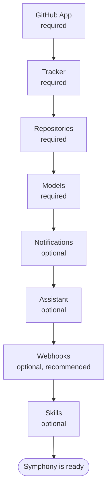

# Install

This document tells you how to install Symphony on Kubernetes (k3s on a VM, or another cluster), on kind for evaluation, and in local mode. A new install starts with only Redis and the API. The first-run setup (`symphony setup`, or **Setup** in Tern) then connects the tracker, GitHub, the models, the notifications and the webhooks. Each person then connects Tern.

## Contents

1. [Choose a mode](#1-choose-a-mode)
2. [Prerequisites](#2-prerequisites)
3. [Minimal install on Kubernetes](#3-minimal-install-on-kubernetes)
4. [Run the first-run setup](#4-run-the-first-run-setup)
5. [Make the GitHub App](#5-make-the-github-app)
6. [Prepare the tracker](#6-prepare-the-tracker)
7. [Prepare notifications (optional)](#7-prepare-notifications-optional)
8. [Prepare the model credentials](#8-prepare-the-model-credentials)
9. [Connect the webhooks](#9-connect-the-webhooks)
10. [Configure by hand (without setup)](#10-configure-by-hand-without-setup)
11. [The merger serves every repository](#11-the-merger-serves-every-repository)
12. [Install k3s on a VM](#12-install-k3s-on-a-vm)
13. [Evaluate on kind](#13-evaluate-on-kind)
14. [Expose the API with a Cloudflare Tunnel](#14-expose-the-api-with-a-cloudflare-tunnel)
15. [Make the team's API tokens](#15-make-the-teams-api-tokens)
16. [Connect Tern (each person)](#16-connect-tern-each-person)
17. [Run in local mode](#17-run-in-local-mode)
18. [Verify the installation](#18-verify-the-installation)
19. [Back up](#19-back-up)

## 1. Choose a mode

| Mode | Use it for | Isolation of agent code |
|---|---|---|
| Kubernetes (k3s on one VM, or any cluster) | Production | A pod for each ticket and a NetworkPolicy. The pod gets only the attempt's credentials: the role's model credential, a short-lived GitHub token for the ticket's repositories, and a telemetry token. |
| kind | Evaluation and end-to-end tests on a workstation | Same as Kubernetes |
| Local mode | Development of Symphony, or a dedicated machine with no Kubernetes | None. The agent runs as the host user. |

[architecture.md](architecture.md#deployment-on-kubernetes) shows the topology of each mode.

## 2. Prerequisites

| Item | Kubernetes | kind | Local mode |
|---|---|---|---|
| Python 3.12 or later and [uv](https://docs.astral.sh/uv/) | for the CLI | yes | yes |
| git | yes | yes | yes |
| Docker (to build images) | yes | yes | no |
| `kubectl` | yes | yes | no |
| Standalone [`kustomize`](https://kubectl.docs.kubernetes.io/installation/kustomize/) (for `kustomize edit`) | yes | no | no |
| kind | no | yes | no |
| Redis 7 or later | in the cluster (`deploy/redis.yaml`) | in the cluster | on the host, with the append-only file on |
| The pinned `omp` (`OMP_VERSION` in `src/symphony/edge.py`) | in the images | in the images | on the host |
| A CNI that enforces NetworkPolicy | yes (k3s, Calico or Cilium) | kind's default CNI | no |
| A GitHub App | yes (setup connects it) | optional | optional |
| A tracker: a Linear workspace and API key, or a GitHub Projects board | yes (setup connects it) | no (memory tracker) | optional |
| A model credential | yes | yes | yes |
| Tern | for each person | optional | optional |

Each workspace pod requests 2 CPUs and 4 GiB of memory by default (`kubernetes.sandbox`). Size the nodes for `agent.max_concurrent_agents` workspaces. Add up to 4 CPUs and 6 GiB for each merger.

Each runner Job pod (one for each running ticket) and each reflector Job pod requests 0.25 CPU and 512 MiB of memory, and its memory limit is 512 MiB (`kubernetes.runner.cpu`, `kubernetes.runner.memory_mib`). A local-stack test process that holds the daemon, the API and a runner peaked at about 110 MiB, so the default leaves room for long attempts. Raise `memory_mib` if a runner ends with `OOMKilled`.

Symphony marks runner pods, reflector pods and busy workspace pods with two annotations: `cluster-autoscaler.kubernetes.io/safe-to-evict: "false"` for the cluster autoscaler, and `karpenter.sh/do-not-disrupt: "true"` for Karpenter (EKS Auto Mode included). Karpenter reads only the second one. With them, neither autoscaler removes the node of an attempt in flight to consolidate. A workspace pod carries them while an attempt uses it; a released workspace drops them, so an idle workspace never holds a node. The runner releases its workspace when the attempt ends. When the runner cannot (it ran out of memory, lost its node, or the daemon stopped it for a stall or an interrupt), the daemon releases the workspace. These annotations have limits:

- A `kubectl drain` does not read them and evicts the pod. Drain a node when no attempt runs on it.
- Karpenter's forceful disruption (node expiry, node repair, Spot interruption) still removes the pods.
- A NodePool `terminationGracePeriod` limits how long a protected pod can block a drain. After it, Karpenter deletes the pod.

The single-replica control-plane pods of `deploy/` also carry `karpenter.sh/do-not-disrupt: "true"`: the merger, Redis, the daemon, the gateway and the assistant. A consolidation would restart their work in flight (reviews, the merge train, live chats, the MCP calls of every attempt) or stop every component while Redis moves. The API does not carry it: it keeps no state, and its clients reconnect. `deploy/` ships no PodDisruptionBudget, because one that allows no disruption of a single replica blocks every drain. The same limits apply: drains and forceful disruption still move these pods. Karpenter does not consolidate the nodes that run them.

## 3. Minimal install on Kubernetes

The minimal install needs two Secrets that you make yourself. Setup fills in everything else.

1. Optional: edit `WORKFLOW.md` before you build. The image ships it as `/opt/symphony/WORKFLOW.default.md` (`SYMPHONY_DEFAULT_WORKFLOW`). Setup seeds the ConfigMap `symphony-workflow` from it. Set `kubernetes.agent_images` and `kubernetes.agent_runtime` there. You can also change them later with `PUT /v1/workflow` (see [configuration.md](configuration.md#how-symphony-loads-workflowmd)). With the published images, change them later: the published image ships the repository's `WORKFLOW.md`.
2. Choose the images (see [Images](#images)): the published images of a release, or your own build:
   ```sh
   REGISTRY=registry.example.com/symphony scripts/build_images.sh
   ```
3. Point the orchestrator image at the published image or at your registry. This command needs the standalone `kustomize`:
   ```sh
   (cd deploy && kustomize edit set image symphony-orchestrator=ghcr.io/<owner>/symphony-orchestrator:<version>)
   ```
   This changes `deploy/kustomization.yaml`. Its `replacements` block then gives the runner and reflector Jobs the same image as the daemon.
4. Apply the manifests. They make the namespace, the empty integration Secrets and the empty ConfigMap `symphony-workflow`:
   ```sh
   kubectl apply -k deploy/
   ```
5. Copy the Secret template. `deploy/secrets.yaml` is ignored by git.
   ```sh
   cp deploy/secrets.example.yaml deploy/secrets.yaml
   ```
6. Make the first admin token (the bootstrap token). Keep it in your password manager:
   ```sh
   python3 -c "import secrets; print(f'sym_{secrets.token_hex(4)}_{secrets.token_urlsafe(32)}')"
   ```
7. Edit `deploy/secrets.yaml`:
   - In the Secret `symphony-api`, set `SYMPHONY_BOOTSTRAP_TOKEN` to the token. Leave out `GITHUB_WEBHOOK_SECRET`. Setup makes it.
   - Only for public preview links (`previews.public_links`, no Cloudflare Access; see [Preview links](#preview-links)), also set `SYMPHONY_PREVIEW_LINK_SECRET` there to a generated value: `python3 -c "import secrets; print(secrets.token_urlsafe(32))"`. Behind Access, leave it out.
   - In the Secret `model-provider`, set the host model credential (step 8). Remove this Secret if you store provider keys from Tern only.
8. Apply the Secrets:
   ```sh
   kubectl apply -n symphony -f deploy/secrets.yaml
   ```
9. Wait for the API. It starts with only Redis and the Secret `symphony-api`:
   ```sh
   kubectl -n symphony rollout status deploy/symphony-api
   ```
10. Reach the API from your machine:
    ```sh
    kubectl -n symphony port-forward svc/symphony-api 8080
    ```
11. Install the CLI (step 16, item 1) and log in with the bootstrap token. Paste the token on standard input:
    ```sh
    symphony login --url http://127.0.0.1:8080 --token -
    ```
12. Run the setup (step 4):
    ```sh
    symphony setup
    ```
    Or open **Setup** in Tern. Tern opens it by itself for an admin while setup is incomplete.

Until setup is complete, nothing crash-loops:

- The daemon keeps its heartbeat and idles. It logs `daemon_setup_incomplete` at most once a minute. The overview shows `daemon.setup: "incomplete"`.
- Each merger idles. It logs `merger_not_configured` at most once a minute, with the names it lacks.
- The nightly sweep, the runner and the reflector Jobs end with `sweep_setup_incomplete`, `runner_setup_incomplete` and `reflector_setup_incomplete`.

[troubleshooting.md](troubleshooting.md#setup-is-incomplete) explains each event.

`deploy/kustomization.yaml` applies these objects:

| File | Objects |
|---|---|
| `namespace.yaml` | Namespace `symphony` |
| `rbac.yaml` | ServiceAccounts, Roles and RoleBindings |
| `providers.yaml` | Empty Secret `symphony-providers` |
| `integrations.yaml` | Empty Secrets `linear-api-key`, `github-app`, `symphony-slack`, `symphony-discord`, and the empty ConfigMap `symphony-workflow` |
| `redis.yaml` | Redis Deployment, Service and PVC (5Gi) |
| `api.yaml` | `symphony-api` Deployment and Service (8080), and the ConfigMap `symphony-api-config` (`SYMPHONY_PUBLIC_URL`) |
| `gateway.yaml` | `symphony-gateway` Deployment and Service (8090) |
| `daemon.yaml` | `symphony-daemon` Deployment |
| `merger.yaml` | `symphony-merger` Deployment (label `merger: default`) and PVC (40Gi) |
| `nightly-sweep.yaml` | CronJob `symphony-nightly-sweep` |
| `networkpolicy.yaml` | NetworkPolicies ([security.md](security.md#network-policy)) |

The integration Secrets carry no data on purpose. The API may only patch Secrets that exist, because Kubernetes cannot limit `create` to a name. A later `kubectl apply -k deploy/` leaves the values that setup wrote alone.

> **Caution:** Do not add data to `deploy/providers.yaml` or `deploy/integrations.yaml`. A later apply would delete the keys that admins saved.

The merger in `deploy/merger.yaml` serves every repository with a `.symphony/merger.md` policy file, plus the default repository and any listed in `SYMPHONY_MERGER_REPO`. See [step 11](#11-the-merger-serves-every-repository).

### Images

Symphony has two image families. Both have the same `omp` pin, `OMP_VERSION` in `src/symphony/edge.py`.

| Image | Runs |
|---|---|
| `symphony-orchestrator` | API, gateway, daemon, mergers, assistant, sweep, runner and reflector Jobs |
| `symphony-agent` (`node`, `dotnet9`, `dotnet10`, `polyglot`) | Workspace pods |

#### Published images

Each release tag `v<version>` publishes multi-arch images (`linux/amd64` and `linux/arm64`) on the GitHub Container Registry of the repository owner. The version is the `version` in `pyproject.toml`, and `symphony --version` prints it.

| Image | Tags |
|---|---|
| `ghcr.io/<owner>/symphony-orchestrator` | `<version>` and `latest` |
| `ghcr.io/<owner>/symphony-agent` | `<runtime>-<version>` and `<runtime>`, for example `node-0.1.0` and `node` |

Each image has the OCI labels (`org.opencontainers.image.version`, `revision`, `source`), an SBOM and a provenance attestation. Use a version tag, not `latest`, so that every pod runs the same code:

```sh
(cd deploy && kustomize edit set image symphony-orchestrator=ghcr.io/<owner>/symphony-orchestrator:<version>)
```

Then point the workspace images at the same release in the workflow (Admin in Tern, or `PUT /v1/workflow`):

```yaml
kubernetes:
  agent_images:
    node: ghcr.io/<owner>/symphony-agent:node-<version>
    dotnet9: ghcr.io/<owner>/symphony-agent:dotnet9-<version>
    dotnet10: ghcr.io/<owner>/symphony-agent:dotnet10-<version>
    polyglot: ghcr.io/<owner>/symphony-agent:polyglot-<version>
```

The packages are private on the first push. Make them public in the package settings on GitHub, give the cluster an image pull Secret, or mirror the images to a registry the cluster already reads.

#### Mirror to AWS ECR (optional)

When the packages must stay private (an organization can disable public packages) and the cluster runs on AWS, the `images` workflow can copy each release to ECR, where the nodes pull with their own role:

1. Make the ECR repositories `symphony-orchestrator` and `symphony-agent` in the cluster's account and region.
2. Make an IAM role that GitHub OIDC can assume only for this repository's release tags (subject `repo:<owner>/<repo>:ref:refs/tags/v*`), allowed to push to those two repositories (`ecr:GetAuthorizationToken`, the layer and `PutImage` actions, `ecr:DescribeImages`, `ecr:BatchGetImage`).
3. Set the repository secrets `MIRROR_REGISTRY` (`<account>.dkr.ecr.<region>.amazonaws.com`), `MIRROR_AWS_ROLE_ARN` and `MIRROR_AWS_REGION`. Secrets, not variables: the values stay masked in the workflow logs, which are public in a public repository.

Each run then copies the version tags (`<version>`, `<runtime>-<version>`), not the rolling ones, with `docker buildx imagetools create`. The digests are the same as on GHCR. A tag that already exists in ECR is skipped, so immutable ECR tags work. Without the secrets the step is skipped.

To publish manually without creating a release tag, open **Actions › images › Run workflow**.
Choose the branch or tag to build and enter its `pyproject.toml` version without the `v` prefix.
The build rejects a version mismatch. With the GitHub CLI, run:

```sh
gh workflow run images.yml --ref main -f version=0.1.0
```

Manual runs publish the same version and rolling tags (`latest`, `node`, `dotnet9`, `dotnet10`, `polyglot`).
They can overwrite those tags. They do not create a Git tag or a GitHub Release.

#### Build the images

`scripts/build_images.sh` builds both families. It reads the `omp` pin from `src/symphony/edge.py`.

| Variable | Default | Effect |
|---|---|---|
| `REGISTRY` | empty | Push to `<REGISTRY>/symphony-*` after the build. |
| `TAG` | `latest` | The tag of the orchestrator image. |
| `VERSION` | empty | A release. It must equal the version in `pyproject.toml`. Also tags `symphony-orchestrator:<VERSION>` and `symphony-agent:<runtime>-<VERSION>`. |
| `RUNTIMES` | `node dotnet9 dotnet10 polyglot` | The agent runtimes to build. |
| `IMAGES` | `orchestrator agent` | The image families to build. |
| `PLATFORM` | empty | The target platforms, for example `linux/amd64` when you build on an arm64 machine. Two or more (`linux/amd64,linux/arm64`) build with `docker buildx build --push`, with an SBOM and provenance. They need `REGISTRY` and a buildx builder that can push. |
| `WITH_DOCKER` | `1` | Install the Docker engine in the agent images. |
| `SOURCE_URL` | empty | The `org.opencontainers.image.source` label, for example the repository URL. |

To build for x86 nodes on an arm64 machine:

```sh
REGISTRY=registry.example.com/symphony PLATFORM=linux/amd64 scripts/build_images.sh
```

To build multi-arch images like a release:

```sh
docker buildx create --use
REGISTRY=registry.example.com/symphony VERSION=0.1.0 PLATFORM=linux/amd64,linux/arm64 scripts/build_images.sh
```

## 4. Run the first-run setup

Setup has eight steps. Four are required. The API verifies each value against the real service before it saves it. A value that fails is not saved. Only an admin can save a step. Any token can read the checklist (`GET /v1/setup`, or `symphony setup --status`).

The API lists the steps in this order: tracker, GitHub App, repositories, models, notifications, assistant, webhooks, skills. The wizard does the GitHub App first, because the GitHub tracker and the repository check use it.



| Step | What you give | What the API verifies | Where it is saved |
|---|---|---|---|
| GitHub App (`github_app`) | App ID, installation ID, private key (step 5) | It mints an installation token, lists the repositories and reports each missing permission | Secret `github-app` |
| Tracker (`tracker`) | Linear: the API key and a team key or project slug. GitHub: the owner, the project number and the status field (step 6) | Linear: the key and the team or project. GitHub: the project and the options of its status field, with the App token | Secret `linear-api-key` (Linear), and the `tracker` section of the published WORKFLOW |
| Repositories (`repositories`) | The default repository, or none (each ticket then names its repository with a `repo:` label) | The App is installed on the repository | `kubernetes.default_repo` in the published WORKFLOW |
| Models (`models`) | A provider API key for each role that has no credential (step 8) | Each role in the team configuration has a stored key or a host credential | Secret `symphony-providers` (`/v1/admin/providers`) |
| Notifications (`notifications`) | Slack and Discord, each a bot token and channel or a webhook URL (step 7) | A test message reaches each new channel | Secrets `symphony-slack` and `symphony-discord` |
| Assistant (`assistant`, optional) | The Slack app-level token and the channels, the Discord channels, the repositories it reads (step 7) | Slack: `apps.connections.open` with the app token and `auth.test` with the bot token. Discord: the bot has the Message Content Intent | Secret `symphony-slack` (`SLACK_APP_TOKEN`), and the `assistant` section of the published WORKFLOW |
| Webhooks (`webhooks`) | Nothing. The API makes the secrets (step 9) | A signed delivery arrived from each source in use | Secrets `linear-api-key` (`LINEAR_WEBHOOK_SECRET`) and `symphony-api` (`GITHUB_WEBHOOK_SECRET`) |
| Skills (`skills`, optional) | A skill source: the repository, and if you want the path, the ref, the roles and the target repositories ([skills.md](skills.md)) | The save checks only the entry's form. The checklist then resolves each source to a commit with the App token: `done` when a source has skills, `error` with the first source that fails | `skills.sources` in the published WORKFLOW |

Setup is complete when every required step is `done`. The repositories step is `done` only when each repository has a merger that runs. The single merger Deployment serves all repositories automatically (step 11).

In Kubernetes, a saved credential reaches the components through a restart. The API restarts the Deployments that read the Secret: the daemon, the mergers, the assistant, and the API itself last. It finds the mergers by their Deployment labels (`app: symphony`, `component: merger`), so an added merger Deployment needs those labels on its `metadata`. Each saved step prints the restarted Deployments. Runner and reflector Jobs read the Secrets when they start, so they need no restart.

[cli.md](cli.md#first-run-setup-symphony-setup) lists each `symphony setup` command. [api.md](api.md#setup) lists the routes.

## 5. Make the GitHub App

Symphony uses one GitHub App for the runners, the mergers, the reflector and the GitHub tracker.

1. In your organization, open **Settings › Developer settings › GitHub Apps**.
2. Select **New GitHub App**.
3. Set the permissions in the tables below.
4. Subscribe to the webhook events below.
5. Turn the webhook off for now. Step 9 gives you the URL and the secret. Until then, the daemon and the mergers use their safety polls (15 s and 30 s).
6. Make the App.
7. Make a private key (`.pem`).
8. Install the App on the repositories that Symphony works on, and only on those.
9. Keep the **App ID**, the **Installation ID** (the number at the end of the installation URL) and the private key file for setup:
   ```sh
   symphony setup github-app --app-id 123456 --installation-id 7890123 --private-key-file app.pem
   ```

**Repository permissions.** The setup check requires each of these levels. It reports a missing one as, for example, `issues: write`.

| Permission | Level | Used for |
|---|---|---|
| Contents | Read and write | Clone, push branches, rebase in the train, delete merged branches, learnings pull requests |
| Pull requests | Read and write | Open pull requests, ready and draft, review comments, merge |
| Issues | Read and write | Labels and comments (the API treats pull requests as issues). With the GitHub tracker, also the tickets: comments, the Workpad, labels, sub-issues, dependencies, close and reopen |
| Checks | Read | CI state of a head |
| Commit statuses | Read | CI state of a head |
| Actions | Read and write | Read job logs, rerun failed jobs, cancel batch runs |
| Metadata | Read | Required by GitHub |
| Projects | Read and write | Only with `tracker.kind: github` on a project that a user owns: read and move the board items |

**Organization permissions** (only with `tracker.kind: github` on a project that an organization owns)

| Permission | Level | Used for |
|---|---|---|
| Projects | Read and write | Read the board, move items between Status options, add sub-issues to the board |

With the GitHub tracker, the check needs one of the two Projects permissions. It reports a missing one as `organization_projects: write`.

**Workflows.** Symphony does not ask for the Workflows permission. The token of a workspace never has it, even when the App grants it. So GitHub rejects a push from an agent that changes a file under `.github/workflows/`. A person must make such a change.

**Webhook events:** `pull_request`, `pull_request_review`, `pull_request_review_comment`, `issue_comment`, `check_suite`, `check_run`, `workflow_run` and `push`. With `tracker.kind: github`, also `issues`, `sub_issues`, `issue_dependencies` and `projects_v2_item`. GitHub sends `projects_v2_item` only for projects that an organization owns. Draft items and pull requests on the board do not wake the daemon.

**Labels.** Make these labels once in each repository: `reviewed`, `wait-ci`, `train-ci`, `review-requested`, `in-audit`, `review-bypass`, `needs-maintainer`, `wait-approval`, and `symphony-learnings` (or your `kubernetes.learning.learnings_label`).

### Branch protection of `main`

1. Require a pull request before a merge.
2. Do not require human approvals. The merger agents do the review. (`require_human: true` in `.symphony/merger.md` changes this for one repository.)
3. Require the CI status checks.
4. Restrict who can push and merge.
5. Include the Symphony GitHub App in the list of who can push and merge.
6. Do not require "branch up to date". The train rebases and merges only the tested head.

### CI concurrency group

The train puts the label `train-ci` on a pull request **before** it pushes the rebase. Your CI workflow must put that run in its own concurrency group and must not start on `labeled`. Otherwise a label change or an old run of the author cancels the run that the train waits for.

```yaml
on:
  pull_request:
    types: [opened, synchronize, reopened, ready_for_review] # no "labeled"
  push:
    branches: [main]

concurrency:
  # Pull request: one group for each pull request, a separate one while the train owns the head.
  # main: one group for each commit, so no run on main is cancelled.
  group: >-
    ci-${{ github.workflow }}-${{ github.event.pull_request.number || github.sha }}${{
    contains(github.event.pull_request.labels.*.name, 'train-ci') && '-train' || '' }}
  cancel-in-progress: ${{ github.event_name == 'pull_request' }}
```

[merger.md](merger.md) explains the repository policy file `.symphony/merger.md`.

## 6. Prepare the tracker

Use Linear or a GitHub Projects (v2) board. Setup writes `tracker.kind` and the board scope into the published WORKFLOW. It also lists the states it found on the board, and warns about each WORKFLOW state that is not there (`state_missing`).

### Linear

1. Make the team states. The defaults are `Todo`, `In Progress`, `In Review`, `Rework`, `Merging`, `Done`, `Canceled` and `Duplicate`. Other names need `tracker.states` in `WORKFLOW.md` (see [configuration.md](configuration.md#tracker)).
2. Turn on the Linear GitHub integration, so that a merged pull request moves its ticket to Done.
3. Make an API key for a service account with access to the team (**Settings › Security & access › Personal API keys**).
4. Make the label `symphony` (or each label in `tracker.required_labels`).
5. Make a label `repo:owner/name` for each repository.
6. Run the tracker step. The CLI reads the key from standard input or a hidden prompt:
   ```sh
   symphony setup tracker --kind linear --team ENG
   ```
7. Step 9 connects the Linear webhook.

### GitHub Projects board

With the GitHub tracker, the tickets are issues on one project board. The GitHub App is the only tracker credential. Set up the App first: without it, the tracker step fails with `github_app_required`.

1. In the organization, make a project (**Projects › New project**).
2. Keep the project number: the `N` in `https://github.com/orgs/<owner>/projects/N`.
3. Open the project's `Status` field. Make one option for each state in `WORKFLOW.md`: `Todo`, `In Progress`, `In Review`, `Rework`, `Merging`, `Done`, `Canceled` and `Duplicate`. The names must match `tracker.active_states`, `tracker.terminal_states` and `tracker.states`. The comparison ignores case.
4. Optional: add a field `Priority`. Use a single-select field (the first option is the most urgent) or a number field.
5. Keep the project workflow **Item closed** on, with the value `Done`. Then a merged pull request that closes its issue moves the ticket to Done.
6. Give the GitHub App the Projects permission and the webhook events of step 5.
7. Install the App on every repository whose issues are on the board.
8. Make the label `symphony` (or each label in `tracker.required_labels`) in each of these repositories.
9. Add the issues to the board. A ticket's repository is the issue's own repository. A `repo:owner/name` label changes it.
10. Run the tracker step:
    ```sh
    symphony setup tracker --kind github --owner acme --project-number 1 --status-field Status
    ```
    [`docs/examples/WORKFLOW.github.md`](examples/WORKFLOW.github.md) is a complete WORKFLOW for this tracker.

When Symphony moves a ticket to a terminal state, it closes the issue: `completed` for `tracker.states.done`, `not_planned` for the other terminal states. A move to any other state reopens it.

[configuration.md](configuration.md#github-tracker) explains how Symphony reads the board.

## 7. Prepare notifications (optional)

Symphony can send notifications to Slack, to Discord, or to both. Each event goes to every configured channel. With no channel, Symphony sends no notifications. The notifications step sends a test message to each new channel first. It saves nothing when the test fails (`notification_unverified`).

### Slack

Use one of the two methods. When both are set, the bot wins.

To use a bot (recommended):

1. Make an app at api.slack.com.
2. Add the bot scope `chat:write`.
3. Install the app in the workspace.
4. Invite the bot to the channel (`/invite @<bot name>`).
5. Keep the bot token (`xoxb-…`) and the channel ID (`C…`).
6. Run `symphony setup notifications slack --channel C0123456789`. The CLI reads the token from standard input or a hidden prompt.

To use an incoming webhook:

1. Turn on **Incoming Webhooks** in the app.
2. Run `symphony setup notifications slack --webhook`. The CLI reads the webhook URL from standard input or a hidden prompt.

The values go in the Secret `symphony-slack`.

### Discord

Use one of the two methods. When both are set, the bot wins.

To use a channel webhook:

1. In Discord, open the channel settings.
2. Open **Integrations › Webhooks** and make a webhook.
3. Copy the webhook URL (`https://discord.com/api/webhooks/<id>/<token>`).
4. Run `symphony setup notifications discord --webhook`.

To use a bot:

1. Make an application in the Discord Developer Portal.
2. Add a bot to the application.
3. Copy the bot token.
4. Invite the bot to your server.
5. Give the bot the permissions **View Channel** and **Send Messages** in the channel.
6. Turn on Developer Mode in Discord, and copy the channel ID.
7. Run `symphony setup notifications discord --channel-id 123456789012345678`.

The values go in the Secret `symphony-discord`.

### Mentions

For mentions, map GitHub logins to user IDs in `WORKFLOW.md`. A Slack member ID starts with `U`. A Discord user ID is a number: turn on Developer Mode, then select **Copy User ID** on the user. Quote it.

```yaml
notify:
  users:
    slack:
      example-login: U01234567
    discord:
      example-login: "123456789012345678"
```

The runner sends `input_requested` when an agent asks a person a question. The merger sends `back_to_author`, `needs_maintainer`, `batch_split`, `main_red`, `main_green` and `run_error`.

Symphony sends an identical message to a channel at most once in 60 seconds. A notification failure never stops a run. On Discord, a message has at most 2000 characters, and only the mapped user can be pinged (never a role, `@everyone` or `@here`).

With a bot, each notification about a ticket also goes as a direct message to the ticket's assignee, and a question to the person who decides, when `notify.users` maps them (by GitHub login, e-mail or tracker name). Slack needs no other scope than `chat:write`; turn on the App Home **Messages Tab** so people can reply. On Discord, the person must share a server with the bot and accept direct messages from its members. `notify.direct_messages: false` keeps notifications in the channel only ([configuration.md](configuration.md#notify)).

### The assistant on Slack and Discord (optional)

The assistant is a chat bot that answers questions and plans tickets ([assistant.md](assistant.md)). It reuses the bot of the notifications step, so set up a Slack bot or a Discord bot above first. A webhook is not enough. Either transport alone works.

#### Slack app

In the same Slack app as the notifications bot:

1. Open **Socket Mode** and turn it on.
2. Make an app-level token with the scope `connections:write`. Keep it (`xapp-…`).
3. Open **OAuth & Permissions**. Add these bot scopes:

   | Scope | Why |
   |---|---|
   | `chat:write` | Post, edit (`chat.update`) and send private answers (`chat.postEphemeral`) |
   | `app_mentions:read` | Receive `app_mention` |
   | `im:history` | Receive DMs (`message.im`) and read DM threads |
   | `channels:history` | Receive thread replies in public channels, and read a thread for context (`conversations.replies`) |
   | `groups:history` | Read a thread in a private channel |
   | `mpim:history` | Read a thread in a group DM |
   | `files:read` | Optional. Download attached images so the assistant can see them ([assistant.md](assistant.md#attachments)). Without it, file names still appear but the images are not read |
   | `files:write` | Post files the assistant made in its sandbox (`share_file`, [assistant.md](assistant.md#sharing-files)): `files.getUploadURLExternal` and `files.completeUploadExternal`. Without it, `share_file` fails with `missing_scope` |

4. Open **Event Subscriptions** and turn it on. Subscribe to the bot events `app_mention`, `message.im` and `message.channels`. With Socket Mode, no request URL is needed.
5. Open **Interactivity & Shortcuts** and turn it on, for the proposal buttons. No request URL is needed.
6. Open **App Home**. Turn on the **Messages Tab**, and allow users to send messages, so people can DM the bot.
7. Reinstall the app in the workspace, so the new scopes apply.
8. Invite the bot to each channel where it answers (`/invite @<bot name>`), and copy the channel IDs.

#### Discord application

In the same Discord application as the notifications bot:

1. Open **Bot**. Turn on **Message Content Intent**. Without it, setup fails with `message_content_intent_missing`.
2. Invite the bot with the scope `bot`. Give it the permissions **View Channels**, **Send Messages**, **Send Messages in Threads** and **Attach Files** (for `share_file`) in each channel where it answers.
3. Copy the channel IDs (Developer Mode, then **Copy Channel ID**).

The bot token stays `DISCORD_BOT_TOKEN`. The assistant connects to the Gateway with the intents `GUILDS`, `GUILD_MESSAGES`, `DIRECT_MESSAGES` and `MESSAGE_CONTENT`.

#### Turn it on

```sh
symphony setup assistant --slack-channel C0123ABCD --discord-channel 123456789012345678 --repo acme/app
```

The CLI reads the Slack app-level token from standard input or a hidden prompt. The API checks both apps, publishes `assistant:` in WORKFLOW and restarts `symphony-assistant`. Run `symphony assistant status` to see that it is connected.

Only people mapped in `notify.users` ([Mentions](#mentions)) can create tickets from a proposal.

## 8. Prepare the model credentials

Symphony supports provider API keys, unauthenticated custom endpoints, and host cloud credentials. The models step lists each role with its credential: `stored` (a key saved through the API), `host` (a key in the Secret `model-provider`) or none. The wizard stores provider API keys for you. Tern does the same in **Symphony: Admin › Providers**.

For a host credential, fill the Secret `model-provider` in step 3. For the built-in team configuration (Amazon Bedrock), use `AWS_REGION` and `AWS_BEARER_TOKEN_BEDROCK`. The API reads only which keys exist in that Secret, never their values.

[providers.md](providers.md) explains all options, Bedrock IAM, and the precedence.

## 9. Connect the webhooks

Webhooks make dispatch fast. Without them, the safety polls still work.

1. Give the API a public address (for example step 14).
2. If the API is behind a proxy, or the webhook URLs must use a public host, set `SYMPHONY_PUBLIC_URL` in the ConfigMap `symphony-api-config`. Without it, the URLs use the address of the request. Then restart the API:
   ```sh
   kubectl -n symphony patch configmap symphony-api-config --type merge -p '{"data":{"SYMPHONY_PUBLIC_URL":"https://symphony.example.com"}}'
   kubectl -n symphony rollout restart deploy/symphony-api
   ```
3. Run the webhooks step:
   ```sh
   symphony setup webhooks
   ```
   It prints the Linear and GitHub URLs, the secrets and the GitHub events. **Symphony shows the secrets only once.** A second call fails with `webhooks_exist`. Use `--rotate` to replace them.
4. In the GitHub App, turn the webhook on. Enter the GitHub URL (`<public URL>/v1/webhooks/github`) and the GitHub secret.
5. With Linear, open **Settings › API › Webhooks** and make a webhook. Enter the Linear URL (`<public URL>/v1/webhooks/linear`) and the Linear secret. Select the events **Issue** and **Comment**.
6. Make a change on the board or a pull request. The webhooks step is `done` after one signed delivery from each source in use.

## 10. Configure by hand (without setup)

You can fill the integration Secrets yourself. Setup is better, because it verifies each value first.

1. Copy `deploy/integrations.example.yaml` outside the repository.
2. Fill in only what you use.
3. Replace the Secrets. Use `kubectl replace`, never `kubectl apply`:
   ```sh
   kubectl replace -n symphony -f integrations.yaml
   ```
   `kubectl apply` records the values in its last-applied annotation. The next `kubectl apply -k deploy/` then compares with the empty Secrets in `deploy/integrations.yaml` and erases them. That includes values that setup wrote later.
4. Restart the consumers:
   ```sh
   kubectl -n symphony rollout restart deploy/symphony-api deploy/symphony-daemon deploy/symphony-merger
   ```
5. Publish `WORKFLOW.md` with the tracker scope and `kubernetes.default_repo`. Use `PUT /v1/workflow`, or `scripts/sync_workflow.sh` for recovery:
   ```sh
   scripts/sync_workflow.sh WORKFLOW.md symphony
   ```

[configuration.md](configuration.md#kubernetes-secrets) lists every Secret and key.

## 11. The merger serves every repository

One merger Deployment serves every repository that has a `.symphony/merger.md` policy file. The merger discovers repositories automatically from three sources:

1. `SYMPHONY_MERGER_REPO` (comma-separated list, optional extra repos).
2. The default repository in `WORKFLOW.md` (`kubernetes.default_repo`).
3. Every non-archived repository the daemon's discovery marks `merger_policy: true`.

A reconcile loop (every ~60 s) starts loops for new repositories and stops those that disappear. Each repository gets its own coordinator heartbeat, train, main-watch and review workers, so `GET /v1/merger` and the Tern Merger tab list every served repository.

You no longer need one Deployment per repository. The single `deploy/merger.yaml` handles all repositories. To add a repository, commit a `.symphony/merger.md` file to that repository, and the merger picks it up on the next reconcile.

### Concurrency

| Variable | Default | Effect |
|---|---|---|
| `SYMPHONY_MERGER_CONCURRENCY` | `8` | Maximum concurrent agent review steps across all repositories. A process-wide semaphore. |
| `SYMPHONY_MERGER_REVIEWERS` | `2` | Review worker threads per repository. |

Each review step runs one or more agents (reviewer, oracle, arbiter). The semaphore limits how many run at the same time across the entire process. Idle workers do not hold a slot.

### Resources

Scale resources with the concurrency. Each concurrent review can use up to 1 CPU and 2 GiB for the agent and its tools.

| Concurrency | Suggested requests | Suggested limits |
|---|---|---|
| 4 | 1 CPU / 2 GiB | 4 CPU / 8 GiB |
| 8 (default) | 2 CPU / 4 GiB | 8 CPU / 16 GiB |
| 16 | 4 CPU / 8 GiB | 16 CPU / 32 GiB |

The merger's memory grows with the number of repositories (each keeps a git mirror and worktrees) and with the number of concurrent reviews (each agent session loads the diff and the codebase into memory). Start with the defaults and raise them when reviews get `OOMKilled`.

### Workdir layout

The first/default repository (`kubernetes.default_repo` or the first entry in `SYMPHONY_MERGER_REPO`) uses the existing flat layout (`<workdir>/mirror`, `<workdir>/wt`, `<workdir>/sessions`) so an existing mirror is not re-cloned on upgrade. Every other repository lives under `<workdir>/repos/<owner>__<name>/` with the same subdirectories.

### Legacy: extra repositories via env

`SYMPHONY_MERGER_REPO` accepts a comma-separated list of repositories. Use this to add repositories that do not have a `.symphony/merger.md` file yet, or to pin specific repositories without depending on discovery. The env value is merged with the other sources; duplicates are ignored.

## 12. Install k3s on a VM

One VM is enough to start. k3s includes containerd, `local-path` storage and a NetworkPolicy controller.

1. Make a VM with Ubuntu 24.04, 8 vCPUs and 32 GiB of memory or more, and a 200 GiB disk or more.
2. Allow only SSH into the VM. The API goes out through the tunnel (step 14).
3. Install k3s:
   ```sh
   curl -sfL https://get.k3s.io | sh -s - --disable traefik --write-kubeconfig-mode 0600
   ```
4. Copy the kubeconfig:
   ```sh
   mkdir -p ~/.kube && sudo cat /etc/rancher/k3s/k3s.yaml > ~/.kube/config
   ```
5. Get the images to the VM. Use a registry (step 3), or import the images into the containerd of k3s:
   ```sh
   docker save symphony-orchestrator:v1 symphony-agent:node | ssh <vm> 'sudo k3s ctr images import -'
   ```
   With imported images, use a tag other than `latest` (for example `TAG=v1`). With `latest`, the kubelet tries to pull the image.
6. Do steps 3 and 4.
7. Back up the Redis volume (step 19). On k3s it is under `/var/lib/rancher/k3s/storage/`.

## 13. Evaluate on kind

`scripts/e2e_kind.sh` makes a kind cluster, builds and loads the images, deploys Symphony, runs a real attempt and keeps a port-forward open at the end.

```sh
scripts/e2e_kind.sh                 # make, deploy, run one attempt
E2E_TEARDOWN=1 scripts/e2e_kind.sh  # the same, then delete the cluster
E2E_ATTEMPT=0 scripts/e2e_kind.sh   # deploy only, no model call
E2E_DELETE=1 scripts/e2e_kind.sh    # delete the cluster
```

- The deployment is the overlay `scripts/e2e` (image `:e2e`).
- The merger has 0 replicas unless you set `E2E_MERGER_REPO=owner/name` with a real GitHub App.
- The `WORKFLOW.md` comes from `scripts/e2e/WORKFLOW.md.tmpl`: the memory tracker with a seed ticket, a local git repository instead of GitHub, `max_turns: 1`, and learning off.
- The model credential comes from `AWS_REGION` and `AWS_BEARER_TOKEN_BEDROCK` in your environment, through the Secret `model-provider`. Without them, the script only deploys.
- The admin token is in `~/.cache/symphony-e2e/bootstrap-token`.

[testing.md](testing.md) describes the other variables and the end-to-end suites.

## 14. Expose the API with a Cloudflare Tunnel

Until the API has a hostname, people use `kubectl port-forward`. A Cloudflare Tunnel gives a public hostname with no open port.

1. In Cloudflare Zero Trust, make a tunnel.
2. Copy the tunnel token.
3. In **Public hostname**, route `symphony.<your domain>` to `http://symphony-api.symphony.svc.cluster.local:8080`.
4. Store the tunnel token:
   ```sh
   kubectl -n symphony create secret generic cloudflared-token --from-literal=TUNNEL_TOKEN=<token>
   ```
5. Apply the connector:
   ```sh
   kubectl apply -k deploy/cloudflared
   ```
6. Set `SYMPHONY_PUBLIC_URL` to `https://symphony.<your domain>` and connect the webhooks (step 9).

The tunnel makes only outbound connections. The REST and MCP routes still need an API token, and the webhook routes still need the vendor's signature. Workspaces still cannot reach the API.

### Preview links

With previews on (`preview:` in a repository's merger policy and a Seiji server named `seiji`, [assistant.md](assistant.md#pr-previews)), the merger posts a link per build on the pull request. The links need:

1. `SYMPHONY_PUBLIC_URL` (step 6 above). The merger reads it from the ConfigMap `symphony-api-config` too.
2. A Cloudflare Access application on `symphony.<your domain>` (at least the path `/v1/previews/`), and its team domain and audience tag in `WORKFLOW.md`:
   ```yaml
   api:
     access: {team_domain: <team>.cloudflareaccess.com, aud: <Application Audience (AUD) tag>}
   ```
   Map each person's Access e-mail in `notify.users` ([configuration](configuration.md#notify)). That is all: no secret is needed, the Access sign-in authorizes the person.

Without Access, the API refuses the links unless `previews.public_links: true` ([security](security.md#preview-links)). Then the link itself is the credential and must be signed: set `SYMPHONY_PREVIEW_LINK_SECRET` in the Secret `symphony-api` (step 3.7). The API reads the whole Secret; the merger reads only this key (`secretKeyRef` in `deploy/merger.yaml`). To add it later:

```sh
kubectl -n symphony patch secret symphony-api --type merge \
  -p "{\"stringData\":{\"SYMPHONY_PREVIEW_LINK_SECRET\":\"$(python3 -c 'import secrets; print(secrets.token_urlsafe(32))')\"}}"
kubectl -n symphony rollout restart deploy/symphony-api
kubectl -n symphony rollout restart deploy -l app=symphony,component=merger
```

Rotating it voids every signed link already posted. With Access and the secret both set, the links are signed too and a present signature must match.

## 15. Make the team's API tokens

1. Install the CLI (step 16, item 1).
2. Log in with the bootstrap token. Paste the token on standard input:
   ```sh
   symphony login --url https://symphony.example.com --token -
   ```
3. Make one token for each person, with the lowest role that the person needs:
   ```sh
   symphony token create backend-operator --role operator --expires 90d
   symphony token create support-viewer --role viewer
   ```
4. Give each token to its person through a secure channel. Each token prints once.
5. Make a personal admin token for yourself:
   ```sh
   symphony token create admin-2 --role admin
   ```
6. Log in with your personal admin token.
7. Find the ID of the bootstrap token:
   ```sh
   symphony token list
   ```
8. Revoke the bootstrap token:
   ```sh
   symphony token revoke <bootstrap token id>
   ```

You can also make tokens in Tern: **Symphony: Admin › Tokens › Create token**.

## 16. Connect Tern (each person)

1. Install the CLI of the release your server runs. Replace `<owner>` with the GitHub owner of this repository and `<version>` with that release (`symphony version` shows the server's after the login):
   ```sh
   uv tool install git+https://github.com/<owner>/symphony@v<version>
   ```
   This install updates itself to the server's version ([cli.md](cli.md#symphony-update-and-symphony-version)). To work on Symphony itself, install it from a clone instead; a clone is never updated for you, `symphony update` prints the command:
   ```sh
   git clone <repository URL> symphony
   cd symphony
   uv tool install --editable .
   ```
2. Log in. The CLI keeps the token in the system keychain, or in a file with mode `0600` when no keychain is available. With a port-forward, use `http://127.0.0.1:8080` as the URL:
   ```sh
   symphony login --url https://symphony.example.com --token -
   ```
3. Connect Tern:
   ```sh
   symphony tern install
   ```
   The command adds these entries to Tern's `settings.json`, and keeps the other settings:
   - the ACP agent `symphony` (`symphony acp`), so live sessions open as a native chat;
   - the MCP server `symphony` at `<url>/mcp`, with your token as a literal `Authorization: Bearer` header;
   - the Tern plugin of the same version as the CLI (through `tern plugin install`): the copy the CLI carries, or `tern-plugin/` of the clone. Nothing is installed when Tern already has that version.

   The command sets the mode of `settings.json` to `0600`, because the file now holds your token. Use `--plugin DIR` for another plugin directory. Use `--no-plugin` to skip the plugin. The Symphony panel then keeps the plugin and the CLI at the server's version ([tern.md](tern.md#updates)).
4. Optional: apply the team's `omp` settings and the developer model to your own `omp`, in a separate profile `symphony`. In Tern, **Symphony: Admin › Team omp › Apply to my omp** does the same.
   ```sh
   symphony omp sync
   ```
5. Restart Tern.
6. Open **Symphony: Dashboard** (`Ctrl+Alt+S`). While setup is incomplete, an admin sees **Setup**, and other people see a banner.
7. Open a live session with **Symphony: Chat with an agent** (`Ctrl+Alt+A`).

[tern.md](tern.md) describes each view. [cli.md](cli.md) lists each command.

## 17. Run in local mode

Local mode runs the API, the gateway, the daemon and the runners in one process. The attempts drive a local `omp` in directories on the host.

> **Warning:** In local mode, the agent runs as the host user, with that user's files, network and git credentials. Read [security.md](security.md#local-mode) before you use it with real tickets.

### Start

1. Make the Redis data directory:
   ```sh
   mkdir -p ~/.local/share/symphony/redis
   ```
2. Start Redis with the append-only file on:
   ```sh
   redis-server --appendonly yes --dir ~/.local/share/symphony/redis --daemonize yes
   ```
3. Set the Redis URL:
   ```sh
   export REDIS_URL=redis://127.0.0.1:6379/0
   ```
4. Start Symphony:
   ```sh
   uv run python -m symphony.entry.local --root ~/symphony-local --workflow WORKFLOW.md
   ```
5. Keep the admin token that the process prints at the first start. It prints it once, only if no valid admin token exists and `SYMPHONY_BOOTSTRAP_TOKEN` is not set.
6. Log in:
   ```sh
   symphony login --url http://127.0.0.1:8080 --token -
   ```
7. Run the setup:
   ```sh
   symphony setup
   ```

Setup works in local mode as in the cluster:

- Setup writes the credentials to `<root>/secrets.env`, with mode `0600`. The process loads the file at start. A change applies at once, with no restart.
- A variable that is set in the host environment when the process starts wins over the file. Setup then refuses to save that variable, with `host_env_overrides`. Unset it in the host environment, or keep it there.
- Setup publishes the tracker section and `kubernetes.default_repo` into the `--workflow` file. The process reloads the file.
- In local mode, the repositories step does not ask for a merger.

You can also set the credentials in the host environment instead of setup:

```sh
export AWS_REGION=us-east-1
export AWS_BEARER_TOKEN_BEDROCK=<Bedrock API key>
export LINEAR_API_KEY=<Linear API key>              # tracker.kind: linear only
export GITHUB_APP_ID=<App ID>                        # required with tracker.kind: github
export GITHUB_APP_INSTALLATION_ID=<Installation ID>
export GITHUB_APP_PRIVATE_KEY="$(cat /path/to/app-private-key.pem)"
```

With another tracker than `github`, the GitHub App variables give each attempt a scoped GitHub token. Skip them only if the agent must use your own git credentials.

If you lose the admin token, make another one:

```sh
uv run python -m symphony.entry.admin_token create --name <name> --role admin
```

| Option | Default | Effect |
|---|---|---|
| `--root DIR` | required | The base directory: `workspaces/<ticket>/`, `sessions/`, `logs/`, `run/`, `credentials/`, `secrets.env`. |
| `--workflow FILE` | `WORKFLOW.md` | The workflow file. It must exist. Symphony reloads it when it changes, and setup publishes into it. |
| `--host` | `127.0.0.1` | The API address. |
| `--port` | `8080` (or `$PORT`) | The API port. |
| `--gateway-port` | `8090` | The gateway port, always on `127.0.0.1`. |

### Change `WORKFLOW.md` for local mode

- Set `engine.command` to the absolute path of the pinned `omp`, with no spaces. The `omp` on `PATH` can be another version.
- Hooks run in the workspace directory (also `$SYMPHONY_WORKSPACE`). Use relative paths instead of `/workspace`, for example `git clone "${GITHUB_SERVER_URL:-https://github.com}/${SYMPHONY_TARGET_REPO}.git" .`. When base branch overrides are set (`kubernetes.base_branches`), the `SYMPHONY_BASE_BRANCHES` environment variable carries them as space-separated `owner/name=branch` pairs; the default `after_create` hook in the shipped WORKFLOW.md contains a `base_of` helper that looks up each repo. An existing deployment whose WORKFLOW was seeded earlier must copy the new hook lines from the shipped WORKFLOW.md — the published document is not rewritten automatically.
- With the GitHub App variables set, each attempt gets an installation token for the ticket's repositories only (read-only for an investigation). The token is in a file with mode `0600` under `<root>/credentials/<workspace>/`, and Symphony deletes it when the attempt ends. A git credential helper reads it. The git of the hooks and of the agent gets this helper through `GIT_CONFIG_*` variables, which first clear the host's own helpers (for example `osxkeychain`). Without the App, the agent uses the host user's git credentials (an SSH key or `gh auth`).
- The model credentials come from the host environment and `secrets.env`.
- Symphony ignores the `kubernetes:` block, except `kubernetes.default_repo`, `kubernetes.base_branches` and `kubernetes.learning`.
- The reflector does not run.
- A workspace stays on disk until its ticket is terminal. There is no idle reaper.

The merger can also run on the host, with the same variables and one repository:

```sh
SYMPHONY_MERGER_REPO=acme/app uv run python -m symphony.entry.merger
```

Outside a cluster (no `KUBERNETES_SERVICE_HOST`), the merger does not read the Secret `symphony-providers`. Its agents use the model credentials of the host environment. It does not read `secrets.env`: give it its variables in the environment.

### Tickets without Linear

With `tracker.kind: memory`, the API adds `/v1/dev/issues` (local mode only). The tickets live in the process memory.

| Route | Token role | Effect |
|---|---|---|
| `GET /v1/dev/issues` | `viewer` | The tickets, with the comments that Symphony posted. |
| `POST /v1/dev/issues` `{identifier, title, description?, state?, labels?, priority?}` | `operator` | Make a ticket (default state `Todo`) and wake the daemon. |
| `POST /v1/dev/issues/{id}/state` `{state}` | `operator` | Move a ticket. A terminal state stops the attempt and deletes the workspace. |

```sh
symphony api POST /v1/dev/issues --data '{"identifier":"DEV-1","title":"Make a.txt","description":"Make a.txt with the text alpha."}'
symphony sessions
symphony chat DEV-1
```

### Run as a service

1. Make a Unix user `symphony` with no `sudo`.
2. Install `uv`, git, Redis and the pinned `omp`.
3. Put this repository in `/opt/symphony`.
4. Put `REDIS_URL` in `/etc/symphony/env`. Let setup write the integration credentials to `<root>/secrets.env`. A variable that you put in `/etc/symphony/env` instead wins over setup.
5. Set the mode of `/etc/symphony/env` to `0600`.
6. Make a systemd unit:
   ```ini
   [Service]
   User=symphony
   EnvironmentFile=/etc/symphony/env
   WorkingDirectory=/opt/symphony
   ExecStart=/usr/local/bin/uv run python -m symphony.entry.local --root /srv/symphony --workflow /etc/symphony/WORKFLOW.md
   KillSignal=SIGTERM
   TimeoutStopSec=60
   Restart=on-failure
   ```
7. Keep the API on `127.0.0.1`. Reach it with `ssh -L 8080:127.0.0.1:8080`, or with a Cloudflare Tunnel to `http://127.0.0.1:8080`.

SIGTERM stops the attempts. An attempt that was running goes back to the queue through the stall detection at the next start.

## 18. Verify the installation

1. Check the setup. Every required step must be `done`:
   ```sh
   symphony setup --status
   ```
2. Check the pods:
   ```sh
   kubectl -n symphony get pods
   ```
   `symphony-api`, `symphony-gateway`, `symphony-daemon`, each `symphony-merger*` and `symphony-redis` must be `Running`.
3. Check the liveness route:
   ```sh
   curl -fsS http://127.0.0.1:8080/healthz
   ```
4. Check the readiness route:
   ```sh
   curl -fsS http://127.0.0.1:8080/readyz
   ```
5. Check the overview. The daemon must be alive, not paused, and `daemon.setup` must be `ready`:
   ```sh
   symphony status
   ```
6. Check the workflow:
   ```sh
   symphony api GET /v1/workflow
   ```
7. Check the team configuration:
   ```sh
   symphony admin config observed
   ```
8. Make a small test ticket with the `symphony` label. With Linear, also add a `repo:` label. With GitHub, add the issue to the board in `Todo`. In about 3 seconds (or one poll), `symphony sessions` shows a session.
9. Open the session in Tern (**Symphony: Chat with an agent**).
10. Send a message. The agent gets it in less than a second.
11. If Slack or Discord is configured, make the agent ask a question. The channel shows "Agent is waiting for an answer".

If a step fails, see [troubleshooting.md](troubleshooting.md).

## 19. Back up

| Data | Where | How |
|---|---|---|
| Redis (tokens, audit, sessions, team configuration, merger state) | PVC `symphony-redis` | Daily volume snapshot, or a copy of the append-only file |
| Provider keys | Secret `symphony-providers` | Your cluster's Secret backup |
| Integration credentials | Secrets `linear-api-key`, `github-app`, `symphony-api`, `symphony-slack`, `symphony-discord` (local mode: `<root>/secrets.env`) | Your cluster's Secret backup |
| `WORKFLOW.md` | ConfigMap `symphony-workflow` | Keep the file in version control |
| Merger mirrors | PVC `symphony-merger` and each `symphony-merger-<name>` | Not necessary. Each merger clones again. |
