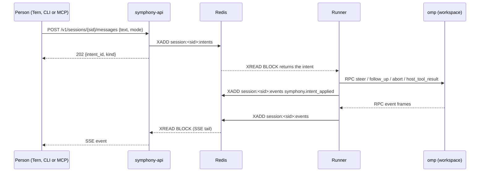
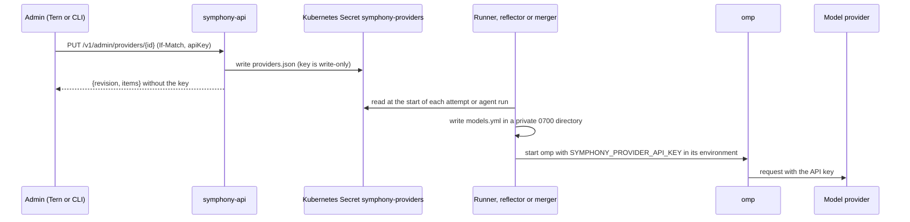
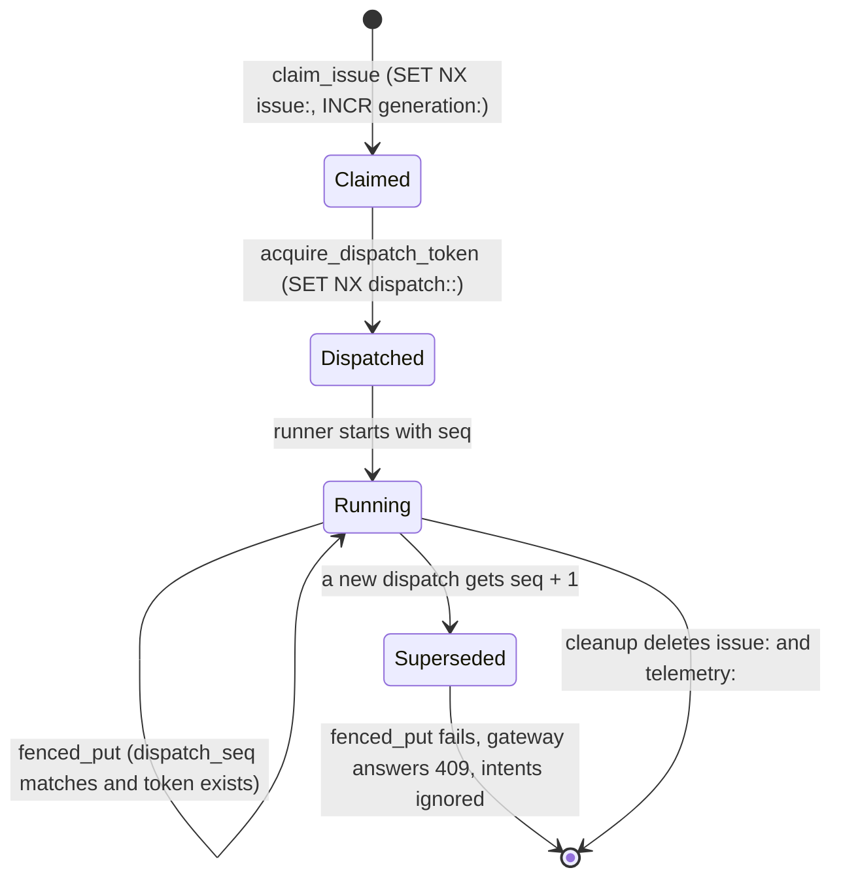
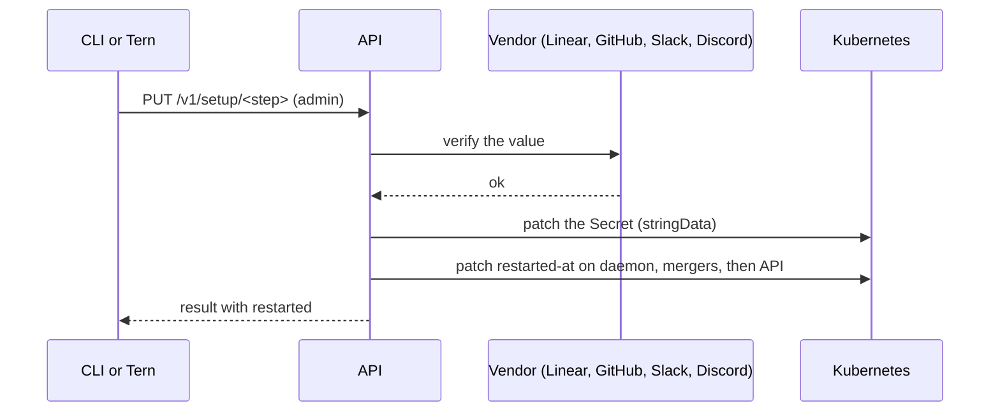

# Internals

This document describes the contracts between the Symphony components. Each component uses
only these contracts to talk to another component. If you change a contract, change this file
and the tests on the two sides in the same commit.

For the system overview, read [architecture.md](architecture.md). For the HTTP routes, read
[api.md](api.md). For the merger, read [merger.md](merger.md).

## 1. Shared stores (Redis)

All components share one Redis. Clients use `decode_responses=True`, and every value is JSON
or a plain string. The namespace `<ns>` is the Kubernetes namespace of the pod
(`edge.pod_namespace()`). The tests use the `redis_client` fixture, a real disposable Redis.

| Module | Purpose | Writer |
|---|---|---|
| `symphony.state` + `symphony.kv.RedisKV` | Ticket tracking, dispatch tokens, leases, holds, telemetry, metrics | Daemon, runner, gateway, reflector |
| `symphony.sessions.SessionStore` | Session metadata, events, transcript, intents, input requests | The runner and the merger write events and transcript; the API writes intents |
| `symphony.apitokens.TokenStore` | API tokens `sym_<id>_<secret>` with the roles `viewer < operator < admin` | API (admin) |
| `symphony.teamconfig.TeamConfig` | The model of each role and the shared omp defaults, as numbered generations | API (admin); every consumer reads and reports `observe()` |
| `symphony.admin_commands.AdminStore` | Durable commands, audit log, admission flag, workflow observations | API accepts; daemon executes |
| `symphony.wake` | `wake(target, reason)` and `wait(target, timeout)` for the targets `daemon` and `merger:<repo>` | Webhooks and the API wake; the daemon and each merger wait |
| `symphony.merger.store.MergerStore` | Merger records, leases, heartbeat and operator actions of one repository | Merger; the API reads and adds actions |
| `symphony.usage` | Provider rate limits (section 10) | Runner and merger agents |

### Key reference

The `state` keys have no namespace prefix. All other keys have a namespace prefix.

| Key | Type | Content | Expiry |
|---|---|---|---|
| `issue:<issue_id>` | String (JSON) | The tracking entry of a ticket: `status`, `identifier`, `attempt`, `dispatch_seq`, `runs`, `tokens`, `session_id`, `bridge_token`, timestamps | 7 days idle |
| `repos:discovery` | String (JSON) | The daemon's last repository discovery: `{observed_at_ms, items:[{name, default_branch, archived, merger_policy, runtime, components, truncated}], error?}`. Dispatch reads it to fill what WORKFLOW.md leaves unset; `/v1/repos` shows it | 7 days idle |
| `repos:provisioned:<owner/name>` | String (JSON) | What provisioning last did for a repository: `{signature, at, failed, outcome: {labels_created, policy_pr, error}}` (`provision.py`) | 7 days idle |
| `dispatch:<issue_id>:<seq>` | String (JSON) | The dispatch token of one dispatch: `{daemon_owner, created_at}` | 7 days idle |
| `generation:<issue_id>` | Integer | The last dispatch sequence of a ticket | Never |
| `toolcall:<issue_id>:<seq>:<call_id>` | String (JSON) | The cached result of one host tool call, so a replay never repeats a mutation | 7 days idle |
| `subissue:<issue_id>:<key>` | String (JSON) | The record of one sub-issue that `symphony_create_issues` made | 7 days idle |
| `subissue:<issue_id>:<blocker>><blocked>` | String (JSON) | One `blocks` relation that `symphony_create_issues` made | 7 days idle |
| `retro:<issue_id>` | String (JSON) | The retrospective token of the reflector | 7 days idle |
| `telemetry:<issue_id>` | String (JSON) | The span rollup of the current attempt | 7 days idle |
| `metrics:<yyyymm>` | String (JSON) | Monthly counters (dispatched, rework, pull requests opened and merged, learning pull requests, `retries: {failure, continuation}` redispatches) | 7 days idle; the daemon reads 12 months to keep them |
| `metrics:day:<yyyymmdd>` | Hash | The daily rollup of one UTC day (`rollups.py`): integer fields written with `HINCRBY` where each event happens (dispatches, ended sessions by kind and outcome, tokens, cost in micro-USD, per model and repository, the start hour of the week, merger results, questions, pull requests). `GET /v1/telemetry/history` reads it | Never |
| `metrics:days` | Sorted set | The days that have a rollup (score `yyyymmdd`), so a read never scans | Never |
| `metrics:once` | Sorted set | The events already counted in the rollups (`session:<sid>`, `dispatch:<issue_id>:<seq>`, `ask:<qid>`, …) by when, kept 35 days: a replayed event counts once | Never; members older than 35 days are pruned on write |
| `hold:<issue_id>` | String (JSON) | A person holds the ticket: `{by, reason, at}` (section 12) | Never |
| `abandoned:<issue_id>` | String (JSON) | The daemon finalized the ticket in an abandon state (`tracker.abandon_states`): `{state, identifier, at}`. Its questions asked before `at` close as canceled (`questions._advance`) | 7 days idle |
| `repo:` | Label prefix | Not a key: the Linear label `repo:<owner/name>` routes a ticket to a repository | — |
| `orchestrator:heartbeat` | String | Last daemon heartbeat (epoch ms) | 7 days idle |
| `daemon:setup` | String (JSON) | Whether the daemon can work: `{status: "ready" \| "incomplete", reason, at}`, written each step (section 17) | 7 days idle |
| `lock:orchestrator` | String (JSON) | The daemon lease `{owner, lease_expires}` | Its own `PX` |
| `totals:tokens` | String (JSON) | Token totals | 7 days idle |
| `refresh:requested` | String (JSON) | A pending `refresh` | 7 days idle |
| `ratelimits:engine` | String (JSON) | Engine rate limit state of the daemon | 7 days idle |
| `poll:backoff` | String (JSON) | Tracker poll backoff | 7 days idle |
| `lessons:usage_age` | String (JSON) | `{slug: incorporations since last use}` for learnings | 7 days idle |
| `sym:<ns>:session:<sid>:meta` | String (JSON) | Session metadata (section 2) | `retention.sessions_days` (7) after `close` |
| `sym:<ns>:session:<sid>:events` | Stream | Event frames `{kind, data, t}`, about 5000 entries | `retention.sessions_days` (7) after `close` |
| `sym:<ns>:session:<sid>:transcript` | List | omp session entries for replay, last 4000 | `retention.sessions_days` (7) after `close` |
| `sym:<ns>:session:<sid>:usage` | Hash | The usage the session's `message_end` events carried: `input`, `output`, `cache_read`, `cache_write`, `cost_micro_usd`. `close` copies it into `meta.usage` and the daily rollup | `retention.sessions_days` (7) after `close` |
| `sym:<ns>:session:<sid>:intents` | Stream | Human intents `{kind, actor, payload, t}`, about 1000 entries | `retention.sessions_days` (7) after `close` |
| `sym:<ns>:sessions` | Sorted set | Session ids by `updated_at` | Never; expired ids are removed on read |
| `sym:<ns>:tokens` | Hash | Token id → token record (SHA-256 of the secret, never the secret) | Never |
| `sym:<ns>:teamconfig` | String (JSON) | The published team configuration | Never |
| `sym:<ns>:teamconfig:history` | List | The last 50 generations | Never |
| `sym:<ns>:teamconfig:observed` | Hash | Consumer → `{generation, at}` | Never |
| `sym:<ns>:wake:<target>` | List | Pending wake reasons, at most 100 | Never |
| `sym:<ns>:ratelimit:<bucket>:<window>` | Integer | API request counter for one minute (section 10) | 65 s |
| `sym:<ns>:ratelimits` | Hash | `<provider>/<model>` → rate limit observation (section 10) | Never; the API shows only the last hour |
| `sym:<ns>:mcp:token:<sha256>` | String (JSON) | One agent session's MCP token: `{role, session, exp}`; the key holds the SHA-256 of the token, never the token (section 18) | Its own TTL (4 h by default); deleted when the session ends |
| `sym:<ns>:mcp:calls` | Hash | `<server>:<role>` → MCP calls through the gateway | Never |
| `sym:<ns>:preview:live` | Hash | `<owner/name>:<pr>:<sha12>` → a live preview device `{repo, pr, head_sha, lease_id, server, mcp_token, started_at, bundle_id, origin}`; `origin` is `button` or `link` ([assistant.md](assistant.md#pr-previews)) | 1 h, renewed on each write |
| `sym:<ns>:preview:starting:<owner/name>:<pr>:<sha12>` | String (JSON) | A start in progress, `{step}` (`queued`, `downloading`, `installing`, `launching`): one start per build across the assistant and the API | 15 min; deleted when the start ends |
| `sym:<ns>:preview:failed:<owner/name>:<pr>:<sha12>` | String | Why the last start of that build failed, for the link's status page | 10 min |
| `sym:<ns>:preview:sweep` | String | The preview sweep lock: one process sweeps a round | 55 s |
| `sym:<ns>:preview:builds:<owner/name>:<pr>` | String (JSON) | The PR's preview links that the merger listed, `{comment, builds: [{sha, sha12, url, at}]}`, newest first, at most 5; the answer run reads them | 90 days |
| `sym:<ns>:merger:repos` | Set | Every repository that a merger registered | Never |
| `sym:<ns>:merger:<repo>:heartbeat` | String | The merger of `<repo>` is alive | 90 s, renewed every 30 s or less |
| `sym:<ns>:merger:<repo>:*` | Several | Merger state of one repository; see [Merger keys](#merger-keys) | Per key |
| `sym:<ns>:setup:webhook:<source>` | String | The last signed delivery from `linear` or `github` (epoch ms), written by the webhook route (section 17) | Never |
| `sym:<ns>:setup:notify:<channel>` | String (JSON) | The last setup test message to `slack` or `discord`: `{ok, error, at}` (section 17) | Never |
| `sym:<ns>:setup:status` | String (JSON) | The last setup status the API computed: `{complete, steps: {<step>: done\|todo\|error\|skipped}, at}`, for `/metrics` only (`metrics.record_setup`) | Never |
| `sym:<ns>:metrics:counters` | Hash | Prometheus counters, `<name>\|<label>\|…` → count (`HINCRBY`): `attempts_finished`, `rate_limit_events`, `tokens`, `cost`, `mcp_cleanup` ([observability.md](observability.md)) | Never |
| `sym:<ns>:retention` | String (JSON) | The WORKFLOW `retention:` `{sessions_days, audit_days}`, written by the lease holder on each tick (`admin_commands.process_commands`); `SessionStore.close` and `AdminStore` read it (`symphony.retention`) | Never |
| `sym:<ns>:backup:status` | Hash | `backup`, `archive`, `restore` → the last outcome `{status, at, …}` ([backup.md](backup.md)) | Never |
| `sym:<ns>:archive:sessions` | Hash | Session id → the `ended_at` the archive stored; ids of expired sessions are removed each run | Never |
| `sym:<ns>:archive:audit` | String | The position (`<ms>:<event id>`) of the last audit entry the archive stored | Never |
| `admin:<ns>:commands` | Hash | Durable commands, idempotency records and the audit log | Finished commands and audit entries: `retention.audit_days` (30) |
| `admin:<ns>:admission` | String | `true` when dispatch is paused | Never |
| `admin:<ns>:observations` | Hash | Which workflow revision each consumer applied | Pruned on write |

The 7-day idle expiry applies to every `state` key except the prefixes `generation:`, `lock:`
and `hold:` (`kv.NO_TTL_PREFIXES`). Each write sets `EX`, and each read renews it.

### Merger keys

One merger Deployment serves one repository. Several mergers can share a namespace. Thus all
merger state is scoped by the repository.

- `<repo>` is `owner/name` in lower case (`merger.store.normalize_repo`). A malformed name
  raises `ValueError`.
- `MergerStore(client, ns, repo)` reads and writes one repository.
- `register(ttl_ms=90_000)` adds the repository to `sym:<ns>:merger:repos` and writes the
  heartbeat. `heartbeat()` renews it, and `alive()` reads it.
- `registered_repos(client, ns)` lists the registered repositories.

The prefix of the keys below is `sym:<ns>:merger:<repo>:`.

| Key | Type | Content |
|---|---|---|
| `rec` | Hash | Pull request → train record (`publishing`, `reviewed`, `train`, `resolve`, `finalizing`) |
| `parked` | Hash | Pull request → a review that waits for the head CI |
| `skips` | Hash | Pull request → why stage 1 stopped on the pull request, and when to try again |
| `baseline` | Hash | Pull request → the last review (head, fork point, findings, rounds, outcome) |
| `run` | Hash | Pull request → a finished review whose outcome is not applied yet |
| `caps` | Hash | Pull request → the largest batch the pull request can join after a red batch |
| `probe` | Hash | Role → the last tool check of the role |
| `reviewing` | Hash | Pull request → the review in progress |
| `reviewing:<pr>:sessions` | List | The session ids of that review |
| `batch` | String (JSON) | The batch that the train merges on one CI run |
| `queue` | String (JSON) | The review queue as the last pick saw it |
| `mainci` | String (JSON) | The state of the main watch |
| `actions` | Stream | Operator actions (`bypass`, `requeue`, `release`) |
| `actions:cursor` | String | The id of the last action that the merger applied |
| `seq:<pr>:<role>` | Integer | Counter for the merger session ids |
| `abandoned:<pr>` | String | `<ticket>:<state>` the merger closed the PR for (`abandon.py`), or `commented:<ticket>:<state>` between the comment and the close | 90 days |
| `lease:train`, `lease:pr:<n>`, `lease:fixslot:<k>`, `lease:actions`, `lease:abandon` | String | Lease owner, with `PX` expiry |

## 2. Sessions

A session is one agent conversation that people can follow and steer.

- **Id:** an attempt is `<issue_id>:<dispatch_seq>` (`sessions.attempt_session_id`). A merger
  agent is `merger:<owner>:<name>:<pr>:<role>:<n>`, in lower case. Thus the same pull request
  number in two repositories never shares a session. A merger probe uses `0` as `<pr>`. An
  assistant thread is `assist:<transport>:<channel>:<thread>:<n>` (section 19).
- **Open:** `open(sid, kind=…, identifier, title, issue_id, seq, repo, branch, url, model,
  pod)`. The `kind` is one of `implement`, `answer`, `review`, `oracle`, `arbiter`,
  `resolve`, `reflect` or `assist`.
- **States:** `starting`, `running`, `waiting_input`, `idle`, `ended`. `close(sid, outcome)`
  sets `ended` and gives the four keys an expiry of 7 days.
- **Events:** the runner sets the omp event filter to `delta` mode. Each omp RPC event frame
  becomes `append_event(sid, frame["type"], frame)`. The runner drops `extension_ui_request`
  frames with `setWidget`. An event larger than 64 KiB becomes a `{truncated: true}` marker.
- **Symphony event kinds:** `symphony.state`, `symphony.intent_applied`,
  `symphony.input_requested`, `symphony.input_resolved`.
- **Transcript:** at the end of each turn, `get_entries since=<last id>` becomes
  `append_transcript(sid, entries)`.
- **Meta:** the runner keeps `turn`, `tokens{input,output,total,cost}`, `pr_url`,
  `last_message` (at most 280 characters) and `evidence[]` with `update()`. Merger meta also has
  `role`. For merger sessions, `identifier` is the Linear key or `PR #n`, and `issue_id` is null.

A new viewer reads `GET /v1/sessions/{sid}` first. That response reads `last_event_id` before
the transcript. The viewer replays the transcript, then tails the events after that id. Thus
the viewer loses no event.

### Intents

The API writes intents with `send_intent`. The runner reads them with
`read_intents(after, block_ms)` in its own thread. Thus the runner applies an intent at once,
not at the end of a turn.

| Intent | Payload | Effect on omp |
|---|---|---|
| `steer` | `text` | RPC `steer`: the text enters the current turn |
| `follow_up` | `text` | RPC `follow_up`: the text starts a turn after the current turn |
| `interrupt` | `reason` | RPC `abort` |
| `answer` | `request_id`, `text` | Completes the pending `symphony_ask` host tool call |

After the runner applies an intent, it calls `intent_applied(sid, id, kind)`. If the attempt is
not the current owner of the ticket (a different `dispatch_seq`), the runner ignores the intent
and writes `intent_applied(..., ignored=True)`. Merger agents apply `steer`, `follow_up` and
`interrupt`, and ignore `answer`.

## 3. Host tools

The runner gives tools to omp with `set_host_tools`. omp sends each call as a
`host_tool_call` frame and waits for a `host_tool_result`. The runner serves each call in its
own thread, so the event stream and the intent reader do not stop. The tracker credential
(Linear API key or GitHub App token) stays in the runner process. It never goes into the
workspace pod.

The runner also sends `set_ask_dialog false`. Thus the built-in `ask` tool of omp is off, and
human questions go through `symphony_ask`.

| Tool | Served by | Input schema | Result |
|---|---|---|---|
| `linear_graphql` (`tracker.kind: linear`) | Runner, through the tracker adapter | `{query: string, variables?: object}` | The GraphQL response |
| `github_graphql` (`tracker.kind: github`) | Runner, through the tracker adapter, with the GitHub App token | `{query: string, variables?: object}` | The GraphQL response |
| `symphony_ask` | Runner: `request_input`, then a wait for an `answer` intent | `{question: string, options?: string[]}` | The answer text, or a fallback text after the timeout (see below) |
| `symphony_blocked` | Runner: recorded by the broker, read by the turn loop at the end of the turn | `{reason: string (≤ 500), needs: "answer" \| "access" \| "decision" \| "other"}` | A text that tells the agent to end its turn |
| `symphony_create_issues` | Runner, through `tracker.create_sub_issues` | `{issues: [{key, title, description, labels?: string[], blocked_by?: string[]}]}` (at least one item) | `[{key, identifier, url}]` |
| `symphony_attach_evidence` | Runner, through `tracker.attach_evidence` | `{path, title, kind: "screenshot" \| "video" \| "log" \| "report"}` | `{url}` |
| `symphony_ticket_attachments` (trackers that store files) | Runner, through `tracker.ticket_attachments` | `{}` | `[{id, title, kind, host, created_at}]` |
| `symphony_fetch_attachment` (trackers that store files) | Runner, through `tracker.fetch_attachment` | `{id, path}` | `{path, bytes}` |
| `submit_finding`, `submit_review`, `submit_verdict`, `submit_arbitration`, `submit_resolution` | Merger | See [merger.md](merger.md#typed-output) | — |

Rules for the runner tools:

- `symphony_blocked` ends the run at the end of the turn with outcome `blocked`: the
  ticket waits for a person ([concepts](concepts.md#waiting-for-a-person)). It refuses an
  empty reason, a reason over 500 characters and an unknown `needs`.
- `symphony_ask` waits for `agent.input_timeout_ms` (default 15 minutes). If no person
  answers, the result is a fallback that says to proceed with the agent's best judgment and
  record the assumption in the Workpad. Thus the run never stops on a question.
- `symphony_ask` refuses, with an error the agent can act on, a question over 1200
  characters, three or more sub-questions inline on one line (`(1) … (2) … (3) …`), more
  than 5 options, or an option over 60 characters: options become Slack buttons.
- The question outlives the run (`questions.py`): a Redis hash
  `sym:<ns>:question:<call id>`, kept 14 days, and the set `sym:<ns>:questions` of those not
  finished. Each daemon tick moves each one a step: it posts the comment (on the ticket,
  mentioning the person `to` names through the profile link Linear turns into a
  mention) and the Slack message (`ask:<id>:<n>` buttons; the mention comes from
  `notify.users.slack`, whose keys may be e-mails); reminds once after
  `agent.ask_reminder_ms`; and closes it unanswered after seven days. The set
  `sym:<ns>:questions:open:<issue id>` holds a ticket's open questions. The tracker adapter
  that `edge.make_tracker` builds in every process (Linear, memory) records the id of each
  comment it writes, the agent's `linear_graphql` comment mutations included, as
  `sym:<ns>:comment-own:<comment id>` (14 days). An answer is a comment on the ticket: the
  Linear webhook queues a comment that is not a bot's or an app's (`botActor`, `actor.type`)
  in `sym:<ns>:questions:inbox` when it replies in a question's thread or the ticket has an
  open question. The daemon judges each one at least 5 s after it arrived, so the process
  that wrote it has recorded it. A recorded comment never answers, whoever its author is.
  Otherwise it answers when it replies in the question's thread, or, with exactly one open
  question on the ticket, when it is top-level or replies to a recorded comment, and was
  made after the question. An answer is also a comment or a
  review by a person (`User`) on the ticket's open pull request, after the question, with
  exactly one open question: the GitHub webhook claims it before it wakes the daemon and
  writes its node id in `answered:<issue id>`, which the review watch skips. The pull
  request is the ticket's when the review watch recorded it (`pr_numbers`), its branch is
  `symphony/<issue id>` (remembered from `pull_request` events, as `issue_comment` does not
  carry it), or its title, body or branch names the ticket. A Slack button or thread reply
  (the assistant; only people mapped in `notify.users`), or the waiting run itself (Tern,
  CLI), also answers.
  `SET NX` makes the first one win. The daemon delivers it: an `answer` intent to the run
  still waiting on it, `steer` (or `follow_up`) to a later run of the ticket, else Rework
  for a ticket in review, nothing for an active or closed one (an active ticket's next
  attempt reads the comment). Then the ticket thread and the Slack message say who
  answered and where it went.
- An attempt whose runner died leaves its session open. The daemon closes an implementation
  session not updated for 10 minutes when its ticket's live attempt is another one; a
  question it was waiting on stays open.
- The runner always offers `symphony_create_issues` and `symphony_attach_evidence`, for every
  tracker, and `symphony_ticket_attachments` and `symphony_fetch_attachment` for a tracker
  that stores files (`stores_files`: Linear, memory). The tracker adapter does the work (see
  [section 16](#16-tracker-interface)).
- `symphony_create_issues` makes each item a child of the current ticket. Each child gets the
  `repo:` labels and the required label of the parent. `blocked_by` names keys from this call
  or from an earlier call, and each becomes a blocking relation. The records
  `subissue:<issue_id>:<key>` make the call idempotent. The daemon dispatches only children
  that no open issue blocks.
- `symphony_attach_evidence` accepts only a file inside the workspace, at most 25 MB. The URL
  goes into `meta.evidence[]`. The merger report lists the evidence of the ticket.
- Linear stores evidence as a file attachment. GitHub has no public upload API, so the GitHub
  tracker accepts only UTF-8 text evidence. It writes a collapsible comment of at most 65,536
  characters. It refuses binary files with an error that tells the agent why.
- `symphony_ticket_attachments` lists the current ticket's attachments: earlier runs'
  evidence, session traces, drafts and links people added. Only the host of each URL is
  shown; the URL stays in the runner.
- `symphony_fetch_attachment` resolves the id against the current ticket's attachments
  through the tracker API, never a URL from the agent, so another ticket's file is refused.
  Linear downloads only a file in its storage (`uploads.linear.app`, or the API endpoint's
  host against the mock), with the API key in `Authorization`, as Linear's file storage
  authentication describes; a link attachment (a pull request) is refused and never gets the
  key. At most 25 MB. The file is written at `path`, relative and inside the workspace: `..`
  and absolute paths are refused, missing directories are created only below a directory
  that resolves (symlinks included) inside the workspace, and a symlink or a directory at
  `path` is refused. The bytes go to the sandbox on stdin, never in argv. GitHub lists `[]`
  and refuses a fetch: its evidence is a comment.
- The `toolcall:` cache makes each call idempotent for one dispatch.

### Session trace

At the end of each run of an implementation or investigation attempt, and of each PR answer
run, the runner attaches the run's omp session to the ticket (`sessiontrace.py`,
`agent.attach_trace`, default on). It skips a run that never started the engine or has no
session file, an attempt that lost its dispatch, and a tracker that stores no files.

1. After the engine got SIGTERM and the generation was swept, and before the workspace is
   released, the runner runs `<engine binary> --export <session file> <tmp>/session-trace.html`
   in the workspace. The session file is the `sessionFile` of `get_state` (`session_path` on
   the claim), in the `--session-dir` of the attempt.
2. It reads the page back with the evidence reader (inside the temporary directory, at most
   25 MB) and removes the directory.
3. omp does not redact the export. The page holds the session base64-encoded in its
   `session-data` script. The runner decodes it and replaces with `[REDACTED]` every match of
   the merger precheck's secret patterns (`merger.rules.SECRETS`: AWS, GitHub, Slack, OpenAI
   and Anthropic style, Linear keys and whole private-key blocks) and every credential value
   of the run of 12 characters or more: the tracker credential (`edge.tracker_credentials`),
   each GitHub App installation token handed to the workspace, the gateway bridge token and
   the MCP tokens.
   A page without that script is not attached. Only the JSON string literals that held a
   secret are re-encoded; every other byte stays as omp wrote it, and a page with nothing to
   redact is attached unchanged.
4. `tracker.attach_evidence(kind="report", title="Session trace (run N)",
   filename="session-trace-run-N.html", content_type="text/html")`; `N` is the claim's `runs`.
   An answer run (`mode: answer`) uses `title="Session trace (answer, run N)"` and
   `filename="session-trace-answer-run-N.html"`.
5. The claim gets `traces[]`: `{run, url, redactions}`, or `{run, note}` when the trace is not
   attached ("trace too large to attach: 26.3 MB", "trace not attached: the upload failed");
   an answer run's record has `answer: true`. The session report has one line per run:
   `**Session trace**: <url> (run N, K redactions)` (`(answer, run N, …)` for an answer) or
   the note.

A failed export, read or upload is logged (`session_trace_failed`, `session_trace_too_large`,
`session_trace_upload_failed`) and never changes the outcome of the run or its report.

## 4. Team configuration

The team configuration names the model of each role. The roles are `implementer`, `reviewer`,
`oracle`, `arbiter`, `developer`, `reflector`, `probe`, `assistant`, `researcher` and
`planner`. A document published before a role existed gets that role's default on read
(`TeamConfig.get`). Each role has `{provider, model,
thinking}`. The `thinking` levels are `off`, `minimal`, `low`, `medium`, `high`, `xhigh` and
`max`. The `oracle` and the `arbiter` must use a different `provider/model` than the
`reviewer`.

- **Precedence for the daemon roles:** the published configuration (generation 1 or more), then
  `WORKFLOW.md` `engine.provider`/`engine.model`, then `teamconfig.DEFAULT`.
  `config.bind_role_model(cfg, team_doc, role)` applies this order.
- **Precedence for the merger roles:** the published configuration, then `models` in
  `.symphony/merger.md`, then `teamconfig.DEFAULT`. `WORKFLOW.md` does not apply.
- **Publication:** `publish()` deep-merges a patch into `models` and `omp` with optimistic
  concurrency (`WATCH`). The history keeps the last 50 generations.
- **Observation:** each unit of work reads the configuration at its start and calls
  `observe("<consumer>", generation)`. The consumers are `daemon`, `runner:<identifier>`,
  `reflector:<identifier>`, `merger:review:<repo>`, `merger:train:<repo>` and
  `member:<token name>`.
- **Credentials:** the team configuration has no credentials. Provider API keys are only in the
  `symphony-providers` Secret (section 13) and in the `model-provider` Secret. The API never
  returns a key.

## 5. HTTP API

The full route reference is in [api.md](api.md). This section keeps only the internal rules.

- The API reads only Redis on the hot paths. It never calls Kubernetes for overview, sessions
  or events. The target is p95 below 50 ms for overview and session metadata.
- Each change goes through a durable record: an intent (sessions), a command (`AdminStore`) or a
  merger action (`MergerStore`). Then the API calls `wake()`.
- `api/control.py` holds the rules that REST and MCP share. Thus both surfaces apply the same
  checks.

### Wake reasons

`wake.wake(client, ns, target, reason)` pushes a reason to `sym:<ns>:wake:<target>`.
`wake.wait()` blocks with `BRPOP` and returns all pending reasons.

| Reason | Target | Written by |
|---|---|---|
| `linear:<action>:<identifier or type>` | `daemon` | Linear webhook |
| `github:<event>:<action>:<owner/name>#<pr>` | `merger:<repo>` | GitHub webhook for `pull_request`, `check_suite`, `check_run`, `workflow_run` |
| `github:push:<owner/name>:<default branch>` | `merger:<repo>` | GitHub webhook for a push to the default branch |
| `github:comment:<owner/name>#<pr>` | `daemon` | GitHub webhook for `issue_comment` on a pull request, `pull_request_review`, `pull_request_review_comment` |
| `github:issues:<action>:<owner/name>#<n>` | `daemon` | GitHub webhook `issues` (GitHub tracker) |
| `github:issue_comment:<action>:<owner/name>#<n>` | `daemon` | GitHub webhook `issue_comment` on an issue, not a pull request (GitHub tracker) |
| `github:sub_issues:<action>:<owner/name>#<parent>` | `daemon` | GitHub webhook `sub_issues` (GitHub tracker) |
| `github:issue_dependencies:<action>:<owner/name>#<blocked>` | `daemon` | GitHub webhook `issue_dependencies` (GitHub tracker) |
| `github:projects_v2_item:<action>:<issue node id>` | `daemon` | GitHub webhook `projects_v2_item` for an issue item (GitHub tracker). Draft and pull request items wake nothing |
| `command:<action>` | `daemon` | `POST /v1/commands`, `PUT /v1/workflow` |
| `action:<action>:<pr>` | `merger:<repo>` | `POST /v1/merger/prs/{n}/{action}` |

The GitHub webhook takes `<repo>` from `repository.full_name`, in lower case
(`merger.store.wake_target(repo)` → `merger:<repo>`). Thus each wake goes only to the merger of
that repository.

A `github:comment:` reason makes the review watch of that pull request run at once, with no throttle
(`prwatch.parse_comment_wakes`). Every other reason only starts the next tick early. A wake is
a hint. The woken loop reads the source of truth again, so a lost wake costs only latency.

### Consumers

| Consumer | Reads | Blocking call |
|---|---|---|
| Daemon | `sym:<ns>:wake:daemon`, commands, tracker | `wake.wait(daemon, polling.interval_ms)` |
| Merger coordinator (one for each repository) | `sym:<ns>:wake:merger:<repo>` | `wake.wait(merger:<repo>, 30 s)`, then it wakes all merger loops of that repository |
| Runner (intent thread) | `session:<sid>:intents` | `XREAD BLOCK` |
| API SSE route and ACP bridge | `session:<sid>:events` | `XREAD BLOCK` |
| Merger actions loop | `sym:<ns>:merger:<repo>:actions` after `actions:cursor` | Read on each pass, under the `actions` lease |

## 6. Latency targets

| Path | Mechanism | Target | Test |
|---|---|---|---|
| Ticket made or moved in the tracker → dispatch | Webhook → `wake(daemon)`; safety poll every 15 s | < 3 s | `tests/test_daemon_wake.py` (wake to tick p95 < 300 ms) |
| Pull request ready, CI done or push on main → merger | Webhook → `wake(merger:<repo>)`; safety poll every 30 s | < 5 s | `tests/test_merger_units.py` (one wake reaches every idle loop) |
| Human message → omp | Intent → `XREAD BLOCK` in the runner → RPC | < 300 ms | `tests/test_runner_live.py` |
| omp event → Tern | Stream → SSE or ACP (`XREAD BLOCK`) | < 300 ms | `tests/test_api_sse.py` (p95 < 300 ms) |
| Tern dashboard | `GET /v1/overview` with `ETag`, every 2 s | < 100 ms per call | `tests/test_api_latency.py` (p95 < 50 ms with 1000 sessions) |

## 7. Local client

- **Configuration:** the CLI keeps `url` and `token_id` in `~/.config/symphony/config.toml`.
  The token goes into the system keychain (`keyring`). Without a keychain, the token goes into a
  file with mode `0600` next to the configuration. `SYMPHONY_URL` and `SYMPHONY_TOKEN` override
  both.
- **One credential owner:** the CLI is the only owner of the credential. The ACP bridge
  (`symphony acp`), the Tern plugin (`symphony api … --json`) and `symphony omp sync` use the CLI.
- **Tern:** `symphony tern install` adds the ACP agent
  `{id: "symphony", name: "Symphony", command: <absolute path of symphony>, args: ["acp"]}` to
  `agents.custom`, adds the MCP server, and installs the plugin. The plugin's sign-in runs it
  with `--no-plugin`. Without `SYMPHONY_BIN`, the plugin runs the CLI through `/bin/sh`, on the
  daemon's PATH followed by `$UV_TOOL_BIN_DIR`, `$XDG_BIN_HOME`, `~/.local/bin`,
  `/opt/homebrew/bin` and `/usr/local/bin`. See [tern.md](tern.md) and [cli.md](cli.md).

## 8. Trackers and notifications

`WORKFLOW.md` `tracker.kind` selects the tracker: `linear`, `github` or `memory`. The daemon,
the runner, the reflector and the merger use the same adapter (`make_tracker(cfg)`). See
[section 16](#16-tracker-interface).

### States

`WORKFLOW.md` `tracker.states` names the review states. The defaults are `review: "In Review"`,
`rework: "Rework"`, `merging: "Merging"` and `done: "Done"`.

- `rework` must be an active state.
- `review` and `merging` must not be active states.
- `done` must be a terminal state.
- The merger writes `rework` and `merging`. Only the main watch writes `done`, on its own
  ticket.

### Linear tracker

| Item | Linear model |
|---|---|
| Ticket | A Linear issue |
| State | The workflow state of the issue |
| Identifier | The Linear key, for example `ENG-42` |
| Agent tool | `linear_graphql` |
| Evidence | A file upload and an attachment on the issue |
| Credential | `LINEAR_API_KEY` |
| New ticket (main watch) | On the project of the board, or the team `team_key` |

The Linear↔GitHub integration moves a ticket to `Done` when its pull request merges.

### GitHub tracker

`tracker.kind: github` uses issues on a GitHub Projects (v2) board. The provider block is
`tracker.provider: {owner, project_number, status_field}`. `config.py` checks it.

| Item | GitHub model |
|---|---|
| Ticket | An issue that is an item of the project. Draft items and pull requests are not tickets |
| State | The option of the single-select field `status_field` (default `Status`) |
| Terminal | A closed issue is terminal, whatever its status option |
| Close and reopen | `move` to a terminal state closes the issue: `state_reason` `completed` for `tracker.states.done`, `not_planned` for the others. A move to any other state reopens it |
| Pull request link | `identifier_in(text, repo)` reads a `symphony/<identifier>` branch, an `owner/repo#n` reference, an issue URL, a GitHub closing keyword with a bare `#n` (`closes`, `fixes`, `resolves` and their forms) in the pull request's repository, or a leading identifier |
| Identifier | `<repo>-<n>`, for example `app-42`. The branch is `symphony/<identifier>` |
| Target repository | The repository of the issue, unless the issue has `repo:` labels |
| Priority | The optional board field `Priority` (a lower value is more urgent) |
| Blockers | The blocked-by dependencies of the issue |
| Sub-issues | Made in the repository of the parent, with a parent link. They go on the board in the first active state and are linked with blocked-by |
| Evidence | Text only, as a collapsible comment (at most 65,536 characters with the wrapper). Binary files are refused |
| Agent tool | `github_graphql` |
| Webhooks | `issues`, `issue_comment` on issues, `sub_issues`, `issue_dependencies`, `projects_v2_item` (see [Wake reasons](#wake-reasons)) |

The credential is the GitHub App installation token. For the tracker, the App needs
`issues: write`, `metadata: read`, and `organization_projects: write` for an organization
project or `repository_projects: write` for a user project. Section 17 lists the full set
that setup checks.

### Memory tracker

`tracker.kind: memory` keeps tickets in the process memory. Local mode, the kind
certification and the tests use it.

### Notifications

- **Post:** `symphony.notify.post(event, text, *, link=None, github_logins=(), direct_to=())`. The
  events are `input_requested`, `back_to_author`, `needs_maintainer`, `needs_approval`,
  `preview_ready`, `batch_split`, `main_red`, `main_green`, `run_error`,
  `retries_exhausted`, `not_queued` and `triage_opened`. Each configured channel gets each event:
  - Slack: `SLACK_BOT_TOKEN` and `SLACK_CHANNEL`, or `SLACK_WEBHOOK_URL`.
  - Discord: `DISCORD_BOT_TOKEN` and `DISCORD_CHANNEL_ID`, or `DISCORD_WEBHOOK_URL`.
- **Mentions:** `notify.users` in `WORKFLOW.md` has one map per channel:
  `{slack: {<github login>: <Slack user id>}, discord: {<github login>: <Discord user id>}}`.
  A flat map is an error. `github_logins` is a sequence of GitHub logins; every mapped login
  gets a mention in the header. On Discord, `allowed_mentions.users` lists all mapped ids.
- **Discord format:** Discord markdown, at most 2000 characters. `allowed_mentions` allows only
  the mapped users. If Discord answers 429 with a short `retry_after`, `notify` waits and tries
  one more time.
- **Direct messages:** `direct_to` holds `notify.users` keys; each mapped person also gets the
  event as a DM, without a mention, once per event. The daemon passes the ticket's assignee
  (`Issue.assignee_keys`: the e-mail when the tracker has it, then the name or login), the
  merger the assignee of each PR's ticket (`TrackerAdapter.assignee`), and a question
  (`post_question(direct_keys=…)`) the person who decides and the assignee. A DM needs the
  channel of that service configured and its bot token:
  - Slack: `chat.postMessage` with `channel` set to the member ID opens the bot's DM (scope
    `chat:write`). A question's DM carries the option buttons; its `{channel, ts}` (the `D…`
    id Slack answers with) is kept under `dms` in the question's `slack` record, so a click,
    a reply in that DM's thread and the final edit work as in the channel.
  - Discord: Create DM (`POST /users/@me/channels`, `{"recipient_id"}`), kept per process,
    then Create Message there with `allowed_mentions: {"parse": []}`.
  - `notify.direct_messages: false` turns DMs off; `notify.direct_events` lists the events
    that get them (default: all). An unmapped key is skipped (debug log `notify_direct_unmapped`).
- Without a configuration, `post` does nothing. The same event and text are sent at most once
  in 60 s to each destination (the channel, each person's DM).

## 9. Services, ports and variables

| Service (Deployment) | Entry point | Port | Clients |
|---|---|---|---|
| `symphony-api` | `python -m symphony.entry.serve api` | 8080 | People (CLI, plugin, ACP, MCP), webhooks |
| `symphony-gateway` | `python -m symphony.entry.serve gateway` | 8090; 8081 (`/healthz`, `/metrics`) | Workspaces: `POST /v1/traces` (OTLP); workspaces, distill pods, merger agents and the assistant: the MCP proxy `/v1/mcp/<name>` (section 18). Port 8081: a monitoring namespace only |
| `symphony-daemon` | `python -m symphony.entry.daemon` | 8081 (`/healthz`, `/metrics`) | — |
| `symphony-merger` | `python -m symphony.entry.merger` | 8081 (`/healthz`, `/metrics`) | — (the container has `omp`, `git` and a repository mirror on a PVC) |
| `symphony-assistant` | `python -m symphony.entry.assistant` | 8081 (`/healthz`, `/metrics`) | — (it dials Slack Socket Mode and the Discord Gateway; section 19) |
| Jobs | `python -m symphony.entry.run_issue`, `python -m symphony.entry.reflect` | — | — |
| `symphony-backup` (CronJob, nightly) | `python -m symphony.entry.backup` | — | — (it dials Redis and the S3 endpoint; [backup.md](backup.md)) |

| Variable | Use |
|---|---|
| `REDIS_URL` | All components |
| `LINEAR_API_KEY`, `LINEAR_WEBHOOK_SECRET` | Daemon, runner, merger, API (webhook) |
| `GITHUB_APP_ID`, `GITHUB_APP_PRIVATE_KEY`, `GITHUB_APP_INSTALLATION_ID` | Runner, daemon, merger (`ghapp.py`) |
| `GITHUB_WEBHOOK_SECRET` | API |
| `SLACK_BOT_TOKEN` and `SLACK_CHANNEL`, or `SLACK_WEBHOOK_URL` | `notify` (all components) |
| `SLACK_APP_TOKEN` (app-level `xapp-…`, Socket Mode) | Assistant (section 19) |
| `DISCORD_BOT_TOKEN` and `DISCORD_CHANNEL_ID`, or `DISCORD_WEBHOOK_URL` | `notify` (all components) |
| `SYMPHONY_BOOTSTRAP_TOKEN` | API (first admin token) |
| `AWS_REGION` and credentials (IRSA, instance role, or `AWS_BEARER_TOKEN_BEDROCK`) | Workspaces and merger, through the provider environment |
| `SYMPHONY_BACKUP_ACCESS_KEY_ID`, `SYMPHONY_BACKUP_SECRET_ACCESS_KEY` | Backup CronJob and API: the access keys of the S3 backup target ([backup.md](backup.md)) |

**Secrets.** The operator makes `symphony-api` and `model-provider`
(`deploy/secrets.example.yaml`). `deploy/integrations.yaml` makes the others empty, and setup
fills them (`deploy/integrations.example.yaml` is the template for a fill by hand):

- `linear-api-key`: `LINEAR_API_KEY`, `LINEAR_WEBHOOK_SECRET`.
- `github-app`: the three `GITHUB_APP_*` variables.
- `symphony-api`: `GITHUB_WEBHOOK_SECRET`, `SYMPHONY_BOOTSTRAP_TOKEN`.
- `symphony-slack` (optional): the `SLACK_*` variables.
- `symphony-discord` (optional): the `DISCORD_*` variables (name from `SYMPHONY_SECRET_DISCORD`).
- `model-provider` (optional): `AWS_REGION`, `AWS_BEARER_TOKEN_BEDROCK`.
- `symphony-backup` (optional, filled by hand): `SYMPHONY_BACKUP_ACCESS_KEY_ID`,
  `SYMPHONY_BACKUP_SECRET_ACCESS_KEY`.
- `symphony-mcp`: MCP servers for agents (section 18). Not environment variables: the keys
  are `servers.json` and `headers.<name>.json`. The gateway mounts it read-only at
  `SYMPHONY_MCP_DIR` (`/etc/symphony/mcp`); runners and mergers read it through the API
  server (name from `SYMPHONY_SECRET_MCP`).

`notify` reads `notify.users` from `$SYMPHONY_WORKFLOW_MOUNT/WORKFLOW.md` and reads the file
again when its mtime changes. `notify.configure(users)` replaces the map.

**Merger:** the environment has `SYMPHONY_MERGER_REPO` (empty: the `default_repo` of the
workflow), `SYMPHONY_MERGER_WORKDIR`, `SYMPHONY_MERGER_REVIEWERS` (default 2),
`SYMPHONY_OMP_BIN` and `SYMPHONY_HEALTH_PORT` (`/healthz` and `/metrics` on 8081).

Run one merger Deployment for each repository, each with its own `SYMPHONY_MERGER_REPO`.

**Metrics:** `metrics.serve` answers `/healthz` and `/metrics` on `SYMPHONY_HEALTH_PORT` in the
daemon, the merger, the assistant and the gateway. The API has no metrics port. The build info
reads `SYMPHONY_COMMIT` (set by the image build). Each component exposes only what it owns;
[observability.md](observability.md) lists every metric.

**Assistant:** the environment has `SYMPHONY_ASSISTANT_WORKDIR` (mirrors, worktrees, omp
sessions; an `emptyDir`), `SYMPHONY_OMP_BIN` and `SYMPHONY_HEALTH_PORT`. It reads
`SLACK_APP_TOKEN` and `SLACK_BOT_TOKEN` from `symphony-slack`, `DISCORD_BOT_TOKEN` from
`symphony-discord`, the GitHub App, the tracker credential and `model-provider`.

The API also reads `SYMPHONY_API_RATE_LIMIT` (requests per token per minute, default 600) and
`SYMPHONY_OMP_CATALOG` (section 13).

Plain settings (not Secrets):

| Setting | Where | Use |
|---|---|---|
| `SYMPHONY_PUBLIC_URL` | ConfigMap `symphony-api-config` (API, empty by default); local mode: the environment | The address people and vendors reach the API at. Setup builds the webhook URLs from it. Empty: the request's base URL (`endpoints.public_url`) |
| `SYMPHONY_DEFAULT_WORKFLOW` | `docker/orchestrator.Dockerfile` (`/opt/symphony/WORKFLOW.default.md`) | The WORKFLOW the image ships. The API serves it while the ConfigMap `symphony-workflow` is empty, and the first publication writes it (section 17) |

## 10. Rate limits

### API request limits

The API counts requests in fixed one-minute windows in Redis. All API replicas share the
counters.

| Bucket | Limit | Result when exceeded |
|---|---|---|
| `token:<token id>` | `SYMPHONY_API_RATE_LIMIT` per minute (default 600) | 429 `rate_limited` with `Retry-After` |
| `fail:<client address>` | 30 failed authentications per minute | 429 `rate_limited` with `Retry-After` |

### Provider rate limits

The hash `sym:<ns>:ratelimits` has the field `<provider>/<model>`. The value is
`{stage, remaining?, limit?, reset_at?, retry_after_ms?, observed_at, source}`.

- **Writers:** the runner and the merger agents. At the end of each turn they read
  `get_state().usageLimit` (`source: "usage_limit"`; `remaining` and `limit` are percentages,
  with `limit` = 100). On an omp `auto_retry_start` event caused by 429 or throttling, they write
  `stage: "throttled"` (`source: "retry"`, with `retry_after_ms`).
- **Readers:** `GET /v1/overview` returns `rate_limits: [{model, …}]` with only the entries of
  the last hour. `symphony status` and the Tern dashboard show them.

## 11. Investigation

A ticket with the label `tracker.investigation_label` (default `investigation`) is an
investigation. Its GitHub App token is read-only: `contents: read`, `pull_requests: read`,
`metadata: read`. The agent cannot push or open a pull request. The result is a report on the Linear
ticket, as the prompt tells the agent.

## 12. Hold a ticket

A person can take a ticket from Symphony. `POST /v1/commands {action: "hold" | "release",
target, reason}` (operator) is a durable command.

- **Processing:** the daemon writes `hold:<issue_id>` (`{by, reason, at}`) on `hold` and deletes
  it on `release`. The key has no expiry.
- **Effect:** the daemon does not dispatch, retry or continue a held ticket. The daemon
  interrupts a running attempt and parks it. The workspace stays.
- **Display:** `GET /v1/overview` and `GET /v1/issues` show `held: {by, reason, at}`.
- **Clients:** `symphony takeover` holds the ticket before it interrupts the agent. `symphony
  release <ticket>` gives the ticket back. Tern has the same two actions.

## 13. Providers

Symphony uses API keys only. There is no OAuth and no subscription login.

**Storage:** the `symphony-providers` Secret has one item for each provider id in
`providers.json`.

- **Built-in provider key** (`anthropic`, `openai`, `amazon-bedrock`, …): `{builtin: true,
  apiKey}`. The item changes only the credential. The models, the endpoint and the protocol are
  those of the pinned omp. The id must be in the catalog with `credential: "apiKey"`.
- **Custom provider:** `{name, api, baseUrl, auth: "apiKey" | "none", models[], apiKey?}`. The
  `api` is one of `openai-completions`, `openai-responses`, `anthropic-messages`,
  `google-generative-ai`.

**Catalog** (`GET /v1/admin/catalog`, `api/catalog.py`): the API decodes the omp catalog
`@oh-my-pi/pi-catalog` (`models.json`) at `SYMPHONY_OMP_CATALOG` (default
`/opt/symphony/omp-catalog/models.json`). It reads the compiled provider rules (`rules.json`)
next to it. Each provider has `credential: "apiKey"` or `"host"` (host credentials, for example
Vertex ADC). The catalog leaves out providers that need a login: OAuth tokens, a `/login` flow,
or a session that a provider hook renews.

**API:** `PUT /v1/admin/providers/{id}` takes one of the two shapes. If you omit `apiKey`, the
stored key stays (error `provider_key_required` if no key is stored). `GET` returns
`{revision, storageReady, items: [{id, builtin?, name?, api?, baseUrl?, auth?, models?,
credentialConfigured}]}` and never the key. The audit log records `provider.save`.

**Execution** (`ProviderRepository.runtime(provider_id, model_id)` →
`ProviderRuntime(provider_id, models_config, environment)`):

- **Built-in with a key:** `models_config = {providers: {<id>: {apiKey:
  "SYMPHONY_PROVIDER_API_KEY"}}}` and `environment = {SYMPHONY_PROVIDER_API_KEY: <key>}`, plus
  the environment of the `model-provider` Secret.
- **Custom:** one model, with `apiKey` from the same variable.
- **No item:** only the environment of the `model-provider` Secret (for example Bedrock with
  `AWS_BEARER_TOKEN_BEDROCK`).

The runner, the reflector and the merger agents read `symphony-providers` for each attempt or
agent run. Thus a key that an admin saves applies to the next attempt with no restart. The
`models.yml` goes into a private directory of the run (`PI_CODING_AGENT_DIR`, mode `0700`). The
key goes only into the omp environment, never into a file, argv or log.

## 14. Endpoints and mocks

### Endpoints

The defaults are production. The names are the same as in GitHub Actions and GitHub
Enterprise Server where such names exist (`src/symphony/endpoints.py`).

| Variable | Default | Users |
|---|---|---|
| `LINEAR_API_URL` | `https://api.linear.app/graphql` | Tracker, host tools, merger |
| `GITHUB_API_URL` | `https://api.github.com` | `ghapp` (App tokens), `codehost`, reflector, merger REST |
| `GITHUB_GRAPHQL_URL` | `https://api.github.com/graphql` | Merger |
| `GITHUB_SERVER_URL` | `https://github.com` | Git remotes (clone, mirror, push), pull request URLs, slug parsing |
| `SLACK_API_URL` | `https://slack.com/api` | `notify` (Web API) |
| `DISCORD_API_URL` | `https://discord.com/api/v10` | `notify` (Discord bot messages) |

The daemon and the runner pass the set variables (`endpoints.overrides()`) to Jobs, pods and
the workspace. The workflow clones from `${GITHUB_SERVER_URL}`.

### Mocks

The mocks in `scripts/mocks/` are for certification and tests only. Do not use them in
production. See [testing.md](testing.md#vendor-mocks) for each mock.

- Each mock checks each request against the published vendor specification. The specifications
  are in `scripts/mocks/specs/`, with source URL, commit or date, and sha256 in
  `scripts/mocks/specs/SOURCES.md`.
- A request outside the specification gets the error that the vendor documents: GraphQL
  `errors`, REST 4xx with `message`, Slack `ok: false` with `error`, Discord
  `{code, message, errors?}`.
- Authentication is as documented:
  - Linear: `Authorization: <api key>`.
  - GitHub: an RS256 App JWT (`iss`, `iat`, `exp` at most 10 minutes) gets a token from
    `POST /app/installations/{id}/access_tokens`. Git smart HTTP uses `x-access-token`.
  - Slack: `Bearer xoxb-…`.
  - Discord: `Authorization: Bot <token>` for Create Message. Execute Webhook has no header.
  - MCP: `Authorization: Bearer <token>` (`MCP_MOCK_TOKEN`, default `mock-mcp-token`).
  - S3: SigV4 header auth (`AWS4-HMAC-SHA256`, `x-amz-date`, `x-amz-content-sha256`), the
    example keys of the AWS SigV4 page by default.
- The GitHub mock also serves the GitHub tracker surface: Issues REST, sub-issues,
  dependencies and Projects v2 GraphQL. The control routes `/_mock/projects`,
  `/_mock/issues`, `/_mock/project-items` and `/_mock/project-items/move` make boards,
  issues and items, and move items.
- The Discord mock serves Execute Webhook and Create Message, validated against
  `discord-openapi.json.gz` (`discord/discord-api-spec`).
- Webhooks are signed as documented: Linear `Linear-Signature` (HMAC-SHA256 hex of the body) and
  `webhookTimestamp`; GitHub `X-Hub-Signature-256`, `X-GitHub-Event` and `X-GitHub-Delivery`.
- Each mock has a control API under `/_mock/*` for the certification script (the MCP mock:
  `/_control/*`).
- Default ports: Linear 4100, GitHub 4200 (HTTPS with a private CA on `--https-port`), Slack
  4300, models 4400, Discord 4500, MCP 4600, S3 4700.
- The S3 mock serves PutObject, GetObject, ListObjectsV2 and DeleteObject on path-style URLs,
  validated against the request syntax of the `aws-s3-*.md` pages, with the `<Error>` codes
  and statuses of `aws-s3-error-responses.md`.
- The MCP mock serves MCP 2025-11-25 Streamable HTTP at `/mcp`, validated against
  `mcp-2025-11-25-schema.json.gz`: `initialize`, `tools/list`, `tools/call` (`echo`,
  `lookup_ticket_context`), sessions and SSE answers. `GET /_control/requests` records header
  names and `has_auth`, never values.
- The model mock serves Anthropic at `http://HOST:PORT/anthropic` and OpenAI Responses at
  `http://HOST:PORT/openai/v1`. Only the test harness redirects omp to these URLs. Production
  writes only the `models.yml` of section 13.

## 15. Fencing and the dispatch token

The fencing design uses one conditional primitive: put-if-absent (`SET NX`). Production also
uses Lua scripts for leases and fenced writes.

1. **Claim:** `claim_issue` writes `issue:<id>` only if it is absent. It takes the next value of
   `generation:<id>` (`INCR`) as `dispatch_seq`.
2. **Dispatch token:** each spawn (new, retry or continuation) calls `acquire_dispatch_token`.
   Only the process that writes `dispatch:<id>:<seq>` first dispatches. Every spawn gets a new
   seq, so an old token never blocks a new dispatch.
3. **Generation:** `generation:<id>` never expires. Thus an old Job cannot address a reopened
   ticket.
4. **Daemon lease:** `lock:orchestrator` has an owner and an expiry, renewed with Redis time
   (`renew_lease`, 60 s). Only the lease owner ticks. `LeaseKV` compares the snapshot it read
   with the current values before it writes, so a stale tick aborts. On SIGTERM the daemon
   finishes its step and deletes the lease if it still owns it (`release_lease`), so the next
   daemon takes over at once instead of after the 60 s expiry.
5. **Runner writes:** `fenced_put(key, value, expected, token_key)` writes only if the entry
   still has the expected `dispatch_seq` and the dispatch token exists.
6. **Gateway:** `POST /v1/traces` checks the `bridge_token` of the attempt, then the
   `dispatch_seq` of the spans. A wrong token gets 401, and a stale seq gets 409.
7. **Intents:** the runner ignores intents for a session that no longer owns the ticket.
8. **Commands:** the daemon checks again that the token of a queued command is active and has
   the necessary role (`admin_auth.authorize_command`).

The tests are in `tests/test_fencing.py` and `tests/test_dispatch.py`.

## 16. Tracker interface

`src/symphony/trackers/base.py` defines `TrackerAdapter`. The daemon, the runner, the reflector
and the merger know only this interface. The Linear, GitHub and memory trackers implement it.
Each method that takes an `issue` or an `identifier` accepts the `Issue.id` or the identifier.

| Method | Purpose |
|---|---|
| `fetch_issues_by_states(states)`, `fetch_issues_by_ids(ids)` | Read tickets as normalized `Issue` records |
| `agent_tool_specs()`, `execute_agent_tool(name, args)` | The raw tracker tool of the agent (`linear_graphql` or `github_graphql`), run on the host |
| `secret_environment_names()` | The variables that hold the tracker credential |
| `move(issue, state_name)` | Set the state. False when the ticket is unknown or already there. An unknown state raises |
| `comment(issue, body)` | Add a comment; returns its id |
| `upsert_workpad(issue, body)` | Create or edit the one comment that starts with `## Workpad` |
| `fetch_issue_workpad(identifier)` | The comments of the ticket, for the reflector |
| `create_sub_issues(parent, items, labels, records)` | Children of the parent, blockers first. Unknown labels raise `TrackerInputError`. `records` makes the call idempotent |
| `attach_evidence(issue, title, kind, filename, content_type, data)` | Attach proof of work; returns `{title, url, kind}` |
| `create_issue(title, body, labels, state, repo)` | A new ticket on the board; missing labels are created. Returns `{identifier, url}` |
| `state_of(identifier)` | `{name, type}`, with `type` `active`, `terminal` or `unknown` |
| `attachments(identifier)` | The evidence of the ticket: `[{title, url, kind}]` |
| `ticket_attachments(issue)` | The files on the ticket, for the agent: `[{id, title, kind, url, created_at}]`. GitHub: `[]` |
| `fetch_attachment(issue, attachment_id, max_bytes)` | The bytes of one of the ticket's attachments, downloaded with the tracker credential. Another ticket's id, a link that is not a stored file, or a file over `max_bytes` raises `TrackerInputError`. GitHub: always refused |
| `identifier_in(text, repo)` | The first ticket identifier in a branch name, a pull request title or a body. `repo` lets the GitHub tracker read a bare `#n` after a closing keyword. Linear on a team's board (`team_key`, no `project_slug`) takes only that team's key |
| `search(query, limit)` | Tickets whose title or body holds `query`, newest first: `[{identifier, title, state, url}]`. Linear filters the board; GitHub runs issue search over the board owner; read-only (the assistant's `tracker_search`) |
| `add_blocked_by(issue, blocker)` | `blocker` blocks `issue`, any two tickets of the board (Linear `blocks` relation, GitHub issue dependency, across repositories too). True when new, False when already there; a refusal raises `TrackerInputError` |
| `kind` | `linear`, `github` or `memory` |
| `stores_files` | True when tickets keep uploaded files (Linear, memory): the attachment tools are offered and the session trace is attached. False for GitHub |

A transport error, a 5xx or a 429 raises `TrackerUnavailable`. The daemon never reads it as "the
ticket is gone". A request that the tracker cannot serve raises `TrackerInputError`, with a
message that tells the caller what to fix. A Linear single-ticket read (`state_of`,
`attachments`, `assignee`, …) of an identifier Linear does not know returns no ticket: Linear
answers it with an `INPUT_ERROR` "Entity not found", which only these reads take as "none".

## 17. First-run setup

A fresh install has only Redis and the API. The setup API (`src/symphony/api/setup.py`,
routes in [api.md](api.md#setup)) finds what is missing and stores what an admin gives,
after a check against the real service.

**Status.** `GET /v1/setup` computes each step from the process environment, the published
WORKFLOW, Redis and the vendors. No step stores a flag. A vendor check is cached for 30 s
(`CACHE_S`) under a digest of its inputs, in process memory only. Every write clears the
cache. The Redis records that setup reads:

| Key | Writer | Read by |
|---|---|---|
| `daemon:setup` | Daemon (`edge.SetupGate`, `state.report_setup`), each step | Overview `daemon.setup` |
| `sym:<ns>:setup:webhook:<source>` | Webhook route, on each signed delivery (`linear`, `github`) | Step `webhooks` (`last_delivery_at`) |
| `sym:<ns>:setup:notify:<channel>` | Setup, on each test message | Step `notifications` (`last_test`) |
| `sym:<ns>:merger:<repo>:heartbeat` | Each merger | Step `repositories` (a merger counts only while it beats) |

**Secret store.** `setup_secrets.SecretStore` has `put`, `has`, `remove` and `restart`. `has`
tells only whether a name is set; no method reads a value back.

| Group | Secret | Names |
|---|---|---|
| `linear` | `linear-api-key` | `LINEAR_API_KEY`, `LINEAR_WEBHOOK_SECRET` |
| `github-app` | `github-app` | `GITHUB_APP_ID`, `GITHUB_APP_INSTALLATION_ID`, `GITHUB_APP_PRIVATE_KEY` |
| `api` | `symphony-api` | `GITHUB_WEBHOOK_SECRET` |
| `slack` | `symphony-slack` | `SLACK_BOT_TOKEN`, `SLACK_CHANNEL`, `SLACK_WEBHOOK_URL` |
| `discord` | `symphony-discord` | `DISCORD_BOT_TOKEN`, `DISCORD_CHANNEL_ID`, `DISCORD_WEBHOOK_URL` |
| `model-provider` (read-only) | `model-provider` | Only the presence of a host model credential |

- Kubernetes (`KubernetesSecretStore`): a store is a merge PATCH of `stringData` on a Secret
  that the manifests made empty. A missing Secret gives `secret_missing`. Then the store
  restarts every Deployment that reads the group. It patches
  `spec.template.metadata.annotations["symphony.dev/restarted-at"]` in this order: the daemon
  (`symphony-daemon`), each merger (label `app=symphony,component=merger`), and the API
  (`symphony-api`) last, because it serves the request. The `api` group restarts only the API.
  A Deployment that is not there is skipped. A refused patch gives `restart_forbidden`.
  Runner and reflector Jobs read the Secrets when they start.
- Local (`setup_secrets_local.LocalSecretStore`): an atomic rewrite of `<root>/secrets.env`
  (mode 0600, one shell-quoted `NAME='value'` per line), then an update of the process
  environment and a tick wake. No restart. A variable set in the host environment at start
  wins: a write to it fails with `host_env_overrides`.

**Workflow seeding.** The ConfigMap `symphony-workflow` starts empty. Until the first
publication, `admin_workflow.WorkflowRepository` serves the image's WORKFLOW
(`SYMPHONY_DEFAULT_WORKFLOW`, `/opt/symphony/WORKFLOW.default.md`). The tracker and
repositories steps publish into it directly (`admin_workflow`, reason `setup: <step>`), not
through a daemon command, because a fresh install has no working daemon. In local mode,
`workflow_file.file_workflow` gives the same repository over the `--workflow` file.

**Idle components.** No component crash-loops while setup is incomplete.

| Component | Condition | Behavior | Event |
|---|---|---|---|
| Daemon | No valid WORKFLOW, or `edge.make_tracker` raises `TrackerNotConfigured` | Keeps the lease and the heartbeat, writes `daemon:setup` `incomplete` with the reason, re-reads both every step. Durable commands still apply; a command that needs the tracker fails with 409 `setup_incomplete` | `daemon_setup_incomplete` (at most once a minute), then `daemon_setup_complete` |
| Merger | `merger.missing_config` lists `workflow`, a `GITHUB_APP_*` name or `repository`; or the build fails (`github_app`, `repository_access`) | Healthy, no heartbeat, re-reads the WORKFLOW every pass | `merger_not_configured` with `missing` (at most once a minute) |
| Nightly sweep | No WORKFLOW or no usable tracker | Exits 0 | `sweep_setup_incomplete` |
| Reflector Job | The same | Exits 0. The retrospective token stays, so the sweep fires it later | `reflector_setup_incomplete` |
| Runner Job | No usable tracker | Ends the attempt as a fenced failure, with the summary `Setup is incomplete: <reason>` | `runner_setup_incomplete` |

**Workspace token.** `ghapp.WORKSPACE` is the installation-token scope of a workspace that
works a ticket: `contents: write`, `pull_requests: write`, `metadata: read`, `checks: read`,
`actions: read`, `statuses: read`. It has no `issues`, `projects` or `workflows`: agent code
cannot edit tickets or boards, and GitHub rejects a push that changes `.github/workflows/*`.
An investigation gets `ghapp.READ_ONLY` (section 11). The setup check
(`setup_checks.REQUIRED_PERMISSIONS`) asks the installation for `ghapp.WORKSPACE` plus
`issues: write` and `actions: write`, and a projects permission with the GitHub tracker.

The tests are in `tests/test_api_setup.py`, `tests/test_local_setup.py`,
`tests/test_setup_idle.py`, `tests/test_setup_entries.py` and `tests/test_merger_setup.py`.

## 18. MCP servers

Admin picks MCP servers per role (`/v1/admin/mcp`, [api.md](api.md#mcp-servers-for-agents)).
`mcp_servers.McpRepository` stores them in the Secret `symphony-mcp` (local mode:
`<root>/mcp.json`, mode 0600, the same keys).

**Credentials go through the gateway.** An agent never holds a stored header value:

1. Each agent launch mints its own token (`mint_token(client, ns, role, session_id, ttl_s)`)
   and revokes it when the session ends (`revoke_token`). Launches: the workspace runner
   (`implementer`), each merger agent (its role), the reflector's distill pod (`reflector`)
   and the assistant (`assistant`, `researcher`, `planner`).
2. `stage_mcp(write_file, agent_dir, role, token, gateway_url, *, repository)` writes the
   role's enabled servers into `<agent_dir>/mcp.json`. A remote server becomes
   `{gateway}/v1/mcp/<name>` with `Authorization: Bearer <token>`. A stdio server is copied
   with its non-secret `env`. `models.yml` is left alone.
3. The gateway checks the token, drops it, adds the stored headers and streams the request
   to the server ([api.md](api.md#mcp-proxy)).

**No other MCP config.** `stage_mcp` also writes `<agent_dir>/config.yml`:
`mcp.enableProjectConfig: false`, so a repository's `.omp/mcp.json` and third-party configs
are ignored, and `tools.xdev: false`. The agent dir is private (`PI_CODING_AGENT_DIR`), so no
user-level config applies. Verified on omp 18.20.2:

- `--tools a,b` does not turn MCP off. MCP tools are added to the allowlist as
  `mcp__<server>_<tool>`.
- With the default `tools.xdev: true`, omp mounts MCP tools as `xd://` devices and adds
  `write` to the active tools to call them. `tools.xdev: false` keeps them as plain tools, so
  a read-only role gains no file tool.

**Local mode.** The API and the gateway use `<root>/mcp.json`. Local engines keep the host's
omp agent dir (its models and logins), so `stage_overlay` writes, under the attempt's
`credentials/<sandbox>/mcp/`, a Claude-format plugin (`symphony/.claude-plugin/plugin.json`
and `symphony/.mcp.json`) and the same settings as a `config.yml` overlay. The engine command
gains `--plugin-dir <dir>/symphony --config <dir>/config.yml` (`overlay_args`). Tools are
named `mcp__symphony_<server>_<tool>`, and remote servers point at the local gateway with the
attempt's token. Verified on omp 18.20.2: the overlay wins over the host's own
`enableProjectConfig: true`, and a repository's `.omp/mcp.json` stays unconnected. A
standard Agent Plugins `plugin.json` under `--plugin-dir` loads no MCP servers in 18.20.2.
User-level servers in the host's own `~/.omp/agent/mcp.json` still load: they are the host
user's own configuration.

**Companion fields** (optional, `http`/`sse` only; [mcp.md](mcp.md#companion-http-api)):

- `http_base`: the server's HTTP API root. The gateway serves it as
  `/v1/mcp/<name>/http/<path>` with the MCP proxy's checks and header swap, and streams both
  ways. A first segment `view` is never proxied. In JSON and text answers up to
  `REWRITE_LIMIT` (8 MiB) on both routes, `link_rewriter` replaces `http_base` and each
  `rewrite_origins` origin with `{http_url}` (taken from the request's base URL).
- `agent_env`: `{NAME: template}` with only `{token}`, `{http_url}` and `{mcp_url}`.
  `render_agent_env` fills them. `stage_mcp` writes them to `<agent_dir>/mcp.env` (0600), and
  `provider_runtime.prepare_provider` makes the engine env file source it when it exists. Local
  mode adds `McpLaunch.agent_env(role, token)` to the engine's environment.
- `cleanup: {acquire_tool, id_field, release_tool, release_arg}` (`http` only). The gateway
  buffers a `tools/call` POST (up to 8 MiB) and its JSON or SSE answer. `observe_call` turns a
  successful acquire into `record_held` and a successful release into `forget_held`.

**Held ids** (Redis, no token and no header value):

- `sym:<ns>:mcp:held:<sha256(token)>`: hash `<server>/<id>` → `{server, id, session, at,
  model?, platform?}`.
- `sym:<ns>:mcp:held`: set of token hashes that hold something, for the sweep.
- `sym:<ns>:mcp:session-held:<sid>`: the same entries per session. `Control` adds them to
  every session meta as `mcp_leases` (`session_leases`, one pipeline per page).
- Recording or dropping an id appends `symphony.mcp_lease` `{server, id, held, model?,
  platform?}` to the session's events, when the session exists.

`McpLaunch.end(token)` revokes the token, then `release_held` calls `release_tool` for each id
with the stored headers (`initialize`, `notifications/initialized`, `tools/call`; 60 s each).
An answered id is dropped; an unreachable one stays. The gateway runs `sweep_held` every 60 s
in a daemon thread, under the lock `sym:<ns>:mcp:sweep-lock`: it releases what tokens without
a live `mcp:token` key still hold, and drops an id 24 h after it was recorded. Each pass logs
`mcp_cleanup` with counts only.

**Presets** (`PRESETS`, today `seiji`) fill the fields a `PUT` leaves out; the stored form is
plain. `preset_of(definition)` matches by the marker variable in `agent_env` plus `http_base`.
A match gives:

- the attempt prompt paragraph (`McpLaunch.prompt_guidance(role)`, through
  `RunnerEnv.mcp_guidance`);
- the admin test's `me` (`identity_path`, Seiji `/v1/me`);
- the viewer route (`viewer_path`, Seiji `/v1/leases/{id}/viewer`) of
  `POST /v1/mcp/<name>/viewer`, which first checks `held_by_live_session`.

The tests are in `tests/test_mcp_servers.py`, `tests/test_mcp_companion.py`,
`tests/test_gateway_mcp.py`, `tests/test_seiji_gateway.py`, `tests/test_seiji_real.py`
(opt-in, `SYMPHONY_SEIJI_BIN`), `tests/mocks/test_mock_mcp.py` and
`tests/mocks/test_mock_seiji.py`.

## 19. Assistant

`symphony-assistant` is a chat bot on Slack (Socket Mode) and Discord (the Gateway). It dials
out, so it needs no public URL. `WORKFLOW.md` `assistant:` turns it on and names its channels
(`config.py`; unknown keys raise). It answers @mentions in those channels, every DM, and
replies in its threads. Anyone there may ask.

- **Package:** `assistant/__init__.py` holds the shared types (`Inbound`, `Action`, `Ref`,
  `Button`, the `Outbound` and `Transport` protocols). `slack_socket.py` and
  `discord_gateway.py` are the transports. `engine.py` knows no vendor.
- **Mode:** `research …` runs the `researcher` role, `plan …` the `planner`, anything else the
  `assistant`. A follow-up without a mode word keeps the thread's role.
- **Sessions:** one omp process and one `assist` session per thread. Each message is one turn
  (`prompt`). After 30 minutes without a turn the session ends; the next message starts a new
  one with the last 30 thread messages as context. Meta: `transport`, `channel`, `thread`,
  `role`, `asker` (the mapped GitHub login, else `<transport>:<user id>`), `identifier`,
  `title`. From Tern, a steer reaches a running turn; a follow-up becomes the thread's next
  question, answered in the thread.
- **Concurrency:** at most `assistant.max_concurrent` turns run. Over the cap the bot answers
  "I am busy with other questions. I will answer when one ends." and the turn waits.
- **Delivery:** "Working on it…" at once, edited with the streamed answer at most every
  1.5 s, then the final answer. Longer answers continue in more messages (Discord 2,000
  characters; Slack 40,000 per message, 3,000 per block). `owner/repo:path:line` links to
  `GITHUB_SERVER_URL` at the commit of the checkout.
- **Runtime (`runtime.py`):** `omp --mode rpc` with `--tools read,grep,glob,web_search`, the
  role's host tools and its MCP servers (section 18). The agent dir is private, with the
  role's `models.yml`. The working dir holds a worktree of each `assistant.repositories`
  repository at `origin/main` (unset: the default repository, the merger repositories and
  those of tracked tickets), fetched at most every 5 minutes with a `ghapp.READ_ONLY` token.
  The agent's environment has no chat, tracker or GitHub App credential.
- **Host tools (`tools.py`):** `symphony_status` (the `LiveReader` overview, tickets and
  recent failures), `tracker_search` (`TrackerAdapter.search`, section 16) and, for the
  planner, `propose_tickets` (terminal; at most 15 tickets, titles up to 120 characters,
  bodies up to 20,000).
- **Confirmation (`confirm.py`):** a proposal is stored at `sym:<ns>:assistant:proposal:<id>`
  (7 days) and shown with "Create", "Create and start" and "Dismiss" (button ids
  `proposal:<id>:create|start|dismiss`). Only a person mapped in `notify.users` may click;
  others get "Only people mapped in notify.users can create tickets." privately. A click
  creates the tickets in order (parents and blockers first) with `create_issue` (state
  `assistant.ticket_state`, labels `assistant.ticket_labels` and `repo:<owner/name>`) and
  `create_sub_issues` for children. Every `blocked_by` becomes `add_blocked_by`; when the
  tracker refuses one, a comment on the ticket names the blocker. "Create and start" uses the first active state and adds
  `tracker.required_labels`. A claim key (`:claim`) and per-ticket records (`:records`) make
  it idempotent: a double click or a retry never creates a ticket twice. The audit entry is
  `assistant.tickets_created`, with the person's GitHub login and the identifiers.
- **Soul (`soul.py`):** `assistant.soul: {repo, path}` (default `.symphony/assistant.md` in the
  first `assistant.repositories` entry, else `default_repo`; the soul repository is mirrored
  too). Each new session reads the file from the mirror at the `origin/main` of its last
  refresh, at most 8 KiB. Front matter `name`, `language`, `tone`; the body follows the
  built-in instructions and a closing line says those rules win. A missing file means the
  built-in text. The active version is `{repo, path, sha}` (the blob sha; `sha: null` when
  missing), read once at start and at each new session.
- **Memory (`memory.py`):** only for logins mapped in `notify.users`. `sym:<ns>:assistant:memory:
  <login>` is a JSON list of `{id, text, kind: explicit|inferred, at, thread}`, at most 50 items
  of 500 characters, written with WATCH/MULTI. A write, and a session that reads it, renew the
  TTL `assistant.memory.ttl_days` (90). The engine adds the host tools `remember(text, kind)`
  and `forget(id | query)` to each session (`AgentFactory.open(..., tools=…)`); they act for the
  turn's asker. The asker's items go into the prompt once per session and asker. Text that
  looks like a credential (`mcp_servers` env name checks, long token runs, `Bearer`, private
  keys, `sk-`, `xox?-`, `ghp_`, `sj_`, `sym_` and similar prefixes) is refused. The answer ends
  with "I'll remember: …" and "I forgot: …" lines that the engine adds.
  `assistant.memory.enabled: false` offers no tools and no memory.
- **Team facts (`facts.py`):** with the GitHub App on the host, the engine adds
  `propose_team_fact(text, section?)`. A proposal is stored at `sym:<ns>:assistant:fact:<id>`
  (7 days) and posted with "Open PR" and "Dismiss" (`fact:<id>:pr|dismiss`). Only a mapped
  person may click. A click mints an App token with `contents: write` and `pull_requests:
  write` on the soul repository, creates `symphony/assistant-fact-<id>` from `main`, appends
  `- <text>` under `## Team facts` (or its `### <section>`) of the soul file, and opens the PR.
  The branch and the PR are found again on a retry; a claim key lets one click work at a
  time. The audit entry is `assistant.team_fact_pr` (target `fact:<id>`, reason
  `<repo>#<n> <url>`). A 401/403 or a token the App cannot mint is reported in the thread as
  the missing permissions.
- **Admin API (`api/assistant.py`, admin):** `GET /v1/assistant/memory` →
  `{soul, people: [{login, count, updated_at}]}` (`soul` from the heartbeat),
  `GET /v1/assistant/memory/{login}` → `{login, items}`, `DELETE /v1/assistant/memory/{login}`
  → `{login, removed: n}`, `DELETE /v1/assistant/memory/{login}/{id}` → `{login, removed:
  item}` (404 when unknown). Audited `assistant.memory_read`, `assistant.memory_wipe`,
  `assistant.memory_forget`; the audit never holds item text.
- **Entry (`entry/assistant.py`):** until a valid WORKFLOW and a transport's tokens exist it
  idles: `assistant_not_configured missing=[workflow|slack_app_token|slack_bot_token|
  discord_bot_token]` once a minute. With `assistant.enabled: false` it idles with
  `assistant_disabled`. The heartbeat `sym:<ns>:assistant:heartbeat` (TTL 90 s, every 30 s)
  is `{state: "running"|"idle", at, missing, threads, active, queued, soul: {repo, path, sha} |
  null, slack: {configured, connected}, discord: {configured, connected}}`. A graceful stop
  ends every session and removes the heartbeat.

The tests are in `tests/test_assistant_engine.py`, `tests/test_assistant_confirm.py`,
`tests/test_assistant_runtime.py`, `tests/test_assistant_config.py`,
`tests/test_assistant_entry.py`, `tests/test_assistant_trackers.py`,
`tests/test_assistant_soul.py`, `tests/test_assistant_memory.py`,
`tests/test_assistant_facts.py` and `tests/test_assistant_api.py`.
