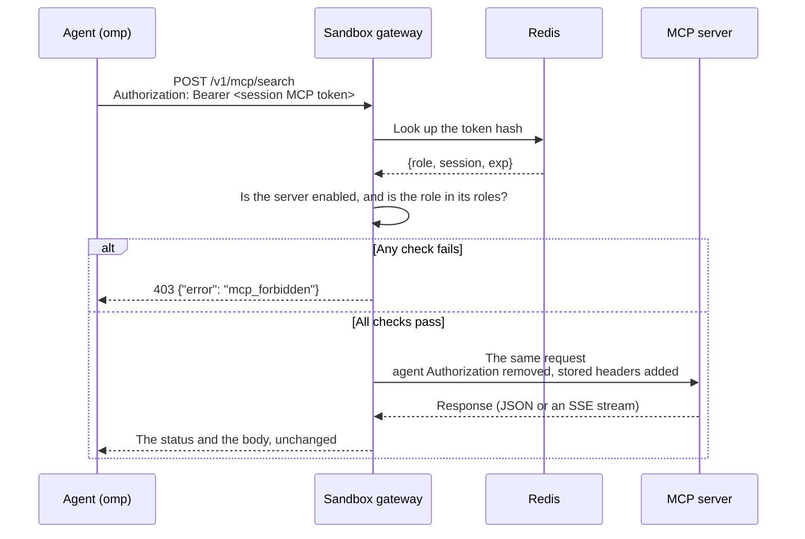

# MCP servers for agents

Symphony can give its agents extra tools through MCP servers. An admin picks the servers and the agent roles that get them. An MCP server can search the web, read a wiki, query a product database or look up an error tracker.

This page is about the MCP servers that agents use. Symphony's own MCP server for people (`/mcp`) is in [api.md](api.md#mcp).

## Contents

- [How it works](#how-it-works)
- [Transports](#transports)
- [Roles](#roles)
- [Add a server](#add-a-server)
- [Presets](#presets)
- [Companion HTTP API](#companion-http-api)
- [Variables for the agent (`agent_env`)](#variables-for-the-agent-agent_env)
- [Session cleanup](#session-cleanup)
- [Where the credentials live](#where-the-credentials-live)
- [How a request flows](#how-a-request-flows)
- [Limits](#limits)
- [Examples](#examples)

## How it works

- An admin saves an MCP server definition: a name, a transport, a URL or a command, and the roles that get it.
- An admin stores the server's secret headers separately. The values are write-only.
- When an agent starts, Symphony writes the role's enabled servers into the agent's private config.
- A remote server points to the sandbox gateway, not to the real URL. The gateway adds the secret headers.
- The agent sees each tool as `mcp__<server>_<tool>`, next to its usual tools.

Symphony ignores every other MCP config. A repository's `.omp/mcp.json` and third-party MCP configs have no effect. [security.md](security.md#mcp-servers) explains why.

## Transports

| Transport | Where it runs | Needs | Secret headers |
|---|---|---|---|
| `http` | A remote server (Streamable HTTP) | `url`, `https://` | Yes, through the gateway |
| `sse` | A remote server (the older HTTP+SSE transport) | `url`, `https://` | Yes, through the gateway |
| `stdio` | A process next to the agent | `command`, optional `args` and `env` | No |

Rules:

- A name matches `^[a-z0-9][a-z0-9_-]{0,47}$`.
- A URL must use `https://`. Plain `http://` works only for hosts in `SYMPHONY_MCP_ALLOW_HTTP_HOSTS` (tests and mocks).
- A URL must not hold a user name or a password. Store them as headers.
- A stdio `env` holds non-secret values only. Symphony refuses a variable whose name looks like a credential (for example `API_KEY`, `TOKEN`, `SECRET`, `PASSWORD` or `AUTH`).
- `timeout_ms` (0 to 7,200,000) and `instructions` (give the server's instructions to the agent) are optional.
- `http_base`, `agent_env`, `rewrite_origins` and `cleanup` are optional, for `http` and `sse` servers only. The sections below explain them.

## Roles

Each server lists the agent roles that get it. The roles are the team roles ([configuration.md](configuration.md#team-configuration)).

| Role | Agent | Where it starts |
|---|---|---|
| `implementer` | The coding agent of a ticket | The workspace runner |
| `reviewer`, `oracle`, `arbiter`, `developer`, `probe` | The merger's agents | The merger |
| `reflector` | The retrospective | The reflector Job |
| `assistant`, `researcher`, `planner` | The chat assistant | `symphony-assistant` ([assistant.md](assistant.md)) |

A role without servers gets no MCP tools. A merger agent keeps its tool allowlist, and the MCP tools come in addition.

For the chat assistant roles, presets that have a `chat_guidance` (such as the `seiji` preset) substitute it for the regular guidance in the session instructions. The chat guidance covers using device tools without a shell and offering the asker control with `share_device`. When the preset also has a viewer, the `share_device` host tool is available in chat sessions.

### Local mode

In local mode, the engines keep the host's omp agent dir, with its models and logins. Symphony adds MCP without changing that dir:

- It writes a plugin with the role's servers, and a settings overlay with `mcp.enableProjectConfig: false` and `tools.xdev: false`, into the attempt's private credentials dir.
- The engine starts with `--plugin-dir` (the plugin) and `--config` (the overlay).
- Remote servers point to the local gateway, with the attempt's MCP token.
- The tools are named `mcp__symphony_<server>_<tool>`.

The overlay wins over the host's own settings, so a repository's `.omp/mcp.json` stays off. One limit stays: the developer's own `~/.omp/agent/mcp.json` still loads in local mode.

## Add a server

Use one of three ways. Each one needs an `admin` token.

### Tern

1. Open **Admin › MCP**.
2. Add a server. Choose the transport, then fill in the URL or the command.
3. Choose the roles.
4. Store the secret headers, if the server needs them.
5. Select **Test**. Tern shows the tools or the error.

### CLI

```sh
symphony admin mcp set search --transport http --url https://mcp.example.com/mcp \
  --role researcher --role planner
echo '{"Authorization": "Bearer <search key>"}' | symphony admin mcp headers search
symphony admin mcp test search
symphony admin mcp list
```

`set` replaces the whole definition, so give every field each time. The stored headers stay. `headers` reads JSON on stdin. A `null` value removes a header. The flags `--http-base`, `--agent-env NAME=TEMPLATE`, `--rewrite-origin ORIGIN` and `--cleanup ACQUIRE_TOOL:ID_FIELD:RELEASE_TOOL:RELEASE_ARG` set the companion fields. [cli.md](cli.md) lists every flag.

### API

| Route | Does |
|---|---|
| `GET /v1/admin/mcp` | Lists the servers and the roles. It shows header names, never values. |
| `PUT /v1/admin/mcp/{name}` | Adds or replaces a definition. |
| `PUT /v1/admin/mcp/{name}/headers` | Stores or removes secret headers. |
| `POST /v1/admin/mcp/{name}/test` | Connects through the gateway and lists the tools. |
| `DELETE /v1/admin/mcp/{name}` | Removes the server and its headers. |

[api.md](api.md#mcp-servers-for-agents) has the bodies. The audit log records each change as `admin.mcp.<put|remove|headers|test>`.

The test runs `initialize`, `notifications/initialized` and `tools/list` through the same proxy code that agents use. A failure has a code: `unreachable`, `rejected` (the server answered 401 or 403) or `protocol_error`. A stdio server cannot be tested from the API. It is tested when an agent starts. For a server that matches a preset with an identity route (Seiji: `GET {http_base}/v1/me`), the test also calls that route with the stored headers and returns its `{user, quota}` as `me`. A 401 or 403 there is `rejected`.

The operator MCP tool `mcp_servers` lists the names, transports, roles and the enabled flag. It never shows headers.

## Presets

A preset fills the fields that a definition leaves out. Give it as `--preset NAME` on the CLI or `"preset": "NAME"` in the `PUT` body. Explicit fields win. Symphony stores the result as a plain definition, so the preset is not a stored mode: a later `set` without `--preset` must give every field.

| Preset | Fills |
|---|---|
| `seiji` | `transport: http`; `http_base` = the url without `/mcp`; `timeout_ms: 3900000`; `agent_env: {SEIJI_TOKEN: "{token}", SEIJI_URL: "{http_url}"}`; `cleanup: {acquire_tool: acquire_device, id_field: lease_id, release_tool: release_device, release_arg: lease_id}` |

A definition matches a preset when its `agent_env` has the preset's marker variable (Seiji: `SEIJI_URL`) and it has an `http_base`. A matching server adds the preset's paragraph to the attempt prompt of every role that has it, uses the preset's identity route in the admin test, and the preset's viewer route for `POST /v1/mcp/{name}/viewer`. [seiji.md](seiji.md) is the guide for Seiji.

## Companion HTTP API

Some MCP servers have an HTTP API next to `/mcp`, with the same credential: build uploads, file downloads, reports. `http_base` is that API's root. It follows the rules of `url`.

- **Route.** `ANY {gateway}/v1/mcp/{name}/http/{path}` goes to `{http_base}/{path}`, with the query string. The checks are the MCP proxy's: a live session token, an enabled server, a role in its roles. The gateway drops the agent's `Authorization` and adds the stored headers.
- **Headers.** The gateway forwards `Accept`, `Content-Type`, `Content-Length`, the MCP transport headers, `X-Filename`, `Range`, `If-Range`, `If-None-Match` and `If-Modified-Since`.
- **Streaming.** Both directions stream. An upload of 1 GiB never sits in the gateway's memory. A body that the gateway does not rewrite keeps its `Content-Length`.
- **Not proxied.** A path whose first segment is `view` gets 404 `{"error": "mcp_not_proxied"}`, and so does a path with an empty, `.` or `..` segment. Viewer routes take no token, so a proxied one would hand the device to anyone with the session token.
- **Links.** In JSON, text and Markdown answers of both the MCP route and this route, the gateway replaces `http_base` and each origin in `rewrite_origins` with `{http_url}`. So the agent can follow every link that the server returns. A binary body (a zip, a video, an image) passes through untouched. A body larger than 8 MiB passes unchanged, without rewriting. A relative link stays relative.
- **`rewrite_origins`.** A list of up to 8 origins (`https://host[:port]`, no path). Use it when the server writes links under another origin than `http_base`, for example Seiji's `listen.publicUrl`.

## Variables for the agent (`agent_env`)

`agent_env` maps an environment variable name to a template. The engine's environment gets the rendered values. The agent's shell inherits them, so the agent can `curl` the companion API.

| Placeholder | Value |
|---|---|
| `{token}` | The agent session's own MCP token |
| `{mcp_url}` | `{gateway}/v1/mcp/{name}` |
| `{http_url}` | `{gateway}/v1/mcp/{name}/http` (needs `http_base`) |

- No other placeholder exists. Symphony refuses literal secrets: a credential-like name (`TOKEN`, `API_KEY`, `SECRET`, `AUTH` and the others of stdio `env`) needs a placeholder, and no literal part may contain `Bearer` or a long run of token characters.
- At most 16 variables. Values are single-line strings of up to 1,024 characters.
- **Workspace.** `stage_mcp` writes the rendered values to `mcp.env` (mode `0600`) in the private agent dir. The engine's private env file sources it. The launcher wipes the dir before each attempt, so an old token never survives.
- **Local mode.** The values join the engine process's own environment.
- The values hold only the session token and gateway URLs. A stored header never reaches them.

## Session cleanup

Some servers hand out a resource that costs money until the agent releases it, such as a Seiji device. `cleanup` names the tools that do this: `{acquire_tool, id_field, release_tool, release_arg}`. It is for `http` servers.

1. **Recording.** The gateway reads each successful `tools/call` of `acquire_tool`: the first text block must be a JSON object, and `isError` must be `false`. It records `id_field` of that object (with `model` and `platform` when present) under the session token in Redis. A successful call of `release_tool` drops the id named by `release_arg`. Without that argument, it drops the session's only id on the server.
2. **Session end.** When the session ends (`McpLaunch.end`), Symphony revokes the token, then calls `release_tool` for every id still held. It uses the server's own url and stored headers, as a JSON-RPC `tools/call` after an `initialize`, with a 60 s timeout each, best effort. An id whose server answered (released or not) is forgotten. An id whose server could not be reached stays for the sweep. It logs `mcp_cleanup` with counts only (`held`, `released`, `failed`, `kept`).
3. **Crash safety.** A crash leaves the record. The gateway sweeps once a minute: it releases what tokens that expired or were revoked still hold. One replica sweeps at a time (a Redis lock). The sweep gives up on an id 24 hours after it was recorded.
4. **Watching.** Each session item of `GET /v1/sessions` has `mcp_leases: [{server, id, model?, platform?}]`. The session's event stream gets `symphony.mcp_lease` with `{server, id, held, model?, platform?}` when an id is recorded (`held: true`) or dropped (`held: false`).

## Where the credentials live

| Item | Kubernetes | Local mode |
|---|---|---|
| Definitions | Secret `symphony-mcp`, key `servers.json` | `<root>/mcp.json` (mode `0600`) |
| Secret headers | Secret `symphony-mcp`, one key `headers.<name>.json` per server | The same file |
| Agent token | Redis, as a SHA-256 hash, with a TTL | The same |

- Only the API writes the Secret. The gateway mounts it read-only.
- No agent, workspace or log gets a header value.
- Each agent session mints its own MCP token. The token names the session and the role. Symphony revokes it when the session ends. Otherwise it expires after 4 hours.

## How a request flows



- The gateway forwards `MCP-Session-Id`, `MCP-Protocol-Version`, `Last-Event-ID` and `Accept`. For a server with `http_base`, it rewrites links in JSON answers (see [Companion HTTP API](#companion-http-api)). For a server with `cleanup`, it reads `tools/call` requests and answers to record held ids.
- The connect timeout is 10 seconds. After that, the stream stays open with no read deadline.
- When the agent closes its request, the gateway closes the upstream request.
- A 403 never says which check failed.
- The gateway cannot reach the server: 502 `{"error": "mcp_unreachable"}`.
- The gateway counts calls per server and role. It never logs a body.

## Limits

- **Change delay on Kubernetes.** The gateway reads the mounted Secret `symphony-mcp`. The kubelet updates a mounted Secret after about a minute. So a new header or a new role can take about a minute to work.
- **Running agents.** An agent reads its MCP config when it starts. A running agent keeps its servers until its session ends.
- **Link rewriting.** Bodies over 8 MiB and SSE answers of legacy `sse` servers are not rewritten. Relative links are never rewritten.
- **Cleanup is best effort.** A release that fails (the server is down, the id ended already) is not retried. The server's own reaper is the backstop.
- **stdio needs the command in the image.** A stdio server runs where the agent runs. The command must exist in that image: the workspace image for `implementer`, the orchestrator image for the merger, the reflector and the assistant.
- **No secrets for stdio.** A stdio server cannot have secret headers or secret env. Use a remote server for anything that needs a key.
- **Private addresses.** The gateway cannot reach private ranges (`10.0.0.0/8`, `172.16.0.0/12`, `192.168.0.0/16`, `100.64.0.0/10`, `169.254.0.0/16`, `127.0.0.0/8`). A remote server must have a public address.

## Examples

A hosted search server for the assistant's research and planning roles:

```sh
symphony admin mcp set search --transport http --url https://mcp.search.example.com/mcp \
  --role researcher --role planner
echo '{"Authorization": "Bearer <key>"}' | symphony admin mcp headers search
```

A hosted docs server for the coding agent and the reviewers, with an API key header:

```sh
symphony admin mcp set docs --transport http --url https://docs.example.com/mcp \
  --role implementer --role reviewer
echo '{"X-API-Key": "<key>"}' | symphony admin mcp headers docs
```

An older SSE server:

```sh
symphony admin mcp set tracker-context --transport sse --url https://context.example.com/sse \
  --role planner
```

A stdio server with a non-secret setting. The command must be in the image:

```sh
symphony admin mcp set time --transport stdio --command uvx --arg mcp-server-time \
  --env TZ=UTC --role assistant
```

The same definition through the API:

```sh
curl -X PUT "$SYMPHONY_URL/v1/admin/mcp/search" \
  -H "Authorization: Bearer $SYMPHONY_TOKEN" -H 'Content-Type: application/json' \
  -d '{"transport": "http", "url": "https://mcp.search.example.com/mcp",
       "roles": ["researcher", "planner"], "enabled": true}'
```
