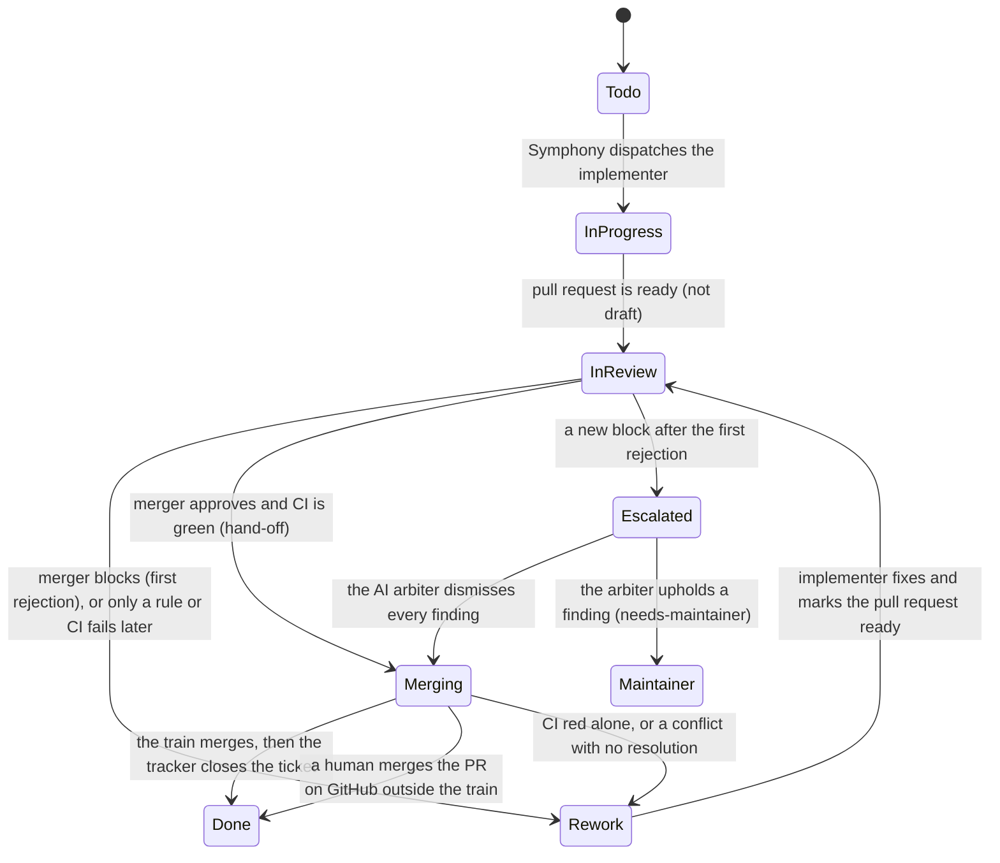
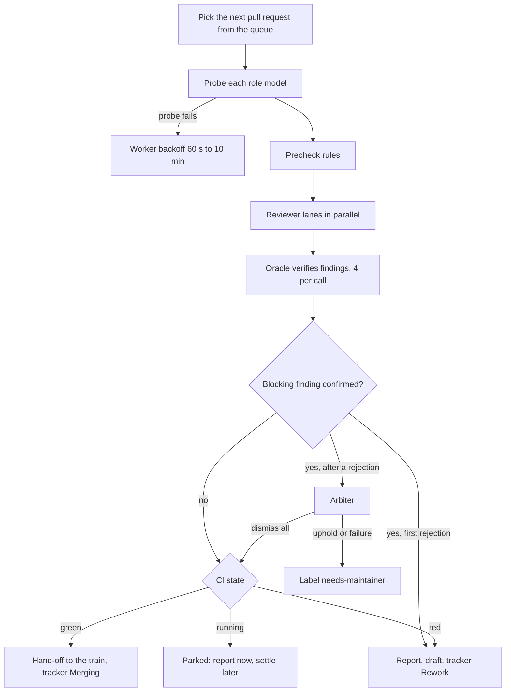
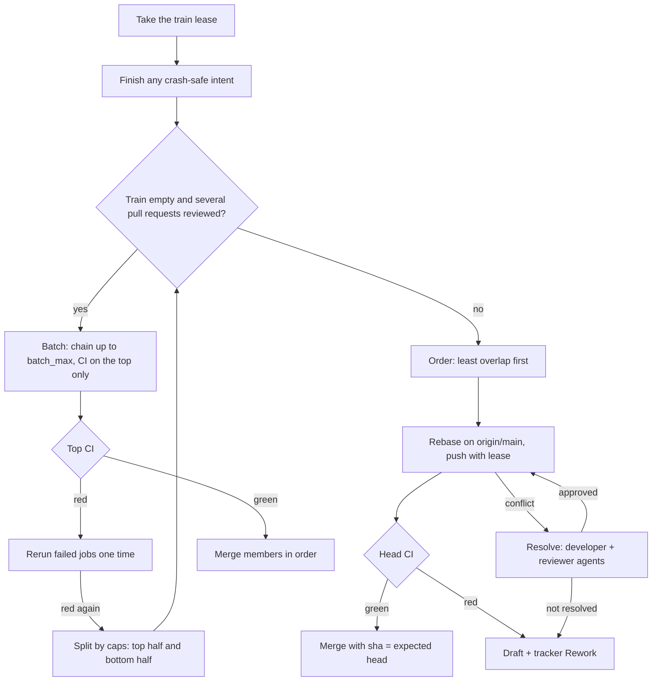

# Merger

The merger reviews and merges pull requests. AI agents do all reviews. No human approval and no
external review service is necessary. The merger runs as the `symphony-merger` Deployment
(`python -m symphony.entry.merger`). The code is in `src/symphony/merger/`.

[Watch the 5-minute merger deep dive](media/symphony-merger.mp4) ([captions](media/symphony-merger.vtt)).

One merger serves one repository (`SYMPHONY_MERGER_REPO`). To serve several repositories, run
one merger for each repository in the same namespace. Each merger keeps its own state, wake
list and sessions.

The merger has two stages:

1. **Review** (`merger/review.py`): agents review each ready pull request and write one report.
2. **Merge train** (`merger/train.py`): a deterministic loop rebases, tests and merges the
   approved pull requests. Agents help only when a rebase conflicts.

## Ticket lifecycle



The merger moves tickets through the tracker adapter of `WORKFLOW.md` (`make_tracker(cfg)`),
with the state names in `tracker.states`. It works with the Linear and the GitHub tracker:

- `Rework`, with an English comment and a link to the report.
- `Merging`, at hand-off.

The merger finds the ticket with `tracker.identifier_in()`, from the branch name, the pull
request title or the pull request body. A tracker failure goes to the log as
`merger_ticket_failed`. It never stops a merge.

The merger moves a ticket to `Done` when a pull request is merged on GitHub outside the merge
train (a human approved and merged while the merger held the PR parked or in reviewed state).
Otherwise:

- With Linear, the Linear↔GitHub integration moves the ticket.
- With the GitHub tracker, a closed issue is terminal, whatever its status option.

The merger sends these notification events (`symphony.notify.post`, to Slack and Discord):
`back_to_author`, `needs_maintainer`, `needs_approval`, `preview_ready`, `batch_split`,
`main_red`, `main_green`, `run_error`. The daemon sends the ticket-side events
(`retries_exhausted`, `not_queued`, `triage_opened`).

## Stage 1: review



### R1. Queue

The `pick` function selects the next pull request.

- Select pull requests with the label `review-bypass` first.
- Select re-reviews second. A re-review is a pull request with a baseline.
- Select first reviews last.
- In each group, select the oldest ready pull request first.

A pull request is eligible when all of these are true:

- It is open and not a draft.
- Its base is the repository's default branch (`origin/HEAD`). This document calls it `main`; a repository whose default is `trunk` works the same.
- Its head has a check run.
- The merger did not review this head before, and did not park it.
- It is not in the train.
- It has no active skip.

| Skip reason | The skip ends when |
|---|---|
| `blocked`, `held` | The head changes, or the pull request is ready again |
| `error` | Main moves, or 1 hour passes |
| `escalated` | A person removes the label `needs-maintainer` |

If the head CI has only cancelled runs, the merger runs the CI again, up to the third try. The
API shows the last queue as `queue`.

### R2. Probe

The `probe` function checks each role before the merger touches a pull request.

- The roles are reviewer, oracle and arbiter. Before a conflict resolution, the roles are
  developer and reviewer.
- Each probe uses the model and the tools of its role, at the thinking level of the `probe`
  role.
- The agent must return a nonce that only the `read` tool can read.
- Each probe has its own directory and nonce.
- Redis caches the result for 10 minutes per role and model.
- A failure raises `ProbeFailed`. The worker then waits from 60 s up to 10 minutes.

### R3. Precheck

`rules.py` runs deterministic checks. A break blocks the pull request.

- Commit subjects: empty, `fixup!`, `squash!`, `amend!`, `WIP`, or more than 100 characters.
- Files larger than `max_file_kib`.
- Local paths: `/Users/…`, `/home/…`, `C:\Users\…`.
- Broken relative links in docs.
- Secrets: AWS, GitHub, private keys, Slack, `sk-…`, Linear.
- The `rule_checks` of the repository.

An empty pull request body is a suggestion, not a break. `TODO` and `FIXME` are leads for the
reviewer. All results go into the same report.

### R4. Reviewer lanes

- A first review runs the lanes of the policy in parallel.
- The default lanes are `correctness`, `security-spec` and `design`.
- A re-review runs one reviewer with all audits.
- The prompt contains the diff.
- The merger merges findings with the same location and claim across lanes.
- The finding ids are `A`, `B`, and so on.

### R5. Oracle

- The merger makes one oracle call for each group of 4 findings. The calls run in parallel.
- The oracle uses the `oracle` model.
- Only a verdict on a finding of its own group counts.
- If a blocking finding has no verdict, the merger asks one more time.
- After that, the finding is `not verified`, and it does not block.

### R6. Blocking classes

- The generic blocking classes are `bug`, `regression`, `security`, `spec` and
  `duplicate-owner`.
- The policy can add classes with `blocking_classes`.
- A finding blocks only when the reviewer and the oracle both grade it `blocking`.
- The class must be a blocking class, and the verdict must be `confirmed` or `partial`.
- A finding about the pull request title or body never blocks. It becomes a suggestion.

### R7. Typed output

`agents.py` gives each role its host tools. See [Typed output](#typed-output).

### R8. One rejection rule

- The merger moves a pull request to draft at most one time. The baseline counts the `rounds`.
- After that, a finding blocks only in two cases.
- Case 1: it reopens (`reopens`) an earlier blocking finding that is not fixed.
- Case 2: it is a `bug` or `regression` within 10 lines of a change since the last review. The
  location must also be inside the diff of the pull request.

### R9. Arbiter

- A confirmed block after the rejection goes to the `arbiter` role.
- The arbiter rules `uphold` or `dismiss` on each finding.
- If the arbiter upholds one finding, the pull request gets the label `needs-maintainer`. It
  stays ready.
- If the arbiter fails, the result is the same as `uphold`.
- If the arbiter dismisses all findings, they become nits.
- Then the pull request continues to hand-off. It parks or holds if a rule or CI still fails.
- With `require_human: true`, the merger skips the arbiter.

### R10. Delta re-review

The `plan_delta` function selects what a re-review reads. The baseline keeps the head, the fork
point, the findings and the rounds.

- Same fork point: the delta is `git diff <reviewed head> <head>`.
- After a rebase: the merger replays the reviewed commits on the new fork point (`merge-tree`).
  The delta starts from there. Thus it does not contain the changes of main.
- A merge commit, or a replay that conflicts, gives a mixed delta. The prompt then contains a
  range-diff.

### R11. Parked CI

- A red CI is a blocker in the same report.
- If CI is still running, the merger writes the report now and parks the review.
- A parked review has the kind `clean` or `report`.
- `settle_parked` edits the same comment when CI ends. Every worker and the train call it.
- Green CI: hand-off.
- Red CI: the pull request goes back to the author. It goes to draft only in the first round.

### R12. Report

`comments.py` writes one comment for each review. The train writes its own comments: "Merged" or
"Not merged" when it finishes, and "Rebased onto main" after an agent resolves a conflict.

- One section for each finding: id, severity, class, verdict, location, claim, and the fix as a
  checklist.
- The evidence of the ticket: `meta.evidence[]` of the implementer sessions and the
  attachments that the tracker reports (`tracker.attachments`). Each URL appears one time.
- Refuted findings and notes.
- No local paths.

The labels are `in-audit`, `reviewed`, `needs-maintainer`, `review-bypass`, `review-requested`,
`wait-ci`, `train-ci` and `wait-approval`.

### R13. Failed run

- A run that fails writes no comment on the pull request.
- It removes `in-audit`, sends `run_error`, and writes the skip `error`.
- If the author pushes during the review, the merger stops. It posts one "Not merged" report that
  says the review stopped (`stopped: its author pushed …`). It does not make a draft and does not
  move the ticket.
- That review becomes the baseline (`interrupted`). The next review covers only the push.

If the process stops after the review and before the outcome, the result stays in `run:<pr>`.
The next run on the same head uses it and does not call the agents again.

### R14. Polish rounds

When the review finishes with no blocker and the policy has `polish_rounds` ≥ 1:

- The pull request must be agent-authored (a GitHub App or bot).
- It must have a tracker ticket (`run.issue`).
- The polish rounds used on this pull request must be fewer than `polish_rounds`.
- It must have at least one actionable nit (verdict `confirmed`, `partial` or `not verified`).

If all conditions hold, the merger sends the pull request back for a polish round instead of
going on to CI, the approval gate or hand-off:

- The pull request goes back to draft with a comment listing the actionable nits (location,
  claim, and fix if any).
- The ticket moves to `Rework` with the same list. The message says: fix the ones that hold;
  for the ones that do not, reply on the PR why; then mark the PR ready.
- The `back_to_author` notification is sent.

Polish rounds are counted separately from rejection rounds. A polish round never increments
the rejection count, so a later real block is still a first rejection. An escalation still
needs two blocks.

Once the rounds are used up, nits are only reported, as today. Human-authored pull requests
never get a polish round.

### Typed output

The agents give results only through host tools.

- The host checks each call against its schema.
- An invalid call returns the error and does not count.
- The terminal tool counts only one time. A second call gets "already recorded". The host then
  stops the agent run and counts it as completed.
- A turn with no terminal call gets one reminder. After that, the run fails.

| Role | Tools | Required fields |
|---|---|---|
| Reviewer | `submit_finding` (one for each finding), then `submit_review` (terminal) | Finding: `severity` (`blocking`, `nit`), `class`, `audit`, `location`, `claim`, `fix`. A re-review adds `reopens`. Review: `strengths`, `verified` |
| Oracle | `submit_verdict` (one for each finding id), then `submit_review` (terminal) | Verdict: `id`, `verdict` (`confirmed`, `partial`, `refuted`, `defer`), `severity`, `class`, `evidence`, `fix`. A re-review adds `reopens`. Review: `summary` |
| Arbiter | `submit_arbitration` (terminal) | `rulings: [{id, ruling: "uphold" \| "dismiss", reason}]` for every blocking id, `summary` |
| Developer | `submit_resolution` (terminal) | `resolved`, `files`, `note`, `checks` |
| Resolution reviewer | `submit_review` (terminal) | `approved`, `issues` |
| Probe | `submit_review` (terminal) | `summary` |

The reviewer, the oracle and the arbiter run with `--tools read,grep`. The developer runs with
`read,grep,bash,edit,write`. If omp stops before its first frame, the error contains the
stderr of omp.

## Stage 2: merge train



### T1. Serial train

- Each step holds the `train` lease (`SET NX PX` and a heartbeat).
- A second loop gets `TrainBusy`.
- The train checks the lease before each push and each merge. A lost lease raises `LeaseLost`.

### T2. Order

The train sorts the reviewed pull requests by these keys, in this order:

1. Least overlap between the packages of the pull request and the packages that main changed
   since the fork point.
2. Fewer commits behind main.
3. A smaller diff.
4. The oldest hand-off.

A package is the nearest directory with a manifest, or the top directory. The `overlap` command
of the policy can select the packages. If the order fails, the train uses FIFO.

### T3. One pull request

1. The train asks the remote if the author pushed (`ls-remote`).
2. It rebases on `origin/main`.
3. It pushes with `--force-with-lease`.
4. It waits for the head CI. A webhook wakes it, and it polls every 30 s.
5. It merges with `PUT pulls/N/merge` and `sha`, in the `merge_method` of the policy.

- If main moved, the train rebases and pushes again.
- A "refused" merge that is in main counts as a merge.
- The train deletes the branch only if the branch is still at the merged head.

### T4. Batch

- When the train is empty, it chains up to `batch_max` pull requests (default 4).
- Each pull request sits on the one below it.
- CI runs only on the top. The train cancels the other runs.
- The members merge in order.
- The train rebases each next member with only its own commits (`--onto origin/main <chain
  base>`).
- A member merges only if main is what the batch left, and the tree is what CI tested.
- On a protected main, the train restarts the CI of the member head. It waits for the required
  checks.
- A member that leaves the batch goes back to `reviewed` at its reviewed head.

### T5. Red CI and bisect

- A red batch reruns only the failed jobs, one time.
- The train saves the `rerun` intent before it asks for the rerun.
- If CI is red again, the train splits the batch by `caps`: top half and bottom half.
- It sends `batch_split`.
- The bad pull request ends up alone.
- A single red pull request goes to draft and the ticket goes to `Rework`.

### T6. Conflict resolution by agents

`merger/resolve.py` handles a rebase conflict.

1. The pull request goes to the `resolve` state.
2. A review worker takes one of the `fix_slots` (default 3).
3. The developer agent resolves the conflict inside the rebase.
4. A reviewer agent reads the range-diff and the change of each side.

- Approved: the train pushes with lease, writes a "Rebased onto main" comment, and puts the
  pull request back to `reviewed` at the same place.
- Not resolved, rejected, or 2 errors: draft and `Rework`.
- A probe failure during a resolution does not use a try.

### T7. Crash-safe resume

The train saves an intent before each effect. It resumes these intents before all other work:

| Intent | Done marker | Effect |
|---|---|---|
| `publishing` | `publication.done` | Hand-off to the train |
| `pushing` | The saved head | The train adopts the head if the remote has it |
| `finalizing` | `outcome.done` | Draft, labels, comment, notice |
| Batch record | — | The batch in progress |

### T8. Main watch

`merger/mainwatch.py` reads the finished push runs on main.

- Red: with `main_watch.ticket: true`, it opens one ticket on the tracker of `WORKFLOW.md`, with
  the logs of the failed jobs. It also sends `main_red`.
- The ticket goes into the state `main_watch.state` (default `Todo`).
- The ticket has the routing labels `repo:<owner/name>` and `tracker.required_labels`.
- It also has `main_watch.labels`. The tracker makes missing labels.
- Thus the daemon dispatches the fix.
- Linear puts the ticket on the project of the board, or on the team `team_key`.
- Green again: the watch comments on the ticket, moves it to `done`, and sends `main_green`.
- A failure with no failed step waits up to 2 hours for a rerun.
- With no state, the watch reads only the newest run.
- Without `ticket: true`, the watch only sends notices.
- `main_watch` accepts only the keys `ticket`, `state` and `labels`. An unknown key raises
  `PolicyError`.

> **Caution:** the CI of the repository must put the label `train-ci` in its concurrency
> group. If not, a push of the author cancels the train run.

### T9. Human approval gate

With `require_approval: true` in the policy, a reviewed pull request does not enter the
merge train until a human approves it on GitHub.

- The merger checks the latest review per human reviewer (the REST
  `GET /repos/{owner}/{repo}/pulls/{n}/reviews` endpoint).  A review state of `APPROVED`
  or `CHANGES_REQUESTED` counts; `COMMENTED`, `DISMISSED` and `PENDING` do not.
- The pull request is approved when at least one reviewer has `APPROVED` and no reviewer
  has `CHANGES_REQUESTED`.
- We check latest-per-reviewer rather than `reviewDecision` because `reviewDecision`
  requires `CODEOWNERS` to be meaningful.  Latest-per-reviewer is deterministic and matches
  what GitHub's branch protection does.
- While waiting, the pull request gets the label `wait-approval` and the reviewers get one
  `needs_approval` notification per (pull request, head sha).
- A new review (webhook `pull_request_review`, or the next pass) moves it on.
- The train re-checks before merging: a dismissed approval after hand-off sends the pull
  request back to `reviewed` and labels it `wait-approval` again.
- Without `require_approval`, behaviour is unchanged.

### T10. Preview announcement

With `preview:` in the policy, the merger announces when a simulator preview is available.

- On each review worker pass, the merger scans open, non-draft pull requests.
- For each pull request whose head sha has a completed, successful workflow run that
  contains a non-expired artifact named `preview.artifact`, the merger posts one Slack
  message per (repository, pull request, head sha).
- The message mentions the mapped reviewers (per `notify.users.slack` in `WORKFLOW.md`),
  or the pull request author when no reviewer is mapped, and contains a button
  with `action_id` `preview:<owner>/<name>:<pr number>:<head sha 12 hex>`.
- A head with no preview artifact yet is looked up again after 2 minutes at the earliest.
- Discord gets the same text as a plain message, with no button.
- Deduplication is in Redis, keyed by (repository, pull request, head sha), with a 7-day
  TTL.
- The announcement does not create a new polling loop: it runs during the review worker's
  normal pass.

## Repository policy: `.symphony/merger.md`

The merger reads the policy from `origin/main`. Thus a pull request cannot make the rules
weaker for its own review. All front matter keys are optional.

```yaml
lanes:                       # default: correctness, security-spec, design
  - {key: correctness, audits: "bugs and regressions in the changed code"}
blocking_classes: [stand-in] # added to the generic blocking classes
models:                      # used while no team configuration is published
  reviewer: {provider: anthropic, model: claude-sonnet-5, thinking: high}
rule_checks:                 # run at the head, with SYMPHONY_BASE and SYMPHONY_HEAD
  - {name: lint, run: "make lint"}
overlap: "tools/ci-plan.sh"  # prints the packages that the changes of main select
merge_method: rebase         # rebase | squash | merge
batch_max: 4
fix_slots: 3
require_human: false         # true: an escalation goes to needs-maintainer, with no arbiter
require_approval: false      # true: a human GitHub approval is required before the train merges
polish_rounds: 0             # 0: today's behaviour; ≥ 1: agent-authored PRs are sent back for nit fixes
ci: {checks: [test, lint], workflow: CI}  # checks that decide; workflow the train reruns and cancels
max_file_kib: 1024
main_watch: {ticket: true, state: Todo, labels: [ci]}   # ticket: false only notifies
preview:                     # absent = previews off
  artifact: ios-simulator-preview   # the Actions artifact name to look for
  platform: ios                     # passed to the assistant's device handler
```

The body of the file holds the review rules of the repository. The reviewer, the oracle and the
arbiter get it in their prompts.

## Role models

The merger uses the roles `reviewer`, `oracle`, `arbiter`, `developer` and `probe`. The
precedence is:

1. The published team configuration (generation 1 or more).
2. `models` in the policy.
3. `teamconfig.DEFAULT`.

`WORKFLOW.md` does not apply. On each pass, the merger calls `observe("merger:review:<repo>")`
or `observe("merger:train:<repo>")`.

The `oracle` and the `arbiter` must use a different model than the `reviewer`. Thus a block
needs two independent models.

For each agent run, the merger calls `ProviderRepository.runtime(provider, model)` for the
role. It reads `symphony-providers` (see [internals.md](internals.md#13-providers)). If the
read fails, the run fails and omp does not start.

## Operator actions

Operators use `POST /v1/merger/prs/{n}/{action}` with a `reason`. If more than one repository
has a merger, the request must also name the `repo`. The merger applies each action one time,
on its next pass.

| Action | Effect |
|---|---|
| `bypass` | Adds the label `review-bypass` and deletes the skip. The pull request goes to the train with no review |
| `requeue` | Deletes the skip and removes `needs-maintainer`. The merger reviews the current head again |
| `release` | Releases the `pr:<n>` claim and the review record of a dead worker |

With the CLI:

```bash
symphony merger status --repo owner/name
symphony merger requeue 42 --reason "the author fixed the test" --repo owner/name
```

Operators can also follow each merger agent as a live session
(`merger:<owner>:<name>:<pr>:<role>:<n>`) in Tern, and interrupt it. An interrupted review is a
failed run with no comment.

## API and store

The API only reads Redis and adds actions. The merger does the work.

```python
from symphony.merger.store import MergerStore, registered_repos

registered_repos(client, namespace) -> ["owner/name", ...]   # every registered repository, sorted
s = MergerStore(client, namespace, "owner/name")              # one repository, lower case

s.snapshot() -> {                      # one entry of GET /v1/merger {repos: [...]}
    "repo":      "owner/name",
    "alive":     bool,                  # the heartbeat key exists
    "reviewing": [{pr, head_sha, worker, phase, started_at, sessions: [sid, ...]}],
    "parked":    [{pr, head_sha, kind: "clean"|"report", parked_at, comment}],
    "train":     {"lease": {owner, expires_in_ms} | None,
                  "records": [{pr, state, head_sha, branch, author, reviewed_at, title,
                               pushing?, conflict?, outcome?}]},
    "batch":     {members: [{pr, reviewed, merged?, chain_base?}], top?, rerun?, main?, end?} | {},
    "queue":     [{pr, title, author, ready_at, kind: "bypass"|"rereview"|"first"}],
}
s.counts() -> {"reviewing": int, "train": int, "parked": int}   # summed in GET /v1/overview
s.request_action(pr, action, *, actor, reason="") -> {"id", "pr", "action", "actor", "reason", "at"}
s.register(ttl_ms=90_000)   # the merger: add to the registry and write the heartbeat
s.heartbeat(); s.alive()
```

`MergerStore` raises `ValueError` for a malformed repository name. `request_action` raises
`ValueError` for an unknown action or `pr < 1`. The API then returns 422.

## State and leases

- **State:** Redis, prefix `sym:<ns>:merger:<repo>:`. The registry is `sym:<ns>:merger:repos`.
  The keys are in [internals.md](internals.md#merger-keys). A malformed value fails closed and
  names the key.
- **Heartbeat:** `sym:<ns>:merger:<repo>:heartbeat` has a TTL of 90 s. The merger renews it
  every 30 s or less. The API shows it as `alive`.
- **Lease owner:** `<role>:<host>:<pid>[:<worker>]`, unique for each process. Thus two pods
  never take the claims of each other.
- **Claims:** a `pr:<n>` claim lasts 2 minutes, and a fix slot lasts 1 minute. A heartbeat
  renews them while they are held. Thus a dead process frees its pull requests in minutes.
- **Agents:** one `omp --mode rpc` for each agent (`AgentRunner`). Each agent is a session with
  events (delta mode), a transcript per turn, and intents.
- **Rate limits:** the agents write provider rate limits to `sym:<ns>:ratelimits`.
- **Git:** a mirror in `$SYMPHONY_MERGER_WORKDIR/mirror` and worktrees in `…/wt`. The GitHub
  App token is in a credential helper, never in the URL.
- **GitHub App permissions:** `contents: write`, `pull_requests: write`, `checks: read`,
  `actions: write` (cancel and rerun), `issues: write`. The App also needs permission to merge
  under the branch protection rules.
- **Process:** `SYMPHONY_MERGER_REVIEWERS` review workers (default 2), one train loop and the
  main watch.
- **Wake-ups:** a coordinator blocks on `wake.wait(client, ns, "merger:<repo>", 30)` and wakes
  all loops at the same time. GitHub webhooks and operator actions wake only the merger of their
  repository. A hand-off and a conflict wake the train at once.
- **Health:** `GET /healthz` is on `SYMPHONY_HEALTH_PORT` (8081).
- **Not configured:** until setup gives it a valid WORKFLOW, the GitHub App credential and a
  repository that the App can reach, the merger idles (`entry/merger.py`, `missing_config`).
  It stays healthy, writes no heartbeat, and logs `merger_not_configured` at most once a
  minute. The event's `missing` names what it lacks: `workflow`, `GITHUB_APP_ID`,
  `GITHUB_APP_INSTALLATION_ID`, `GITHUB_APP_PRIVATE_KEY`, `repository`, `github_app` or
  `repository_access`. It re-reads the WORKFLOW on each pass. The Secrets arrive with the
  restart that setup triggers. With no heartbeat, the setup `repositories` step reports
  `merger_missing` for its repository.

## Certification

The merger was certified on a real GitHub repository with GitHub Actions CI and real agents.
The results are in [certification.md](certification.md#merger-on-a-real-github-repository). The
harness is `scripts/e2e_merger/harness.py`. See [testing.md](testing.md#merger-certification).
