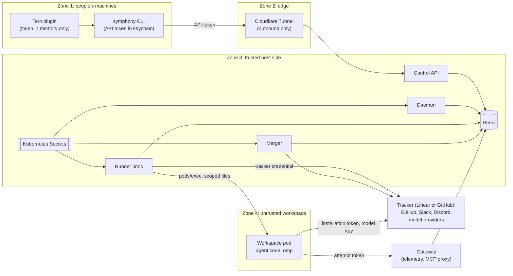

# Security model

This document describes the trust boundaries of Symphony, the path of each credential, and the controls that keep an agent inside the scope of its ticket. To report a vulnerability, follow [SECURITY.md](../SECURITY.md).

## Contents

- [Trust boundaries](#trust-boundaries)
- [Credentials](#credentials)
- [Credentials in a workspace](#credentials-in-a-workspace)
- [Integration credentials from setup](#integration-credentials-from-setup)
- [API tokens and token roles](#api-tokens-and-token-roles)
- [Webhooks](#webhooks)
- [Network policy](#network-policy)
- [Kubernetes permissions](#kubernetes-permissions)
- [Pod security](#pod-security)
- [MCP servers](#mcp-servers)
- [The assistant](#the-assistant)
- [Read-only investigations](#read-only-investigations)
- [Fencing](#fencing)
- [Merger controls](#merger-controls)
- [Local mode](#local-mode)
- [Operator checklist](#operator-checklist)

## Trust boundaries

Symphony treats the agent's code and commands as untrusted. The trusted side keeps the Linear API key, the GitHub App private key and the tracker's App token, Slack and Discord tokens, and Symphony API tokens. It makes every write that needs one of them. A workspace gets only the credentials that its own attempt needs.

| Boundary | Control |
|---|---|
| People → API | API token on every REST and MCP request (health routes need none), token role check on every route, rate limits, audit. |
| Vendors → API | HMAC signature on every webhook. A webhook only wakes a loop. It carries no command. |
| Trusted side → workspace | The runner writes only the attempt's credentials into private files: the role's model credential, a scoped GitHub token and the telemetry token. The pod has no ServiceAccount token. |
| Workspace → trusted side | NetworkPolicy allows only the gateway. The gateway accepts telemetry with the current attempt's token, and MCP requests with a live MCP token of a role that the server allows. |
| Agent → tracker | Only through the tracker host tool (`linear_graphql` or `github_graphql`), which the runner executes with the trusted-side tracker credential. |

## Credentials

| Credential | Stored in | Used by | Reaches a workspace |
|---|---|---|---|
| Linear API key | Secret `linear-api-key` | API, daemon, runner, merger, sweep, reflector (Linear tracker only) | Never. The agent uses `linear_graphql`. |
| Linear webhook secret | Secret `linear-api-key` | API | Never. |
| GitHub tracker token | Process memory of the daemon, runner, merger, sweep and reflector | the GitHub tracker adapter and the `github_graphql` host tool | Never. It is an installation token of the GitHub App with the installation's permissions (Issues, Projects, Metadata). Each process mints its own and renews it before it expires. |
| GitHub App private key and IDs | Secret `github-app` | daemon, runner, merger, sweep, reflector | Never. |
| GitHub installation token | Runner process memory, then a file in the pod | runner, agent's git and GitHub calls | Yes: `/run/symphony/gh-token` (mode `0600`), at most 1 hour, renewed between turns, scoped to the ticket's repositories and narrowed to `ghapp.WORKSPACE` (see [Credentials in a workspace](#credentials-in-a-workspace)). |
| GitHub webhook secret | Secret `symphony-api` | API | Never. |
| Bootstrap admin token | Secret `symphony-api` | API | Never. |
| API tokens | Redis (SHA-256 of the secret only), each person's keychain, the MCP entry of each person's Tern `settings.json` (mode `0600`) | people, CLI, Tern, MCP | Never. |
| Slack token or webhook URL | Secret `symphony-slack` | notifiers | Never. |
| Discord bot token or webhook URL | Secret `symphony-discord` | notifiers | Never. |
| Slack app-level token (`SLACK_APP_TOKEN`) | Secret `symphony-slack` | assistant (Socket Mode) | Never. The assistant's agents never get it either. |
| Model credential of the role | Secret `symphony-providers` or `model-provider` | runner, reflector, merger | Yes, in `/run/symphony/engine.env` (mode `0600`). A custom provider puts only its own key there. A built-in provider, or a provider with no stored key, also puts the host fallback environment of `model-provider` there. |
| Gateway token (attempt token) | Ticket record in Redis | runner, gateway | Yes: in the engine environment. It is valid for one dispatch and authorizes only telemetry. |
| MCP server headers | Secret `symphony-mcp` (local mode: `<root>/mcp.json`, mode `0600`) | gateway only | Never. The gateway adds them to the request. |
| MCP token | Redis (SHA-256 of the token, with a TTL) | each agent session, gateway | Yes: in the agent's private `mcp.json`. One token per agent session and role. It authorizes only that role's MCP servers, and it is revoked when the session ends. |
| Cloudflare tunnel token | Secret `cloudflared-token` | `symphony-cloudflared` | Never. |

The [credential flow diagram](architecture.md#credential-flow) shows the order of these steps.

Rules for all code (see [AGENTS.md](../AGENTS.md)):

- No credential value appears in a log, in Redis or on a command line.
- Provider and infrastructure credentials never appear in an API response. There are two exceptions. `POST /v1/admin/tokens` returns the new API token once, and `POST /v1/setup/webhooks` returns the new webhook secrets once. Both use `Cache-Control: no-store`.
- Model API keys are write-only. The API, the CLI and the Tern plugin never show a stored key.
- Symphony supports provider API keys, unauthenticated custom endpoints (`auth: none`), and host cloud credentials (for example Amazon Bedrock through IAM). It has no provider OAuth or subscription login.

## Credentials in a workspace

A workspace pod gets these credentials, and no others:

- the model credential of its agent role, in `/run/symphony/engine.env` (mode `0600`). For a built-in provider, or a provider with no stored key, this file also holds the host fallback environment of the Secret `model-provider`. Put in that Secret only credentials that agents may use;
- a GitHub installation token for the ticket's repositories, valid for at most 1 hour, in `/run/symphony/gh-token` (mode `0600`);
- the telemetry token of the dispatch, which the gateway accepts only for that dispatch.

The GitHub installation token is narrowed to `ghapp.WORKSPACE`: `contents: write`, `pull_requests: write`, `metadata: read`, `checks: read`, `actions: read`, `statuses: read`. It has no `issues`, `projects` or `workflows`, even when the App grants them. So agent code cannot edit tickets or boards, and GitHub rejects a push that changes `.github/workflows/*`. An investigation gets `ghapp.READ_ONLY` (see [Read-only investigations](#read-only-investigations)).

A workspace pod never holds:

- the Linear API key or webhook secret;
- the GitHub tracker token (with `tracker.kind: github`);
- the GitHub App private key, App ID or installation ID;
- the GitHub webhook secret;
- any Slack or Discord credential;
- any API token, including the bootstrap token;
- the Redis address in a reachable form (the NetworkPolicy blocks Redis);
- a Kubernetes ServiceAccount token (`automountServiceAccountToken: false`);
- the model keys of other providers when the role uses a custom provider.

The runner also replaces any old workspace pod that used `envFrom` with a Secret. Such a pod would expose every key in that Secret.

## Integration credentials from setup

The first-run setup (`/v1/setup/*`) writes the integration credentials into named Secrets. The rules:

- Only an `admin` token can write. Any token can read the checklist, which shows only whether a value is set.
- The API verifies each value against the real service before it saves it. A value that fails is not saved.
- The values are write-only. No response, log, audit entry or command line contains them. Request validation errors name the fields only.
- The audit log records each write as `setup.<step>` (`setup.tracker`, `setup.github_app`, `setup.repositories`, `setup.notifications`, `setup.webhooks`), with a target that holds no secret.
- Redis holds no integration credential. The webhook secrets that `POST /v1/setup/webhooks` makes are the only values returned, once, with `Cache-Control: no-store`, the same exception as a new API token.
- The vendor-check cache (30 s) is in process memory, under a digest of the inputs.
- In local mode, the values go to `<root>/secrets.env` (mode `0600`).

The Secrets that setup writes: `linear-api-key`, `github-app`, `symphony-api` (only `GITHUB_WEBHOOK_SECRET`), `symphony-slack` and `symphony-discord`. It reads only the key names of `model-provider`. Provider keys go to `symphony-providers` through `/v1/admin/providers`, as before.

## API tokens and token roles

An API token has the format `sym_<8 hex>_<43 characters>`. The API stores only the token ID, a SHA-256 hash of the secret, the role, the creation time, the expiry and the last use.

| Token role | Can do |
|---|---|
| `viewer` | Read every view: overview, sessions, live events, tickets, merger, repositories, infrastructure, telemetry, learnings, audit, workflow, team configuration, catalog. Use the read MCP tools. |
| `operator` | Everything of `viewer`, plus: send messages and interrupts to sessions, `pause`, `resume`, `refresh`, `reevaluate`, `hold`, `release`, merger `bypass`, `requeue` and `release`. |
| `admin` | Everything of `operator`, plus: manage API tokens, store provider keys, publish the team configuration, publish `WORKFLOW.md`, write the first-run setup. |

Controls:

- The API compares the secret in constant time.
- Each token can make at most 600 requests each minute. Each client address can make at most 30 failed authentications each minute. Above these limits, the API answers `429` with `Retry-After`.
- A token can expire. `symphony token create` uses 90 days by default.
- A revocation takes effect on the next request. No restart is necessary.
- The API audits every command and every provider change.
- The bootstrap token comes from `SYMPHONY_BOOTSTRAP_TOKEN`. Use it to make the team's tokens, then revoke it.

On each person's machine:

- The CLI keeps the token in the system keychain, or in a file with mode `0600` when no keychain is available.
- `symphony tern install` writes the token as a literal `Authorization: Bearer <token>` header of the MCP server entry in Tern's `settings.json`. The command sets the mode of that file to `0600`. Run `symphony tern install` again after you change your token.
- The Tern plugin gets the token from `symphony token print` and keeps it in memory only.
- `SYMPHONY_URL` and `SYMPHONY_TOKEN` win over the saved configuration.

## Webhooks

| Webhook | Route | Check |
|---|---|---|
| Linear | `POST /v1/webhooks/linear` | `Linear-Signature` must be the HMAC-SHA256 (hex) of the raw body with `LINEAR_WEBHOOK_SECRET`. `webhookTimestamp` must be within 5 minutes of the server time. |
| GitHub | `POST /v1/webhooks/github` | `X-Hub-Signature-256` must be `sha256=` plus the HMAC-SHA256 (hex) of the raw body with `GITHUB_WEBHOOK_SECRET`. |

- The comparison is in constant time.
- A wrong signature gives `401 invalid_signature`. An old Linear timestamp gives `401 stale_webhook`. A missing secret gives `503 webhook_unconfigured`.
- A valid webhook only wakes the daemon or the merger. The woken loop reads the source of truth again. A forged or replayed delivery can cost a poll, but it cannot change state.

## Network policy

`deploy/networkpolicy.yaml` uses plain NetworkPolicy. It needs a CNI that enforces it (k3s's built-in controller, Calico or Cilium).

| Policy | Pods | Rule |
|---|---|---|
| `symphony-workspace` | workspaces | No ingress. Egress only to the gateway on TCP 8090, to cluster DNS, and to public addresses. The policy excludes `10.0.0.0/8`, `172.16.0.0/12`, `192.168.0.0/16`, `100.64.0.0/10`, `169.254.0.0/16` and `127.0.0.0/8`. |
| `symphony-gateway` | gateway | Ingress on TCP 8090 only from workspaces, distill pods, the merger and the assistant. Egress only to Redis, cluster DNS and public addresses (the same private ranges are excluded), so a stored MCP header cannot be sent into the cluster or to the cloud metadata endpoint. |
| `symphony-api` | API | Ingress on TCP 8080. |
| `symphony-redis` | Redis | Ingress on TCP 6379 only from `api`, `gateway`, `daemon`, `merger`, `runner`, `reflector`, `sweep` and `assistant` pods. |
| `symphony-no-ingress` | daemon, merger, runner, reflector, sweep, assistant | No ingress. Egress stays open: the assistant dials Slack, Discord, GitHub, Redis, the gateway and the Kubernetes API. |
| `symphony-metrics` (optional, `deploy/monitoring/`) | daemon, merger, assistant, gateway | Ingress on TCP 8081 (`/healthz`, `/metrics`) only from a namespace labeled `symphony.dev/monitoring: "true"`. The metrics hold no credential, ticket id or session id ([observability.md](observability.md)). |

The workspace cannot reach the API, Redis, the node, other pods or the cloud metadata endpoint (`169.254.169.254`). Nothing connects into a workspace: the runner uses the Kubernetes API's `pods/exec`.

> **Note:** A workspace has open egress to public addresses, because the hosts of a build are not known in advance. Agent code can therefore send the attempt's own credentials anywhere. It cannot send the Linear API key, the GitHub App private key, the tracker's App token, Slack or Discord tokens, or Symphony API tokens, because the pod does not have them. `kubernetes.egress_allowlist` does not restrict egress in the current code.

## Kubernetes permissions

Each identity has a namespaced Role. No ClusterRole exists.

| ServiceAccount | Permissions | Used by |
|---|---|---|
| `symphony-daemon` | Jobs: create, get, list, delete. Pods: get, list, delete, patch. `pods/exec`. PVCs: get, delete. ConfigMap `symphony-workflow`: get, update. | daemon, nightly sweep |
| `symphony-runner` | Pods: create, get, list, delete, patch. `pods/exec`. PVCs: create, get. Secrets `symphony-providers`, `model-provider` and `symphony-mcp`: get. | runner and reflector Jobs |
| `symphony-api` | Pods, PVCs, Jobs: get, list. ConfigMap `symphony-workflow`: get, update (seed and publish). Secret `symphony-providers`: get, update. Secrets `linear-api-key`, `github-app`, `symphony-api`, `symphony-slack`, `symphony-discord`, `symphony-mcp`: get, patch (pre-created empty by `deploy/integrations.yaml` and `deploy/secrets.example.yaml`). Secret `model-provider`: get. Deployments: list; `symphony-api`, `symphony-daemon`, `symphony-merger`, `symphony-assistant`: get, patch (the setup restart). | API |
| `symphony-merger` | Secrets `symphony-providers` and `symphony-mcp`: get. | merger |
| `symphony-assistant` | Secrets `symphony-providers` and `symphony-mcp`: get. | assistant |
| `symphony-gateway` | None. No token is mounted. | gateway |

The API has no `create` or `delete` on any object. Kubernetes cannot limit `create` to a name, so every Secret that the API writes exists before setup runs. The `get` on an integration Secret serves only `has` (is a name set); the API never returns a value. A merger Deployment that an overlay adds must also be added to the named Deployments of the Role `symphony-api` ([install.md](install.md#11-add-a-merger-for-each-repository)). Otherwise the restart gives `restart_forbidden`.

## Pod security

- The Symphony pods run as user and group `10001`, as non-root, with the `RuntimeDefault` seccomp profile, no privilege escalation and all capabilities dropped.
- A workspace pod has CPU and memory limits, a maximum life (`kubernetes.sandbox.timeout_s`) and no ServiceAccount token.
- A workspace runs privileged only when `kubernetes.privileged_agents` is true. See the [Docker postures](configuration.md#docker-in-the-workspace).

> **Warning:** A privileged workspace without a VM runtime class gives agent code close to root access on the node. Prefer `sysbox-runc`, or turn Docker off.

## MCP servers

Agents can use MCP servers that an admin picks per role ([mcp.md](mcp.md)). The rules:

- **Credentials stay in the gateway.** A remote server's secret headers live in the Secret `symphony-mcp`. Only the API writes it, and only the gateway mounts it. The values are write-only: no response, log or audit entry shows them.
- **One token per session and role.** Each agent launch mints its own MCP token and writes it into the agent's private `mcp.json`. The gateway accepts it only for enabled servers of that role, and answers anything else with 403 `mcp_forbidden`, without saying which check failed. The token is revoked when the session ends, and expires after 4 hours.
- **The gateway drops the agent's `Authorization`** and adds the stored headers. A header reaches only its own server.
- **Repository MCP configs are ignored.** Symphony writes `mcp.enableProjectConfig: false` into the agent's settings, so a repository's `.omp/mcp.json` and third-party MCP configs never load. The agent dir is private, so no user-level config applies. In local mode the developer's own `~/.omp/agent/mcp.json` still loads.
- **`tools.xdev: false`.** With the default, omp mounts MCP tools as `xd://` devices and adds `write` to call them. Symphony turns that off, so a read-only role gains no file tool.
- **stdio servers have no secrets.** A stdio server runs next to the agent, so it gets no secret headers. Symphony refuses an `env` name that looks like a credential.
- **Private addresses are closed.** The gateway's egress excludes the private ranges, like a workspace's.
- **What reaches the agent.** The agent gets only its session MCP token and gateway URLs: in its private `mcp.json`, and through `agent_env` (for Seiji, `SEIJI_TOKEN` is the session token and `SEIJI_URL` is `{gateway}/v1/mcp/<name>/http`). Symphony refuses an `agent_env` value that is a literal secret. The server's own token (Seiji's `sj_…`) stays in the Secret and reaches only the server. The agent's `$SEIJI_TOKEN` works only at the gateway, only for that role's servers, and dies with the session.
- **The companion HTTP API** (`/v1/mcp/<name>/http/…`) has the MCP proxy's checks and header swap. Links that the server returns are rewritten to the gateway, so the agent never needs the server's address or token. Viewer routes (`view/…`) are never proxied: they take no token, so a proxy would let anyone with the session token open the device.
- **The viewer link** (`POST /v1/mcp/<name>/viewer`, operator role, audited `mcp.viewer`) opens only a lease that a session with a live MCP token holds, so an operator cannot watch someone else's device on a shared Seiji account. The link is a one-time ticket of 60 s; the audit records the lease and `control`, never the link. With `control: true`, the operator drives the device that the agent uses, and everyone who watches sees it.
- **Held leases.** Redis keeps the ids that a session holds, keyed by the hash of its token. It never keeps the token or a header value.

## The assistant

The assistant reads chat messages from Slack and Discord ([assistant.md](assistant.md)). Treat every message as untrusted input.

- **Read-only tools.** Its agents get `read`, `grep`, `glob`, `web_search`, the role's MCP servers and read-only host tools. They get no `bash`, `edit` or `write`.
- **Stripped credentials.** The agent's environment has no Slack, Discord, tracker or GitHub App credential. The trusted assistant process holds them. The worktrees are fetched with a `ghapp.READ_ONLY` token.
- **Prompt injection.** A message, a file or a web page can try to steer the agent. The agent can only read, answer in the thread, and propose tickets. It cannot change code, the tracker or Symphony.
- **Ticket creation needs a mapped person.** A proposal creates nothing. Only a click by a person mapped in `notify.users` creates tickets, and the audit entry `assistant.tickets_created` names that person's GitHub login. A click from anyone else gets a private refusal.
- **No mass mentions.** Discord replies use `allowed_mentions: {parse: []}`.
- **Kubernetes access.** The `symphony-assistant` ServiceAccount can only read `symphony-providers` and `symphony-mcp`. The pod has no Service and accepts no ingress.

## Read-only investigations

For a ticket with the investigation label, the runner requests an installation token with these permissions only:

| Permission | Level |
|---|---|
| `contents` | read |
| `pull_requests` | read |
| `metadata` | read |

GitHub refuses a push or a new pull request with this token. The deliverable is the report on the ticket.

For other tickets, the token is narrowed to `ghapp.WORKSPACE`, limited to the ticket's repositories:

| Permission | Level |
|---|---|
| `contents` | write |
| `pull_requests` | write |
| `metadata` | read |
| `checks` | read |
| `actions` | read |
| `statuses` | read |

> **Note:** The token never has `issues`, `projects` or `workflows`, even when the App grants them (with `tracker.kind: github` the App has Issues and Projects write). So agent code cannot change issues or the project board. The tracker host tool is the only path to the tracker. GitHub also rejects a push that changes `.github/workflows/*`.

## Fencing

Fencing makes sure that only the current dispatch of a ticket can change state.

- **Dispatch token.** The daemon makes `dispatch:<issue>:<seq>` with put-if-absent. Two daemons cannot both win.
- **Dispatch sequence.** The runner checks before each turn and on each write that the record names its attempt and its `dispatch_seq`, and that the token exists. A runner of an old dispatch exits with no effect (`fenced`).
- **Gateway token.** Each dispatch gets a new random gateway token. The gateway rejects a token of an old dispatch.
- **Holds.** A hold deletes the dispatch tokens and the gateway token at once. A runner that survives its cancellation cannot write, report or get a credential.
- **Intents.** An intent for a session of an old dispatch has no effect.
- **Engine stop.** The runner always stops the engine (SIGTERM, then a confirmed kill) before it releases the workspace. Two engines never share one workspace.
- **Daemon lease.** One daemon holds the orchestration lease at a time.

## Merger controls

- The merger reads the repository policy `.symphony/merger.md` from `origin/main`. A pull request cannot change the rules that review it.
- The reviewer, oracle and arbiter agents run with the tools `read` and `grep` only. Only the developer agent, which resolves conflicts, can edit.
- The deterministic precheck blocks secrets (AWS, GitHub, private keys, Slack, `sk-` keys, Linear) and local paths in the diff.
- The train merges only the exact head that CI tested, and it pushes with `--force-with-lease`.
- The merger runs one train at a time under a lease.

[merger.md](merger.md) gives the details.

## Local mode

> **Warning:** Local mode has no pod and no container. The agent runs as the host user, with that user's environment, git credentials, `~/.omp`, network and files.

- The process removes its own secrets (`REDIS_URL`, `LINEAR_API_KEY`, `LINEAR_WEBHOOK_SECRET`, `GITHUB_APP_*`, `GITHUB_WEBHOOK_SECRET`, `SYMPHONY_BOOTSTRAP_TOKEN`, `SYMPHONY_TOKEN`, `SLACK_BOT_TOKEN`, `SLACK_WEBHOOK_URL`, `DISCORD_BOT_TOKEN`, `DISCORD_WEBHOOK_URL`, and the tracker's own secret names) from the environment of the agent and the hooks. This is hygiene, not a boundary: a process of the same user can read the environment of the Symphony process.
- With a GitHub App, each attempt gets an installation token for the ticket's repositories in `<root>/credentials/<workspace>/` (mode `0600`). Symphony deletes the file when the attempt ends. A git credential helper reads it, and the configuration first clears the host's inherited credential helpers (for example `osxkeychain`), so git does not send or store another credential. Without an App, the agent uses the host user's git credentials.
- Use a dedicated Unix user with no `sudo`, on a machine that does nothing else. Run only tickets from people that you trust with a shell on that machine.
- Keep the API on `127.0.0.1`. Reach it with an SSH tunnel or a Cloudflare Tunnel.
- Setup writes the integration credentials to `<root>/secrets.env` with mode `0600`. A variable set in the host environment wins over the file, and setup refuses to write it (`host_env_overrides`).

## Operator checklist

1. Make a separate GitHub App for Symphony, installed only on the repositories that Symphony works on.
2. With Linear, use a Linear service account for `LINEAR_API_KEY`. With GitHub, give the App the Projects permission only on the board's owner.
3. Use a CNI that enforces NetworkPolicy.
4. Keep `kubernetes.privileged_agents: false`, or use a runtime class.
5. Keep `telemetry.capture_content: none`.
6. Revoke the bootstrap token after you make the admin tokens and finish setup.
7. Give each person a token with the lowest role that they need, with an expiry.
8. Back up the Redis volume. It holds the token hashes and the audit.
