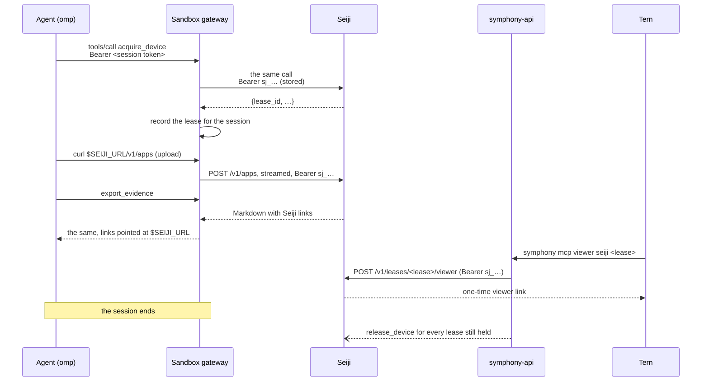

# Seiji

[Seiji](https://github.com/wiljafor1/seiji) lends iOS simulators (and Android emulators) on a shared Mac to agents over MCP. It records evidence of each run: a video, the app log, screenshots and a manifest. This guide shows how Symphony's agents use Seiji, how the evidence reaches the ticket and the pull request, how Symphony releases devices, and how people watch a device.

[Watch the 4-minute Seiji video](media/symphony-seiji.mp4) ([captions](media/symphony-seiji.vtt)).

## Contents

- [How it fits](#how-it-fits)
- [Set up Seiji for Symphony](#set-up-seiji-for-symphony)
- [Add Seiji to Symphony](#add-seiji-to-symphony)
- [What the agent does](#what-the-agent-does)
- [Evidence](#evidence)
- [Cleanup](#cleanup)
- [Watching a device](#watching-a-device)
- [Limits](#limits)
- [Troubleshooting](#troubleshooting)

## How it fits

Seiji is an MCP server with an HTTP API next to it. Both need Seiji's bearer token (`sj_…`). Symphony keeps that token in the Secret `symphony-mcp` and never gives it to an agent. The agent talks to Symphony's gateway with its own session token, and the gateway talks to Seiji with the stored one.



The pieces are generic MCP features ([mcp.md](mcp.md)). The `seiji` preset sets them for Seiji:

| Feature | For Seiji |
|---|---|
| [Companion HTTP API](mcp.md#companion-http-api) | `$SEIJI_URL/v1/apps`, `/v1/me`, `/v1/runs/…` through the gateway |
| [Link rewriting](mcp.md#companion-http-api) | Seiji's links in tool results become `$SEIJI_URL/…` links that work for the agent |
| [`agent_env`](mcp.md#variables-for-the-agent-agent_env) | `SEIJI_TOKEN` (the session token) and `SEIJI_URL` (the gateway URL) in the agent's shell |
| [Session cleanup](mcp.md#session-cleanup) | `release_device` for every lease still held, and `DELETE /v1/apps/{app_id}` for every build the session uploaded, when the session ends |
| Timeout | 65 minutes per tool call, above Seiji's longest run (`xctest.timeoutSeconds` 3600 s) |

The protocol matches: omp 18.20.2 speaks MCP `2025-11-25`, and Seiji (rmcp 3.10) accepts `2024-11-05`, `2025-03-26`, `2025-06-18` and `2025-11-25`. Seiji is stateless and answers JSON only, which the gateway passes through.

## Set up Seiji for Symphony

On the Seiji host ([Seiji's install guide](https://github.com/wiljafor1/seiji/blob/main/docs/install.md)):

1. **Add one user for Symphony.** All of Symphony's agents share it, so its quota is the team's budget, and its `maxConcurrent` is how many attempts can hold a device at once.

   ```sh
   seiji user add symphony --max-concurrent 4
   ```

   The command prints the token once. Keep it for the next section.

2. **Make Seiji reachable from the gateway.** The gateway's egress excludes private addresses ([security.md](security.md#network-policy)). Put Seiji behind TLS on a public name, and add that name to `listen.allowedHosts`.

3. **Set `listen.publicUrl`** to that public URL. Seiji then writes absolute links, and Symphony rewrites them. Without it, Seiji's links are relative (`/v1/runs/…`), and the agent must add `$SEIJI_URL` itself.

## Add Seiji to Symphony

With an `admin` token:

```sh
symphony admin mcp set seiji --preset seiji --url https://seiji.example.com/mcp \
  --role implementer
echo '{"Authorization": "Bearer sj_…"}' | symphony admin mcp headers seiji
symphony admin mcp test seiji
```

The test runs `initialize` and `tools/list` (Seiji has 23 tools), then reads Seiji's `/v1/me` with the stored header. It prints the Seiji account: `seiji works (protocol 2025-11-25). Tools: …. Account: symphony.` With `--json`, the result has `me: {user, quota}`. A wrong token gives `rejected`.

The preset fills:

| Field | Value |
|---|---|
| `transport` | `http` |
| `http_base` | the url without `/mcp` (`https://seiji.example.com`) |
| `timeout_ms` | `3900000` |
| `agent_env` | `{"SEIJI_TOKEN": "{token}", "SEIJI_URL": "{http_url}"}` |
| `cleanup` | `{"acquire_tool": "acquire_device", "id_field": "lease_id", "release_tool": "release_device", "release_arg": "lease_id"}` |

Explicit flags win over the preset. Symphony stores a plain definition, so `symphony admin mcp list --json` shows every field. Tern's Admin › MCP has the same preset ([tern.md](tern.md)).

When Seiji's `publicUrl` origin differs from the MCP URL's origin (for example an internal URL for Symphony and a public one for people), add it:

```sh
symphony admin mcp set seiji --preset seiji --url https://seiji.internal.example.com/mcp \
  --rewrite-origin https://seiji.example.com --role implementer
```

Give Seiji to more roles with more `--role` flags. Only the coding agent's attempt prompt gets the Seiji paragraph (below).

## What the agent does

The attempt prompt of a role with a Seiji server gets this paragraph, after the ticket's own prompt:

```text
Seiji device lab (MCP server `seiji`): Seiji lends you an iOS simulator or an Android emulator and records evidence of each run.
- Upload a build with `curl -sS -H "Authorization: Bearer $SEIJI_TOKEN" -H "X-Filename: MyApp.zip" --data-binary @MyApp.zip "$SEIJI_URL/v1/apps"`. Use `$SEIJI_URL` for every Seiji link.
- Always call `release_device` when you are done. A held device costs budget.
- Put the Markdown of `export_evidence` in the pull request body.
- Download `$SEIJI_URL/v1/runs/<run_id>/evidence.zip` with the same header and attach it with `symphony_attach_evidence` when the tracker accepts files (Linear does). GitHub issues take text only: attach `report.md` from `$SEIJI_URL/v1/runs/<run_id>/report.md` instead.
- Reviewers cannot open Seiji links. Attach the files they need.
```

Seiji's own instructions (its `initialize` text) also tell the agent to `curl` with `$SEIJI_TOKEN`. Symphony sets that variable to the agent's session token, so Seiji's instructions work as written: the request goes to the gateway, which swaps the token.

| Variable | Value |
|---|---|
| `SEIJI_TOKEN` | The agent session's MCP token (`mcp_…`). It works only at the gateway, only for this role's servers, and dies with the session |
| `SEIJI_URL` | `{gateway}/v1/mcp/seiji/http` |

The tools appear as `mcp__seiji_<tool>` (local mode: `mcp__symphony_seiji_<tool>`).

## Evidence

- **Pull request.** `export_evidence` returns a Markdown summary: the verdict, the device, a step table and links. The agent puts it in the PR body. The links point at the gateway, so reviewers cannot open them; the files themselves must be attached.
- **Ticket.** The agent downloads `evidence.zip` (or `report.md`) through `$SEIJI_URL` and attaches it with `symphony_attach_evidence`. Linear takes the zip. GitHub issues take text, so the agent attaches `report.md`. The evidence then shows on the ticket and in the session's evidence list.
- **Binary files pass untouched.** The gateway rewrites links only in JSON, text and Markdown bodies up to 8 MiB. `evidence.zip`, videos and screenshots stream unchanged.

## Cleanup

A Seiji lease costs budget until it ends, and a build takes one of the user's `maxBuildsPerUser` places until it expires. Seiji's idle reaper ends a forgotten lease after `idleMinutes` (15 by default), and its retention deletes a build `appRetentionHours` after its upload (72 by default). Symphony frees both sooner:

1. The gateway records every lease that `acquire_device` returns, under the session's token. `release_device` removes it. It also records the `app_id` of every build the agent uploads through `$SEIJI_URL/v1/apps`.
2. When the session ends (an attempt, a merger or chat assistant session), Symphony calls `release_device` for every lease still held, then `DELETE /v1/apps/{app_id}` for every build the session uploaded, with the stored header. A Seiji that already expired the build, or has no such route, answers 404 or 405, which is fine. The log line `mcp_cleanup` has the counts: `held`, `released`, `failed`, `kept`, `builds`, `deleted`.
3. If the runner crashes, or Seiji is down at that moment, the gateway's sweep releases the leases and deletes the builds of expired sessions within a minute, and keeps trying for 24 hours.

PR previews upload with the stored header, not through a session, so this cleanup never deletes a build a preview reuses. [PR previews](#pr-previews) delete their builds by their own rule.

Sessions show what they hold: `mcp_leases` on each session of `GET /v1/sessions`, and the event `symphony.mcp_lease` on the session's stream ([api.md](api.md#sessions)).

## Watching a device

People watch a device from Symphony's Tern panel or from the CLI. Both ask Symphony for a viewer link; Symphony asks Seiji with the stored header.

```sh
symphony mcp viewer seiji l_3f9c2a7b1e04 --json
```

```json
{"url": "https://seiji.example.com/view/open/…", "expires_in": 60, "control": false}
```

- The link opens once, within 60 seconds. Open it in a browser or in Tern.
- Only a lease that a live Symphony session holds can be watched. Anything else gets `lease_not_held`.
- The route needs the `operator` role and is audited as `mcp.viewer`.
- `--control` lets the link drive the device: taps, swipes and typing. The agent's next step sees what you did, and everyone who watches the device sees it too.
- In Tern, a session that holds a device has **Watch device** (`w`). [tern.md](tern.md#watch-a-device) shows it.
- Seiji's viewer works for iOS simulators only. For an Android lease, Symphony passes Seiji's answer on: `viewer_refused`, "the screen viewer supports iOS simulators only for now".

Seiji has its own Tern plugin (id `seiji`) for your own devices. It can be installed next to Symphony's: they share no id, key, command or block ([tern.md](tern.md#alongside-the-seiji-plugin)). Seiji's plugin signs in as you, so it does not see the devices of Symphony's account; use Symphony's **Watch device** for those.

### In the chat assistant

When a chat assistant role (`assistant`, `researcher` or `planner`) has the Seiji server, the session instructions tell the agent how to use the device tools and how to offer the asker control with `share_device`. The agent has no shell — it uses MCP tools only.

The `share_device` host tool posts a "Control the device" button. Only the mapped person who asked the current turn can click it, and only while that session holds the lease; each click creates a fresh one-time link.

### PR previews

When a Seiji server named `seiji` is configured and the GitHub App has `actions: read`, `contents: read` and `pull_requests: read`, a PR's preview build opens on a simulator in Seiji in two ways ([assistant.md](assistant.md#pr-previews) has the full flow):

- **The Slack button.** A reviewer clicks "Open in simulator" on the merger's notification and gets a viewer link privately. Only for the current head.
- **The link on the PR.** The merger keeps a **Preview** comment on the pull request with a link per build, newest first (the last 5). The link has no expiry: it opens that build days later, as long as GitHub keeps its artifact, and an older sha opens that older version. Behind Cloudflare Access (`api.access`), any person whose Access e-mail is mapped in `notify.users` may open it; without Access it works only with `previews.public_links: true` ([security](security.md#preview-links)). The browser shows the progress, then lands on a fresh control viewer; reload the page later for a new one. When someone asks on the PR to open the app in Seiji, the answer agent replies with this link.

Each build gets its own device, at most 2 per PR (a third releases the oldest). A device goes back after 55 minutes, when the PR is merged or closed, or when the lease is gone. A device from the button also goes back when the head changes or a human approves; one opened from a link keeps its build.

Seiji keeps at most `maxBuildsPerUser` builds per user (10 by default), each for `appRetentionHours` after its upload (72 by default). Symphony uploads each sha's build once: it keeps the `app_id` in Redis (`sym:<ns>:preview:app:<server>:<repo>:<sha12>`) for 60 hours, a margin under the default retention, and every later click, link open or restart of that sha installs the same upload. When Seiji no longer has it (`no uploaded app`, for example under a shorter retention), the start uploads it once more. Symphony deletes a build (`DELETE /v1/apps/{app_id}`) once no live device runs it: when its PR is merged or closed, when the merger closes the PR, or when the PR head has moved past it. A sweep every 10 minutes catches the builds of PRs whose devices ended earlier. A Seiji without the route answers 404 and the build stays until it expires.

## Limits

- **One account.** All agents share the Seiji user of Symphony: its monthly minutes, its `maxConcurrent` and its builds (`maxBuildsPerUser`, 10 by default).
- **iOS only for the viewer.** Android leases have no live screen yet.
- **No progress notifications.** Seiji sends none, so a long call holds the agent until it returns. The 65-minute timeout covers Seiji's longest run.
- **Relative links.** Without `listen.publicUrl`, Seiji's links are relative, and Symphony does not rewrite them.
- **Large bodies.** Links in bodies over 8 MiB are not rewritten.
- **Reviewers.** A link to Seiji or to the gateway never works for a reviewer. Attach the files.
- **Private networks.** On Kubernetes, the gateway reaches only public addresses. Local mode reaches any host in `SYMPHONY_MCP_ALLOW_HTTP_HOSTS` (for `http://`).

## Troubleshooting

| Symptom | Cause and fix |
|---|---|
| `admin mcp test` says `rejected` | The stored `Authorization` header is wrong or the Seiji user is disabled. Store `Bearer sj_…` again with `symphony admin mcp headers seiji` |
| `admin mcp test` says `unreachable` | The gateway cannot reach Seiji. Check the public name, TLS, and that the name is in Seiji's `listen.allowedHosts` (Seiji answers `403 Forbidden: Host header is not allowed` otherwise) |
| `acquire_device` fails with `device failed to start (not billed)` | The Seiji host cannot boot the simulator (no Xcode runtime, or a wrong `runtime` in Seiji's config). Run `seiji doctor` on the host |
| `you already hold N device(s), your limit is N` | More attempts want devices than the Symphony user's `maxConcurrent`. Raise it with `seiji user set symphony --max-concurrent N` |
| `the build upload was refused: you already keep 10 builds, the limit is 10; …` | The Symphony user keeps `maxBuildsPerUser` builds. An agent's builds go when its session ends; previews reuse each build and delete the builds of closed PRs; the others expire `appRetentionHours` after their upload. Wait for one to expire, or raise `maxBuildsPerUser` in Seiji's config |
| `symphony mcp viewer` says `lease_not_held` | No live session holds the lease: the attempt ended (and released it), or the lease id is wrong. Read `mcp_leases` of `symphony sessions --json` |
| The agent's `curl` gets `403 {"error": "mcp_forbidden"}` | The role has no Seiji server, the server is disabled, or the session ended |
