# Symphony in Tern

The `symphony` plugin brings Symphony into Tern. It shows what the agents are doing, opens a live
chat with each session, and covers the merger and team administration (models, providers, tokens
and MCP servers). It is built and tested for Tern 0.8.3. The source is in
[`tern-plugin/`](../tern-plugin).

## Install and sign in

1. Install the `symphony` CLI. The CLI is the only owner of your credential.
2. In Tern, open the palette and run **Symphony: Sign in**. Enter your team's Symphony URL. Paste
   the API token that an admin created for you (`symphony token create <your-name> --role
   operator`). The token is masked. `symphony login` stores it in the keychain. Tern never stores
   it.
3. On the same screen, **Install in Tern** runs `symphony tern install --no-plugin`. It adds the
   "Symphony" ACP agent (live chat) and the Symphony MCP server for your omp. The plugin is
   already installed, so the step does not install it again. Running it again changes nothing.

| Sign in | Ready |
|---|---|
| 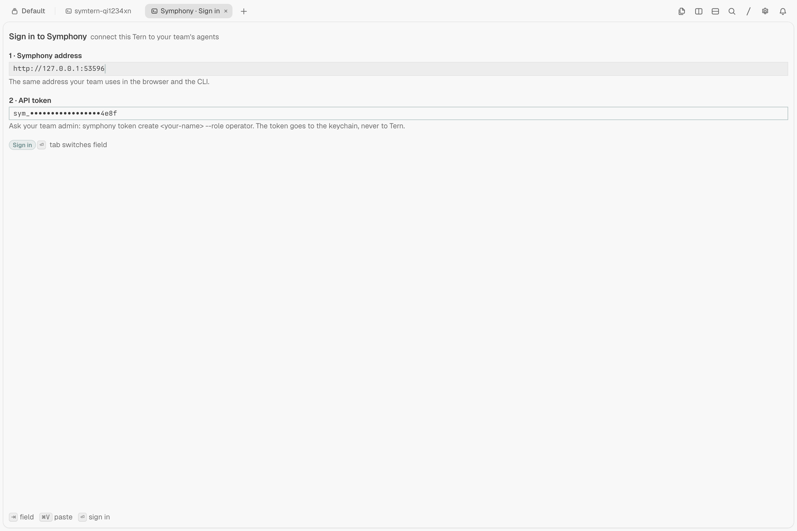 | 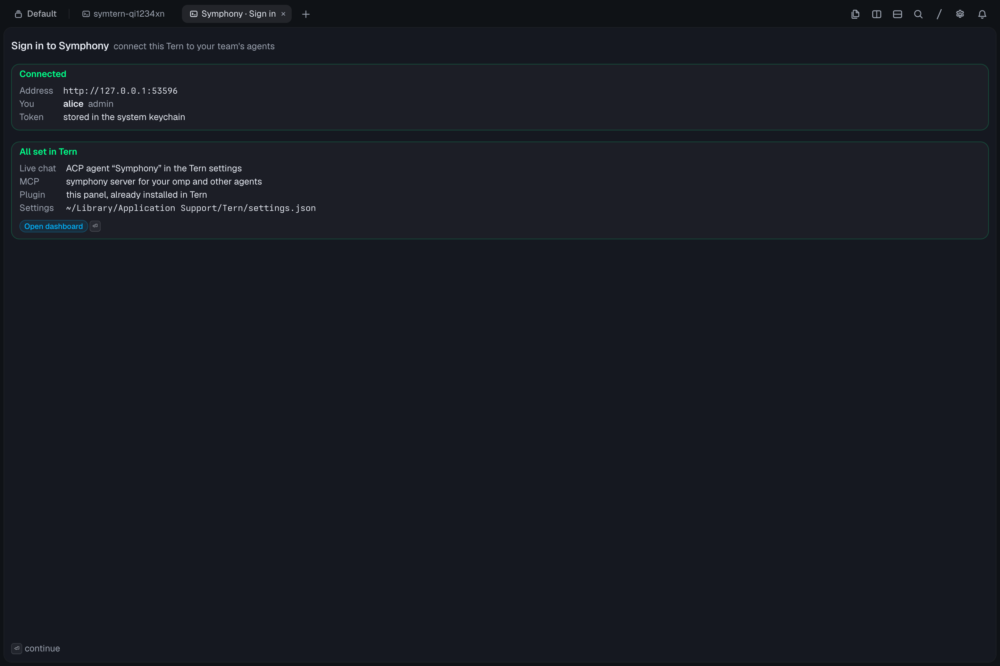 |

When you are not signed in, the panel and the status line show the next step (**Symphony · sign in**):

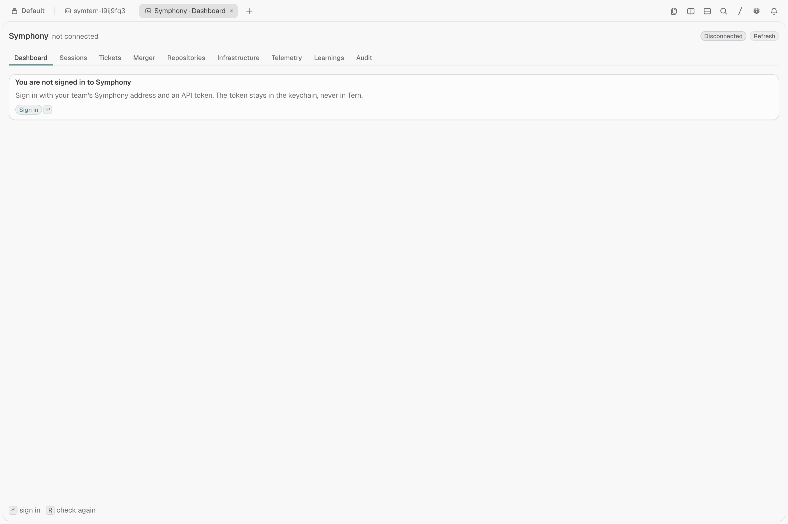

> A Tern started from the Dock does not get your login shell's `PATH`. The plugin then looks
> for `symphony` in `$UV_TOOL_BIN_DIR`, `$XDG_BIN_HOME`, `~/.local/bin` (`uv tool install`,
> pipx), `/opt/homebrew/bin` and `/usr/local/bin`, after Tern's own `PATH`. For a CLI elsewhere,
> set `SYMPHONY_BIN` to its full path where Tern's daemon reads it, and restart Tern.

## Commands and shortcuts

| Palette command | Command id | Shortcut | What it does |
|---|---|---|---|
| Symphony: Dashboard | `plugin.symphony.dashboard` | `ctrl+alt+s` | Opens the panel, or brings it to the front |
| Symphony: Sessions | `plugin.symphony.sessions` | — | Opens the panel on that view |
| Symphony: Tickets | `plugin.symphony.tickets` | — | Opens the panel on that view |
| Symphony: Merger | `plugin.symphony.merger` | `ctrl+alt+m` | Opens the panel on that view |
| Symphony: Repositories | `plugin.symphony.repositories` | — | Opens the panel on that view |
| Symphony: Infrastructure | `plugin.symphony.infrastructure` | — | Opens the panel on that view |
| Symphony: Telemetry | `plugin.symphony.telemetry` | — | Opens the panel on that view |
| Symphony: Learnings | `plugin.symphony.learnings` | — | Opens the panel on that view |
| Symphony: Audit | `plugin.symphony.audit` | — | Opens the panel on that view |
| Symphony: Admin | `plugin.symphony.admin` | — | Opens the panel on that view |
| Symphony: Chat with an agent | `plugin.symphony.chat` | `ctrl+alt+a` | Pick a session and open its live chat in a new tab |
| Symphony: Sign in | `plugin.symphony.signin` | — | Guided sign-in and Tern install |
| Symphony: Setup | `plugin.symphony.setup` | `ctrl+s` in the panel | First-run setup of the backend (admin) |

The status line shows `Symphony · 3 running · 1 needs input`. It is highlighted when an agent waits
for an answer. It adds "paused" when the daemon is paused. It says **Symphony · daemon stopped**
when the daemon has no heartbeat, and **Symphony · offline** when there is no connection. Click it
to open the panel.

Inside the panel: `tab`/`⇧tab` switches views, `↑↓` or `j`/`k` selects, `enter` opens the
session's chat, `r` refreshes and `ctrl+p` pauses or resumes the daemon (operators). On a session
that holds a device, `w` watches it and `⇧W` watches it with control (operators). The footer
shows only the keys that your role can use. A confirmation opens as a strip above the footer:
`enter` confirms, `esc` cancels. Below 120 columns the tab strip drops its counts and uses short
labels (Home, Repos, Infra, Usage, Learn) so every tab fits at 80 columns.

## Setup

A fresh install runs only Redis and the API. When `GET /v1/setup` says the backend is not set up,
the plugin opens **Setup** by itself for an admin, after sign-in and when the Dashboard loads. It
reads the status again every 30 s until every required step is done. Everyone else sees a banner
on the Dashboard: "Symphony is not set up yet. Ask an admin to finish setup."

The page has a head row (Setup, the mode, a status badge and Refresh), a progress bar of the
required steps, and the steps beside the selected step's card. The card says why the step
matters, what the API sees now, and holds the form. **Verify and save** (`enter`) runs
`symphony setup <step> … --json`: secrets go to the CLI on standard input and are masked on
screen. The API checks each value against the real service (Linear, GitHub, Slack, Discord)
before it stores it. The card then shows what it found: repositories, missing permissions, board
states. A step that turns done gets a check mark and a toast. When every required step is done,
"Symphony is ready" lists the next steps.

Keys: `↑↓` step, `tab` field, `enter` verify and save, `ctrl+r` refresh, `ctrl+t` send a test
message (Notifications), `esc` backs out one layer (the one-time webhook secrets, then an error
or a result).

**Assistant** is an optional step after Notifications. It sets up the chat bot in Slack and
Discord. Enter the channel IDs where it answers @mentions (direct messages always work), the
Slack app token (`xapp-…`, for Socket Mode) and, if you want, the repositories it may read. The
bot tokens come from Notifications. **Verify and save** runs `symphony setup assistant
--slack-channel … --discord-channel … [--repo …] --json`. The app token goes on standard input;
an empty field keeps the stored one. Both channel lists are always sent, and a transport without
channels is turned off. The card then shows each transport, the Discord Message Content intent,
and whether the assistant runs (its heartbeat and active threads).

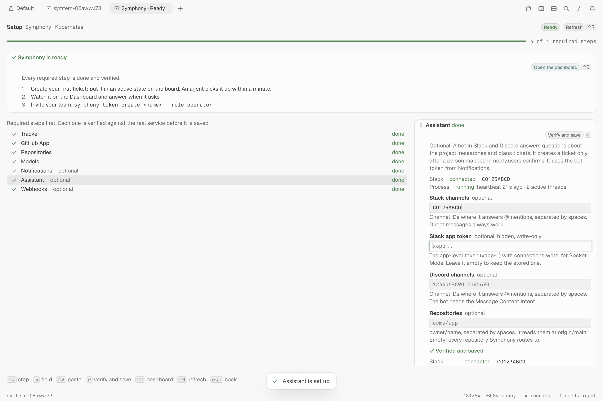
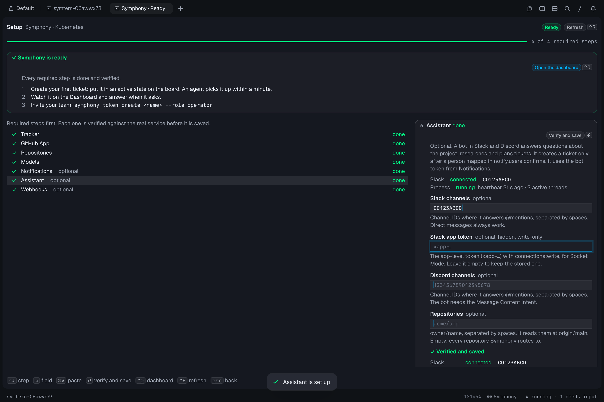

| Verify | Verifying | Done |
|---|---|---|
| 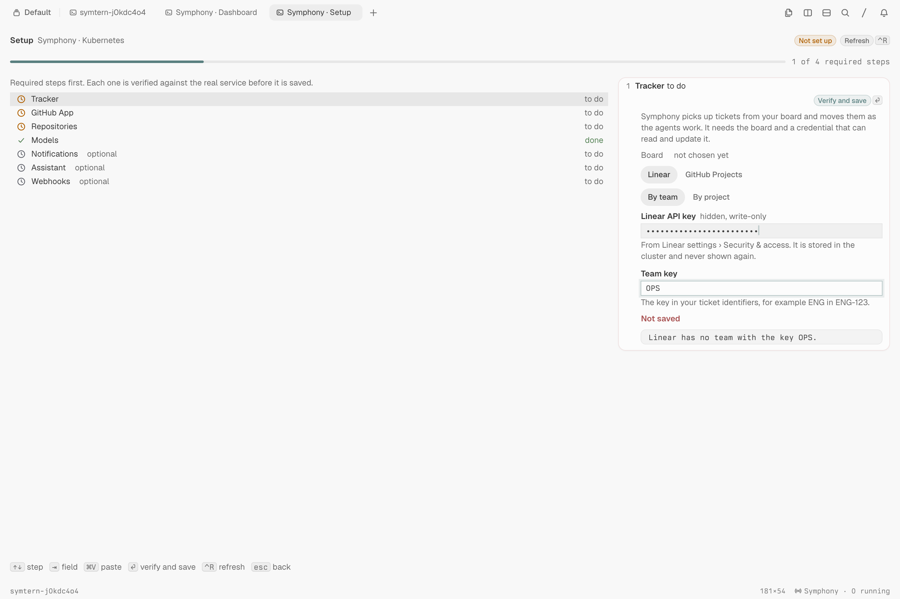 | 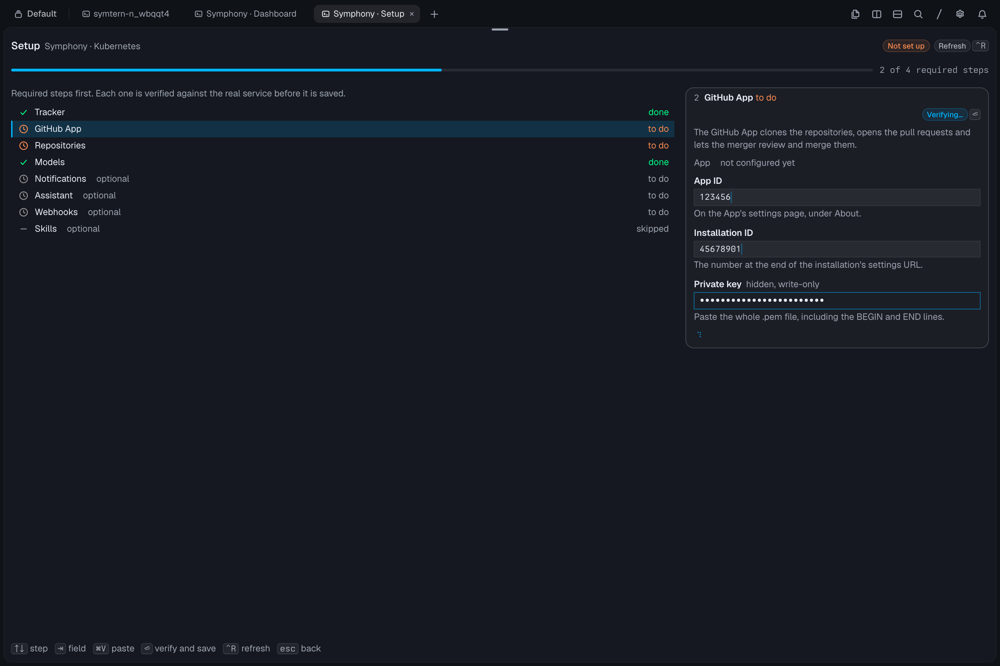 | 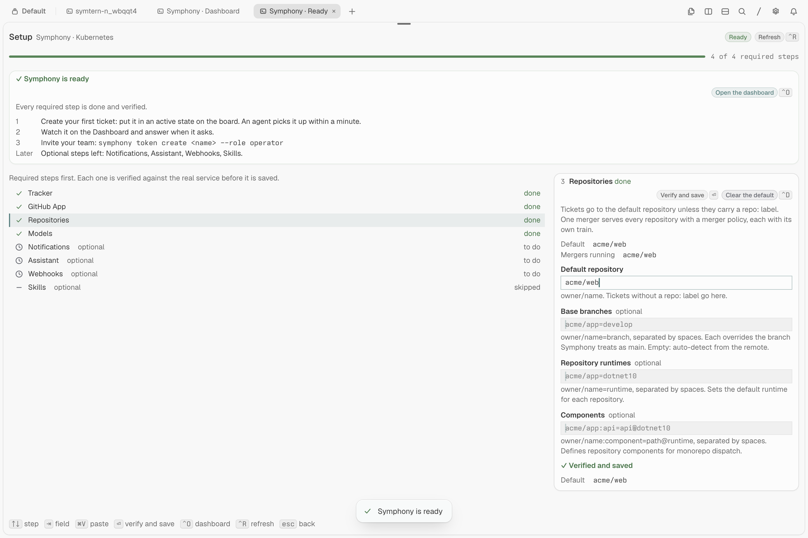 |

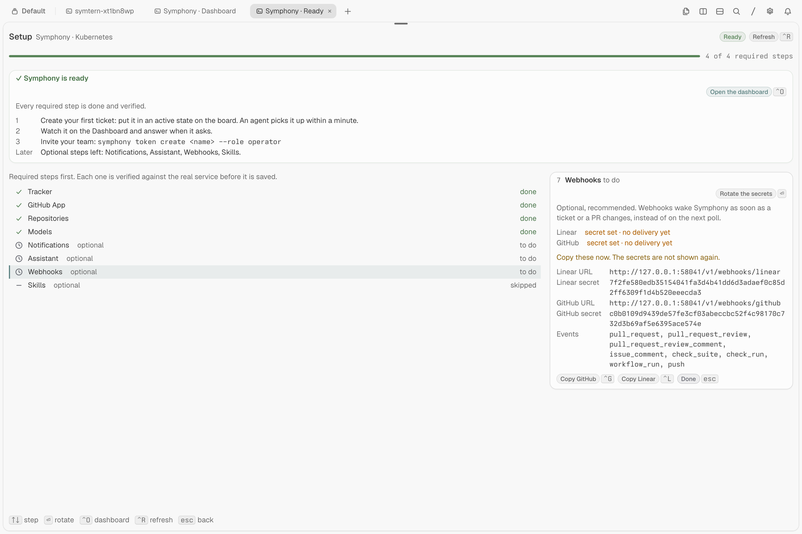
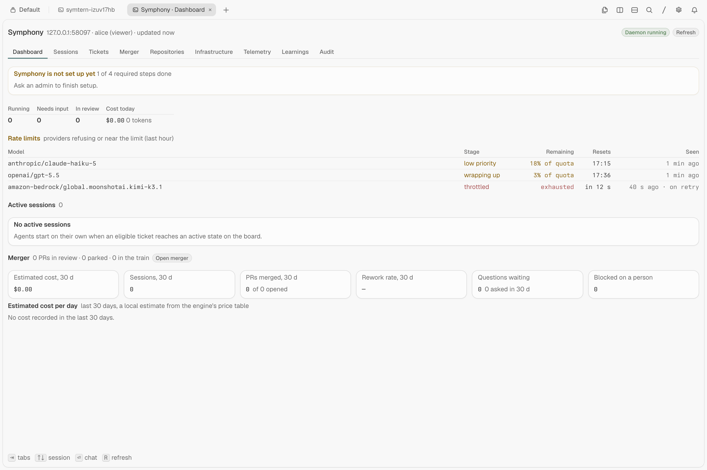

## Dashboard

The day's numbers, the sessions that **need input** at the top with **Answer**, and the list of
active sessions with the details of the selected one. Actions (operator or admin):
**Open chat**, **Answer** (`a`, with the options the agent offered or a free answer),
**Send message** (`m`, joins the current turn when the agent is running), **Interrupt** (`i`, asks
for confirmation), **Take over** (`t`, asks for confirmation, then runs `symphony takeover` in
a new tab) and, on a session that holds a device, **Watch device** (`w`, see
[Watch a device](#watch-a-device)). Pause and resume the daemon at the top; a pause asks for a
reason of at least 8 characters.

Below the merger line, **the last 30 days** (`GET /v1/telemetry/history?from=<29 days ago>&bucket=day`):
six tiles, each a figure over a daily sparkline, and the estimated cost per day as an area chart.

| Tile | Figure | Sparkline (a point a day) |
|---|---|---|
| Estimated cost, 30 d | the 30 days' estimated cost | estimated cost |
| Sessions, 30 d | sessions that ended | sessions that ended |
| PRs merged, 30 d | PRs merged, "of N opened" | PRs merged |
| Rework rate, 30 d | rework ÷ dispatches | the day's rework rate |
| Questions waiting | sessions that wait for an answer now (the overview's `waiting_input`) | questions asked |
| Blocked on a person | tickets blocked on a person now (the overview's `blocked_on_person`) | times a ticket got blocked on a person |

Costs are local estimates from the engine's price table, not a bill.

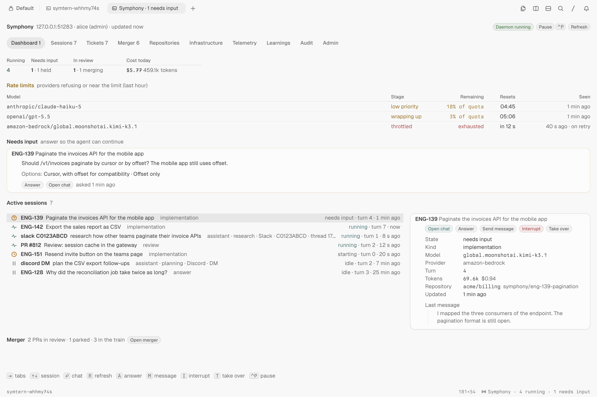
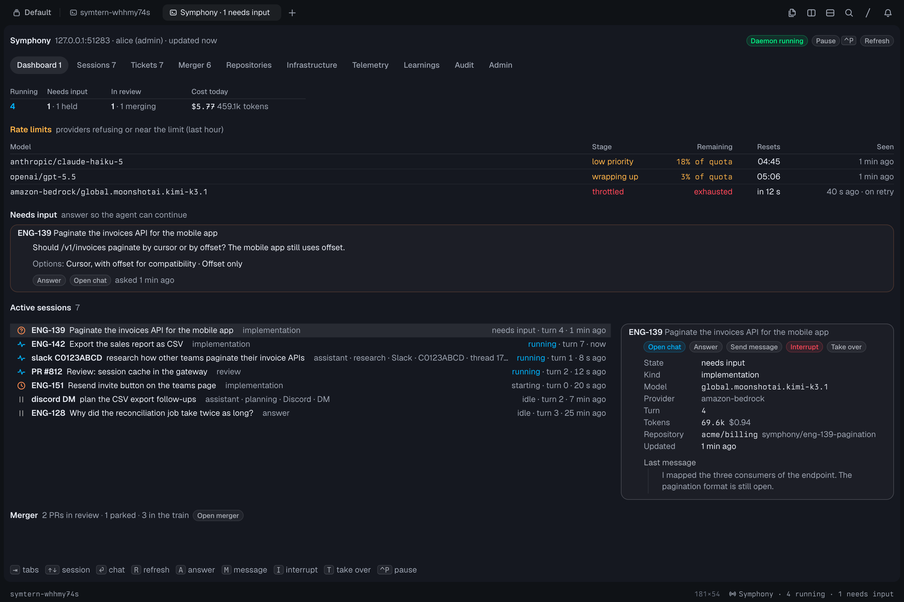

## Sessions and live chat

All sessions, filtered by **Active**, **Needs input**, **Ended** or **All** (`[` and `]`).
`enter` opens the conversation as a native Tern chat (`tern acp symphony --resume <session>`):
history, live events and your messages in one place. The agent keeps running in the cluster: the
chat only shows the session and sends your messages, and its first line says where it runs (pod,
repository, branch). Tern shows the chat tab's local directory as the chat's workdir, and an ACP
agent cannot name its own, so the tab opens in an empty directory named after the session,
`~/.cache/symphony/remote/<repository>/<ticket>` (`$XDG_CACHE_HOME` when set; `assistant`
for assistant threads), instead of one of your projects.

In the chat, `/status` shows the session's state, turn, tokens and PR, `/interrupt` stops the
current turn, and `/pause` and `/resume` pause and resume Symphony. A reason may follow the
command (`/pause Deploying main`); without one, the chat says it came from Tern. `/takeover` does
not take over: it explains how, with the `symphony takeover <ticket>` command to run in a
terminal inside the repository.

Assistant threads from Slack and Discord show as kind **assistant**. The row says the mode
(assistant, research or planning), the transport, the channel or DM, and the thread. The card
adds the role (Assistant, Researcher or Planner), the channel, the thread and who asked. You can
follow and message them like other sessions. **Take over** is only for ticket work.

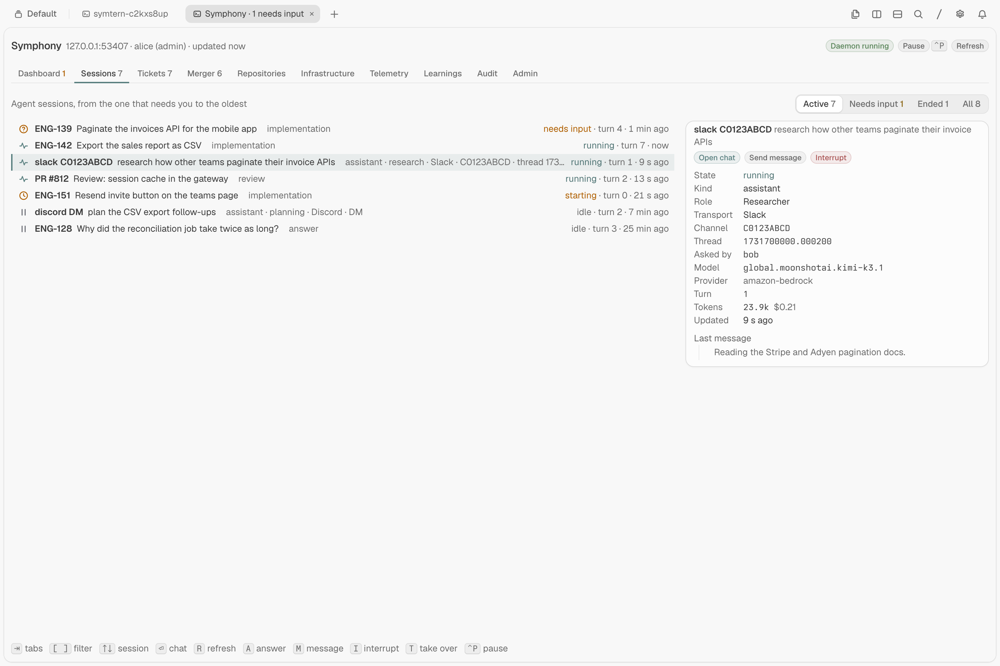
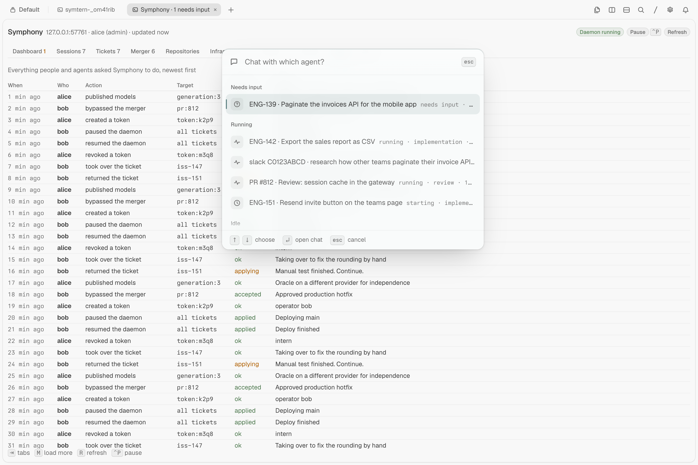

### Watch a device

An agent that uses [Seiji](seiji.md) borrows an iOS simulator (or an Android emulator) for its
session. While it holds one, the session card shows a **Device** row: the model, the MCP server
and the lease (`iphone-16 on seiji · l_3f9c2a7b1e04`). The row comes from the session's
`mcp_leases`, which the gateway records when `acquire_device` succeeds and drops when the device is
released.

- **Watch device** (`w`) runs `symphony mcp viewer NAME LEASE --json` and opens the screen in
  Tern's browser beside the panel, view only. Each press asks for a fresh link: Seiji's links open
  once, within 60 s.
- **Watch with control** (`⇧W`) asks first. The confirm strip says that your taps, swipes and
  typing reach the device at once, while the agent uses it, and that others may be watching: people
  who open it from Symphony or the Seiji plugin, and links the agent shared. `enter` runs
  `symphony mcp viewer NAME LEASE --control --json`.
- A session with several devices asks which one first.
- When the agent released the device after the panel's last read, the API answers
  `lease_not_held` and the footer says that no Symphony session holds the device now.
- Seiji's screen works for iOS simulators only. An Android device shows "no live screen yet" in
  its row, and the footer repeats Seiji's answer: the live screen supports iOS simulators only
  for now.

Both need an operator token. With the viewer role, the card shows the **Device** row but no
action.

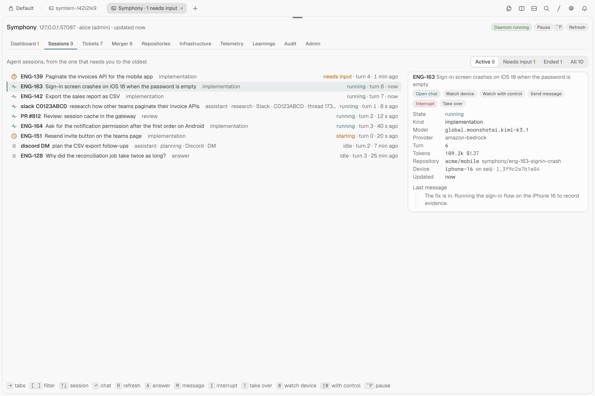
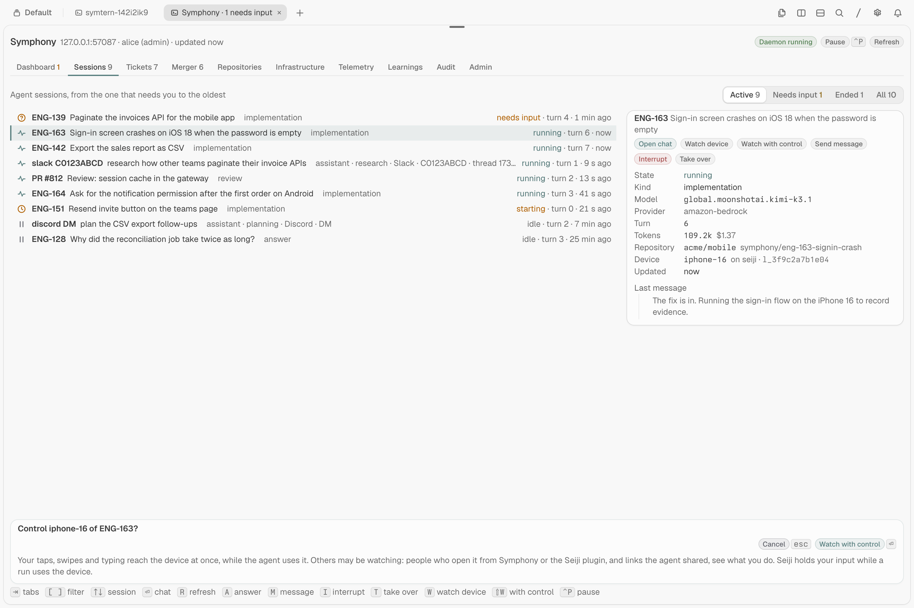
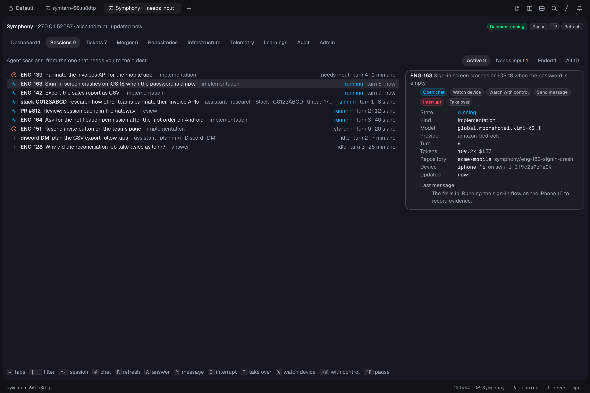

## Tickets

The tickets that Symphony tracks, with their state in Symphony and on the tracker board (Linear or
GitHub Projects), the attempt, the cost and the PR.

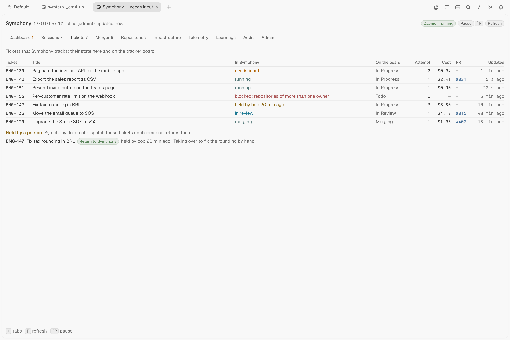

## Merger

Each repository has its own merger. **Mergers** lists them: whether each one runs, who holds its
train lease and its current batch. PRs in review, the merge train and the queue carry a
**Repository** column, so PR #7 of one repository never mixes with PR #7 of another. On the
selected PR: **Bypass** (`b`, asks for a reason of at least 8 characters that goes to the audit
log), **Requeue** (`q`) and **Release** (`l`). Each action goes to the merger of that PR's
repository.

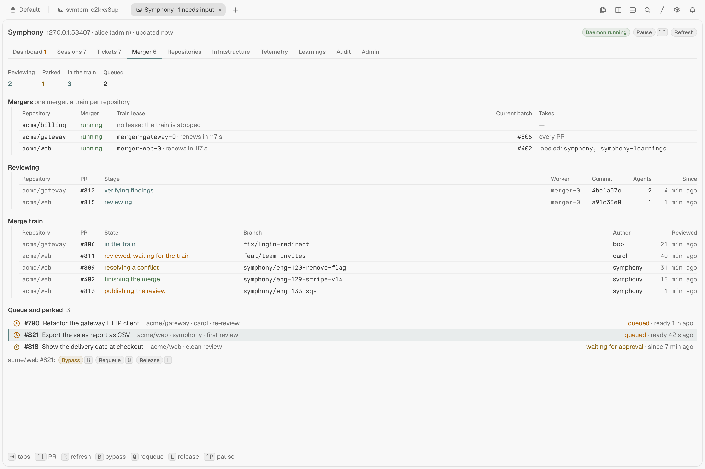
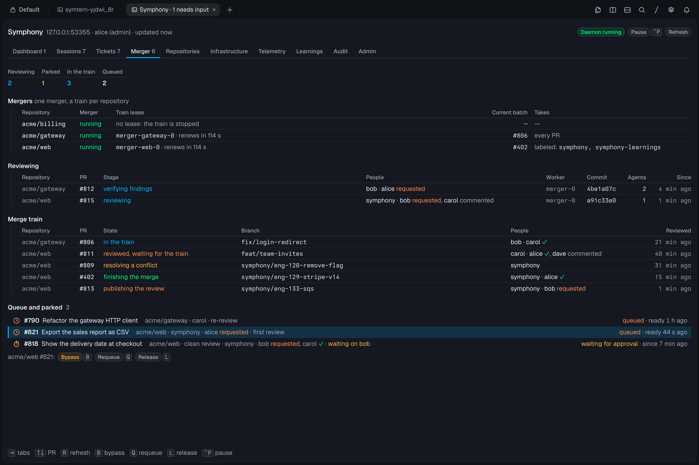

## Admin (admin role)

### Models and rollout

The model and the thinking level of each role: implementer, reviewer, oracle, arbiter, developer,
reflector and probe, plus the assistant's roles (assistant, researcher and planner). The list
follows the roles of the team configuration, so a new role shows up by itself. `enter` picks the
model from the pinned omp catalog, then the thinking level. The change stays marked ("was …")
until you **Publish** (`p`) it with a reason of at least 8 characters. Publishing sends
`If-Match` with the current generation. If someone else published first, nothing is overwritten
and the panel tells you.

Below, **Generation N rollout** shows who already applied the published configuration: the daemon,
the runners, the merger and the people who ran `symphony omp sync`. Each consumer applies it at the
start of its next unit of work.

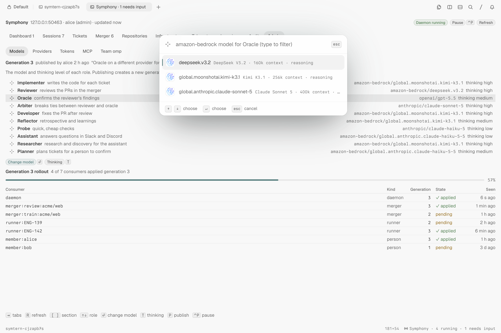
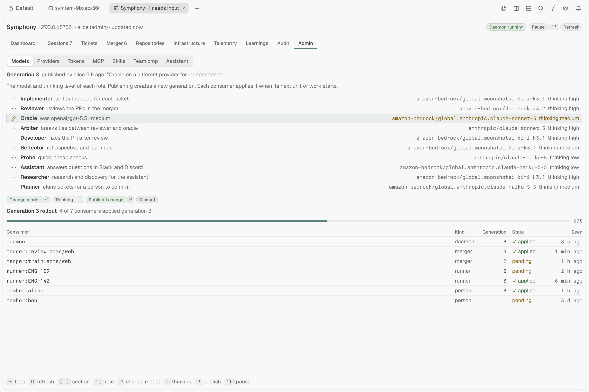
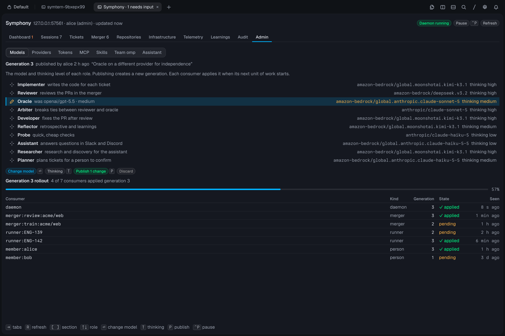

### Providers

Every model uses an API key. There is no OAuth sign-in and no subscription. The list starts with
the omp built-in providers that teams use most (Anthropic, OpenAI, Amazon Bedrock, Google), then
every other stored item. Each row says **key set** or **no key**. **Set key** or **Replace key**
(`c`) asks for the key in a hidden field and saves `{builtin: true, apiKey}`. For a custom provider
it saves the provider's definition with the new key. The key is write-only: it goes to the CLI on
standard input and never comes back through the API. It applies on each agent's next attempt,
without a restart. **Other omp provider…** opens the catalog to set a key for any other built-in
provider. Without a stored key, a provider uses the host credential (the `model-provider` Secret,
for example for Bedrock).

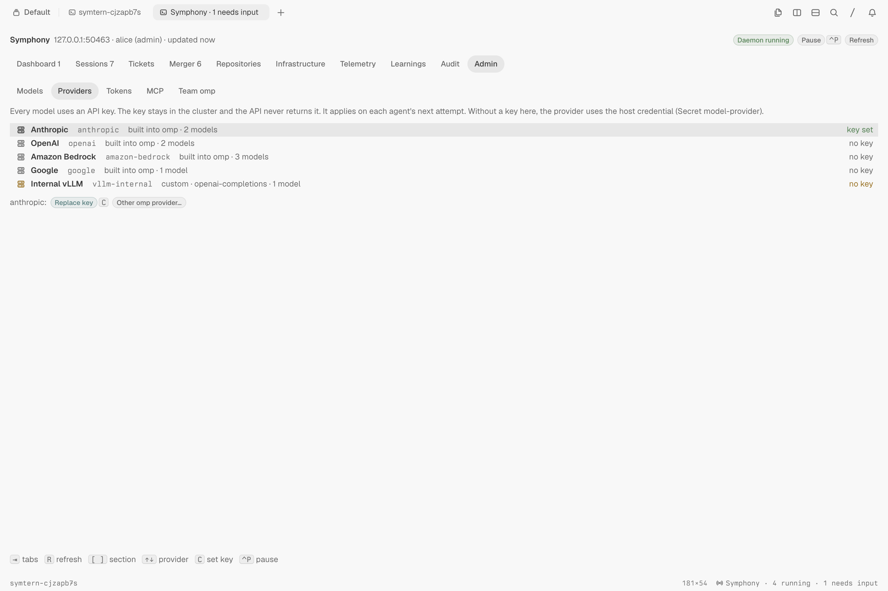

### Tokens

**Create token** (`n`) asks for the name, the role and the expiry. The token appears **only
once**, with **Copy token**. After **I saved it**, the token disappears and is not stored anywhere.
**Revoke** (`x`) asks for confirmation and takes effect at once.

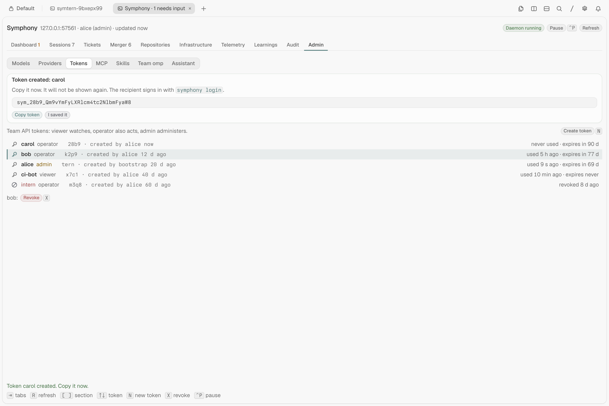
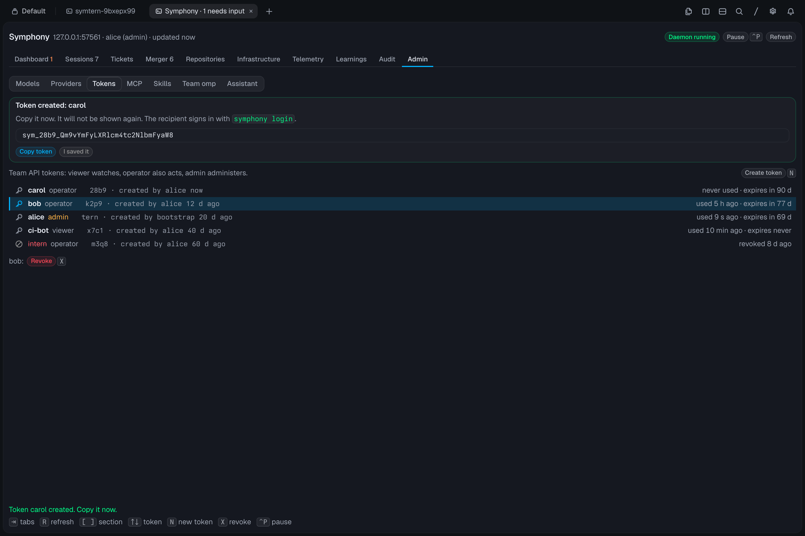

### MCP servers

MCP servers give agents more tools. Each role gets only the servers enabled for it. The table
lists each server's name, transport, roles, secret headers and state. `↑↓` selects a server
(▸ marks it), and its card shows the facts and the last test.

- **Test** (`enter`) runs `symphony admin mcp test NAME --json`. The API calls `initialize` and
  `tools/list` through the gateway's proxy code, with the stored headers. The card lists the
  tools, or says why the test failed (unreachable, rejected, not an MCP server). For a Seiji
  server it also reads Seiji's `GET /v1/me` and shows the user and the quota ("Signed in as
  symphony-agents · 6000 min a month · 4 devices at once"). A stdio server is tested when an agent
  starts.
- **Add server** (`n`) and **Edit** (`e`) open a form in the card: name, transport (`←→`), URL or
  command, roles (typed, or clicked below the field) and state. A new remote server can take its
  first secret header in the same form. **Save** (`enter`) runs `symphony admin mcp set NAME …
  --json` with the whole definition. Edit and **Disable** re-send the fields the form does not
  show (`--timeout-ms`, `--http-base`, `--agent-env`, `--rewrite-origin`, `--cleanup`), so they
  stay.
- **Preset** at the top of the add form offers **Seiji**. It fills the name (`seiji`), the
  transport and the header name (`Authorization`). Enter Seiji's MCP URL, the roles and the header
  value, `Bearer sj_…`. **Save** runs `symphony admin mcp set NAME --preset seiji --url URL --role …
  --json`, then stores the header. The preset adds the HTTP API (`http_base`, the URL without
  `/mcp`), a 65 min timeout, `SEIJI_TOKEN` and `SEIJI_URL` for the agent, and the release of held
  devices when the session ends. The card shows each of them.
- **Headers** (`h`) sets one secret header. The value is masked on screen and goes to `symphony
  admin mcp headers NAME --json` on standard input. An empty value removes the header. The API
  never returns a value: the gateway adds the headers itself, so no secret reaches an agent.
- **Disable** or **Enable** (`d`) sends the definition again with the new state. **Remove** (`x`)
  asks for confirmation, then runs `symphony admin mcp remove NAME --json`.

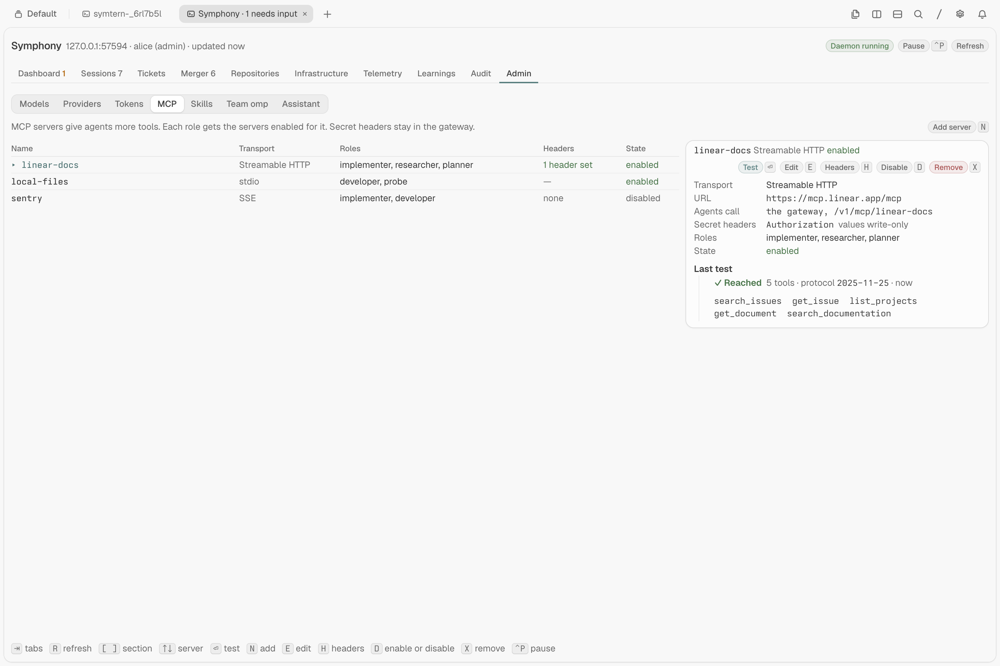
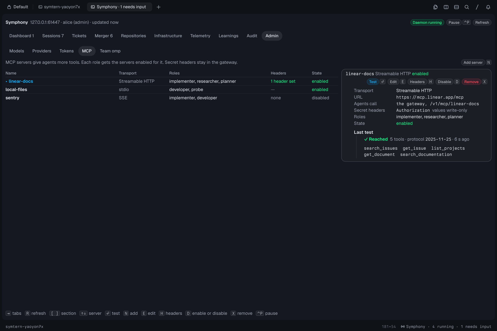
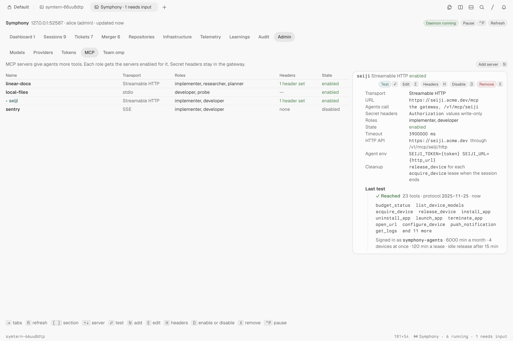

### Team omp

The omp defaults that the workers use. **Apply to my omp** (`s`) runs `symphony omp sync`, which
writes a `symphony` profile separate from yours.

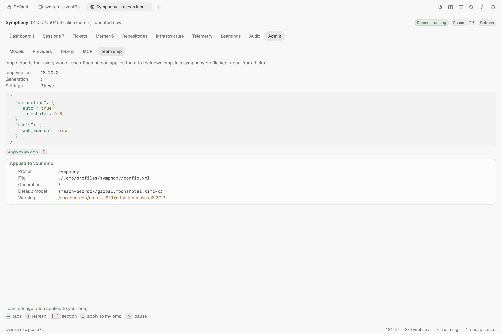

### Assistant

What the chat assistant is and what it remembers ([assistant.md](assistant.md#soul)).

- The head shows the **soul** in use: the file (`owner/name:path`) and its version, the blob sha
  on `origin/main` from the assistant's heartbeat. "the built-in text: the file is missing" means
  that the file is not there. "not reported" means that the assistant is not running.
- The list shows each person with memory, the number of items and when it last changed. `↑↓`
  selects a person, and the card at the right lists their items: the text, `explicit` or
  `inferred`, when it was stored, and its id.
- **Wipe** (`x`) asks for confirmation in the dock strip, then sends `DELETE
  /v1/assistant/memory/LOGIN`. One item is removed with `symphony assistant memory forget LOGIN
  ID`.
- Every read of memory is audited (`assistant.memory_read`), so the tab reads it once when it
  opens, when you pick another person, after a wipe, and on **Refresh** (`r`). It does not poll.

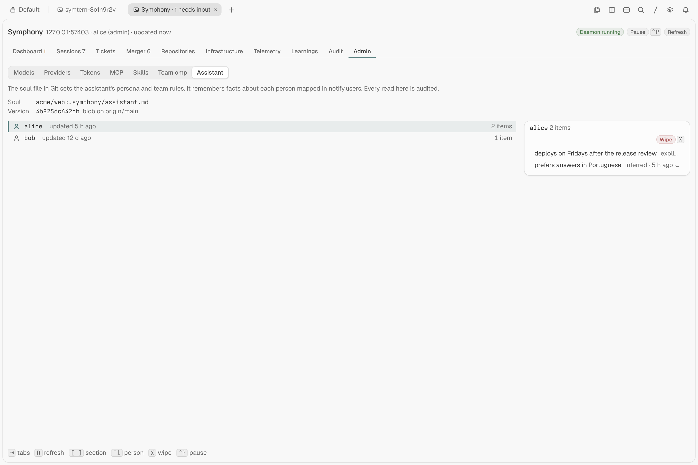
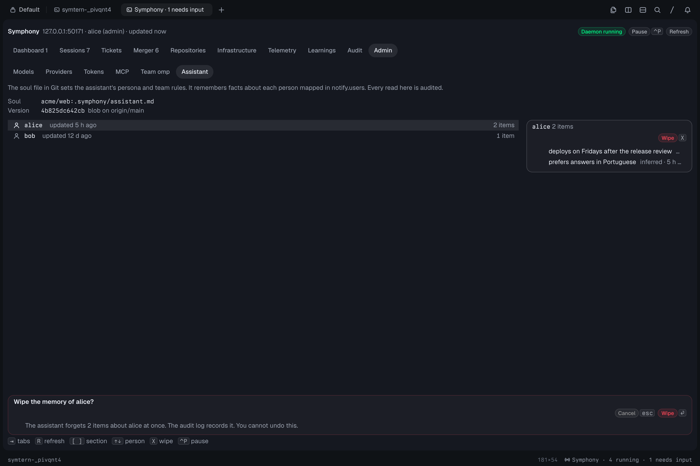

## Repositories, Infrastructure, Telemetry, Learnings and Audit

Read-only views for every role: the repositories Symphony dispatches to (with their configured
base branch, per-repository runtime override, and components — or "default" for auto-detected), the services and cluster
resources, usage by model, by month and by session, the learnings from reflection, and the audit
log (`m` loads more). When a source is stale or unavailable, the view says which one. An empty list
caused by missing data never shows as "none".

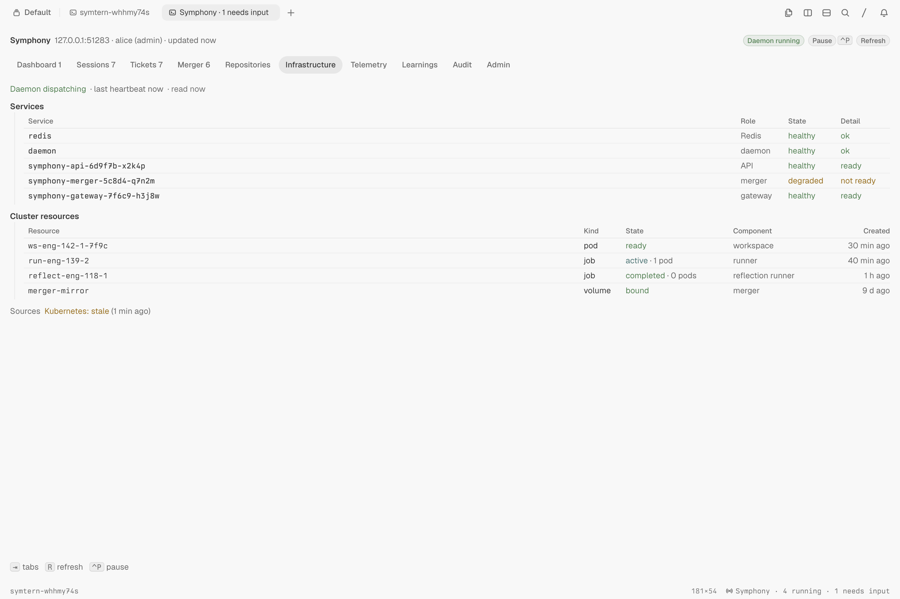
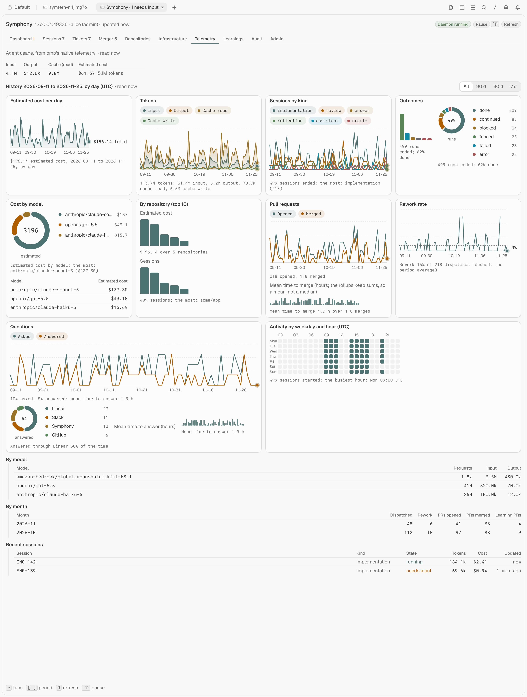
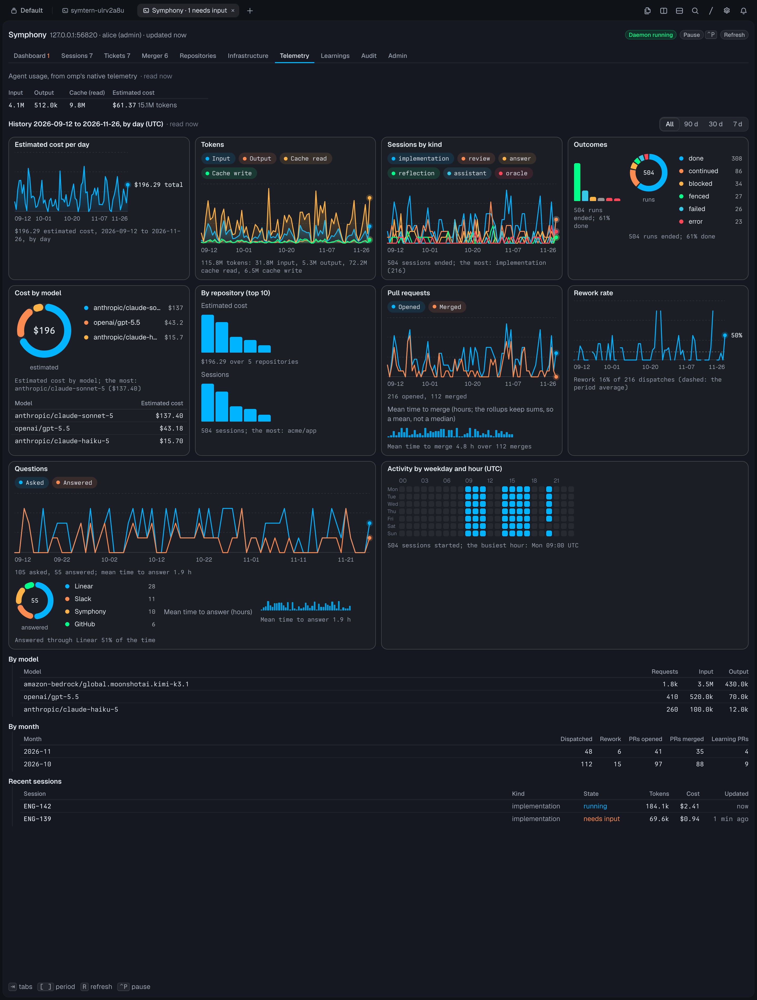
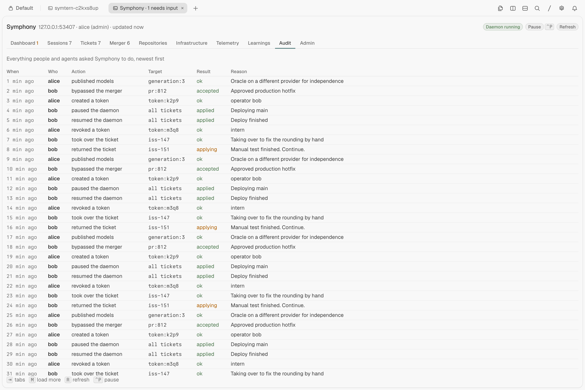

The Dashboard also shows the providers' **rate limits** seen in the last hour. Tickets **held by a
person** (after **Take over**, which runs `symphony takeover` and holds the ticket) show in Tickets
with **Return to Symphony** (`symphony release`).


Reasons that go to the audit log (pause, bypass, publish) need at least 8 characters. The field
warns you and reopens before it sends anything.

### Telemetry charts

Between the usage totals and the tables, **History** charts the daily rollups of
`GET /v1/telemetry/history` ([api.md](api.md)). The period picker at its right (`[` and `]`, or a
click) picks **All** (from the first rollup), **90 d**, **30 d** or **7 d**; All is the default.
The API picks the bucket (a day, a week or a month, at most 120 points), and every day is UTC.
The x axis names a day `11-25`, a week by its ISO number (`W48`) and a month by its name
(`Nov`); the charts in the narrow cards show five of those labels, the first and the last
among them. Each chart has a one-line summary with its headline number, and says so when the
period has no data.

| Chart | What it shows |
|---|---|
| Estimated cost per bucket | area chart of the estimated cost, labeled with the period's total |
| Tokens | input, output, cache read and cache write per bucket |
| Sessions by kind | sessions that ended per bucket, a line per kind (the six biggest, then "other") |
| Outcomes | bars and a donut of how the period's runs ended (done, continued, failed, blocked, …) |
| Cost by model | donut of the estimated cost per model, and a table with each model's cost, tokens and a sparkline of its cost per bucket |
| By repository (top 10) | bars of the estimated cost and of the sessions per repository |
| Pull requests | PRs opened and merged per bucket, and a sparkline of the mean time to merge (the rollups keep sums, so it is a mean, not a median) |
| Rework rate | rework ÷ dispatches per bucket, with the period average as a dashed line |
| Questions | questions asked and answered per bucket, a donut of where they were answered (Linear, Slack, GitHub, Symphony) and the mean time to answer |
| Activity | heatmap of session starts by weekday and hour (UTC) |

The charts use Tern's `chart` node (heatmap, bars, spark, line, area, donut) and take their
colors from the theme's chart palette and tones.

## Offline

If Symphony goes down, the panel keeps the last data, shows **Offline** and explains the error in
the footer. The status line shows **Symphony · offline**. Everything recovers on the next read.

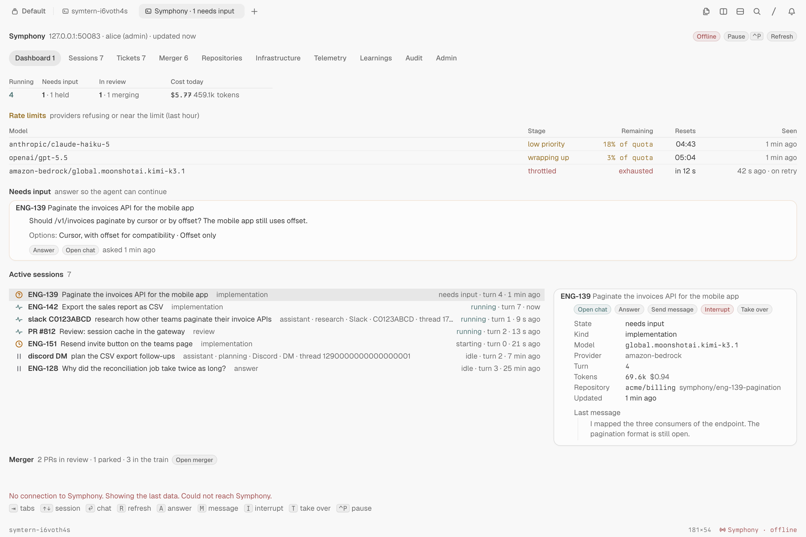

## Alongside the Seiji plugin

Seiji has its own Tern plugin, id `seiji` ([Seiji in Tern](seiji.md)). Install both: they share
no id, key chord, command, block, link or style. Use the Seiji plugin for your own devices, your
budget and your runs; use Symphony's panel to watch the devices that agents hold.

| What | Symphony plugin | Seiji plugin |
|---|---|---|
| Plugin id | `symphony` | `seiji` |
| Blocks | `symphony.app`, `symphony.signin`, `symphony.setup` | `seiji.app` |
| Commands | `plugin.symphony.*`, titles "Symphony: …" | `plugin.seiji.devices`, `.runs`, `.signin`, `.signout`, titles "Seiji: …" |
| Global chords | `ctrl+alt+s` (Dashboard), `ctrl+alt+m` (Merger), `ctrl+alt+a` (Chat) | `ctrl+alt+d` (Devices) |
| Panel keys | in `symphony.app` only (`w` and `⇧W` watch a device) | in `seiji.app` only (`o` opens a screen, `f` floats it) |
| Links it claims | `symphony://…` from its own blocks | `seiji://ui?req=…` from its own block, and viewer links `http(s)://host/view/open/<ticket>` from any pane |
| Styles | `.sf-region[data-surface^="plugin.symphony."]` | `.sf-region[data-surface^="plugin.seiji."]` |
| CLI and variables | `symphony`, `SYMPHONY_BIN` | `seiji`, `SEIJI_BIN` |
| Status line | `Symphony · 3 running` | `Seiji · 1 device · 42 min left` |

- **Who sees what.** The Seiji plugin shows the devices of the person signed in to it. Agents
  act as the Seiji user whose token the MCP server's header holds, so their devices show in
  Symphony's sessions, not in your Seiji panel, unless you sign in to Seiji as that user.
- **Viewer links.** Symphony opens the viewer itself, with `cx:open`, which skips the link routes:
  the Seiji plugin does not open it a second time. A viewer link that an agent prints in a
  terminal (`share_screen`) is the Seiji plugin's to open, beside that pane; without it, Tern opens
  it in the browser.
- **One screen, many viewers.** Seiji takes a few open screens per lease (`viewer.maxViewersPerLease`,
  4 by default). Every one of them sees the same device and, with control, the same input.

## How it works (for maintainers)

- **Credential.** The plugin never stores the token: not in the blocks' `save()` and not in their
  arguments. The host half asks `symphony token print --json` and keeps the answer in memory only.
  A 401 makes it ask again, so a new sign-in applies at once.
- **Fast reads.** The panel reads `GET /v1/overview` and `GET /v1/sessions` with `If-None-Match`
  every 2 s (a 304 redraws nothing), plus only the data of the visible view. The status line does
  the same in the window half.
- **Writes through the CLI.** Messages, answers and interrupts use `symphony say|answer|interrupt`.
  Setup uses `symphony setup <step>`, MCP servers use `symphony admin mcp …` and device screens use
  `symphony mcp viewer`. Everything else uses `symphony api METHOD PATH --data -`. Bodies and
  secrets go on standard input, so keys and tokens never appear in the process list.
- **Block ↔ window.** A block asks the window for what only the window can do (palette, pickers,
  prompts, new tabs, a browser beside the panel) by opening a `symphony://ui?req=…` link. The
  window accepts requests only from Symphony's own blocks and sends the answer back to the block as
  an event. A viewer link goes to the window this way, and the window opens it with `cx:open`.
- **Tern 0.8.3.** The views follow Tern's design guide with what this version draws. Checked with
  real renders (`tern ctl shot`) on 0.8.3 (e2b8656): `button`, `stats`, `skeleton`, `empty`,
  `field`, `select`, `switch` and `nav` draw nothing; a card ignores `meta`, `icon` and `end`; an
  `input` ignores `secret`; a table cell's `dot` draws nothing and tables cannot select rows (a
  row's `actions` are ignored too). So actions are keyed chips (the key shows beside each and in
  the legend), pickable rows are `list`s, a table that must stay a table (MCP servers) is
  selected with `↑↓` and marks the row with ▸, the number strip is a one-row table of at most
  four columns, a card's primary action opens its body at the right, secrets are masked by the
  plugin, a choice in a form is a segmented `tabs`, and `styles.css` (scoped to Symphony's
  surfaces, fonts only) gives the regions the UI face. `progress`, `meter`, `spinner`,
  `shimmer`, segmented `tabs`, a toned `card` in the `dock` (the confirm strip), `min`/`max`,
  toasts and the block's `cx.cols` (the width the tab strip adapts to) do work and are used.

## Tests

```sh
uv run pytest tests/tern/test_tern_plugin.py      # flows against the fake API and the test CLI
uv run pytest tests/tern/test_tern_real_stack.py  # the real stack: Redis, API, CLI and symphony acp
uv run python tests/tern/scenarios.py             # regenerates the docs/tern screenshots (light and dark)
uv run pytest tests/tern/test_tern_views.py       # the Telemetry and Dashboard charts' node shapes (needs luau)
uv run pytest tests/tern/test_tern_signin.py      # Install in Tern finds the CLI off Tern's PATH (needs luau)
```

The first three start `tern serve` with an isolated `TERN_CONFIG_DIR` and the plugin loaded as a fixture
(`STENCIL_FIXTURE_ROOT`). They fail if Tern logs a plugin error. The fake-API tests
(`tests/tern/fake_api.py`, which reads the merger through the real `MergerStore` in a disposable
Redis) use the test CLI `tests/tern/bin/symphony`. Its `seiji` state adds a Seiji server and two
sessions that hold a device (an iPhone and an Android emulator). Its viewer route answers like the
API (`lease_not_held`, and `viewer_refused` with Seiji's text for Android), and its viewer link
opens a stand-in page. The real-stack tests (`tests/tern/real_stack.py`)
seed the real stores and start the production API (`tests/tern/real_api.py`; only the providers
Secret is in memory, because there is no cluster, and MCP servers are in a local `mcp.json`).
They use the real CLI with an isolated HOME and no keychain, run `symphony login` and `symphony
tern install`, and open the chat through the real `symphony acp`. The MCP test there reaches the
MCP mock (`scripts/mocks/mcp`), which answers only when the stored header arrives.

`test_tern_views.py` runs without Tern: it copies the plugin's modules next to a stub of the
`tern` global (`tests/tern/tern_stub.luau`), renders Telemetry and the Dashboard with the `luau`
CLI (`tests/tern/render_views.luau`) and checks the charts' kinds, series lengths, summaries and
empty states. It skips when `luau` is not installed. Its history documents, and the fake API's
`GET /v1/telemetry/history`, come from `tests/tern/history_fixture.py`: seeded daily rollups
bucketed like the API.

`test_tern_signin.py` uses the same stub, which records each spawn. It presses Enter on the
sign-in block's install step (`tests/tern/signin_install.luau`), then runs the recorded argv with
launchd's PATH and a fake CLI in `~/.local/bin` or `$UV_TOOL_BIN_DIR`. It checks that the step
runs `tern install --no-plugin --json`, that a CLI on Tern's PATH wins, that `SYMPHONY_BIN`
wins over both, and that no CLI at all exits 127 (`cli_missing`). `tests/tern/cli_missing.luau`
checks the error text for a CLI that does not start: the lookup's directories without
`SYMPHONY_BIN`, and only the configured path with it.

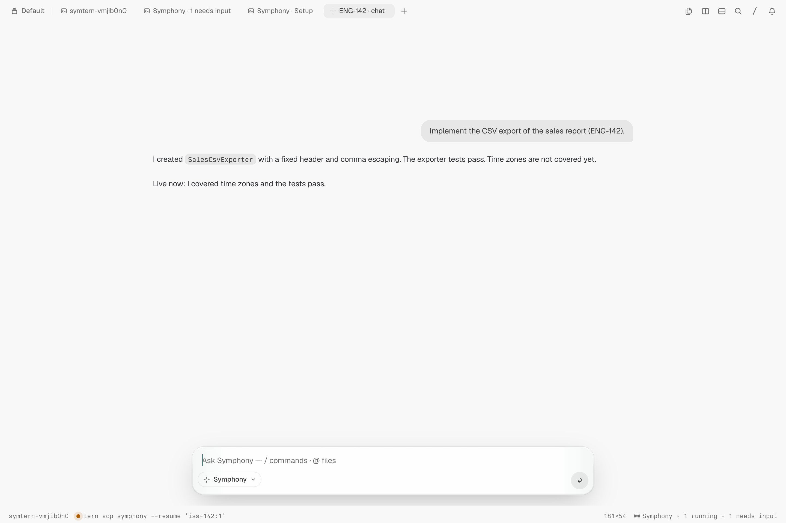
