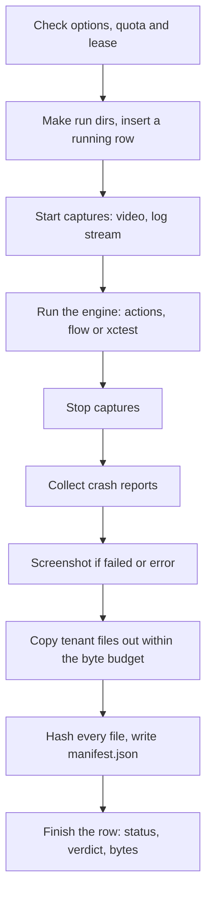

# MCP interface

This document is the reference for the interface that agents use. It covers the MCP endpoint, the 23 tools with their arguments, results and errors, the steps of `run_actions`, the HTTP API for builds, evidence and viewer links, the viewer routes, the client setup for Claude Code, Cursor and Codex, and short guides to actions, XCTest bundles and Maestro flows. For the terms, read [glossary.md](glossary.md). For the rules behind budgets and leases, read [concepts.md](concepts.md).

## Contents

- [Endpoint](#endpoint)
- [Authentication](#authentication)
- [Server instructions](#server-instructions)
- [Results and errors](#results-and-errors)
- [The `lease_id` rule](#the-lease_id-rule)
- [Tools](#tools)
- [Run results](#run-results)
- [Actions reference](#actions-reference)
- [HTTP API](#http-api)
- [Viewer routes](#viewer-routes)
- [Client setup](#client-setup)
- [Writing actions](#writing-actions)
- [Preparing an XCTest bundle](#preparing-an-xctest-bundle)
- [Writing flows](#writing-flows)

## Endpoint

| Item | Value |
|---|---|
| URL | `POST /mcp` on `listen.host`:`listen.port` (default `127.0.0.1:4780`). Put a TLS proxy in front for remote agents (see [install.md](install.md)) |
| Transport | MCP Streamable HTTP, stateless. The server issues no `Mcp-Session-Id`. Each POST is independent, so a `tools/call` works without an `initialize` first |
| Response | `Content-Type: application/json`, one JSON-RPC message for each POST. The server opens no SSE stream |
| Other methods | `GET /mcp` and `DELETE /mcp` return `405 Method Not Allowed` with `Allow: POST` |
| `Content-Type` | Must be `application/json`. Else `415` `Unsupported Media Type: Content-Type must be application/json` |
| `Accept` | Must list both `application/json` and `text/event-stream`. Else `406` `Not Acceptable: Client must accept both application/json and text/event-stream` |
| `MCP-Protocol-Version` | Optional. A missing header means `2025-03-26`. An unknown version returns `400` `Bad Request: Unsupported MCP-Protocol-Version: <value>`. On `initialize`, the header must match `params.protocolVersion` |
| `Host` | Must be in `listen.allowedHosts` (default `localhost`, `127.0.0.1`). An entry without a port matches every port. Else `403` `Forbidden: Host header is not allowed` |

The `Host` check guards against DNS rebinding. Behind a proxy, add the public hostname to `listen.allowedHosts`, or make the proxy send a `Host` that is in the list. See [configuration.md](configuration.md).

## Authentication

Every request to `/mcp`, `/v1/apps`, `/v1/runs/…`, `/v1/me` and `/v1/leases/…` has the header `Authorization: Bearer <token>`. The token has the form `sj_<43 characters>`. `seiji user add` and `seiji user rotate-token` print it once (see [cli.md](cli.md)). The server stores only its SHA-256. The viewer routes (`/view/…`) take no token; they use a viewer session cookie (see [Viewer routes](#viewer-routes)).

| Case | Response |
|---|---|
| No header, a header without the exact prefix `Bearer `, an unknown token, or a disabled user | `401` with the plain-text body `missing, invalid or disabled bearer token` |
| The token lookup fails in SQLite | `500` with no body |

The server checks the token before the `Host` header. A request with a bad token and a bad `Host` gets `401`.

## Server instructions

The server sends this text as `instructions` in the `initialize` result. Most clients give it to the model. It is quoted from `INSTRUCTIONS` in `src/mcp.rs`:

```text
Seiji lends you a fresh iOS simulator (or Android emulator) on a shared Mac and records evidence of what you do on it.

Devices are metered: every minute you hold one counts against your monthly budget, so release it when done.

Workflow:
1. `budget_status` / `list_device_models` to see what you can use.
2. `acquire_device` (platform `ios`) boots a device just for you (30-90 s) and returns a `lease_id`.
3. Upload your build: `curl -H "Authorization: Bearer $SEIJI_TOKEN" -H "X-Filename: MyApp.zip" --data-binary @MyApp.zip <server>/v1/apps` (iOS: zip/tar.gz of the simulator .app), then `install_app` with the returned `app_id`.
4. Optional: `configure_device` (status bar, dark mode, location, permissions) for clean, reproducible screenshots.
5. `inspect_screen` shows the accessibility tree: use its exact labels and ids in selectors.
6. `run_actions` runs a list of steps (tap, type, scroll, wait_for, assert_visible, screenshot, launch_app, ...) and records a video, the app's logs, crash reports and a screenshot per step. It returns a `run_id`.
   `run_xctest` runs a compiled XCUITest bundle (`build-for-testing`) and keeps the `.xcresult`. `run_flow` runs Maestro YAML when the host has Maestro.
7. Evidence: `get_run` (steps and files), `get_run_artifact` (a screenshot, the log, ...), `export_evidence` (a Markdown summary for the pull request and a download link for evidence.zip).
8. `release_device` when finished. Idle devices are released automatically; runs stay for the retention period.

`lease_id` may be omitted when you hold exactly one device. `bundle_id` defaults to the app installed last on the lease.
```

Step 3 uses `$SEIJI_TOKEN`. Put the token in that variable in the agent's shell (see [Client setup](#client-setup)).

## Results and errors

A tool that fails returns a normal JSON-RPC result with `isError: true`. It does not return a JSON-RPC error. The model sees the error text and can act on it.

| Case | What the client gets |
|---|---|
| Success | `result` with `content` and `isError: false` |
| The tool fails | `result` with one text block and `isError: true`. The text is the error chain, joined with `: ` (for example `device failed to start (not billed): simctl bootstatus timed out: …`) |
| A run does not pass | `result` with `isError: true`, the run summary, and a screenshot when the status is `failed` or `error` and Seiji can take one (see [Run results](#run-results)) |
| An unknown tool name | JSON-RPC error `-32602` `tool not found` |
| Arguments that do not fit the schema (a missing `platform`, a platform other than `ios` or `android`, a wrong type, an unknown action or an unknown field inside an action) | JSON-RPC error `-32602` `failed to deserialize parameters: <cause>` |
| No caller identity on the request | JSON-RPC error `-32600` `unauthenticated`. The auth layer answers `401` first, so a client does not see this in practice |
| Not authenticated | HTTP `401` (see [Authentication](#authentication)). No JSON-RPC message |

Tool results carry text and image blocks only. JSON results are pretty-printed JSON inside one text block. The server sets no `structuredContent`.

Unknown top-level argument names are ignored. Inside an action, a selector or `status_bar`, an unknown field is a schema error.

### Calls on one lease

- Seiji runs one operation at a time on a device. A second call on the same lease waits until the first one ends.
- `release_device` cancels the running operation and waits until it stops, then deletes the device. A recorded run stops its steps, still collects its evidence, and ends with the status `cancelled`. Any other cancelled call returns `lease <lease id> was released during the operation (released)`.
- The reaper can end a lease during a call (see [concepts.md](concepts.md)). A plain call then returns `lease <lease id> was released during the operation (<end reason>)`, for example `(max_lease_duration)`. A recorded run ends as `cancelled`.
- A lease is never idle while a call on it runs.
- If the client gives up before a result comes back (for example a short tool timeout during `acquire_device`), the server still finishes the call. The device still boots and counts against the budget. Call `budget_status` to find the lease in `active_leases`, then use it or release it. A run that the client gave up on still appears in `list_runs`.

### Which calls count as activity

The idle timer (`idleMinutes`) starts when the device is ready. It restarts at the start and at the end of each call that uses the device.

| Tool | Needs a lease | Lease status | Restarts the idle timer |
|---|---|---|---|
| `budget_status` | No | — | No |
| `list_device_models` | No | — | No |
| `acquire_device` | Creates one | — | It starts the timer when the device is ready |
| `release_device` | Yes | `booting` or `ready` | — (ends the lease) |
| `install_app` | Yes | `ready` | Yes |
| `uninstall_app`, `launch_app`, `terminate_app`, `open_url` | Yes | `ready` | Yes |
| `configure_device` | Yes | `ready` | Yes, once for each operation it applies |
| `push_notification`, `get_logs` | Yes | `ready` | Yes |
| `inspect_screen`, `take_screenshot` | Yes | `ready` | Yes |
| `share_screen` | Yes | `ready` | No. A watched lease is touched every 60 s, and each viewer input restarts the timer (see [Viewer routes](#viewer-routes)) |
| `run_actions`, `run_xctest`, `run_flow` | Yes | `ready` | Yes |
| `list_runs`, `get_run`, `get_run_artifact`, `export_evidence` | No | — | No |
| `cheat_sheet` | No | — | No |

### Lease errors

Every tool that needs a lease shares these errors. `release_device` can return the first three, and the two tenant account errors at the end.

| Error text | Cause |
|---|---|
| `you hold no device; call acquire_device first` | No `lease_id`, and you hold no active lease |
| `you hold N devices; pass lease_id` | No `lease_id`, and you hold two or more active leases |
| `no active lease "<lease id>" for you` | The lease does not exist, has ended, or belongs to another user. The text is the same in each case |
| `user "<user>" is disabled` | An admin disabled the user after the token check of this request. Later requests get `401` |
| `user no longer exists` | An admin removed the user |
| `lease <lease id> is still booting` | The lease is `booting`. Wait for `acquire_device` to return |
| `lease is being released` | A release of the lease is in progress |
| `lease <lease id> was released` | The lease ended while the call waited for the device |
| `lease <lease id> was released during the operation (<end reason>)` | The lease ended while the call ran. Recorded runs return a `cancelled` run instead |
| `user "<user>" has no macOS account` | `os_user` isolation, and the user row has no tenant account |
| ``macOS account "<tenant account>" is missing; run `sudo seiji tenant provision` `` | `os_user` isolation, and the tenant account does not exist on the host |

### iOS-only tools

`uninstall_app`, `launch_app`, `terminate_app`, `open_url`, `configure_device`, `push_notification`, `get_logs`, `run_actions` and `run_xctest` work on iOS simulators only. On an Android lease they fail with `<name> supports iOS simulators only for now`. `<name>` is the operation or tool name: `uninstall_app`, `launch_app`, `terminate_app`, `open_url`, `status_bar`, `appearance`, `location`, `permissions`, `push_notification`, `get_logs`, `run_actions` or `run_xctest`. `configure_device` puts the operation name in front, for example `status_bar: status_bar supports iOS simulators only for now`.

`share_screen` works on iOS simulators only too. On an Android lease it fails with `the screen viewer supports iOS simulators only for now`.

`install_app`, `inspect_screen`, `take_screenshot` and `run_flow` work on both platforms.

### The default app

`install_app` remembers the app it installed on the lease. A tool or an action that takes an optional `bundle_id` uses that app when you leave the field out. With no installed app, it fails with `no bundle_id given and no app installed on this lease`. A given `bundle_id` must match `[A-Za-z0-9.-]+` and have at most 255 characters, else `bundle id "<id>" must be [A-Za-z0-9.-]+`. `uninstall_app` of the remembered app clears it.

## The `lease_id` rule

Every tool that works on a device takes an optional `lease_id`.

- **With `lease_id`:** Seiji uses that lease if it is yours and has not ended. Else the call fails with `no active lease "<lease id>" for you`.
- **Without `lease_id`:** Seiji uses your only active lease (`booting` or `ready`). With no active lease, the call fails with `you hold no device; call acquire_device first`. With two or more, it fails with `you hold N devices; pass lease_id`.

An agent that holds one device can leave out `lease_id` in every call. An agent that holds more than one (`maxConcurrent` 2 or more) must pass it.

## Tools

The tools are listed in the order of `src/mcp.rs`. In the argument tables, `lease_id` always means: "Lease from `acquire_device`; optional when you hold exactly one device".

### `budget_status`

Your device-minute budget for this month, your limits, and the devices you hold.

**Arguments:** none.

**Result:** one text block with this JSON object (`BudgetView`):

| Field | Type | Meaning |
|---|---|---|
| `user` | string | Your user name |
| `month` | string | The current month, `YYYY-MM`, UTC |
| `used_minutes` | number | Device-minutes of the month so far, active leases included, rounded to 0.1. A failed boot is not counted |
| `monthly_minutes` | integer | Your budget (`monthlyMinutes`) |
| `remaining_minutes` | number | `monthly_minutes` minus `used_minutes`, at least 0, rounded to 0.1 |
| `max_concurrent` | integer | Devices you can hold at the same time (`maxConcurrent`) |
| `max_lease_minutes` | integer | The longest lease (`maxLeaseMinutes`) |
| `idle_minutes` | integer | A lease with no device call for this long is released (`idleMinutes`) |
| `estimated_cost_usd` | number | `used_minutes / 60 × costPerDeviceHourUsd`, rounded to cents. Present only when `costPerDeviceHourUsd` is set |
| `active_leases` | array | Your active leases, as lease objects (see [`acquire_device`](#acquire_device)) |

`estimated_cost_usd` only splits the host cost. An EC2 Mac dedicated host has a fixed price and a 24-hour minimum allocation. See [concepts.md](concepts.md).

**Errors:** `user no longer exists`.

**Example result:**

```json
{
  "user": "alice",
  "month": "2026-11",
  "used_minutes": 312.4,
  "monthly_minutes": 1200,
  "remaining_minutes": 887.6,
  "max_concurrent": 2,
  "max_lease_minutes": 120,
  "idle_minutes": 15,
  "estimated_cost_usd": 3.91,
  "active_leases": []
}
```

### `list_device_models`

The platforms and device models that the host offers, with the current use.

**Arguments:** none.

**Result:** one text block with a JSON array. It has one object (`ModelsView`) for each platform that is configured and has a `capacity` above 0:

| Field | Type | Meaning |
|---|---|---|
| `platform` | string | `ios` or `android` |
| `models` | array of strings | The model names from `ios.models` or `android.models`, sorted |
| `default_model` | string | The model that `acquire_device` uses when you pass no `model` |
| `capacity` | integer | The host-wide device limit for the platform (`capacity.ios` or `capacity.android`) |
| `in_use` | integer | Active leases of all users on the platform, `booting` and `ready` |

**Errors:** none in normal use. A SQLite failure returns its text.

**Example result:**

```json
[
  {
    "platform": "ios",
    "models": ["ipad-air", "iphone-16"],
    "default_model": "iphone-16",
    "capacity": 12,
    "in_use": 3
  },
  {
    "platform": "android",
    "models": ["pixel-8"],
    "default_model": "pixel-8",
    "capacity": 6,
    "in_use": 1
  }
]
```

### `acquire_device`

Boots a fresh iOS simulator or Android emulator for you. The call returns when the device is ready, usually after 30 to 90 seconds. The lease counts against your budget from the start of admission, boot included, until it ends.

**Arguments:**

| Name | Type | Required | Meaning |
|---|---|---|---|
| `platform` | string | Yes | `ios` or `android` |
| `model` | string | No | A device model from `list_device_models`. The host default (`ios.defaultModel` or `android.defaultModel`) when you leave it out |

**What happens:** Seiji checks, in one atomic step (admission): your budget, your concurrency limit, the host capacity, and a free driver port (and, for Android, a free console port). Then it inserts a `booting` lease, creates the device and waits for the boot. The iOS simulator is named `seiji-<lease id>`. The Android emulator is `emulator-<console port>`. There is no queue: when the host is full, the call fails at once.

**Result:** one text block with the lease object (`LeaseView`):

| Field | Type | Meaning |
|---|---|---|
| `lease_id` | string | The lease, `l_<12 hex>` |
| `platform` | string | `ios` or `android` |
| `model` | string | The device model |
| `device_id` | string or null | The simulator UDID, or the adb serial `emulator-<console port>`. Null before the device exists |
| `status` | string | `booting` or `ready`. `acquire_device` returns `ready` |
| `started_at` | integer | Start of the lease, Unix seconds |
| `ends_at_latest` | integer | `started_at + maxLeaseMinutes × 60`. The reaper releases the lease at this time at the latest |
| `idle_release_minutes` | integer | Your `idleMinutes` |

**Errors:**

| Error text | Cause |
|---|---|
| `<platform> is not available on this host` | No `model`, and the platform is not configured |
| `unknown <platform> model "<model>"; available: [...]` | The model is not in the config. An unconfigured platform lists `[]` |
| `user "<user>" is disabled` | The user was disabled |
| `user no longer exists` | The user was removed |
| `monthly budget exhausted: <used> of <monthlyMinutes> device-minutes used in <YYYY-MM>` | The budget of the month is used up. It resets on the first day of the next month, 00:00 UTC |
| `you already hold <n> device(s), your limit is <maxConcurrent>; release one first` | The concurrency limit |
| `host is full: <in use>/<capacity> <platform> devices in use; try again later` | The host capacity for the platform. A platform with capacity 0 gives `0/0` |
| `no free emulator console port in android.consolePortRange` | No even port of `android.consolePortRange` is free together with the port above it |
| `device failed to start (not billed): <cause>` | The create or the boot failed. Seiji deletes the device and ends the lease as `boot_failed`, which is not billed |
| `the lease was released while the device booted` | A `release_device` call, or the reaper, ended the lease during the boot. Seiji deletes the device. The lease keeps the end reason of the release and is billed |
| `user "<user>" has no macOS account`, ``macOS account "<tenant account>" is missing; run `sudo seiji tenant provision` `` | `os_user` isolation without a tenant account. Seiji checks the account before it creates the lease, so no lease is left |

Examples of `<cause>` after `device failed to start (not billed): `: `simctl create exited 1: …`, `simctl bootstatus timed out: …` (after `ios.bootTimeoutSeconds`), `emulator did not finish booting in 240s` (`android.bootTimeoutSeconds`), `emulator exited during boot: <end of the emulator log>`.

> **Status:** Under `os_user` isolation, Seiji runs `simctl` as a tenant account that never logged in to the GUI, through `launchctl asuser`. This path is not yet verified on a real EC2 host. Android emulators on an EC2 Mac (Hypervisor.framework on bare metal) are not verified either. `seiji doctor <user> --platform ios|android` checks both (see [testing.md](testing.md#check-a-real-host)). If iOS fails, the operator can set `isolation.mode` to `"shared"`.

**Example call and result:**

```json
{"platform": "ios", "model": "iphone-16"}
```

```json
{
  "lease_id": "l_3f9c2a7b1e04",
  "platform": "ios",
  "model": "iphone-16",
  "device_id": "8D1B6E4A-2C3F-4E5A-9B7C-1A2B3C4D5E6F",
  "status": "ready",
  "started_at": 1794823200,
  "ends_at_latest": 1794830400,
  "idle_release_minutes": 15
}
```

### `release_device`

Releases a device that you hold. Seiji cancels any running operation on it, waits until the operation stops, deletes the device and the lease dir, and stops counting minutes. The end reason is `released`. Runs of the lease stay until `evidence.retentionHours` after they ended.

**Arguments:**

| Name | Type | Required | Meaning |
|---|---|---|---|
| `lease_id` | string | No | Lease from `acquire_device`; optional when you hold exactly one device |

A `booting` lease can be released. Seiji cancels the boot and waits until it stops, then deletes the device. The waiting `acquire_device` call fails with `the lease was released while the device booted`. The lease ends as `released` and is billed for the time it existed, so a release during the boot is not free.

A release during a recorded run waits until the run has collected its evidence: it stops the video and the log, collects crash reports and copies the files out. These steps have their own timeouts.

**Result:** one text block, `released <lease id>`.

**Errors:** the resolution errors of [Lease errors](#lease-errors) (`you hold no device; call acquire_device first`, `you hold N devices; pass lease_id`, `no active lease "<lease id>" for you`), the two tenant account errors, and `lease <lease id> was already released` when the lease ended (for example by the reaper) between the lookup and the release.

**Example:**

```json
{"lease_id": "l_3f9c2a7b1e04"}
```

```text
released l_3f9c2a7b1e04
```

### `install_app`

Installs an app on your device from an uploaded build (`app_id`) or from an `https` URL. Returns its bundle id, executable and version.

**Arguments:**

| Name | Type | Required | Meaning |
|---|---|---|---|
| `lease_id` | string | No | Lease from `acquire_device`; optional when you hold exactly one device |
| `app_id` | string | One of `app_id` and `url` | `app_id` returned by `POST /v1/apps` |
| `url` | string | One of `app_id` and `url` | https URL of the build (iOS: .zip/.tar.gz of a simulator .app; Android: .apk) |

**What happens:**

1. Seiji checks the lease first: it must exist, be yours and be `ready`. A bad lease fails before any download (see [Lease errors](#lease-errors)).
2. With `app_id`, Seiji finds your build. With `url`, it checks that you have room for one more build (`maxBuildsPerUser`), downloads the file and stores it as a new build of yours (see [Builds](#builds)). The download has a timeout of 600 seconds. Redirects must stay on `https`, at most 5. A partial file is deleted.
3. Seiji copies the build into `<lease dir>/app/<filename>`, as the tenant account under `os_user` isolation.
4. Seiji installs it. The file name extension decides the format (see [Accepted formats](#accepted-formats)). On iOS, it reads `CFBundleIdentifier`, `CFBundleExecutable` and `CFBundleShortVersionString` from the app's `Info.plist`.
5. Seiji remembers the app as the [default app](#the-default-app) of the lease. Recorded runs use its executable to filter the log and to find crash reports.

> **Note:** The server downloads from any `https` host that it can reach, including hosts on its own internal network. Do not run Seiji in a network where an internal `https` service must stay out of reach of its users.

**Result:** one text block with this JSON object (`InstalledApp`):

| Field | Type | Meaning |
|---|---|---|
| `filename` | string | The sanitized file name of the build |
| `bundle_id` | string or null | iOS `CFBundleIdentifier`. Null for Android. Use it as `bundle_id`, or as `appId` in flows |
| `executable` | string or null | iOS `CFBundleExecutable`: the process name in logs and crash reports. Null for Android, or when the key is missing |
| `version` | string or null | iOS `CFBundleShortVersionString`. Null for Android, or when the key is missing |

**Errors:**

| Error text | Cause |
|---|---|
| `pass exactly one of app_id or url` | Both or neither |
| `no uploaded app "<app id>"` | The build does not exist, belongs to another user, or has expired after `appRetentionHours` |
| `invalid url: <cause>` | The URL does not parse |
| `only https URLs are accepted` | The scheme is not `https` |
| `url has no file name` | The URL path ends with `/` or is empty |
| `you already keep <n> builds, the limit is <maxBuildsPerUser>; they expire <appRetentionHours>h after upload` | `url`, and you already keep `maxBuildsPerUser` builds |
| `HTTP status client error (404 Not Found) for url (...)` and similar | The download server returned an error status |
| `error following redirect for url (...)` with the cause `redirect to a non-https URL` or `too many redirects` | A redirect left `https`, or there were more than 5 |
| A request error that names the timeout | The download took more than 600 seconds |
| `download exceeds <maxUploadBytes> bytes` | The download is larger than `maxUploadBytes` |
| `installing app exited 2: iOS apps must be a .zip or .tar.gz containing a simulator .app bundle` | iOS, and the file name does not end with `.zip`, `.tar.gz` or `.tgz` |
| `installing app exited 2: no .app bundle inside the archive` | iOS, and the archive has no `.app` directory within three levels |
| `installing app exited <n>: <output>` | iOS extraction, `simctl install` or `PlistBuddy` failed. A device build (not a simulator build) fails here |
| `Android apps must be an .apk` | Android, and the file name does not end with `.apk` |
| `adb install exited <n>: <output>` | `adb install` failed |
| `copying app exited <n>: <output>` | The copy into the lease dir failed |
| `… timed out: <output>` | A step took more than 600 seconds |
| [Lease errors](#lease-errors) | The lease could not be used |

**Example:**

```json
{"app_id": "a_5e1d0c9b8a72"}
```

```json
{
  "filename": "MyApp.zip",
  "bundle_id": "com.example.myapp",
  "executable": "MyApp",
  "version": "1.4.0"
}
```

### `uninstall_app`

iOS: removes an app from your simulator with `xcrun simctl uninstall <udid> <bundle id>`.

**Arguments:**

| Name | Type | Required | Meaning |
|---|---|---|---|
| `lease_id` | string | No | See [The `lease_id` rule](#the-lease_id-rule) |
| `bundle_id` | string | No | Defaults to the app installed last on this lease |

**Result:** one text block, `uninstalled <bundle id>`. When this is the default app of the lease, Seiji forgets it.

**Errors:** the [default app](#the-default-app) errors, `simctl uninstall_app exited <n>: <output>`, `simctl uninstall_app timed out: <output>` (60 seconds), `uninstall_app supports iOS simulators only for now`, and the [Lease errors](#lease-errors).

**Example:**

```json
{"bundle_id": "com.example.myapp"}
```

```text
uninstalled com.example.myapp
```

### `launch_app`

iOS: launches an app with `xcrun simctl launch [--terminate-running-process] <udid> <bundle id> <arguments…>`. It restarts a running app by default.

**Arguments:**

| Name | Type | Required | Meaning |
|---|---|---|---|
| `lease_id` | string | No | See [The `lease_id` rule](#the-lease_id-rule) |
| `bundle_id` | string | No | Defaults to the app installed last on this lease |
| `arguments` | array of strings | No | Launch arguments passed to the app. Default `[]` |
| `restart` | boolean | No | Kill a running instance first (default true). Adds `--terminate-running-process` |

**Result:** one text block with the output of `simctl launch`, usually `<bundle id>: <pid>`. `launched` when the output is empty.

**Errors:** the [default app](#the-default-app) errors, `simctl launch_app exited <n>: <output>`, `simctl launch_app timed out: <output>` (60 seconds), `launch_app supports iOS simulators only for now`, and the [Lease errors](#lease-errors).

**Example:**

```json
{"arguments": ["-UITestMode", "YES"]}
```

```text
com.example.myapp: 48213
```

### `terminate_app`

iOS: terminates a running app with `xcrun simctl terminate <udid> <bundle id>`.

**Arguments:**

| Name | Type | Required | Meaning |
|---|---|---|---|
| `lease_id` | string | No | See [The `lease_id` rule](#the-lease_id-rule) |
| `bundle_id` | string | No | Defaults to the app installed last on this lease |

**Result:** one text block, `terminated <bundle id>`.

**Errors:** the [default app](#the-default-app) errors, `simctl terminate_app exited <n>: <output>` (for example when the app does not run), `simctl terminate_app timed out: <output>`, `terminate_app supports iOS simulators only for now`, and the [Lease errors](#lease-errors).

**Example:**

```json
{}
```

```text
terminated com.example.myapp
```

### `open_url`

iOS: opens a deep link or a web URL on your simulator with `xcrun simctl openurl <udid> <url>`.

**Arguments:**

| Name | Type | Required | Meaning |
|---|---|---|---|
| `lease_id` | string | No | See [The `lease_id` rule](#the-lease_id-rule) |
| `url` | string | Yes | Deep link or web URL. Any scheme, for example `myapp://orders/42` or `https://example.com` |

**Result:** one text block, `opened <url>`.

**Errors:**

| Error text | Cause |
|---|---|
| `invalid url "<url>": <cause>` | The URL does not parse, for example a value without a scheme |
| `simctl open_url exited <n>: <output>` | No app handles the scheme, or `simctl` failed |
| `open_url supports iOS simulators only for now` | An Android lease |
| [Lease errors](#lease-errors) | The lease could not be used |

**Example:**

```json
{"url": "myapp://orders/42"}
```

```text
opened myapp://orders/42
```

### `configure_device`

iOS: prepares the simulator natively with `simctl`, for clean and comparable screenshots. It applies a fixed status bar, the light or dark appearance, a simulated location and privacy permissions, in this order.

**Arguments:**

| Name | Type | Required | Meaning |
|---|---|---|---|
| `lease_id` | string | No | See [The `lease_id` rule](#the-lease_id-rule) |
| `status_bar` | object | No | Fixed status bar values (see below). `clear_status_bar` removes them |
| `clear_status_bar` | boolean | No | Remove the status bar override. Default false |
| `appearance` | string | No | `light` or `dark` |
| `location` | object | No | `{"latitude": <number>, "longitude": <number>}`: the simulated GPS position. `clear_location` removes it |
| `clear_location` | boolean | No | Remove the simulated location. Default false |
| `permissions` | array of objects | No | Grant, revoke or reset privacy permissions. No system prompt appears for granted ones. Default `[]` |

`status_bar` fields (unknown fields are a schema error):

| Field | Type | Range | `simctl status_bar <udid> override` flags |
|---|---|---|---|
| `time` | string | 1-32 characters, for example `9:41` | `--time <time>` |
| `battery_level` | integer | 0-100 | `--batteryLevel <n>` |
| `battery_state` | string | `charging`, `charged`, `discharging` | `--batteryState <state>` |
| `wifi_bars` | integer | 0-3 | `--dataNetwork wifi --wifiMode active --wifiBars <n>` |
| `cellular_bars` | integer | 0-4 | `--cellularMode active --cellularBars <n>` |

`permissions` items:

| Field | Type | Required | Meaning |
|---|---|---|---|
| `action` | string | Yes | `grant`, `revoke` or `reset` |
| `service` | string | Yes | `all`, `calendar`, `contacts-limited`, `contacts`, `location`, `location-always`, `photos-add`, `photos`, `media-library`, `microphone`, `motion`, `reminders` or `siri` |
| `bundle_id` | string | No | Defaults to the app installed last on this lease |

**What happens:** Seiji checks every value first. Then it runs one `simctl` command for each operation, in this order:

| Order | Operation name | Command |
|---|---|---|
| 1 | `status_bar` | `simctl status_bar <udid> clear` (`clear_status_bar`) |
| 2 | `status_bar` | `simctl status_bar <udid> override …` (`status_bar`) |
| 3 | `appearance` | `simctl ui <udid> appearance light\|dark` |
| 4 | `location` | `simctl location <udid> clear` (`clear_location`) |
| 5 | `location` | `simctl location <udid> set <latitude>,<longitude>` |
| 6 | `permissions` | `simctl privacy <udid> <action> <service> <bundle id>`, once for each item |

A failed operation stops the call. The operations before it stay applied.

**Result:** one text block, `applied: <operation names>`, for example `applied: status_bar, appearance, location, permissions`.

**Errors:**

| Error text | Cause |
|---|---|
| `nothing to configure` | No field asks for a change |
| `status_bar: battery_level 0-100, wifi_bars 0-3, cellular_bars 0-4, time 1-32 chars` | A `status_bar` value is out of range |
| `location: latitude -90..90, longitude -180..180` | A coordinate is out of range |
| `<operation>: simctl <operation> exited <n>: <output>` | A `simctl` command failed, for example `permissions: simctl permissions exited 1: …` |
| `<operation>: <operation> supports iOS simulators only for now` | An Android lease |
| The [default app](#the-default-app) errors | A permission without `bundle_id`, and no installed app |
| [Lease errors](#lease-errors) | The lease could not be used |

**Example:**

```json
{
  "status_bar": {"time": "9:41", "battery_level": 100, "battery_state": "charged", "wifi_bars": 3},
  "appearance": "dark",
  "location": {"latitude": -23.55, "longitude": -46.63},
  "permissions": [{"action": "grant", "service": "photos"}]
}
```

```text
applied: status_bar, appearance, location, permissions
```

### `push_notification`

iOS: delivers a push notification payload to an app on your simulator, with `xcrun simctl push <udid> <bundle id> -`. The payload goes through standard input from a daemon-owned file, never on a command line.

**Arguments:**

| Name | Type | Required | Meaning |
|---|---|---|---|
| `lease_id` | string | No | See [The `lease_id` rule](#the-lease_id-rule) |
| `bundle_id` | string | No | Defaults to the app installed last on this lease |
| `payload` | object | Yes | APNs payload, e.g. `{"aps": {"alert": {"title": "Hi", "body": "There"}}}` (max 4 KB) |

**Result:** one text block, `pushed to <bundle id>`.

**Errors:**

| Error text | Cause |
|---|---|
| `payload is <n> bytes; APNs allows 4096` | The compact JSON of `payload` is larger than 4096 bytes |
| `simctl push_notification exited <n>: <output>` | `simctl push` failed |
| `push_notification supports iOS simulators only for now` | An Android lease |
| The [default app](#the-default-app) errors, [Lease errors](#lease-errors) | See there |

**Example:**

```json
{"payload": {"aps": {"alert": {"title": "Order shipped", "body": "Your order 42 is on its way"}}}}
```

```text
pushed to com.example.myapp
```

### `get_logs`

iOS: recent unified-log lines from your simulator, by default the installed app's. Seiji runs `xcrun simctl spawn <udid> log show --style compact --last <last_seconds>s [--predicate <predicate>]` with a timeout of 60 seconds.

**Arguments:**

| Name | Type | Required | Meaning |
|---|---|---|---|
| `lease_id` | string | No | See [The `lease_id` rule](#the-lease_id-rule) |
| `last_seconds` | integer | No | How far back (default 300, max 3600) |
| `predicate` | string | No | Unified-log predicate; defaults to the installed app's process and subsystem |

The default predicate is `process == "<executable>" OR subsystem BEGINSWITH "<bundle id>"`, or `subsystem BEGINSWITH "<bundle id>"` when the app has no executable name. With no `predicate` and no installed app, the call fails.

**Result:** one text block with the last 200 000 bytes of the output. `no matching log lines` when the output is empty.

**Errors:**

| Error text | Cause |
|---|---|
| `last_seconds must be 1-3600` | `last_seconds` is 0 or above 3600 |
| `no app is installed on this lease; pass predicate` | No `predicate`, and the lease has no default app |
| `simctl get_logs exited <n>: <output>` | `log show` failed, for example on a bad predicate |
| `simctl get_logs timed out: <output>` | `log show` took more than 60 seconds |
| `get_logs supports iOS simulators only for now` | An Android lease |
| [Lease errors](#lease-errors) | The lease could not be used |

**Example:**

```json
{"last_seconds": 60}
```

### `inspect_screen`

The current screen. iOS: the accessibility tree, one element per line. Android: Maestro's hierarchy. Use the exact labels and ids that it shows in your selectors.

**Arguments:**

| Name | Type | Required | Meaning |
|---|---|---|---|
| `lease_id` | string | No | Lease from `acquire_device`; optional when you hold exactly one device |

**What happens:**

- iOS: Seiji runs `axe --output json describe-ui --udid=<udid>` with a timeout of `axe.stepTimeoutSeconds` (default 60) and renders the tree (`render_tree`).
- Android: Seiji runs `maestro --device <device id> --driver-host-port <driver port> hierarchy --no-ansi --compact` with a timeout of 120 seconds. This needs `maestro` in the config.

**Result:** one text block, cut to the first 200 000 bytes.

The iOS lines have this form:

```text
<two spaces per level><type> label="<AXLabel>" id="<AXUniqueId or AXIdentifier>" value="<AXValue>" @(<x>,<y> <width>x<height>) disabled
```

- `<type>` is the node's `type`, else its `role`, else `?`.
- `label`, `id` and `value` appear only when the node has them. A node with both `AXUniqueId` and `AXIdentifier` shows two `id=` parts.
- The frame is in logical points, rounded to whole numbers. `disabled` appears when the node has `enabled: false`.
- A node without a label, an id and a value is left out, except a root. Its children move up one level.

Example:

```text
Application label="Demo" @(0,0 402x874)
  Button label="Sign In" id="signin" @(20,700 362x50)
  TextField label="Email" value="ana@example.com" disabled
  StaticText label="Welcome back, Ana!"
```

**Errors:**

| Error text | Cause |
|---|---|
| `describe-ui failed (<code>): <message>` | AXe returned an error envelope |
| `describe-ui timed out` | AXe took more than `axe.stepTimeoutSeconds` |
| `describe-ui failed: <output>` | AXe exited without a JSON envelope |
| ``Maestro is not configured on this host (`maestro` in seiji.json)`` | Android, and the config has no `maestro` |
| `maestro hierarchy exited <n>: <output>`, `maestro hierarchy timed out: <output>` | Android, and Maestro failed or took more than 120 seconds |
| [Lease errors](#lease-errors) | The lease could not be used |

**Example:**

```json
{}
```

### `take_screenshot`

A screenshot of your device (JPEG, longest side at most 2000 pixels).

**Arguments:**

| Name | Type | Required | Meaning |
|---|---|---|---|
| `lease_id` | string | No | Lease from `acquire_device`; optional when you hold exactly one device |

**What happens:** Seiji captures a PNG (`xcrun simctl io <udid> screenshot --type=png` for iOS, `adb -s <serial> exec-out screencap -p` for Android). Then `sips` converts it to JPEG at quality 85, with the longest side at most 2000 pixels. Vision models reject larger images.

**Result:** one image block: base64 JPEG data, `mimeType` `image/jpeg`.

**Errors:**

| Error text | Cause |
|---|---|
| `taking screenshot exited <n>: <output>` | The capture failed |
| `encoding screenshot exited <n>: <output>` | `sips` failed |
| `… timed out: <output>` | A step took more than 60 seconds |
| [Lease errors](#lease-errors) | The lease could not be used |

**Example result block:**

```json
{"type": "image", "data": "/9j/4AAQSkZJRgABAQ…", "mimeType": "image/jpeg"}
```

### `share_screen`

iOS: a one-time link (valid 60 s) for a person to watch your simulator live in a browser, or in Tern. View-only unless `control` is true.

**Arguments:**

| Name | Type | Required | Meaning |
|---|---|---|---|
| `lease_id` | string | No | Lease from `acquire_device`; optional when you hold exactly one device |
| `control` | boolean | No | Let the person tap and type too. Default `false`: watch only |

**What happens:** Seiji makes a ticket for the lease and returns a viewer link. The person opens it within 60 s; the ticket works once. Opening it starts a viewer session in the browser (see [Viewer routes](#viewer-routes)). The call takes no device time and does not wait for the person. [tern.md](tern.md) shows the viewer page.

**Result:** one text block with this JSON object (`ViewerLink`):

| Field | Type | Meaning |
|---|---|---|
| `url` | string | The viewer link, `<publicUrl>/view/open/<ticket>`. Without `listen.publicUrl` it is the path `/view/open/<ticket>` |
| `expires_in` | integer | Seconds the link stays valid: `60` |
| `control` | boolean | Whether the viewer may send input |
| `lease_id` | string | The lease |

**Errors:**

| Error text | Cause |
|---|---|
| `the screen viewer supports iOS simulators only for now` | An Android lease |
| [Lease errors](#lease-errors) | The lease could not be used. A `booting` lease fails with `lease <lease id> is still booting` |

**Example call and result:**

```json
{"control": false}
```

```json
{
  "url": "https://seiji.example.com/view/open/9f2c…e41a",
  "expires_in": 60,
  "control": false,
  "lease_id": "l_3f9c2a7b1e04"
}
```

A link is a credential for its 60 seconds: whoever opens it first gets the session. Give it only to the person who should watch. See [security.md](security.md#the-viewer).

### `run_actions`

iOS: runs a sequence of UI steps and records evidence: a video, the app log, crash reports, a screenshot per step, and the accessibility tree at a failure. It stops at the first failed step unless `continue_on_error`. Returns a `run_id`. A run that does not pass is `isError` with a screenshot.

**Arguments:** the [common run arguments](#common-run-arguments), and:

| Name | Type | Required | Meaning |
|---|---|---|---|
| `actions` | array of actions | Yes | Steps, each an object with one key, e.g. `[{"launch_app": {}}, {"tap": {"label": "Sign In"}}, {"type": {"text": "ana@example.com"}}, {"wait_for": {"label": "Welcome"}}, {"screenshot": {"name": "home"}}]`. See [Actions reference](#actions-reference) |
| `screenshot_each_step` | boolean | No | A screenshot after every step (default true). Failed steps always get one |
| `continue_on_error` | boolean | No | Run the remaining steps after a failure (default false) |

**What happens:**

1. Seiji checks the count (1 to `evidence.maxSteps`, default 200) and validates every action. A bad action fails the call before anything runs, and no run is recorded.
2. Seiji records the run (see [How a run is recorded](#how-a-run-is-recorded)). The step engine runs the actions one by one. The whole run, all steps included, may take at most `evidence.maxRunSeconds` (default 1800).
3. After each step, Seiji saves `steps/NNN-<kind>.png` when `screenshot_each_step` is true. After a failed step, it saves `steps/NNN-<kind>-failure.png` and the rendered accessibility tree `steps/NNN-<kind>-tree.txt`.
4. After a failure, the next steps are `skipped` with the error `an earlier step failed`, unless `continue_on_error` is true.

The `input` of the manifest holds `actions` (with secret text replaced by `<redacted>`), `screenshot_each_step` and `continue_on_error`.

**Statuses and verdicts:**

| Status | Verdict |
|---|---|
| `passed` | `<n> of <n> steps passed` |
| `failed` | `step <k> (<kind>) failed: <error>`, with ` (+<m> more)` when more steps failed. `<k>` counts from 1 |
| `failed` | `<passed> of <n> steps ran: the run reached evidence.maxRunSeconds`, when the time ran out between steps |
| `cancelled` | The lease was released during the run: `the lease was released during the run: <verdict>` |
| `error` | The error chain of a failure outside the steps |

**Errors** (before a run exists):

| Error text | Cause |
|---|---|
| `run_actions takes 1-<evidence.maxSteps> actions` | `actions` is empty or too long |
| `action <i> (<kind>): <cause>` | Action `<i>` (counted from 1) is not valid. `<cause>` is one of the texts in the [Actions reference](#actions-reference) |
| `run_actions supports iOS simulators only for now` | An Android lease |
| The [common run errors](#common-run-errors) | See there |

**Example call:**

```json
{
  "name": "Login with a valid account",
  "tags": ["smoke", "PR-123"],
  "actions": [
    {"launch_app": {}},
    {"tap": {"id": "email"}},
    {"type": {"text": "ana@example.com"}},
    {"tap": {"id": "password"}},
    {"type": {"text": "hunter2", "secret": true, "submit": true}},
    {"wait_for": {"label": "Welcome", "timeout_seconds": 15}},
    {"screenshot": {"name": "home"}}
  ]
}
```

The result is a [run summary](#run-results).

### `run_xctest`

iOS: runs a compiled XCUITest bundle (`xcodebuild test-without-building`) on your simulator. Keeps the `.xcresult`, per-test results, attachments, video, logs and crash reports. Returns a `run_id`.

**Arguments:** the [common run arguments](#common-run-arguments), and:

| Name | Type | Required | Meaning |
|---|---|---|---|
| `app_id` | string | Yes | `app_id` of a .zip/.tar.gz of the `build-for-testing` Products folder (the `.xctestrun` file and the `Debug-iphonesimulator` folder with the app and its test runner). See [Preparing an XCTest bundle](#preparing-an-xctest-bundle) |
| `xctestrun` | string | No | `.xctestrun` file name; the first one in the bundle when omitted |
| `only_testing` | array of strings | No | `Target[/Class[/method]]` to run only these. Each one becomes `-only-testing:<id>` |
| `skip_testing` | array of strings | No | `Target[/Class[/method]]` to skip. Each one becomes `-skip-testing:<id>` |
| `test_configuration` | string | No | Test plan configuration name. Passed as `-only-test-configuration <name>` |

**What happens:**

1. Seiji finds your build and checks the options.
2. Seiji records the run (see [How a run is recorded](#how-a-run-is-recorded)). The engine copies the build into `<lease dir>/app/` and runs `XCTEST_SCRIPT` as the tenant account:
   1. It extracts the archive (`.zip` with `ditto`, `.tar.gz` or `.tgz` with `tar`).
   2. It finds the `.xctestrun` file (the named one, or the first one) at most four levels deep.
   3. It runs `xcrun xcodebuild test-without-building -xctestrun <file> -destination "platform=iOS Simulator,id=<udid>" -resultBundlePath xctest/result.xcresult <filters>`, with the output in `xctest/xcodebuild.log`.
   4. If the result bundle exists, it writes `xcrun xcresulttool get test-results summary` to `xctest/xcresult-summary.json` and `get test-results tests` to `xctest/xcresult-tests.json`, exports the attachments to `xctest/attachments/`, and zips the bundle to `xctest/result.xcresult.zip`.
3. The run may take at most `xctest.timeoutSeconds` (default 3600). Seiji writes the last 8000 bytes of the output to `xctest/output-tail.txt`.
4. The steps of the manifest are the test cases of `xcresult-tests.json`: one record for each `Test Case` node, with `index`, `name` (`<bundle>/<suite>/<test>`), `status` (`passed`, `failed` or `skipped`; `Expected Failure` counts as `passed`), `duration_ms` and `error` (the first `Failure Message`).

The tests run as the tenant account and can run any code that account can run. Under `shared` isolation that is the daemon account. See [security.md](security.md).

Install the app under test with `install_app` first. The run takes the log predicate and the crash report name from the default app of the lease. Without one, the run has a warning and no `app.log`.

**Statuses and verdicts:**

| xcodebuild result | Status | Verdict |
|---|---|---|
| Exit 0 | `passed` | `<n> tests: <p> passed, <f> failed, <s> skipped` |
| Exit 65 (tests failed) | `failed` | `<n> tests: <p> passed, <f> failed, <s> skipped` |
| Timeout | `failed` | `xcodebuild timed out (xctest.timeoutSeconds)` |
| Released lease | `cancelled` | `the lease was released` |
| Another exit code | `error` | `xcodebuild exited <n>: <last 400 bytes of the output>`, or `xcodebuild exited by signal: …`. A bad archive gives `xcodebuild exited 2: XCTest bundles must be a .zip or .tar.gz of the build-for-testing Products folder`, a bundle without `.xctestrun` gives `xcodebuild exited 2: no .xctestrun file in the bundle` |

The `input` of the manifest holds `app_id`, `filename`, `xctestrun`, `only_testing`, `skip_testing` and `test_configuration`.

**Errors** (before a run exists):

| Error text | Cause |
|---|---|
| `run_xctest is turned off on this host (xctest.enabled)` | The operator set `xctest.enabled` to `false` |
| `no uploaded app "<app id>"` | The build does not exist, belongs to another user, or has expired |
| `xctestrun must be a file name ending in .xctestrun` | `xctestrun` has a `/`, needs cleaning, or has another extension |
| `test identifier "<id>" must be Target[/Class[/method]] of [A-Za-z0-9_./-]` | An `only_testing` or `skip_testing` value is empty, longer than 512 characters, or has another character |
| `test_configuration must be 1-200 characters on one line` | `test_configuration` is empty, too long, or has a newline |
| `run_xctest supports iOS simulators only for now` | An Android lease |
| The [common run errors](#common-run-errors) | See there |

**Example call:**

```json
{
  "app_id": "a_7c3e9d2b1f40",
  "name": "Nightly UI tests",
  "tags": ["nightly"],
  "only_testing": ["MyAppUITests/LoginTests"]
}
```

The result is a [run summary](#run-results).

### `run_flow`

Runs a Maestro flow (inline YAML) and records it like `run_actions`. Needs Maestro on the host. Call `cheat_sheet` before writing unfamiliar Maestro commands. This is the only run tool that also works on Android.

**Arguments:** the [common run arguments](#common-run-arguments), and:

| Name | Type | Required | Meaning |
|---|---|---|---|
| `yaml` | string | Yes | Maestro flow YAML: config section (`appId: com.example`), `---`, then commands |
| `env` | object of string to string | No | Variables available to the flow as `${NAME}`. Only the keys are kept in the evidence. Each key must match `[A-Za-z0-9_]+` |

**What happens:**

1. Seiji checks that the config has `maestro` and that every `env` key is valid, and writes the YAML to a daemon-owned temp file.
2. Seiji records the run (see [How a run is recorded](#how-a-run-is-recorded)). On Android, there is no video, no log and no crash collection.
3. The engine writes the YAML to `<run dir>/flow.yaml` as the tenant account. Then it runs this command as the tenant account (or as the daemon account under `shared` isolation), with the lease dir as the working directory:

   ```sh
   maestro --device <device id> --driver-host-port <driver port> test --no-ansi --format junit --output <run dir>/maestro/report.xml --debug-output <run dir>/maestro/debug --flatten-debug-output --test-output-dir <run dir>/maestro/output -e NAME=value <run dir>/flow.yaml
   ```

   `<run dir>` is `<lease dir>/runs/<run id>`.

4. Seiji stops the flow after `maestro.flowTimeoutSeconds` (default 600). It writes Maestro's standard output and standard error to `maestro/output.txt`.
5. The steps of the manifest come from Maestro's `commands-*.json` debug files: one record for each command, with `index`, `action` (Maestro's command object), `status` (`COMPLETED` becomes `passed`, `FAILED` becomes `failed`, `SKIPPED` and `PENDING` become `skipped`), `duration_ms` and `error`.

Each lease has its own driver port, so flows on different devices run at the same time. Seiji does not use `maestro mcp`, because it fixes the iOS XCTest port at 22087 (`McpMaestroSessionManager.DEFAULT_XCTEST_PORT`), and two iOS simulators on one host would collide.

The `input` of the manifest holds `yaml` and `env_keys`. The `env` values are not stored in the manifest.

**Statuses and verdicts:**

| Maestro result | Status | Verdict |
|---|---|---|
| Exit 0 | `passed` | `the flow passed` |
| Timeout | `failed` | `the flow timed out (maestro.flowTimeoutSeconds)` |
| Another exit | `failed` | `the flow failed (exit <n>): <last non-empty output line>`, or `(exit signal)` |
| Writing the flow failed | `error` | `writing flow exited <n>: <output>` |

**Errors** (before a run exists):

| Error text | Cause |
|---|---|
| ``Maestro is not configured on this host (`maestro` in seiji.json)`` | The config has no `maestro` section |
| `env key "<key>" must match [A-Za-z0-9_]+` | An `env` key is empty, longer than 128 characters, or has another character |
| The [common run errors](#common-run-errors) | See there |

**Example call:**

```json
{
  "name": "Sign in",
  "yaml": "appId: com.example.myapp\n---\n- launchApp\n- tapOn: \"Sign in\"\n- assertVisible: \"Welcome\"",
  "env": {"USER_EMAIL": "qa@example.com"}
}
```

The result is a [run summary](#run-results).

### `list_runs`

Your recorded runs, newest first.

**Arguments:**

| Name | Type | Required | Meaning |
|---|---|---|---|
| `status` | string | No | `passed`, `failed`, `error`, `cancelled` or `running` |
| `tag` | string | No | Only runs that have this tag |
| `limit` | integer | No | Default 20, max 200. Values outside 1-200 are clamped |

**Result:** one text block with a JSON array of run objects (`RunView`):

| Field | Type | Meaning |
|---|---|---|
| `run_id` | string | `r_<12 hex>` |
| `kind` | string | `actions`, `flow` or `xctest` |
| `name` | string or null | The `name` of the run |
| `tags` | array of strings | The `tags` of the run |
| `status` | string | `running`, `passed`, `failed`, `error` or `cancelled` |
| `verdict` | string or null | The verdict. Null while the run is `running`. `server restarted during the run` for a run that a restart interrupted |
| `lease_id` | string | The lease the run used |
| `started_at` | integer | Unix seconds |
| `ended_at` | integer or null | Unix seconds. Null while the run is `running` |
| `bytes` | integer | The size of the run's evidence. 0 while the run is `running` |

Runs are deleted `evidence.retentionHours` (default 168) after they ended.

**Errors:** `status must be running, passed, failed, error or cancelled` for another `status`. A SQLite failure returns its text.

**Example:**

```json
{"tag": "PR-123", "limit": 5}
```

```json
[
  {
    "run_id": "r_9b2c4e1f0a37",
    "kind": "actions",
    "name": "Login with a valid account",
    "tags": ["smoke", "PR-123"],
    "status": "passed",
    "verdict": "7 of 7 steps passed",
    "lease_id": "l_3f9c2a7b1e04",
    "started_at": 1794823500,
    "ended_at": 1794823541,
    "bytes": 6482113
  }
]
```

### `get_run`

A run's manifest: status, verdict, device, app, every step with its timing and error, and every file with its size and SHA-256.

**Arguments:**

| Name | Type | Required | Meaning |
|---|---|---|---|
| `run_id` | string | Yes | A `run_id` from a run tool or `list_runs` |

**Result:** one text block with the pretty-printed `manifest.json` of the run, cut to the first 200 000 bytes. The fields of `Manifest` (schema `seiji.run.v1`):

| Field | Type | Meaning |
|---|---|---|
| `schema` | string | `seiji.run.v1` |
| `run_id` | string | `r_<12 hex>` |
| `kind` | string | `actions`, `flow` or `xctest` |
| `name` | string or null | The `name` of the run |
| `tags` | array of strings | The `tags` of the run |
| `status` | string | `passed`, `failed`, `error` or `cancelled` |
| `verdict` | string | One line: what happened |
| `user` | string | The user name |
| `lease_id` | string | The lease the run used |
| `device` | object | `platform`, `model`, `udid`, `device_type` and `runtime`. `device_type` and `runtime` come from `ios.models`; they are null on Android |
| `app` | object | The default app of the lease at the start of the run (`filename`, `bundle_id`, `executable`, `version`). Absent when no app was installed |
| `started_at`, `ended_at` | integer | Unix seconds |
| `seiji_version` | string | The version of `seiji serve` |
| `input` | object | What the run executed: actions, flow YAML or XCTest options |
| `steps` | array | Per-step records (`run_actions`), per-command records (`run_flow`) or per-test results (`run_xctest`) |
| `files` | array | Every file of the evidence, sorted by path: `{"path", "bytes", "sha256"}`. `manifest.json` itself is not listed |
| `dropped` | array of strings | Files that were not kept because the run hit `evidence.maxRunBytes` or the user's quota |
| `warnings` | array of strings | Problems while collecting evidence that did not fail the run |

A `run_actions` step record has these fields:

| Field | Type | Meaning |
|---|---|---|
| `index` | integer | The position in `actions`, from 0 |
| `action` | object | The action as stored: secret text replaced by `<redacted>`. Fields that were not given are left out |
| `status` | string | `passed`, `failed` or `skipped` |
| `started_ms` | integer | Milliseconds from the start of the steps |
| `duration_ms` | integer | Milliseconds. 0 for a skipped step |
| `error` | string | Present for a failed or skipped step |
| `files` | array of strings | Paths relative to the run, e.g. `steps/003-tap.png`. Absent when empty |

The texts of `warnings`:

| Warning | Cause |
|---|---|
| `video: <cause>` | The screen recording did not start |
| `logs: <cause>` | The log stream did not start |
| `logs: no app is installed on this lease; pass log_predicate` | `capture_logs` is true, there is no `log_predicate`, and the lease has no default app |
| `crash reports: <cause>` | The crash report search failed |
| `app.log was cut to <n> bytes` | `app.log` was larger than half the run's byte budget |
| `listing the run's files: <output>` | `find` in the tenant's run dir failed |
| `skipped a file with an unusable name: "<path>"` | A tenant file path cannot be cleaned (see [How a run is recorded](#how-a-run-is-recorded)) |
| `copying <path>: <cause>` | A tenant file could not be copied |
| `skipped "<path>": <clean path> already exists in the evidence` | A tenant file would replace a file already in the evidence: one that Seiji wrote, or an earlier tenant file whose name cleans to the same path |
| `the server restarted during the run; only files written before that are kept` | A restart interrupted the run (see [How a run is recorded](#how-a-run-is-recorded)) |
| `recording the run failed` | Seiji could not finish the evidence of the run (see [Common run errors](#common-run-errors)) |
| `removing the tenant's copy: <cause>` | The tenant's run dir could not be deleted |

**Errors:**

| Error text | Cause |
|---|---|
| `no run "<run id>" for you` | The run does not exist, was deleted after `evidence.retentionHours`, or belongs to another user |
| `run <run id> is still running` | The run has not ended |
| `the run has no manifest yet: <cause>` | The run has no `manifest.json` |

**Example:**

```json
{"run_id": "r_9b2c4e1f0a37"}
```

```json
{
  "schema": "seiji.run.v1",
  "run_id": "r_9b2c4e1f0a37",
  "kind": "actions",
  "name": "Login with a valid account",
  "tags": ["smoke", "PR-123"],
  "status": "passed",
  "verdict": "2 of 2 steps passed",
  "user": "alice",
  "lease_id": "l_3f9c2a7b1e04",
  "device": {"platform": "ios", "model": "iphone-16", "udid": "8D1B6E4A-2C3F-4E5A-9B7C-1A2B3C4D5E6F", "device_type": "com.apple.CoreSimulator.SimDeviceType.iPhone-16", "runtime": "com.apple.CoreSimulator.SimRuntime.iOS-18-4"},
  "app": {"filename": "MyApp.zip", "bundle_id": "com.example.myapp", "executable": "MyApp", "version": "1.4.0"},
  "started_at": 1794823500,
  "ended_at": 1794823511,
  "seiji_version": "0.1.0",
  "input": {"actions": [{"launch_app": {"arguments": []}}, {"type": {"text": "<redacted>", "submit": true, "secret": true}}], "screenshot_each_step": true, "continue_on_error": false},
  "steps": [
    {"index": 0, "action": {"launch_app": {"arguments": []}}, "status": "passed", "started_ms": 0, "duration_ms": 1840, "files": ["steps/000-launch_app.png"]},
    {"index": 1, "action": {"type": {"text": "<redacted>", "submit": true, "secret": true}}, "status": "passed", "started_ms": 1990, "duration_ms": 910, "files": ["steps/001-type.png"]}
  ],
  "files": [
    {"path": "app.log", "bytes": 18211, "sha256": "4f1c…"},
    {"path": "steps/000-launch_app.png", "bytes": 412337, "sha256": "a90e…"},
    {"path": "steps/001-type.png", "bytes": 409118, "sha256": "77b2…"},
    {"path": "video.mp4", "bytes": 1388402, "sha256": "e3d5…"}
  ],
  "dropped": [],
  "warnings": []
}
```

### `get_run_artifact`

One file of a run. Images come back as a JPEG, small text files (logs, trees, JSON) inline, anything else (video, `.xcresult`) as a download link.

**Arguments:**

| Name | Type | Required | Meaning |
|---|---|---|---|
| `run_id` | string | Yes | A `run_id` from a run tool or `list_runs` |
| `path` | string | Yes | A path from the run's file list, e.g. `steps/003-tap.png`, `app.log`, `video.mp4`. `manifest.json` also works |

**What happens:** Seiji serves only `manifest.json` and the paths that the manifest lists. The file extension decides the content type and the result:

| Extension | Content type | Result |
|---|---|---|
| `png`, `jpg`, `jpeg` | `image/png`, `image/jpeg` | One image block: a JPEG made with `sips` from the daemon's copy, longest side at most 2000 pixels, quality 85. `sips` runs as the daemon account and parses an image that the tenant wrote |
| `txt`, `log`, `ips`, `json`, `xml`, `yaml`, `yml`, at most 200 000 bytes (`MAX_INLINE_ARTIFACT`) | `text/plain; charset=utf-8`, `application/json`, `application/xml`, `application/yaml` | One text block with the whole file |
| The same, above 200 000 bytes | The same | One text block: `<bytes> bytes; last 200000 shown. Full file: <url>`, a blank line, then the last 200 000 bytes |
| Anything else (`mp4`, `zip`, …) | `video/mp4`, `application/zip`, `application/octet-stream` | One text block with JSON: `{"path", "bytes", "content_type", "download"}` |

`<url>` and `download` are `<listen.publicUrl>/v1/runs/<run id>/files/<path>`. Without `listen.publicUrl`, they start at `/v1/runs/`. Download them with the bearer token (see [HTTP API](#http-api)).

**Errors:**

| Error text | Cause |
|---|---|
| `the run has no file "<path>"` | The manifest does not list the path |
| `sips could not convert the image: <output>` | `sips` failed on the image |
| The `get_run` errors | `no run "<run id>" for you`, `run <run id> is still running`, `the run has no manifest yet: <cause>` |

**Example:**

```json
{"run_id": "r_9b2c4e1f0a37", "path": "video.mp4"}
```

```json
{
  "path": "video.mp4",
  "bytes": 1388402,
  "content_type": "video/mp4",
  "download": "https://seiji.example.com/v1/runs/r_9b2c4e1f0a37/files/video.mp4"
}
```

### `export_evidence`

Evidence for a pull request: a Markdown summary (verdict, device, app, step table, links to the video, log, crash reports and failure screenshots) and the `evidence.zip` download link.

**Arguments:**

| Name | Type | Required | Meaning |
|---|---|---|---|
| `run_id` | string | Yes | A `run_id` from a run tool or `list_runs` |

**Result:** one text block with Markdown. `GET /v1/runs/{run_id}/report.md` returns the same text. It has:

1. A heading `### <mark> <name>`. `<mark>` is ✅ for `passed`, ❌ for `failed`, ⏹️ for `cancelled` and ⚠️ for `error`. Without a `name`, the title is `<kind> run`.
2. A line `**<status>**: <verdict>`.
3. A list: `Device: <model> (<platform>, <runtime>)`, ``App: `<bundle id>` <version>`` (when the run had an app), ``Run: `<run id>` (<seconds>s), lease `<lease id>` ``, and `Tags: …` (when the run has tags).
4. A table `| # | Step | Status | Time | Error |` with one row for each step. The step is the action as compact JSON (or the test or command name), cut to 120 characters.
5. `Files:` with links to `video.mp4`, `app.log`, every `crashes/…` file, every `…-failure.png` and every `….xcresult.zip`, with their sizes.
6. A line ``Evidence: [evidence.zip](<base>/evidence.zip) · manifest SHA-256 `<hash>` · <n> files``.
7. When files were dropped: `> <n> file(s) were not kept: the run hit its evidence size limit.`

`<base>` is `<listen.publicUrl>/v1/runs/<run id>`, or `/v1/runs/<run id>` without `listen.publicUrl`. The links need the bearer token, so a reviewer without a token cannot open them. Attach `evidence.zip` to the pull request when reviewers need the files.

**Errors:** the `get_run` errors.

**Example result:**

```markdown
### ❌ Login with a valid account

**failed**: step 2 (tap) failed: tap failed (elementNotFound): No accessibility element matched --label 'Sign In'.

- Device: iphone-16 (ios, com.apple.CoreSimulator.SimRuntime.iOS-18-4)
- App: `com.example.myapp` 1.4.0
- Run: `r_9b2c4e1f0a37` (14s), lease `l_3f9c2a7b1e04`
- Tags: smoke, PR-123

| # | Step | Status | Time | Error |
|---|---|---|---|---|
| 1 | ✅ `{"launch_app":{"arguments":[]}}` | passed | 1.8s |  |
| 2 | ❌ `{"tap":{"label":"Sign In"}}` | failed | 5.4s | tap failed (elementNotFound): No accessibility element matched --label 'Sign In'. |

Files:
- [app.log](https://seiji.example.com/v1/runs/r_9b2c4e1f0a37/files/app.log) (18211 bytes)
- [steps/001-tap-failure.png](https://seiji.example.com/v1/runs/r_9b2c4e1f0a37/files/steps/001-tap-failure.png) (409118 bytes)
- [video.mp4](https://seiji.example.com/v1/runs/r_9b2c4e1f0a37/files/video.mp4) (1388402 bytes)

Evidence: [evidence.zip](https://seiji.example.com/v1/runs/r_9b2c4e1f0a37/evidence.zip) · manifest SHA-256 `5d0c…` · 6 files
```

### `cheat_sheet`

The Maestro cheat sheet: flow syntax, commands and selector rules. Read it before you write flows with commands that you do not know. It does not apply to `run_actions`.

**Arguments:** none. No lease is needed.

**What happens:** the first successful call downloads `https://api.copilot.mobile.dev/v2/bot/maestro-cheat-sheet` (timeout 60 seconds). The server keeps the text in memory until it stops. A failed download is not kept, so the next call tries again. The host needs outbound HTTPS.

**Result:** one text block with the cheat sheet.

**Errors:** `fetching the Maestro cheat sheet; see https://docs.maestro.dev/llms.txt: <cause>`.

## Run results

`run_actions`, `run_xctest` and `run_flow` record a run and return the same summary.

### Common run arguments

Every run tool takes these arguments (`RunCommon`) next to its own:

| Name | Type | Required | Meaning |
|---|---|---|---|
| `lease_id` | string | No | Lease from `acquire_device`; optional when you hold exactly one device |
| `name` | string | No | Title shown in the evidence, e.g. "Login with a valid account". 1-200 characters |
| `tags` | array of strings | No | Labels for `list_runs`, e.g. `["smoke", "PR-123"]` ([A-Za-z0-9_-], at most 10). Each tag has 1-64 characters |
| `record_video` | boolean | No | Record the screen (default true). iOS only |
| `capture_logs` | boolean | No | Stream the app's unified log into `app.log` (default true). iOS only |
| `log_predicate` | string | No | Log predicate; defaults to the installed app's process and subsystem. 1-2000 characters |

### Common run errors

| Error text | Cause |
|---|---|
| `name must be 1-200 characters` | `name` is empty or too long |
| `at most 10 tags` | More than 10 tags |
| `tags: name "<tag>" must be 1-64 characters of [A-Za-z0-9_-]` | A tag is empty, too long, or has another character |
| `log_predicate must be 1-2000 characters` | `log_predicate` is empty or too long |
| `evidence quota full: <held> of <evidence.maxBytesPerUser> bytes kept or reserved by running runs; runs expire <evidence.retentionHours>h after they end` | Your ended runs and the byte budgets reserved by your running runs reach `evidence.maxBytesPerUser` (default 5 GiB) |
| `preparing the run exited <n>: <output>` | The tenant's run dir could not be made |
| [Lease errors](#lease-errors) | The lease could not be used |
| `run <run id> failed while recording its evidence: <cause>` | The run exists, but copying, hashing or writing the manifest failed. Seiji closes the run as `error` (see below) |

After the run exists, an engine failure does not return a tool error. It becomes a run with the status `error`, and its verdict is the error chain. When the evidence recording itself fails, the tool returns the error above, and Seiji still writes a manifest: status `error`, the error chain as verdict, the warning `recording the run failed`, an empty `steps`, a null `input`, no `app`, and the files already in the daemon's run dir. No run stays `running`.

### How a run is recorded

A run holds the op lock of the lease from start to end.



1. Seiji checks the options and your evidence quota. The quota counts the bytes of your ended runs and the byte budgets that your running runs reserve. The byte budget of the run is the smaller of `evidence.maxRunBytes` (default 2 GiB) and what is left of `evidence.maxBytesPerUser`. The run reserves it until it ends.
2. Seiji makes two run dirs. The tenant's run dir `<lease dir>/runs/<run id>/` is where device tools write as the tenant account. The daemon's run dir `<dataDir>/runs/<user id>/<run id>/` holds the evidence. It inserts a row with the status `running`.
3. On iOS, Seiji starts the captures. A capture that fails to start becomes a warning, not a failure.
   - Video (`record_video`): `xcrun simctl io <udid> recordVideo --codec=h264 --force <tenant run dir>/video.mp4`.
   - Log (`capture_logs`): `xcrun simctl spawn <udid> log stream --style compact --level debug --predicate <predicate>`, written to `app.log` in the daemon's run dir.
4. The engine runs. A cancelled lease turns a status other than `passed` into `cancelled`. `cancelled` means only that the lease was released.
5. Evidence collection is never cancelled. Seiji stops the video with SIGINT, so `recordVideo` writes a playable file, and stops the log stream. On iOS, when the default app has an executable name, it copies crash reports `<executable>-*.ips` from `~/Library/Logs/DiagnosticReports` of the account that runs the simulator, newer than the start of the run, into `crashes/`. Under `shared` isolation, all users share that folder, so a crash of the same app name in another user's run at the same time can land in your evidence.
6. For a `failed` or `error` run, Seiji takes a JPEG screenshot for the result.
7. Seiji cuts `app.log` to half the byte budget when it is larger.
8. Seiji copies every regular file of the tenant's run dir into the daemon's run dir (`copy_out`). It reads each file as the tenant account with `cat`, so a symlink reaches only what the tenant can read. It cleans each path: characters other than `A-Z`, `a-z`, `0-9`, `.`, `-` and `_` become `_`, each part is cut to 128 characters and loses leading dots, and a path with an empty part, `.`, `..` or more than 8 levels is skipped. A file never replaces one already in the evidence: Seiji's own files (`app.log`, trees, outputs) and the first tenant file of a cleaned name keep their place. A file that does not fit in the rest of the budget is listed in `dropped`. Then Seiji deletes the tenant's run dir.
9. Seiji hashes every file with SHA-256 and writes `manifest.json`. It sets the row's status, end time, size and verdict.

The video and the log stream grow while the run executes. The byte budget applies only at the end: `app.log` is cut, and a `video.mp4` that does not fit is dropped. Until then, both use disk space on the host.

A restart closes every `running` run: Seiji writes a manifest with the status `error`, the verdict `server restarted during the run`, the warning `the server restarted during the run; only files written before that are kept`, an empty `steps`, and the files that exist in the daemon's run dir. Files in the tenant's run dir are not copied. The run's bytes count against your quota. The reaper deletes a run and its files `evidence.retentionHours` after it ended. A released lease does not delete its runs.

### Run directory layout

| Path | Written by | Contents |
|---|---|---|
| `manifest.json` | Seiji | The manifest. Not listed in `files` |
| `video.mp4` | Tenant | The screen recording (iOS) |
| `app.log` | Seiji | The log stream (iOS) |
| `crashes/<executable>…ips` | Tenant | Crash reports of the app (iOS) |
| `steps/NNN-<kind>[-name\|-failure\|-tree].<ext>` | Tenant (`.png`), Seiji (`.txt`, `.json`) | `run_actions` screenshots and trees (see [File names](#file-names)) |
| `flow.yaml` | Tenant | `run_flow`: the flow |
| `maestro/output.txt` | Seiji | `run_flow`: Maestro's output |
| `maestro/report.xml`, `maestro/debug/…`, `maestro/output/…` | Tenant | `run_flow`: the JUnit report, the debug output and the test output |
| `xctest/xcodebuild.log`, `xctest/result.xcresult.zip`, `xctest/xcresult-summary.json`, `xctest/xcresult-tests.json`, `xctest/attachments/…` | Tenant | `run_xctest`: the log, the result bundle, the summaries and the attachments |
| `xctest/output-tail.txt` | Seiji | `run_xctest`: the last 8000 bytes of the output |

### The summary

The result has one text block with this JSON object, and one image block (`image/jpeg`) of the screen when the status is `failed` or `error` and the screenshot succeeded. `isError` is `false` only for `passed`.

| Field | Type | Meaning |
|---|---|---|
| `run_id` | string | `r_<12 hex>` |
| `status` | string | `passed`, `failed`, `error` or `cancelled` |
| `verdict` | string | One line: what happened |
| `steps` | array | One object for each step: `index`, `step` (the action kind, the Maestro command, or the test name), `status`, `duration_ms`, `error` and `files`. A missing value is `null` |
| `files` | integer | The number of files in the evidence |
| `video` | boolean | `video.mp4` is in the evidence |
| `crash_reports` | integer | The number of files under `crashes/` |
| `dropped_files` | integer | The number of files that did not fit in the byte budget |
| `warnings` | array of strings | See the warnings of [`get_run`](#get_run) |
| `manifest_sha256` | string | The SHA-256 of `manifest.json` |
| `evidence_zip` | string | `<listen.publicUrl>/v1/runs/<run id>/evidence.zip` |
| `next` | string | `get_run for every file, get_run_artifact to look at one, export_evidence for a PR summary` |

**Example:**

```json
{
  "run_id": "r_9b2c4e1f0a37",
  "status": "failed",
  "verdict": "step 2 (tap) failed: tap failed (elementNotFound): No accessibility element matched --label 'Sign In'.",
  "steps": [
    {"index": 0, "step": "launch_app", "status": "passed", "duration_ms": 1840, "error": null, "files": ["steps/000-launch_app.png"]},
    {"index": 1, "step": "tap", "status": "failed", "duration_ms": 5410, "error": "tap failed (elementNotFound): No accessibility element matched --label 'Sign In'.", "files": ["steps/001-tap-failure.png", "steps/001-tap-tree.txt"]},
    {"index": 2, "step": "screenshot", "status": "skipped", "duration_ms": 0, "error": "an earlier step failed", "files": null}
  ],
  "files": 6,
  "video": true,
  "crash_reports": 0,
  "dropped_files": 0,
  "warnings": [],
  "manifest_sha256": "5d0c3b…",
  "evidence_zip": "https://seiji.example.com/v1/runs/r_9b2c4e1f0a37/evidence.zip",
  "next": "get_run for every file, get_run_artifact to look at one, export_evidence for a PR summary"
}
```

## Actions reference

An action is an object with one key: the action kind. The value holds its fields. For example `{"tap": {"label": "Sign In"}}`, `{"button": "home"}` or `{"key": 40}`. An unknown kind, a second key or an unknown field is a schema error (`failed to deserialize parameters: <cause>`). A field that fits the schema but breaks a rule fails the call with `action <i> (<kind>): <rule text>`.

AXe sends the screen input (`tap`, `type`, `swipe`, `scroll`, `button`, `key`) and reads the accessibility tree. Seiji runs each AXe command as `axe --output json <command> … --udid=<udid>`, with every value in the form `--key=value`, so a value that starts with `-` is never read as a flag. One AXe command may take at most `axe.stepTimeoutSeconds` (default 60). The native actions (`open_url`, `launch_app`, `terminate_app`) use `simctl`.

### Actions

| Kind | Fields | Rules and defaults | What runs |
|---|---|---|---|
| `tap` | `id`, `label`, `value`, `element_type`, `x`, `y`, `count`, `hold_seconds`, `timeout_seconds` | Exactly one of `id`, `label` and `value`, or both `x` and `y` (logical points). `element_type` and `timeout_seconds` need a selector. `count` is 1, or 2 for a double tap. `hold_seconds` is above 0 and at most 10, for a long press, and not with `count: 2`. `timeout_seconds` is how long to wait for the element: default 5, above 0 and at most 30. `contains` is not accepted | `axe tap --id=…\|--label=…\|--value=… --wait-timeout=<s> [--element-type=…]`, or `axe tap --x=… --y=…`, plus `[--count=…] [--hold=…]`. AXe finds the element |
| `type` | `text`, `submit`, `secret` | `text` is 1-10000 bytes, typed into the focused field on the simulator's keyboard layout. `submit` presses Return afterwards (default false). `secret` keeps the text out of the evidence: recorded as `<redacted>` (default false) | `axe type --stdin`, with the text in a daemon-owned file as standard input. `submit` adds `axe key 40` |
| `swipe` | `from`, `to`, `duration_seconds` | `from` and `to` are `[x, y]` in logical points. `duration_seconds` is above 0 and at most 10. Without it, Seiji passes no duration and AXe uses its default | `axe swipe --start-x=… --start-y=… --end-x=… --end-y=… [--duration=…]` |
| `scroll` | `direction`, `until`, `max_swipes` | `direction` is `up`, `down`, `left` or `right`: the content direction. `until` is a selector with exactly one of `id` and `label`, and nothing else: keep scrolling until it is on screen. `max_swipes` is 1-50 (default 10) and needs `until` | `axe gesture scroll-up\|scroll-down\|scroll-left\|scroll-right [--until-id=…\|--until-label=… --max-swipes=…]` |
| `button` | a string | `home`, `lock`, `side-button` or `siri` | `axe button <name>` |
| `key` | an integer | A HID usage code 0-255, for example 40 Return, 41 Escape, 42 Backspace, 43 Tab | `axe key <code>` |
| `wait_for` | `id`, `label`, `value`, `contains`, `element_type`, `timeout_seconds`, `gone` | A [selector](#selectors) with at least one of `id`, `label`, `value` and `contains`. `timeout_seconds` default 10, above 0 and at most 120. `gone: true` waits until the element disappears (default false) | Reads the tree every 500 ms until the element is there (or gone) |
| `assert_visible` | a selector | At least one of `id`, `label`, `value` and `contains` | Fails unless the element is on screen within 2 s |
| `assert_not_visible` | a selector | The same | Fails if the element is still on screen after 2 s |
| `screenshot` | `name` | `name` is 1-64 characters of `[A-Za-z0-9_-]`; it becomes the file name | `simctl io <udid> screenshot --type=png`: a full-resolution PNG `steps/NNN-screenshot-<name>.png` |
| `capture_tree` | `name` | The same rule as `screenshot` | Saves the raw AXe tree as `steps/NNN-capture_tree-<name>.json` |
| `sleep` | `seconds` | Above 0 and at most 60 | Waits |
| `open_url` | `url` | A URL that parses and has a scheme. Deep link or web URL | `simctl openurl <udid> <url>` |
| `launch_app` | `bundle_id`, `arguments`, `restart` | `bundle_id` defaults to the app installed last on this lease. `arguments` are launch arguments passed to the app, at most 8192 bytes together (default `[]`). `restart` kills a running instance first (default true) | `simctl launch [--terminate-running-process] <udid> <bundle id> <arguments…>` |
| `terminate_app` | `bundle_id` | Defaults to the app installed last on this lease | `simctl terminate <udid> <bundle id>` |

### Validation errors

The `<rule text>` of `action <i> (<kind>): <rule text>`:

| Rule text | Cause |
|---|---|
| `tap needs exactly one of id, label or value, or both x and y` | No target, two targets, a selector and a point, or only one of `x` and `y` |
| `tap: element_type and timeout_seconds need a selector, not a point` | `element_type` or `timeout_seconds` with `x` and `y` |
| `tap: count must be 1 or 2` | Another `count` |
| `tap: a double tap cannot also hold` | `count: 2` with `hold_seconds` |
| `tap: hold_seconds must be > 0 and <= 10` | `hold_seconds` out of range |
| `tap: timeout_seconds must be > 0 and <= 30` | `timeout_seconds` out of range. AXe refuses selector waits above 30 s |
| `type: text must be 1-10000 bytes` | Empty or too long |
| `swipe: duration_seconds must be > 0 and <= 10` | Out of range |
| `scroll: until needs exactly one of id or label, and nothing else` | `until` with neither, both, `value`, `contains` or `element_type` |
| `scroll: max_swipes needs until` | `max_swipes` without `until` |
| `scroll: max_swipes must be 1-50` | Out of range |
| `a selector needs one of id, label, value or contains` | A `wait_for`, `assert_visible` or `assert_not_visible` without a criterion |
| `wait_for: timeout_seconds must be > 0 and <= 120` | Out of range |
| `name "<name>" must be 1-64 characters of [A-Za-z0-9_-]` | A bad `screenshot` or `capture_tree` name |
| `sleep: seconds must be > 0 and <= 60` | Out of range |
| `invalid url "<url>": <cause>` | The URL does not parse |
| `url "<url>" has no scheme` | The URL has no scheme |
| `bundle id "<id>" must be [A-Za-z0-9.-]+` | A bad `bundle_id` |
| `launch_app: arguments are too long` | `arguments` above 8192 bytes together |

### Step errors

A step that fails has one of these errors:

| Error | Cause |
|---|---|
| `<what> failed (<code>): <message>` | AXe returned an error, for example `tap failed (elementNotFound): No accessibility element matched --label 'X'.`. `<what>` is `tap`, `type`, `swipe`, `scroll`, `button`, `key` or `describe-ui` |
| `<what> timed out` | AXe took more than `axe.stepTimeoutSeconds` |
| `<what> failed: <output>` | AXe failed without a JSON envelope |
| `<selector> is not on screen after <s>s` | `wait_for` or `assert_visible` timed out, for example `label="Welcome" is not on screen after 10.0s` |
| `<selector> is still on screen after <s>s` | `wait_for` with `gone: true`, or `assert_not_visible` |
| `simctl screenshot exited <n>: <output>` | A `screenshot` step failed |
| `simctl open_url exited <n>: <output>`, `simctl launch_app exited <n>: <output>`, `simctl terminate_app exited <n>: <output>` | A native action failed |
| `no bundle_id given and no app installed on this lease` | `launch_app` or `terminate_app` without `bundle_id`, and no installed app |
| `the run reached evidence.maxRunSeconds` | The run ran out of time during the step |
| `the lease was released` | The lease ended during the step |

`<selector>` lists the given criteria as `id="…" label="…" value="…" contains="…" type="…"`.

A skipped step has one of these errors: `an earlier step failed`, `the run reached evidence.maxRunSeconds` or `the lease was released`.

### Selectors

`wait_for`, `assert_visible`, `assert_not_visible` and `scroll.until` take a selector. `tap` takes the `id`, `label`, `value` and `element_type` fields of a selector, and AXe does the matching.

| Field | Matches |
|---|---|
| `id` | Accessibility identifier (exact): `AXUniqueId` or `AXIdentifier` |
| `label` | Accessibility label (exact): `AXLabel` |
| `value` | Accessibility value (exact): `AXValue` |
| `contains` | Case-insensitive substring of the label or the value: `AXLabel`, `AXValue` or `title`. Not accepted by `tap` |
| `element_type` | Narrow to one element type, e.g. `Button`, `TextField`, `Switch`. Compared without case with `type`, `role` and `role_description`, with or without the `AX` prefix (`Button` matches `AXButton`) |

Rules of `Selector::matches`:

- A node matches when the node itself, not one of its children, meets every given criterion.
- `id`, `label` and `value` compare whole strings, with case.
- An empty string, a missing field and `null` count as no value. A number or a boolean counts as its text.
- Seiji searches every node of the tree, depth first. One match is enough. Several matches are fine.

### File names

`run_actions` names its files `steps/NNN-<kind>[-name|-failure|-tree].<ext>`. `NNN` is the step index from 0, with three digits. `<kind>` is the action kind, for example `wait_for`.

| File | When |
|---|---|
| `steps/NNN-<kind>.png` | After every step while `screenshot_each_step` is true, except a `screenshot` step, which saves only its named PNG |
| `steps/NNN-screenshot-<name>.png` | A `screenshot` step |
| `steps/NNN-capture_tree-<name>.json` | A `capture_tree` step: the raw AXe tree |
| `steps/NNN-<kind>-failure.png` | A failed step, also when `screenshot_each_step` is false |
| `steps/NNN-<kind>-tree.txt` | A failed step: the rendered accessibility tree, as `inspect_screen` shows it |

No screenshot or tree is saved after a step that the lease release cut.

## HTTP API

These routes exist besides `/mcp`. Error bodies of `/v1/apps`, `/v1/runs/…` and `/v1/leases/…` are JSON: `{"error": "<text>"}`. The `401` body is plain text.

| Method and path | Auth | Response |
|---|---|---|
| `GET /healthz` | None | `200`, plain text `ok` |
| `POST /v1/apps` | Bearer token | `200` `{"app_id", "filename", "size"}` |
| `GET /v1/runs/{run_id}/files/{*path}` | Bearer token | `200`, one file of the run |
| `GET /v1/runs/{run_id}/evidence.zip` | Bearer token | `200`, the whole run as a zip |
| `GET /v1/runs/{run_id}/report.md` | Bearer token | `200`, the Markdown of `export_evidence` |
| `GET /v1/me` | Bearer token | `200` `{"user", "quota"}` |
| `POST /v1/leases/{lease_id}/viewer` | Bearer token | `200`, a viewer link `{"url", "expires_in", "control", "lease_id"}` |
| `GET /v1/leases/{lease_id}/screenshot.jpg` | Bearer token | `200`, the screen now as JPEG |
| `/view/…` | Viewer session cookie | The viewer (see [Viewer routes](#viewer-routes)) |

### `GET /healthz`

Returns `ok` when the HTTP server answers. It checks neither SQLite nor the devices. Use it for a load balancer or the TLS proxy.

```sh
curl -s https://seiji.example.com/healthz
```

### `POST /v1/apps`

Uploads a build or an XCTest bundle. The request body is the raw file, not a multipart form.

| Header | Required | Meaning |
|---|---|---|
| `Authorization` | Yes | `Bearer <token>` |
| `X-Filename` | Yes | The file name, for example `MyApp.zip` or `app-debug.apk`. Its extension decides the format at install time |

| Status | Body | Cause |
|---|---|---|
| `200` | `{"app_id": "a_<12 hex>", "filename": "<sanitized name>", "size": <bytes>}` | The build is stored |
| `400` | `{"error": "X-Filename header is required (e.g. MyApp.zip or app-debug.apk)"}` | No `X-Filename`, or a value with bytes that are not visible ASCII |
| `400` | `{"error": "empty upload"}` | The body is empty |
| `401` | `missing, invalid or disabled bearer token` | See [Authentication](#authentication) |
| `400` | `{"error": "upload failed: <cause>"}` | Reading the body failed, for example because the client broke the connection |
| `413` | `{"error": "upload exceeds maxUploadBytes (<maxUploadBytes> bytes)"}` | The body is larger than `maxUploadBytes` (default 1 GiB). Seiji stops reading at the limit |
| `429` | `{"error": "you already keep <n> builds, the limit is <maxBuildsPerUser>; they expire <appRetentionHours>h after upload"}` | You already keep `maxBuildsPerUser` builds (default 10) |
| `500` | `{"error": "<cause>"}` | A file or SQLite write failed |

Seiji checks the header, then the build count, then reads the body. After a `400` or `413` on the body, Seiji deletes the partial file. Nothing is stored.

#### Builds

- Seiji stores the file at `<dataDir>/apps/<user id>/<app_id>/<filename>`.
- A build belongs to the user who uploaded it. Another user's `app_id` gives `no uploaded app "<app id>"`.
- You can install one build on many leases until it expires. An XCTest bundle is a build too, and `run_xctest` takes its `app_id`.
- The reaper deletes a build `appRetentionHours` (default 72) after it arrived. Upload it again after that. A device that has the app installed keeps it.
- You can keep at most `maxBuildsPerUser` builds (default 10) at the same time, uploads and `url` downloads together. Older builds free their place when they expire. There is no delete route.
- `seiji user remove` deletes the user's builds and runs (`<dataDir>/apps/<user id>` and `<dataDir>/runs/<user id>`).

**File name sanitizing:** Seiji replaces each character other than `A-Z`, `a-z`, `0-9`, `.`, `-` and `_` with `_`, then removes leading dots. An empty result becomes `app`. `My App.zip` becomes `My_App.zip`. The same rule applies to the last path segment of a `url`.

#### Accepted formats

The upload accepts any file. `install_app` and `run_xctest` check the format.

| Use | File name ends with | Contents | Command |
|---|---|---|---|
| iOS app | `.zip` | A simulator `.app` bundle, at most three directory levels deep | `ditto -x -k`, then `xcrun simctl install` |
| iOS app | `.tar.gz` or `.tgz` | The same | `tar -xzf`, then `xcrun simctl install` |
| Android app | `.apk` | An APK | `adb install -r -g` (replace an installed app, grant runtime permissions) |
| XCTest bundle | `.zip`, `.tar.gz` or `.tgz` | The `build-for-testing` Products folder, with a `.xctestrun` file at most four levels deep | `xcodebuild test-without-building` (see [`run_xctest`](#run_xctest)) |

If an archive has more than one `.app`, Seiji installs the first one that `find` returns. The name check rejects an `.ipa` and an `.aab`. A device build inside a `.zip` fails at `simctl install`.

#### Examples

1. Build a simulator app (example for an Xcode project):

   ```sh
   xcodebuild -scheme MyApp -sdk iphonesimulator -configuration Debug -derivedDataPath build build
   ```

2. Zip the `.app` bundle:

   ```sh
   ditto -c -k --keepParent build/Build/Products/Debug-iphonesimulator/MyApp.app MyApp.zip
   ```

3. Upload it:

   ```sh
   curl -s -H "Authorization: Bearer $SEIJI_TOKEN" -H "X-Filename: MyApp.zip" --data-binary @MyApp.zip https://seiji.example.com/v1/apps
   ```

   ```json
   {"app_id":"a_5e1d0c9b8a72","filename":"MyApp.zip","size":48213377}
   ```

4. Upload an Android build:

   ```sh
   curl -s -H "Authorization: Bearer $SEIJI_TOKEN" -H "X-Filename: app-debug.apk" --data-binary @app/build/outputs/apk/debug/app-debug.apk https://seiji.example.com/v1/apps
   ```

5. Pass the `app_id` to `install_app`.

### `GET /v1/runs/{run_id}/files/{*path}`

Returns one file of a run: `manifest.json`, or a path that the manifest lists. The route checks that the run belongs to the token's user.

| Header | Value |
|---|---|
| `Content-Type` | From the extension: `image/png`, `image/jpeg`, `video/mp4`, `application/json`, `application/xml`, `application/zip`, `application/yaml`, `text/plain; charset=utf-8` (`txt`, `log`, `ips`), else `application/octet-stream` |
| `Content-Disposition` | `attachment; filename="<last path part>"`, except for images, text and JSON, which the browser shows |
| `Cache-Control` | `private, no-store` |
| `X-Content-Type-Options` | `nosniff` |

| Status | Body | Cause |
|---|---|---|
| `200` | The file | The run is yours and lists the path |
| `404` | `{"error": "no run \"<run id>\" for you"}` | The run does not exist, was deleted, or belongs to another user |
| `404` | `{"error": "run <run id> is still running"}` | The run has not ended |
| `404` | `{"error": "the run has no file \"<path>\""}` | The manifest does not list the path, for example `../../seiji.db` |
| `404` | `{"error": "the run has no manifest yet: <cause>"}` | The run has no manifest |
| `500` | `{"error": "opening the file: <cause>"}` | The file could not be opened |

```sh
curl -s -H "Authorization: Bearer $SEIJI_TOKEN" -o video.mp4 https://seiji.example.com/v1/runs/r_9b2c4e1f0a37/files/video.mp4
```

### `GET /v1/runs/{run_id}/evidence.zip`

Returns the whole run dir, `manifest.json` included, as a zip that `ditto -c -k --keepParent` makes. The top folder of the zip is the run id. The response has `Content-Type: application/zip` and `Content-Disposition: attachment; filename="<run id>-evidence.zip"`. Seiji builds the zip in `<dataDir>/run/` for every request and deletes it while it streams. A large run costs the same work at each download, so download it once and keep the file.

| Status | Body | Cause |
|---|---|---|
| `200` | The zip | The run is yours |
| `404` | `{"error": "<text>"}` | The `get_run` errors: `no run "<run id>" for you`, `run <run id> is still running`, `the run has no manifest yet: <cause>` |
| `500` | `{"error": "ditto failed: <output>"}` or `{"error": "running ditto: <cause>"}` | The zip could not be built |

```sh
curl -s -H "Authorization: Bearer $SEIJI_TOKEN" -o evidence.zip https://seiji.example.com/v1/runs/r_9b2c4e1f0a37/evidence.zip
```

To check a download, unzip it and compare each file with the `sha256` of its entry in `<run id>/manifest.json`:

```sh
unzip -q evidence.zip && cd r_9b2c4e1f0a37 && shasum -a 256 video.mp4
```

### `GET /v1/runs/{run_id}/report.md`

Returns the Markdown of [`export_evidence`](#export_evidence) with `Content-Type: text/markdown; charset=utf-8`, `Cache-Control: private, no-store` and `X-Content-Type-Options: nosniff`. The errors are the `404` errors of `evidence.zip`.

### `GET /v1/me`

Returns the user that the token belongs to, and its quota. `seiji login` and the Tern plugin use it to check a token ([cli.md](cli.md#seiji-login)).

```json
{"user": "alice", "quota": {"monthlyMinutes": 1200, "maxConcurrent": 2, "maxLeaseMinutes": 120, "idleMinutes": 15}}
```

### `POST /v1/leases/{lease_id}/viewer`

Returns a viewer link to one of your leases, like [`share_screen`](#share_screen). The body is optional: `{"control": <bool>}`. Here `control` defaults to `true`, so the link may drive the device. An unknown field is an error. The response has `Cache-Control: no-store`.

| Status | Body | Cause |
|---|---|---|
| `200` | `{"url": "/view/open/<ticket>", "expires_in": 60, "control": true, "lease_id": "<lease id>"}` | The link. `url` is absolute when `listen.publicUrl` is set |
| `400` | `{"error": "invalid body: <cause>"}` | The body is not `{"control": <bool>}` |
| `404` | `{"error": "<text>"}` | The [lease errors](#lease-errors) (the lease is not yours, has ended or is still booting), or `the screen viewer supports iOS simulators only for now` |

```sh
curl -s -X POST -H "Authorization: Bearer $SEIJI_TOKEN" -d '{"control": false}' https://seiji.example.com/v1/leases/l_3f9c2a7b1e04/viewer
```

### `GET /v1/leases/{lease_id}/screenshot.jpg`

Returns the screen now as a JPEG, the same image as [`take_screenshot`](#take_screenshot), with `Content-Type: image/jpeg` and `Cache-Control: no-store`. It runs on the lease like `take_screenshot`, so it waits for the operation in progress and restarts the idle timer. Every error, the lease errors and a failed capture included, is `404` `{"error": "<text>"}`.

```sh
curl -s -H "Authorization: Bearer $SEIJI_TOKEN" -o screen.jpg https://seiji.example.com/v1/leases/l_3f9c2a7b1e04/screenshot.jpg
```

## Viewer routes

The viewer shows a lease's screen live in a browser or in Tern, and can send input to it. It works on iOS simulators only. [tern.md](tern.md) covers its use. [security.md](security.md#the-viewer) covers the ticket, the cookie and every check. [configuration.md](configuration.md#viewer) covers the frame rate, scale, quality and limits.

These routes take no bearer token. `GET /view/open/{ticket}` trades a ticket (single use, 60 s) for a viewer session: it answers `303` to `/view/s/{sid}/` and sets the `seiji_view` cookie, scoped to `/view/s/<sid>`. Every other route needs that cookie.

| Method and path | Response |
|---|---|
| `GET /view/open/{ticket}` | `303` to the page with the session cookie. A used or expired ticket gets a `401` HTML page |
| `GET /view/s/{sid}/` | The viewer page |
| `GET /view/assets/viewer.js`, `GET /view/assets/viewer.css` | The page's script and style, embedded in the binary |
| `GET /view/s/{sid}/info` | JSON: `lease_id`, `user`, `model`, `device_type`, `runtime`, `udid`, `started_at`, `ends_at_latest`, `control`, `busy` (a run holds the device), `viewers`, `fps`, `app` |
| `GET /view/s/{sid}/stream` | `multipart/x-mixed-replace; boundary=seijiframe`, one JPEG part per frame |
| `POST /view/s/{sid}/input` | `204`. Needs the header `X-Seiji-View: 1` |
| `GET /view/s/{sid}/screenshot.jpg` | A JPEG download of the screen |

Errors are JSON, `{"error": {"code": "<code>", "message": "<text>"}}`:

| Status | `code` | Cause |
|---|---|---|
| `401` | `expired` | No session, a wrong cookie, an expired session, or a disabled or removed user. Open a new link |
| `410` | `gone` | The lease was released, or is booting or being released |
| `409` | `busy` | Input while a run or another input holds the device. Input waits up to 1 s for the lease's operation lock |
| `403` | `view_only` | Input in a view-only session |
| `429` | `full` | The lease already has `viewer.maxViewersPerLease` streams |
| `400` | `bad_request` | No `X-Seiji-View: 1` header, or a bad input body |

### The stream

Seiji runs one `axe stream-video --format=raw` process for each watched lease and sends its frames to every viewer. A slow viewer skips frames; it never queues them. The process starts with the first viewer and stops when the last one leaves or the lease ends. If AXe exits while someone watches, Seiji starts it again after 1 s. While someone watches, Seiji touches the lease every 60 s, so a watched device is not released as idle.

### Input

The body of `POST /view/s/{sid}/input` is `{"input": {...}, "aspect": <width / height>}`. `aspect` is optional: the picture's aspect ratio. `x` and `y` are fractions (0 to 1) of the picture. Seiji maps them to points with the screen size from the root frame of the accessibility tree. It caches the size for each lease and reads it again when `aspect` differs by more than 3 % (a rotation).

| `kind` | Fields | Effect |
|---|---|---|
| `tap` | `x`, `y`, `hold` (optional, seconds) | A tap. A `hold` of 0.35 s or more is a long press, at most 10 s |
| `swipe` | `x1`, `y1`, `x2`, `y2`, `duration` (optional, 0.05–5 s, default 0.3) | A swipe |
| `type` | `text` (1–10 000 bytes) | Types the text through `axe type --stdin`, from a scratch file in `<dataDir>/run/` that Seiji deletes after the input |
| `key` | `code` | One HID key (usage code) |
| `button` | `name` | A hardware button, for example `home` or `lock` |

Each input restarts the idle timer. Viewer input is not recorded as a run.

```json
{"input": {"kind": "tap", "x": 0.5, "y": 0.5}, "aspect": 0.46}
```

On a 402×874 screen, this tap lands at (201, 437).

## Client setup

Each client needs the URL of `/mcp` and the header `Authorization: Bearer <token>`. Also export `SEIJI_TOKEN` in the shell where the agent runs commands, because the [server instructions](#server-instructions) tell the agent to upload with `curl` and `$SEIJI_TOKEN`.

```sh
export SEIJI_TOKEN=sj_...
```

Set `listen.publicUrl` on the server, so that `evidence_zip`, download links, viewer links and the Markdown of `export_evidence` are absolute URLs (see [configuration.md](configuration.md)).

Some calls take long, and Seiji sends no progress notifications. Set the client's tool timeout above the longest call that you use:

| Call | Takes up to |
|---|---|
| `acquire_device` | 30 to 90 seconds, at most `ios.bootTimeoutSeconds` or `android.bootTimeoutSeconds` |
| `run_actions` | `evidence.maxRunSeconds` (default 1800), plus the evidence collection |
| `run_flow` | `maestro.flowTimeoutSeconds` (default 600), plus the evidence collection |
| `run_xctest` | `xctest.timeoutSeconds` (default 3600), plus the evidence collection |

### Claude Code

1. Add the server:

   ```sh
   claude mcp add --transport http seiji https://seiji.example.com/mcp --header "Authorization: Bearer $SEIJI_TOKEN"
   ```

2. Claude Code aborts an HTTP tool call that sends nothing for 5 minutes. For longer runs, raise the idle timeout (milliseconds) before you start Claude Code:

   ```sh
   export CLAUDE_CODE_MCP_TOOL_IDLE_TIMEOUT=3900000
   ```

The shell expands `$SEIJI_TOKEN` in step 1, so Claude Code stores the token in its configuration.

### Cursor

Add the server to `~/.cursor/mcp.json` (all projects) or `.cursor/mcp.json` (one project). Cursor expands `${env:SEIJI_TOKEN}` from its environment:

```json
{
  "mcpServers": {
    "seiji": {
      "url": "https://seiji.example.com/mcp",
      "headers": { "Authorization": "Bearer ${env:SEIJI_TOKEN}" }
    }
  }
}
```

### Codex

Add the server to `~/.codex/config.toml`. Codex reads the token from the named variable. Its default tool timeout is 60 seconds, which is too short for `acquire_device` and for runs:

```toml
[mcp_servers.seiji]
url = "https://seiji.example.com/mcp"
bearer_token_env_var = "SEIJI_TOKEN"
tool_timeout_sec = 3900
```

### Raw curl session

Use this to check a server by hand. Every POST needs the four headers.

1. Set the URL:

   ```sh
   SEIJI=https://seiji.example.com
   ```

2. Initialize (optional, because the server is stateless):

   ```sh
   curl -s "$SEIJI/mcp" -H "Authorization: Bearer $SEIJI_TOKEN" -H "Content-Type: application/json" -H "Accept: application/json, text/event-stream" -H "MCP-Protocol-Version: 2025-11-25" -d '{"jsonrpc":"2.0","id":1,"method":"initialize","params":{"protocolVersion":"2025-11-25","capabilities":{},"clientInfo":{"name":"curl","version":"0"}}}'
   ```

   The result has `serverInfo.name` `seiji` and the `instructions` text (shortened):

   ```json
   {"jsonrpc":"2.0","id":1,"result":{"protocolVersion":"2025-11-25","capabilities":{"tools":{}},"serverInfo":{"name":"seiji","version":"0.1.0"},"instructions":"Seiji lends you a fresh iOS simulator …"}}
   ```

3. List the tools:

   ```sh
   curl -s "$SEIJI/mcp" -H "Authorization: Bearer $SEIJI_TOKEN" -H "Content-Type: application/json" -H "Accept: application/json, text/event-stream" -H "MCP-Protocol-Version: 2025-11-25" -d '{"jsonrpc":"2.0","id":2,"method":"tools/list","params":{}}'
   ```

4. Call a tool:

   ```sh
   curl -s "$SEIJI/mcp" -H "Authorization: Bearer $SEIJI_TOKEN" -H "Content-Type: application/json" -H "Accept: application/json, text/event-stream" -H "MCP-Protocol-Version: 2025-11-25" -d '{"jsonrpc":"2.0","id":3,"method":"tools/call","params":{"name":"budget_status","arguments":{}}}'
   ```

   ```json
   {"jsonrpc":"2.0","id":3,"result":{"content":[{"type":"text","text":"{\n  \"user\": \"alice\",\n  \"month\": \"2026-11\", …"}],"isError":false}}
   ```

A failed tool looks like this:

```json
{"jsonrpc":"2.0","id":4,"result":{"content":[{"type":"text","text":"host is full: 12/12 ios devices in use; try again later"}],"isError":true}}
```

## Writing actions

`run_actions` drives the screen through the accessibility tree. A step that targets the wrong element fails, so look before you act.

1. Install the app with `install_app`. The app becomes the default for `launch_app` and `terminate_app`, and the run uses its executable for the log and the crash reports.
2. Optional: call `configure_device` with a fixed status bar and an appearance, so that screenshots of different runs compare.
3. Start the app with a short run (`[{"launch_app": {}}]`) or with `launch_app`, then call `inspect_screen`. Copy the exact labels and ids from its lines.
4. Write the steps. Keep each run short: a few steps, then look at the result.
5. Call `run_actions`. On failure, read the verdict, the attached screenshot and `steps/NNN-<kind>-tree.txt` (with `get_run_artifact`), then fix the step.
6. Call `export_evidence` and paste the Markdown into the pull request.

Rules:

- **Inspect first.** Use the texts and ids that `inspect_screen` shows. A label that only looks like the one on screen fails, because `label` compares whole strings, with case.
- **Prefer ids.** An accessibility identifier (`id`) does not change with the language or the copy. Use `label` when the element has no id. Add `element_type` when two elements share a label.
- **Wait after navigation.** After a tap that opens a screen, add a `wait_for` on an element of the new screen before the next tap. A `tap` waits only for its own element (default 5 s, at most 30 s). A `wait_for` can wait up to 120 s.
- **Name your screenshots.** Add `{"screenshot": {"name": "checkout-total"}}` at the points that a reviewer must see. The name appears in the file name. Set `screenshot_each_step: false` for long runs, so that the evidence keeps only named screenshots and failures.
- **Mark secrets.** Use `"secret": true` on every `type` of a password, a token or a code. The manifest, the step records and the Markdown then show `<redacted>`. The text never appears on a command line: AXe reads it from standard input. The video still shows what the screen shows, and a password field shows dots.
- **Use `contains` to read, not to tap.** `wait_for` and the asserts accept `contains` (a case-insensitive substring). `tap` does not.
- **Use `continue_on_error` for checklists.** With it, every step runs, and the verdict counts the failures (` (+<m> more)`).

Example:

```json
{
  "name": "Checkout with a saved card",
  "tags": ["checkout", "PR-123"],
  "screenshot_each_step": false,
  "actions": [
    {"launch_app": {"arguments": ["-UITestMode", "YES"]}},
    {"wait_for": {"id": "home.cart", "timeout_seconds": 20}},
    {"tap": {"id": "home.cart"}},
    {"wait_for": {"label": "Your cart"}},
    {"scroll": {"direction": "down", "until": {"id": "cart.checkout"}}},
    {"tap": {"id": "cart.checkout"}},
    {"tap": {"id": "card.cvv"}},
    {"type": {"text": "123", "secret": true, "submit": true}},
    {"wait_for": {"contains": "order confirmed", "timeout_seconds": 30}},
    {"assert_not_visible": {"label": "Payment failed"}},
    {"screenshot": {"name": "confirmation"}}
  ]
}
```

## Preparing an XCTest bundle

`run_xctest` takes the output of `xcodebuild build-for-testing`, not the source.

1. Build the tests for the simulator:

   ```sh
   xcodebuild build-for-testing -scheme MyApp -destination 'generic/platform=iOS Simulator' -derivedDataPath DD
   ```

2. Zip the Products folder. It holds the `.xctestrun` file and `Debug-iphonesimulator/` with the app and its test runner:

   ```sh
   ditto -c -k --keepParent DD/Build/Products MyAppTests.zip
   ```

3. Upload the zip and note the `app_id`:

   ```sh
   curl -s -H "Authorization: Bearer $SEIJI_TOKEN" -H "X-Filename: MyAppTests.zip" --data-binary @MyAppTests.zip https://seiji.example.com/v1/apps
   ```

4. Install the app under test with `install_app` (upload the `.app` zip of [Examples](#examples)), so that the run captures its log and crash reports.
5. Call `run_xctest` with the `app_id` of step 3. Use `only_testing` to run a part.

The zip must fit in `maxUploadBytes` and counts against `maxBuildsPerUser`. When the Products folder has more than one `.xctestrun` file (one for each test plan), pass `xctestrun` with the file name.

## Writing flows

A flow is a Maestro YAML file. `run_flow` takes it inline. The full command reference is at [docs.maestro.dev](https://docs.maestro.dev/), and `cheat_sheet` returns a short version. `run_flow` needs `maestro` in the host config.

1. Install the app with `install_app`. For iOS, note `bundle_id` in the result. For Android, use the package name of your APK.
2. Call `inspect_screen` to see the texts and ids on the screen.
3. Write the flow: the config section with `appId`, a line `---`, then the commands. Start with `launchApp`.
4. Call `run_flow`. On failure, read the verdict and the screenshot, read `maestro/output.txt` with `get_run_artifact`, call `inspect_screen` again, and fix the flow.

Example:

```yaml
appId: com.example.myapp
---
- launchApp:
    clearState: true
- tapOn: "Email"
- inputText: ${USER_EMAIL}
- tapOn: "Sign in"
- assertVisible: "Welcome"
```

Pass `{"USER_EMAIL": "qa@example.com"}` as `env`.

Rules:

- Use the exact texts and ids that `inspect_screen` shows. A selector that only looks like the label fails.
- An `env` key must match `[A-Za-z0-9_]+`. Seiji passes each pair to Maestro as `-e NAME=value`.
- Seiji passes `env` values on the Maestro command line. Other local accounts on the host can see command lines in the process list. Do not pass a secret that other users of the host must not see. The manifest keeps only the keys, but Maestro's own output and debug files in the evidence can show the values that a command used.
- The flow runs with the lease dir as its working directory. Seiji writes only the one flow file. A `runFlow`, `runScript` or `addMedia` that points to another file finds nothing.
- Maestro writes its report to `maestro/report.xml`, its debug output to `maestro/debug/` and its test output to `maestro/output/` of the run, and these become evidence. Files that a flow writes elsewhere stay in the lease dir and are deleted at release.
- The flow runs as your tenant account under `os_user` isolation. Under `shared` isolation it runs as the daemon account `seiji` and can read what `seiji` can read. See [security.md](security.md).
- Keep flows short. Run a few steps, check the screen, then go on. A flow stops after `maestro.flowTimeoutSeconds`.
- Release the device when you are done. Every minute counts against your budget.
